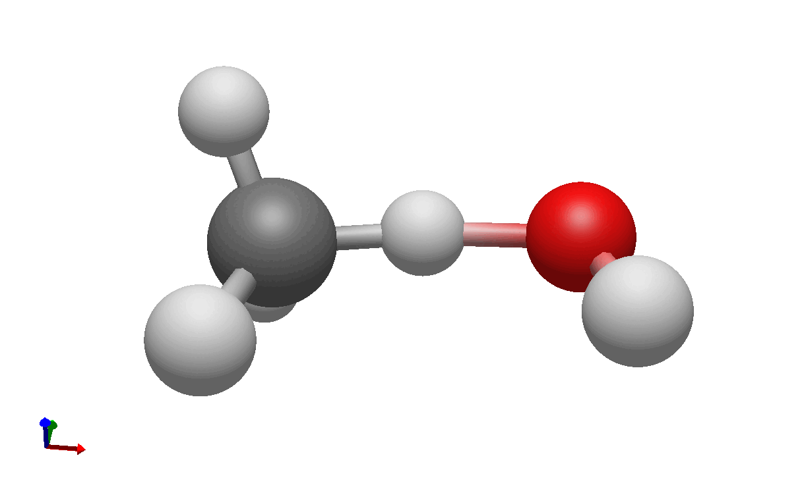

<!----------------------------------------------->

<!------------ Figure - TS complex  ------------->

<!----------------------------------------------->

<figure>

</figure>

A <b>vibrational mode</b> of the T<b>ransition</b> S<b>tate</b> reaction complex CH<b>3⋅⋅⋅</b>H<b>⋅⋅⋅</b>OH.

<!---------------------------------------------->

<!---------------------------------------------->

<!---------------------------------------------->

The third instalment of **ChemPrimer** takes a look at how molecules are formed, with chemical bonding theory taking centre stage. Although our current understanding of chemical bonding is based on quantum mechanics, the concept of chemical bonding dates back many years. In the early 19th century chemical bonds were being described as a product of electrical charges (i.e. electro-chemistry) by such luminary scientists as **Humphrey Davy** (1807), **Amedeo Avogadro** (1809) and **Jons Berzelius** (1811).<b>[1](#ref-davy_i_1807),[2](#ref-jensen_electronegativity_2003)</b> However, it was only after **JJ Thomson’s** (1897)<b>[3](#ref-thomson_cathode_1897)</b> discovery of the electron that chemical bonding theory and electro-chemistry eventually merged. In particular, it was **Gilbert Lewis** (1916) and **Walter Kossel** (1916) who independently proposed that chemical bonding is a product of the electronic structure of atoms.<b>[4](#ref-lewis_atom_1916),[5](#ref-kossel_uber_1916)</b> Most importantly it was **Lewis** who suggested that at the heart of every covalent bond is a shared pair of electrons. This idea, along with the octet rule, formed the corner stones of his **Cubical Atom** theory, one which gave rise to his famous <b><a class="one" href="https://www.lewisstructures.net/index.php" target="_blank" title="Go to Lewis Structures">Lewis Structure</a></b> diagrams.<b>[4](#ref-lewis_atom_1916),[6](#ref-lewis_introductory_1923)</b>

> “…every atom is an essential kernal…and an outer atom or shell, in the case of the neutral atom, contains negative electrons equal in number to the excess of positive charges of the kernal, but the number of electrons in the shell may vary during chemical change between 0 and 8.”<b>[4](#ref-lewis_atom_1916)</b>

By the late 1920s and early 1930s several scientists, most notably **Fredrich Hund** (1926), **Robert Mulliken** (1926), **Walter Heitler** (1926), **Fritz London** (1927), **J.E. Leonnard-Jones** (1929), **Linus Pauling** (1931) and **John Slater** (1931), had developed quantum mechanical descriptions of chemical bonds.<b>[7](#ref-hund_zur_1926)–[12](#ref-slater_directed_1931)</b> Some fifty years later computer software programs were developed that perform the enormous number of integral calculations needed to accurately model the electronic structures of molecules using quantum mechanics. Today there are several quantum chemistry programs that academics and enthusiasts alike use to model complex molecules and chemical reactions, such as the hydroxyl radical abstraction of hydrogen from methane animated above.

 

…as always good reading, and of course stay bonded!

JCH

 

**REFERENCES**

1 Davy H. I. The Bakerian Lecture, on some chemical agencies of electricity. *Philosophical Transactions of the Royal Society of London* 1807;**97**:1–56. <https://doi.org/10.1098/rstl.1807.0001>.

2 Jensen WB. Electronegativity from Avogadro to Pauling: II. Late Nineteenth- and Early Twentieth-Century Developments. *Journal of Chemical Education* 2003;**80**:279. <https://doi.org/10.1021/ed080p279>.

3 Thomson J. Cathode Rays. *Philosophical Magazine* 1897;**44**:293–316.

4 Lewis GN. THE ATOM AND THE MOLECULE. *Journal of the American Chemical Society* 1916;**38**:762–85. <https://doi.org/10.1021/ja02261a002>.

5 Kossel W. Über Molekülbildung als Frage des Atombaus. *Annalen Der Physik* 1916;**354**:229–362. <https://doi.org/10.1002/andp.19163540302>.

6 Lewis GN. Introductory address: Valence and the electron. *Transactions of the Faraday Society* 1923;**19**:452–8. <https://doi.org/10.1039/TF9231900452>.

7 Hund F. Zur Deutung einiger Erscheinungen in den Molekelspektren. *Zeitschrift Für Physik* 1926;**36**:657–74. <https://doi.org/10.1007/BF01400155>.

8 Mulliken RS. Electronic States and Band Spectrum Structure in Diatomic Molecules. I. Statement of the Postulates. Interpretation of CuH, CH, and Co Band-Types. *Physical Review* 1926;**28**:481–506. <https://doi.org/10.1103/PhysRev.28.481>.

9 Heitler W, London F. Wechselwirkung neutraler Atome und homöopolare Bindung nach der Quantenmechanik. *Zeitschrift Für Physik* 1927;**44**:455–72. <https://doi.org/10.1007/BF01397394>.

10 Lennard-Jones JE. The electronic structure of some diatomic molecules. *Transactions of the Faraday Society* 1929;**25**:668–86. <https://doi.org/10.1039/TF9292500668>.

11 Pauling L. [THE NATURE OF THE CHEMICAL BOND. APPLICATION OF RESULTS OBTAINED FROM THE QUANTUM MECHANICS AND FROM A THEORY OF PARAMAGNETIC SUSCEPTIBILITY TO THE STRUCTURE OF MOLECULES](https://pubs.acs.org/doi/10.1021/ja01355a027). *Journal of the American Chemical Society* 1931;**53**:1367–400.

12 Slater JC. Directed Valence in Polyatomic Molecules. *Physical Review* 1931;**37**:481–9. <https://doi.org/10.1103/PhysRev.37.481>.

