

<!------------------------------------------------>

<!-------- JAVASCRIPT - enable LaTex MATH -------->

<!------------------------------------------------>

<!-- this is a subheadline -->

<b>TABLE OF CONTENTS</b>

1.  <a href="#QNE"><b>Quantum Nature of Electrons</b></a>
    - <a href="#Box1"><b>Information Box 1: Quantum Numbers</b></a>
    - <a href="#Tab1"><b>Table 1: Quantum Numbers</b> & <b>Atomic
      Orbitals</b></a>
2.  <a href="#AO"><b>Atomic Orbitals</b></a>
    - <a href="#EC"><b>2.1 Electron Configuration</b></a>
    - <a href="#Box2"><b>Information Box 2 - Electron Configuration Guide</b></a>
    - <a href="#PTEC"><b>2.2. Periodic Table & Electron Configuration</b></a>
      - <a href="#Fig1"><b>Fig. 1: Periodic Table</b></a>
      - <a href="#ECF"><b>2.2.1 Electron Configuration of
        Families</b></a>
      - <a href="#ECP"><b>2.2.2 Electron Configuration of
        Periods</b></a>
3.  <a href="#CB"><b>Chemical Bonds</b></a>
    - <a href="#CBI"><b>3.1 Ionic Bonds & Lewis Structures</b></a>
      - <a href="#Fig2"><b>Fig. 2: Electrostatic Interactions - Ionic Bonds</b></a>
    - <a href="#CBC"><b>3.2 Covalent Bonds & Lewis Structures</b></a>
      - <a href="#Fig3"><b>Fig. 3: Covalent Bonds & Dipole Moments</b></a>
    - <a href="#Res"><b>3.3 Resonance Structures</b></a>
      - <a href="#Fig4"><b>Fig. 4: H2 Resonance Structures</b></a>
      - <a href="#Fig5"><b>Fig. 5: HCl Resonance Structures</b></a>
      - <a href="#Fig6"><b>Fig. 6: NO3-1 Resonance Structures</b></a>
    - <a href="#CBE"><b>3.4 Chemical Bond Energy</b></a>
    - <a href="#HL"><b>Hess’s Law</b></a>
4.  <a href="#CBMG"><b>Chemical Bonds & Molecular Geometry</b></a>
    - <a href="#Vesp"><b>4.1 VSEPR Theory</b></a>
      - <a href="#Fig7"><b>Fig. 7: VSEPR Geometries</b></a>
      - <a href="#Fig8"><b>Fig. 8: Carbonic Anhydrase Active Site Geometry</b></a>
      - <a href="#Fig9"><b>Fig. 9: Carbonic Anhydrase Inhibitors</b></a>
      - <a href="#Fig10"><b>Fig. 10: Ferrichrome Siderophore</b></a>
      - <a href="#Fig11"><b>Fig. 11: Heme (Protoporphyrin Fe complex)</b></a>
    - <a href="#VBT"><b>4.2 Valence Bond Theory (VBT)</b></a>
      - <a href="#VBThyb"><b>4.2.1 VBT & Hybridization</b></a>
      - <a href="#VBTen"><b>4.2.2 VBT & Electronegativity</b></a>
      - <a href="#VBTsp"><b>4.2.3 VBT - σ & π Bonds</b></a>
        - <a href="#Fig12"><b>Fig. 12: Hybrid Molecular Orbitals</b></a>
    - <a href="#MOT"><b>4.3 Molecular Orbital Theory (MOT)</b></a>
      - <a href="#Fig13"><b>Fig. 13: Molecular Orbital (MO) Energy Diagram of H2</b></a>
      - <a href="#Fig14"><b>Fig. 14: MO Diagrams of Homo-nuclear Diatomic Molecules</b></a>
      - <a href="#Fig15"><b>Fig. 15: MO Diagrams of Homo- & Hetero-nuclear Molecules</b></a>
      - <a href="#LCAOsp"><b>I. LCAO & Hybrid sp Orbitals</b></a>
        - <a href="#Fig16"><b>Fig. 16: Vector Diagram for sp hybrid orbitals</b></a>
      - <a href="#LCAOsp2"><b>II. LCAO & Hybrid sp2 Orbitals</b></a>
        - <a href="#Fig17"><b>Fig. 17: Vector Diagram for sp2 hybrid orbitals</b></a>
        - <a href="#Fig18"><b>Fig. 18: Normalized 1s Orbital Wave Functions</b></a>
      - <a href="#LCAOsp3"><b>III. LCAO & Hybrid sp3 Orbitals</b></a>
        - <a href="#Fig19"><b>Fig. 19: Vector Diagram for sp3 hybrid orbitals</b></a>
        - <a href="#Fig20"><b>Fig. 20: MO Diagram of Methane (Hetero-nuclear molecule)</b></a>
      - <a href="#LCAOpi1"><b>IV-1. LCAO & Conjugated π Bond Systems</b></a>
        - <a href="#Fig21"><b>Fig. 21: Conjugated Double Bond System of Ethylene</b></a>
        - <a href="#Fig22"><b>Fig. 22: Matrix Algebra - Dot Product</b></a>
        - <a href="#Fig23"><b>Fig. 23: MO Diagram of 1,3-butadiene</b></a>
        - <a href="#Fig24"><b>Fig. 24: Ethylene π-electron Orbital Diagram</b></a>
        - <a href="#Fig25"><b>Fig. 25: Allyl Molecular Orbitals (MO)</b></a>
        - <a href="#Fig26"><b>Fig. 26: Allyl Carbon Bond</b></a>
        - <a href="#Fig27"><b>Fig. 27: Allyl MO Energy Diagram</b></a>
        - <a href="#Fig28"><b>Fig. 28: Frost Circles / Polygon Method</b></a>
        - <a href="#Fig29"><b>Fig. 29: Cyclopentadienyl System</b></a>
      - <a href="#LCAOpi2"><b>IV-2. LCAO & Conjugated Hetero-atomic Systems</b></a>
        - <a href="#Fig30"><b>Fig. 30: Heterocyclic Molecules</b></a>
        - <a href="#Fig31"><b>Fig. 31: HuLis (Huckel-Lewis) analysis of Pyrrole</b></a>
      - <a href="#MOTah"><b>4.3.1 Approximating the Ground State of Hydrogen</b></a>
        - <a href="#Box3"><b>Information Box 3 - Hartree Energy Units</b></a>
      - <a href="#MOThe"><b>4.3.2 Approximating the Ground State of Helium</b></a>
        - <a href="#Fig32"><b>Fig. 32: He Vector Diagram</b></a>
      - <a href="#MOThim"><b>4.3.3 Ground State of Hydrogen Ion Molecule</b></a>
        - <a href="#Fig33"><b>Fig. 33: H+ Vector Diagram</b></a>
        - <a href="#Fig34"><b>Fig. 34: Potential Energy Plot of H+ Molecule</b></a>
    - <a href="#MOTchem"><b>4.4 Frontier Molecular Orbitals & Chemical Reactivity</b></a>
      - <a href="#Fig35"><b>Fig. 35: Arrhenius Equation</b></a>
      - <a href="#Fig36"><b>Fig. 36: Arrhenius plot of Reaction Rates for Hydroxyl Radical reaction with Methane</b></a>
      - <a href="#Fig37"><b>Fig. 37: Eyring-Polanyi (EP) plot of the Temperature-dependent Rate Coefficients for Hydroxyl Radical reaction with Methane</b></a>
      - <a href="#Fig38"><b>Fig. 38: Potential Energy Surface (PES) plot of the Hydroxyl Radical reaction with Methane</b></a>
      - <a href="#Fig39"><b>Fig. 39: Reaction Coordinate</b></a>
      - <a href="#Fig40"><b>Fig. 40: SOMO-HOMO interaction of Hydroxyl radical reaction with Methane</b></a>
      - <a href="#Box4"><b>Information Box 4 - Computational Quantum Chemistry</b></a>
      - <a href="#Fig41"><b>Fig. 41: Basis Set Exchange</b></a>
      - <a href="#Fig42"><b>Fig. 42: Gaussian Functions & ORCA Computer analysis of TS complex</b></a>
      - <a href="#Fig43"><b>Fig. 43: Transition State (TS) Vibrational Mode</b></a>
5.  <a href="#Refs"><b>References</b></a>

<h2>

MOLECULES

</h2>

<!---------------------------------------------------->

<!-------- SECTION 1 - ELECTRON CONFIGURATION -------->

<!---------------------------------------------------->

**  1. QUANTUM NATURE OF ELECTRONS  :** As previously discussed in <b><a class="one" href="https://opc-project.netlify.app/project/opcchemprimer2_atom/" target="_blank" title="Go to ChemPrimer2">ChemPrimer2</a></b> electrons have both particle and wave-like properties (i.e. **wave-particle** duality), with the latter being described by the famous **Schrodinger’s wave equation** (1926).<b>[1](#ref-schrodinger_quantisierung_1926),[2](#ref-schrodinger_undulatory_1926)</b> Equally strange is the probabilistic nature (interpretation) of the wave equation. According to **Max Born** (1926)<b>[3](#ref-born_zur_1926-1),[4](#ref-born_zur_1926)</b> the primary outcome of the wave equation is a probability distribution of the electron within an atom. Central to this probability description are four **quantum numbers** (**Box 1**). Three of these numbers were previously discussed in <b><a class="one" href="https://opc-project.netlify.app/project/opcchemprimer2_atom/" target="_blank" title="Go to ChemPrimer2">ChemPrimer2</a></b>, namely: (i) **principal quantum number** (`\(n\)`); (ii) <b>angular momentum quantum number</b> (`\(\ell\)`); and (iii) <b>azimuthal</b> or <b>magnetic quantum number</b> (`\(m_{\ell}\)`). The fourth <b>quantum number</b>, the <b>magnetic spin</b> (`\(m_{s}\)`), was confirmed experimentally just over 100 years ago by <b>Otto Stern</b> and <b>Walter Gerlach</b> (i.e. <b><a class="one" href="https://toutestquantique.fr/en/spin/" target="_blank" title="Go to Quantum101">Stern-Gerlach Experiment</a></b> - please consult the University of Colorado’s <b><a class="one" href="https://phet.colorado.edu/sims/html/quantum-measurement/latest/quantum-measurement_all.html" target="_blank" title="Go to PhET">SG Measurement Simulations</a></b>).<b>[5](#ref-friedrich_stern_2003),[6](#ref-gerlach_experimentelle_1922-1)</b> At that time <b>Bohr</b> knew that the magnetic moment (i.e. spatial orientation) of an orbiting electron should be quantized.<b>[7](#ref-bohr_i_1913)</b> However, during the early 1920s many physicists were still using celestial mechanics to solve quantum theoretical calculations of <b>Bohr’s</b> atomic model. Even <b>Born</b> himself viewed the idea of quantized space as purely symbolic in nature.<b>[5](#ref-friedrich_stern_2003)</b> <b>Stern</b> obviously believed that this “<i>idea</i>” was worth testing experimentally. The initial **Stern-Gerlach Experiment** (**SGE**) involved firing a collimated beam of <u>silver</u> atoms through a non-homogeneous magnetic field (i.e. atoms exposed to a net force) onto a detector (i.e. <u>photographic</u> plates). Although the silver atoms did not escape the affects of gravity (i.e. Maxwell distribution of velocities) there was a clear two-way split in the trajectory of the beam. If the silver atoms obeyed classical mechanics they would precess (i.e. wobble) in response to the magnetic field gradient but remain randomly oriented. As a result magnetic deflections of the beam would cause the atoms to spread out leaving only a broad “<i>smeary</i>” signal. However the clear two-fold deflection of the silver atoms by the magnetic field gradient supported the concept of space quantization. According to **Wolgang Pauli** (1925) the results of the **SGE** along with other aspects of **Bohr’s** atomic model (i.e. energy shells, **n**) suggested that a <u>fourth</u> degree of freedom or **quantum number** was needed to fully describe the <u>quantum state</u> of a particle. He famously referred to this new found degree of freedom as a “<i>two-valuedness not describable classically</i>”.<b>[8](#ref-pauli_uber_1925),[9](#ref-pauli_nobel_1946)</b> However its abstract nature makes it unlike the other **quantum numbers**, all of which have real tangible physical meaning (i.e. radial distance, orbital shape and angle). Fortunately that same year **Samuel Goudsmit** and **George Uhlenbeck** (1925) interpreted the electron’s fourth degree of freedom as a product of its <u>inner</u> rotational motion (i.e. “<i>spin</i>”).<b>[10](#ref-uhlenbeck_ersetzung_1925)–[12](#ref-commins_electron_2012)</b> However many, including **Pauli**, were not taken with the idea. After all how can a charged “point-like” electron, which apparently lacks any internal structure, spin about some imaginary axis? Classically a “<i>spin</i>” like property would lead to serious problems since a spherical object the size of an electron would have to be spinning at unimaginable velocities (i.e. greater than the speed of light) in order to attain the required amount of angular momentum. So one has to assume that the electrons behave like tiny magnets with discrete spatial orientations (i.e. `\(m_{s} = \pm \frac{1}{2}\)`, “<i>spin up</i>” or “<i>spin down</i>”). The significance of **spin angular momentum** will become clearer in the next section when the discussion turns to orbitals since electrons that occupy these quantized spaces are subject to strict constraints as per the **Pauli Exclusion Principle** (i.e. no two electrons within an atom can have the same set of **quantum numbers**).  
    It is worth noting that the use of the word “orbital” in quantum mechanics is often confused with its more familiar use in classical orbital mechanics. This is an important point given that atomic and molecular “orbitals” are central to the discussion that follows. So an “orbital” in quantum mechanical parlance has more to do with the underlying mathematical <u>wave function</u> that describes the three-dimensional space occupied by the electron. Physicists often refer to this one electron **wave function** (e.g. `\(\large \psi_{\normalsize e^-}\)`) as an **eigenfunction**. It is part of a special **eigenvalue** equation, shown below, that is better known as the **Schrodinger equation**.

`$$\boxed{\, \hat H \cdot \large \psi_{\normalsize e^-} \normalsize \phantom{.} = \phantom{.} \text E \cdot \large \psi_{\normalsize e^-} \,}$$`

Here the <b><a class="one" href="http://hyperphysics.phy-astr.gsu.edu/hbase/quantum/hamil.html" target="_blank" title="Go to ChemPrimer2">Hamiltonian</a></b>, which in classical mechanics describes the total energy of a system (i.e. `\(H \; = \; KE \, + \, PE = \; T \, + \, V\)`), takes the form of an energy <b><a class="one" href="http://hyperphysics.phy-astr.gsu.edu/hbase/quantum/hamil.html" target="_blank" title="Go to ChemPrimer2">operator</a></b> (`\(\hat H\)`). Like other <b><a class="one" href="http://hyperphysics.phy-astr.gsu.edu/hbase/quantum/qmoper.html#c1" target="_blank" title="Go to ChemPrimer2">quantum mechanical operators</a></b> it describes a measurable parameter of the probabilistic wave function (Recall: quantum mechanics is not deterministic). Here `\(\hat H\)` basically serves as a scalar energy multiplier (`\(\text E\)`), which is often referred to as an **eigenvalue**. So an “orbital” is a volume of space occupied by an electron, described by a probabilistic wave equation, whose discrete energy states can be described using a **Hamiltonian operator**. The specific potential energy (`\(V\)`) state of an orbital wave function includes not only the electro-static attraction between electrons and protons, but also the electro-static repulsion between electrons. Nevertheless, both classical and quantum mechanics do share one major problem, namely the inability to provide <u>exact</u> analytical solutions to systems containing multiple moving bodies (i.e. <b><a class="one" href="https://physicshub.github.io/blog/physics-behind-three-body-problem" target="_blank" title="Go to PhysicsHub">three-body problem</a></b>). Fortunately this problem can be largely overcome by using approximation methods (e.g. variational method). However, like the **Kinetic Molecular Theory** (**KMT**) of gases, quantum mechanics generates statistical information about the state of an unseen system (e.g. average speeds and energy). Even though quantum mechanics is one the most successful scientific theories we have, its description of nature is profoundly mysterious for both physicists and non-physicists alike. For this reason alone the quantum reality of molecules is too important and irresistible to ignore.

<!--------------------------------------------------------------->
<!------------------ Quantum Numbers Info Box ------------------->
<!--------------------------------------------------------------->

  INFORMATION BOX 1 - QUANTUM NUMBERS     <b>n</b>, <b>ℓ</b>, <b>mℓ</b>, <b>ms</b>

<b>  1. Principal Quantum Number (Shell)  :</b> This <b>quantum number</b>, which is symbolized by `\(n\)`, is a product of the <b><a class="one" href="https://opc-project.netlify.app/project/opcchemprimer2_atom/" target="_blank" title="Go to ChemPrimer2">Radial function</a></b> (`\(\text R(r)\)`).<b>[13](#ref-mcquarrie_physical_1997)–[15](#ref-Ball_physical_2014)</b> It represents the <b>energy level</b> of an <b>atom</b> and is always a positive integer value (i.e. `\(n > 0\)`). Traditionally it is identified using the following letter code:

`$$\begin{align*} n \phantom{1} = & \phantom{1} 1, 2, 3, 4, 5 \, ...  \\ \text{Letter} \phantom{1} = & \phantom{1} \text{K, L, M, N, O}... \end{align*} \\$$`

Energy levels are often referred to as “*shells*”. For example, the lone electron of the H **atom** occupies the **K shell** (`\(n = 1\)`). Besides having a value greater than zero it is also greater than the value of `\(\ell\)`, the so called <b>Orbital angular momentum quantum number</b> (i.e. `\(n > \ell\)`).

<b>  2. Angular Momentum Quantum Number (Sub-shell)  :</b> This <b>quantum number</b> (`\(\ell\)`) tells us the “<i>shape</i>” of the orbital, and its value is dependent on `\(n\)`. Specifically `\(\ell\)` can be <u>any possible integer value</u> from 0 to `\(n\)` - 1. So if `\(n\)` = 1 than `\(\ell\)` = 0 (1 state). If `\(n\)` = 2 than `\(\ell\)` can be either 0 or 1 (i.e. two possible states). If `\(n\)` = 3 than `\(\ell\)` can be either 0, 1, or 2 (three possible states). Also `\(\ell\)`, like the <b>Principal quantum number</b>, is traditionally identified using a letter designation:

`$$\\ \begin{align*} \ell \phantom{1} = & \phantom{1} 0, \phantom{1} 1, \phantom{1} 2, \phantom{1} 3, \phantom{1} 4, \phantom{1} 5 \phantom{1}... \\ \text{Letter} \phantom{1} = & \phantom{1} \text{s, p, d, f, g, h} \phantom{1}... \\ \end{align*}$$`

This letter code was originally used by early investigators, such as <b>Sommerfeld</b>, <b>Born</b> and <b>Hund</b>, to describe the <u>spectral lines</u> of <b>alkali metals</b> (i.e. `\(\text s\)`<i>harp</i>, `\(\text p\)`<i>rinciple</i>, `\(\text d\)`<i>iffuse</i> and `\(\text f\)`<i>undamental</i> line series).<b>[16](#ref-sommerfeld_atomic_1923)–[19](#ref-jensen_origin_2007)</b> As noted above the values of `\(\ell\)` have to be less than `\(n\)` (i.e. `\(\ell < n\)`). It’s also customary to denote the <u>quantum state</u> of an <b>electron</b> by using both the `\(n\)` number and `\(\ell\)` letter. For example an <b>electron</b> in the second <b>energy level</b> (`\(n = 2\)`) with an `\(\ell\)` value of zero (`\(\ell = 0\)`) would be referred to as a <b>2𝓈 electron</b>, while an <b>electron</b> occupying the same <b>energy level</b> but with an `\(\ell\)` value of <u>one</u> would be referred to as a <b>2</b>𝓅 <b>electron</b>. Some quantum states are <u>forbidden</u>. For example, an <b>electron</b> can not occupy a <b>2</b>𝒹 <b>quantum state</b>. In this scenario `\(n = 2\)` and `\(\ell = 2\)` which violates the rule: `\(n \ne \ell\)`.<b>[13](#ref-mcquarrie_physical_1997)–[15](#ref-Ball_physical_2014)</b>

<b>  3. Azimuthal or Magnetic Quantum Number (# Subshells)  :</b> This <b>quantum number</b>, symbolized by `\(m_{\ell}\)`, describes the spatial <u>orientation</u> of the <b>electron orbital</b>. Since the <b>Azimuthal equation</b> (`\(g(\phi)\)`) only deals with one vector component of `\(\vec L\)` (i.e. `\(L_{\text z}\)`) the mathematical relationship between `\(m_{\ell}\)` and `\(L_{\text z}\)` is as follows:

`$$L_{\text z} \phantom{1} = \phantom{1} m_{\ell} \cdot \hbar$$`

The value of `\(m_{\ell}\)` also depends upon `\(\ell\)`. Specifically there are 2 `\(\ell\)` + 1 integer values for `\(m_{\ell}\)`. So if `\(\ell\)` = 0 than `\(m_{\ell}\)` = 2(0) + 1 = 1 (one possible state `\(\Rightarrow\)` 0), and if `\(\ell\)` = 1 than `\(m_{\ell}\)` = 2(1) + 1 = 3 (three possible states `\(\Rightarrow\)` -1, 0, +1). Overall this relationship can be summarizes as:

`$$m_{\ell} \phantom{1} = \phantom{1} -\ell, \phantom{1} (-\ell +1) \phantom{1} .. \phantom{1} 0, \phantom{1} .. \phantom{1} (+\ell -1), \phantom{1} \ell$$`

<b>  4. Electron Spin Quantum Number (# electrons per orbital)  :</b> This quantum number (`\(m_{s}\)`) describes an inner or fundamental “<i>spin</i>” like property of electrons which is independent of its <b>orbital angular momentum</b> (`\(\vec L\)`). Experiments suggest that there are only two possible quantum spin <u>states</u> designated `\(m_{s} = +\frac{1}{2}\)` and `\(m_{s} = -\frac{1}{2}\)`. An inner “<i>spinning</i>” negatively charged electron generates a <u>magnetic field</u>, which makes it behave like a tiny magnet. An electron can “<i>spin</i>” in one of two possible directions (i.e. clockwise, or counter-clockwise), which results in a type of spatial quantization. Moreover, this “<i>spinning</i>” behaviour of a negatively charged electron is a fundamental component of every atom, which means all atoms interact with <u>magnetic fields</u>. In fact researchers discovered that magnetic fields can split the spectral lines of atoms (i.e. <b>Zeeman effect</b>), which is a manifestation of the electron’s “<i>spin</i>” behaviour. The “<i>spin</i>” direction of these tiny <b>quantum magnets</b> in turn determines the direction of its magnetic field and therefore how it interacts with external magnetic fields (i.e. direction of deflection).

<!------------------------------------------------------->

<!------------ END - Quantum Number Info Box ------------>

<!------------------------------------------------------->

<!------------------------------------------------------------------>
<!------------------------------------------------------------------>
<!---------- TABLE 1 - QUANTUM NUMBERS & ATOMIC ORBITALS ----------->
<!------------------------------------------------------------------>
<!------------------------------------------------------------------>

<!-- 
 -->

<table class="Table">

<thead>

<tr style="text-align:left">

<td colspan="5">

<b>TABLE 1. Quantum Numbers & Atomic Orbitals</b>
</td>

</tr>

<thead>

<tr>

<th class="lc16" style="width:5%">

<i>n</i>   (energy level)
</th>

<th class="lc16" style="width:20%">

ℓ   (Orbital Shape)   0 ≤ ℓ \< n
</th>

<th class="lc16">

mℓ   (# Subshells)   mℓ = 2ℓ + 1
</th>

<th class="lc16">

ms   (# <i>e</i>-)
</th>

<th class="lc16" style="width:30%">

Orbital   Occupancy   (max.)
</th>

</tr>

</thead>

<tbody>

<tr>

<td>

1
</td>

<td>

0 (𝓈)
</td>

<td class="tcell">

0 (1)
</td>

<td>

↿⇂ (2)
</td>

<td>

<b>1𝓈</b>↿⇂
</td>

</tr>

<tr>

<td>

2
</td>

<td>

0 (𝓈)
</td>

<td class="tcell">

0 (1)
</td>

<td>

↿⇂ (2)
</td>

<td>

<b>2𝓈</b>↿⇂
</td>

</tr>

<tr>

<td>

2
</td>

<td>

1 (𝓅)
</td>

<td class="tcell">

-1, 0, +1 (3)
</td>

<td>

↿⇂, ↿⇂, ↿⇂ (6)
</td>

<td>

<b>2</b>𝓅x↿⇂, <b>2</b>𝓅y↿⇂, <b>2</b>𝓅z↿⇂
</td>

</tr>

<tr>

<td>

3
</td>

<td>

0 (𝓈)
</td>

<td class="tcell">

0 (1)
</td>

<td>

↿⇂ (2)
</td>

<td>

3𝓈↿⇂
</td>

</tr>

<tr>

<td>

3
</td>

<td>

1 (𝓅)
</td>

<td class="tcell">

-1, 0, +1 (3)
</td>

<td>

↿⇂, ↿⇂, ↿⇂ (6)
</td>

<td>

<b>3</b>𝓅x↿⇂, <b>3</b>𝓅y↿⇂, <b>3</b>𝓅z↿⇂
</td>

</tr>

<tr>

<td>

3
</td>

<td>

2 (𝒹)
</td>

<td class="tcell">

-2, -1, 0, +1, +2 (5)
</td>

<td>

↿⇂, ↿⇂, ↿⇂, ↿⇂, ↿⇂ (10)
</td>

<td>

<b>3</b>𝒹xy↿⇂, <b>3</b>𝒹yz↿⇂, <b>3</b>𝒹xz↿⇂,   <b>3</b>𝒹x2-y2↿⇂, <b>3</b>𝒹z2↿⇂
</td>

</tr>

</tbody>

</table>

<!-- 
 --->

<!------------------------------------------------------>

<!------------------------------------------------------>

<!---------- TABLE 1 - END - QUANTUM NUMBERS ----------->

<!------------------------------------------------------>

<!------------------------------------------------------>

<!--------------------------------------------------->
<!----------- SECTION 2 - ATOMIC ORBITALS ----------->
<!--------------------------------------------------->
**  2. ATOMIC ORBITALS  :** Previous discussions about the <b><a class="one" href="https://opc-project.netlify.app/project/opcchemprimer2_atom/" target="_blank" title="Go to ChemPrimer2">Radial wave function</a></b> (`\(\text R_{n,\ell}\)`) of Hydrogen (H) showed that the <b>s</b>pherical (`\(\ell = 0\)`) <b>probability distributions</b> (`\(\text R_{n,\ell}(r, 0, 0)\)`) of its 1𝓈 orbital is solely dependent on the `\(r\)`adial component (i.e. `\(\theta = 0\)`, `\(\phi = 0\)`). Although the `\(r\)`adial probability function falls off rapidly with increasing distance it does essentially continue to infinity. Fortunately the spherical shape of <b>𝓈 orbitals</b> accounts for the majority of electronic charge within a H atom (e.g. ~99% probability of finding the 1𝓈 electron within a spherical radius of 4 atomic units, or approximately `\(4 \times 10^{-10} \phantom{.} \text{m}\)`). As a result the boundary surface of the sphere provides a useful representation of any <b>𝓈-shaped</b> orbital regardless of the energy level. Moreover since there is a single `\(m_{\ell}\)` value when `\(\ell = 0\)` (i.e. `\(m_{\ell} = 2\ell + 1 = 1\)`) there can only be one possible orbital state (<b>Table 1</b>). For a much closer look at these and other atomic orbitals please consult the following useful websites: Prof. Mark Winter’s (University of Sheffield) <b><a class="one" href="https://winter.group.shef.ac.uk/orbitron/" target="_blank" title="Go to Orbitron">Oribtron</a></b>, and Wolfram’s <b><a class="one" href="https://demonstrations.wolfram.com/VisualizingAtomicOrbitals/" target="_blank" title="Go to Wolfram's">Visualizing Atomic Orbitals</a></b>. These visual tools help clarify the <b>Schrodinger equations</b> that generate these <b>atomic orbitals</b>. However, progressively filling up these <b>atomic orbitals</b> for atoms larger than H requires some additional rules that are partly explained below.  
    The 𝓅 <b>orbital</b> emerges when `\(\ell = 1\)` (<b>Table 1</b>). According to established quantum rules (i.e. `\(\ell = 0 \phantom{.} \text{to} \phantom{.} n-1\)`, `\(m_{\ell} = 2(\ell) +1\)`, and `\(m_{s} = \pm \frac{1}{2}\)`) these odd dumbbell-shaped 𝓅 <b>orbitals</b> will only appear at higher energy levels (i.e. `\(n = 2 \phantom{.} \Rightarrow \phantom{.} \ell = 2-1 = 1\)`). There will also be a maximum of three possible 𝓅 <b>orbital</b> states (`\(m_{\ell} = 2(1) +1 = 3\)`) with each one holding a maximum of 2 electrons that occupy either a “<i>spin up</i>” (`\(m_{s} = +\frac{1}{2}\)`) or “<i>spin down</i>” quantum state (`\(m_{s} = -\frac{1}{2}\)`). The letter subscripts attached to each 𝓅 <b>orbital</b> indicates its particular three dimensional orientation (i.e. <b>𝓍</b>, <b>𝓎</b>, or <b>𝓏</b> axis). Despite their different spatial orientation these three 𝓅 <b>orbitals</b> are identical in size, shape, and energy. As alluded to above the boundary surface of a 𝓅 <b>orbital</b> takes on an odd two-lobed or dumbbell shape with the nucleus located in the middle. Also similar to <b>𝓈 orbitals</b> the 𝓅 <b>orbitals</b> increase in size as the energy level increases.  
    The last electron <b>orbital</b> of note is the 𝒹 <b>orbitals</b>. According to the same quantum rules (i.e. `\(\ell = 0 \phantom{.} \text{to} \phantom{.} n-1\)`, `\(m_{\ell} = 2(\ell) +1\)`, and `\(m_{s} = \pm \frac{1}{2}\)`) 𝒹 <b>orbitals</b> only emerge when `\(n \ge 3\)`. At this higher energy level there are <u>three</u> possible `\(\ell\)` states (`\(\ell = 0, 1, 2\)`). The first of these states (`\(\ell = 0\)`) represents a single <b>3𝓈 orbital</b>, the second of these `\(\ell\)` states generates three <b>3</b>𝓅 <b>orbitals</b> and the last `\(\ell\)` state produces five <b>3</b>𝒹 <b>orbitals</b> (`\(m_{\ell} = 2(2) +1 = 5\)`). As always a maximum of 2 electrons (`\(m_{s} = \pm \frac{1}{2}\)`) can occupy any given orbital regardless of the energy level, which means that five <b>3</b>𝒹 <b>orbitals</b> can hold up to 10 electrons. Similar to 𝓅 <b>orbitals</b> the five 𝒹 <b>orbitals</b> each have different spatial orientations (i.e. <b>3</b>𝒹xy, <b>3</b>𝒹yz, <b>3</b>𝒹xz, <b>3</b>𝒹x2-y2, <b>3</b>𝒹z2), but share the same amount of energy. However, there are differences in the overall shape of the different 𝒹-<b>orbitals</b>. For example, the <b>3</b>𝒹xy, <b>3</b>𝒹yz, <b>3</b>𝒹xz and <b>3</b>𝒹x2-y2 orbitals have a similar four lobed structures, but the <b>3</b>𝒹z2 orbital has only two symmetric lobes oriented along the z-axis along with a central doughnut or torus shaped lobe. There are of course higher energy levels with other types of atomic <b>orbitals</b>, but they are rarely encountered in biochemical settings since they involve the heavier metal elements (i.e. atomic number greater than 57).  
    Although the <u>energy</u> of a one electron H atom is determined solely by its <b>principal quantum number</b> (**n**), heavier elements with multiple electrons behave differently. Specifically multiple negatively charged electrons within different shells and sub-shells interact with one another (i.e. <b>electrostatic energy</b> and <b>angular momentum</b> considerations), which affects the overall stability and energy of the sub-shells (e.g. sub-shell energy levels differentiate and are therefore no longer <u>degenerate</u>). As a consequence additional rules and guidelines were introduced. For example the energy of different sub-shells (i.e. <b>𝓈</b>, 𝓅, 𝒹, <b>𝒻</b>) found in different energy levels (i.e. `\(n \ge 3\)`) eventually begin to overlap one another which complicates shell and sub-shell electron assignments. To determine which energy shell or sub-shell “<i>truly</i>” has the lowest energy the so called <b>Madelung</b> or <b>Janet rule</b> was introduced. It essentially ranks orbital energy using the basic formulas: `\(n + \ell\)` values, and `\(n\)` (in case of identical `\(n + \ell\)` values).<b>[20](#ref-janet_classificaiton_1928)–[23](#ref-stewart_charles_2010)</b> For example the energy of an atom is lower when the <b>4s</b> sub-shell is filled (i.e. `\(n + \ell = 4 + 0 = 4\)`) as apposed to the <b>3</b><b>𝒹</b> sub-shell (`\(n + \ell = 3 + 2 = 5\)`). This new rule is part of the overall <i>Aufbau</i> principle first proposed by <b>Bohr</b> (German: <i>Aufbau prinzip</i> or “<i>building-up principle</i>”), which essentially states that the electronic structure of atoms is built by first placing electrons within orbitals that have the lowest energy.<b>[24](#ref-bohr_bau_1922),[25](#ref-Bohr_AtomicTheory_1922)</b> This is very much consistent with basic thermodynamic principles that have been mentioned in the previous <b><a class="one" href="https://opc-project.netlify.app/project/opcchemprimer1_atomists/#Max" target="_blank" title="Go to OPC ChemPrimer1">ChemPrimer1</a></b> project.

<!----------------------------------------------------->
<!----------- SECTION 2.1 - ATOMIC ORBITALS ----------->
<!----------------------------------------------------->
**  2.1 ELECTRON CONFIGURATION  :** To understand molecules we need to know how electrons are configured within atomic orbitals. This goal can be achieved using what we know about <b>quantum numbers</b>, as well as some empirical rules (e.g. <b>Madelung rule</b>) and guiding principles (i.e. <i>Aufbau</i>). One of the most convenient approaches is to write down all of the individual <b>quantum numbers</b> using the following notation: (`\(n, \ell, m_{\ell}, m_{s}\)`). For example, the notation for the lone electron occupying the ground state of a H atom would be either: (`\(1, 0, 0, +\frac{1}{2}\)`) or (`\(1, 0, 0, -\frac{1}{2}\)`). Now consider a slightly more complicated atom like Carbon (<b>6</b>C) which has six electrons. The first energy level, which has a single <b>1𝓈</b> orbital can accommodate up to 2 electrons. So we can register both of them using the simplified orbital notation: (`\(1, 0, 0, \pm\frac{1}{2}\)`). The second energy level of C has 4 electrons. The first two electrons will fill up the <b>2𝓈</b> orbital since it’s the lowest energy sub-shell within the second energy level. We can therefore register both of them using the following simplified notation: (`\(2, 0, 0, \pm\frac{1}{2}\)`). The other two electrons will be registered within one of three possible <b>2</b>𝓅 orbitals, since they represent the only other energy sub-shells within the 2nd energy level. Here things get a little more interesting since (theoretically) there are a few possible notations. The first scenario would have the two remaining electrons occupying only one of the three <b>2</b>𝓅 orbital such as <b>2</b> 𝓅x: (`\(2, 1, 0, \pm\frac{1}{2}\)`). The second scenario would have each electron occupying separate <b>2</b>𝓅 orbitals. Since all three 𝓅 orbitals have the <u>same</u> energy (i.e. <b>degenerate</b>) we can simply select any two of them (i.e.  𝓅x and 𝓅y). Here we would have the following possible notations: (i) 𝓅x: (`\(2, 1, 0, +\frac{1}{2}\)`) and 𝓅y: (`\(2, 1, 0, +\frac{1}{2}\)`), or (ii) 𝓅x: (`\(2, 1, 0, +\frac{1}{2}\)`) and 𝓅x: (`\(2, 1, 0, -\frac{1}{2}\)`), or (iii) 𝓅x: (`\(2, 1, 0, -\frac{1}{2}\)`) and 𝓅x: (`\(2, 1, 0, -\frac{1}{2}\)`). So obviously there must be some additional rules that can help determine the correct notations.  
    The <b>Pauli exclusion principle</b> (<b>PEP</b>) is an important concept that governs how electrons are configured within atomic orbitals. The basic principle states that <u>no two electrons in an atom can have the same set of four <b>quantum numbers</b></u>. For example if two electrons in the ground state of an atom have the same `\(n\)`, `\(\ell\)`, and `\(m_{\ell}\)` values, then they must have different `\(m_{s}\)` values. For example He<b>lium</b> (He), has two electrons within the `\(1\text{s}\)` energy shell. Its electron orbital notation would be: (`\(1, 0, 0, 1, \pm\frac{1}{2}\)`), and not: (`\(1, 0, 0, -\frac{1}{2}\)`) and (`\(1, 0, 0, -\frac{1}{2}\)`), or (`\(1, 0, 0, +\frac{1}{2}\)`) and (`\(1, 0, 0, +\frac{1}{2}\)`). The key point here is that <u>only two electrons with opposite “<i>spin</i>” states can occupy the same atomic orbital</u>. The validity of the He electron configuration can be easily tested since if the two electrons had parallel “<i>spin</i>” states (i.e. both “<i>spin</i>” up, or “<i>spin</i>” down) the magnetic fields of the electrons (<b>quantum magnets</b>) would reinforce each other resulting in the gas being <b>para-magnetic</b> (i.e. attracted to a magnet). However experiments have shown that He has <u>no net magnetic field</u>, which clearly supports the idea that the two electrons have anti-parallel (opposite) “<i>spin</i>” values.  
    Another important concept to consider when assigning electrons to atomic orbitals is the so called **Hund’s rule**.<b>[26](#ref-hund_zur_1925)–[29](#ref-hund_zur_1928)</b> It states that the most stable arrangement of electrons within sub-shells is the one with the greatest number of parallel “<i>spins</i>”. For example if we take a closer look at <b>6</b>C (<b>1s</b>↿⇂<b>2𝓈</b>↿⇂<b>2</b>𝓅↿⇂) there are three possible ways of arranging the <b>2</b>𝓅↿⇂ electrons.
 

A                             B                             C
 
↑↓                 ↑   ↑             ↑   ↓    
 
<b>2</b>𝓅x   <b>2</b>𝓅y   <b>2</b>𝓅z         <b>2</b>𝓅x   <b>2</b>𝓅y   <b>2</b>𝓅z         <b>2</b>𝓅x   <b>2</b>𝓅y   <b>2</b>𝓅z

According to the <b>PEP</b> all three of the above arrangements (<b>A</b>, <b>B</b>, <b>C</b>) are allowed. However since the stability of the system has to be taken into account the next obvious question is - which arrangement is more stable? According to **Hund’s rule** the most stable arrangement of electrons in any given sub-shell is one that has the greatest number of parallel “<i>spins</i>” (i.e. arrangement B). Specifically **Hund’s rule** uses the term **maximum multiplicity** which is defined as: <b>2𝒮 + 1</b> (Note: <b>𝒮</b> is the total “<i>spin</i>” <b>angular momentum</b>, or number of unpaired electrons). Under this rule the <u>lowest</u> energy state is one where <b>𝒮</b> is <u>maximized</u> (i.e. maximum number of unpaired electrons with equal <b>spin angular momentum</b> values). For the above C example if both <b>2</b>𝓅 electrons have the same `\(m_s = +\frac{1}{2}\)` value then `\(S = 2(\frac{1}{2} + \frac{1}{2}) + 1 = 3\)`, whereas if they have opposite `\(m_s\)` values (`\(\pm\frac{1}{2}\)`) then `\(S = 2(\frac{1}{2} - \frac{1}{2}) + 1 = 1\)`. In this case <b>maximum multiplicity</b> is attained if both <b>2</b>𝓅 electrons have the same “<i>spins</i>” values, which means they must occupy different <b>2</b>𝓅 orbitals. Also for equal values of <b>𝒮</b> <b>Hund’s</b> second rule stipulates that the configuration with highest <b>total angular momentum</b> (<b>ℒ</b>) would be energetically more favourable. Collectively <b>Hund’s</b> rules address stability issues that can be compromised by electron-electron repulsive <b>electrostatic energy</b>. Presumably increasing the distance between negative charged electrons and factoring in the direction of their motion can <u>reduce</u> the overall repulsive <u>electrostatic energy</u> of the system (i.e. lower energy state). So in the case of 6C we can now write its full electron configuration as:

C<b>:</b> <b>1𝓈</b>2<b>2𝓈</b>2<b>2</b>𝓅2 or <b>\[</b>He<b>\]</b><b>2𝓈</b>2<b>2</b>𝓅2
 
↑↓         ↑↓         ↑   ↑    
 
  <b>1𝓈</b>           <b>2𝓈</b>           <b>2</b>𝓅x   <b>2</b>𝓅y   <b>2</b>𝓅z

A more concise electron configuration notation for 6C is <b>1𝓈</b>2<b>2𝓈</b>2<b>2</b>𝓅2. In fact since the electron configuration of He is <b>1𝓈</b>2 an alternative way of representing the electron configuration of 6C is: \[He\]<b>2𝓈</b>2<b>2</b>𝓅2. This preferred abbreviated notation (i.e. He “<i>core</i>”) comes in handy when dealing with much heavier chemical elements.

<!------------------------------------------------------------------->
<!--------------- BOX 2 Electron Configuration Rules ---------------->
<!------------------------------------------------------------------->

INFORMATION BOX 2 - ELECTRON CONFIGURATION GUIDE

<b>1. Electron Numbers:</b> It’s important to note that all electron orbitals can hold a maximum of two electrons (i.e. in accordance with the <b>PEP</b>, `\(m_s = \pm\frac{1}{2}\)`), whereas the total number of electrons per energy level can be calculated based on the formula: `\(2n^2\)`. For example we know that 6C has six electrons. Based on the above formula the first and second energy levels can only hold a maximum of 2 (i.e. `\(2(1)^2 = 2\)`) and 8 electrons (i.e. `\(2(2)^2 = 8\)`), respectively. Thus all six electrons will be found within the first two energy levels. The <i>Aufbau</i> principle (i.e. building up) also tells us that the address of the first 2 electrons will be the first (lowest) energy level, with the four remaining electrons occupying the second shell.
 
<b>2. Number of Orbitals per Energy Level:</b> After determining how many electrons there are per energy level (step 1) we now need to decide which orbitals to place them in. Calculating the number and types of orbitals for a given shell can be done as follows:  
(i) if `\(n = 1 \phantom{.} \Rightarrow \phantom{.} \ell = 0 \phantom{.} \text{to} \phantom{.} n - 1 \phantom{.} \Rightarrow \phantom{.} \ell = 0\)`. Thus there is only one <b>𝓈</b> type orbital found within the first shell.  
(ii) the number of <b>𝓈</b> orbitals within the first shell is one since: `\(2\ell +1 = 2(0) + 1 = 1\)`. This lone <b>1𝓈</b> orbital can hold up to 2 electrons as per the <b>PEP</b>. 
(iii) if `\(n = 2 \phantom{.} \Rightarrow \phantom{.} \ell = 0 \phantom{.} \text{to} \phantom{.} n - 1 \phantom{.} \Rightarrow \phantom{.} \ell = 0 \phantom{.} \text{and} \phantom{.} 1\)`. Thus there is both <b>𝓈</b> (i.e. `\(\ell = 0\)`) and 𝓅 type orbitals (i.e. `\(\ell = 1\)`) within the second shell. Moreover there is a total of 4 orbitals since: `\(\text{for } \ell = 0 \phantom{.} \Rightarrow \phantom{.} 2\ell + 1 = 2(0) + 1 = 1\)`, and `\(\text{for } \ell = 1 \phantom{.} \Rightarrow \phantom{.} 2\ell + 1 = 2(1) + 1 = 3\)`. These four orbitals can accommodate up to 8 electrons. In the case of <b>6</b>C there are only 4 electrons that need to be assigned to the second energy level or shell. Again we must heed the <i>Aufbau principle</i> and build-up from the lowest energy orbital, which means the lone <b>2𝓈</b> orbital is filled first. The remaining 2 electrons will now be assigned to one or more <b>2</b>𝓅 orbitals. Using <b>Hund’s rule</b> (i.e. most stable arrangement of electrons in sub-shells is the one that maximizes parallel “<i>spin</i>” states) we know that the last two electrons will be assigned to separate <b>2</b>𝓅 orbitals since this maximizes parallel “<i>spin</i>” states (i.e. `\(m_s = +\frac{1}{2}\)` and `\(\text{ and } m_s = +\frac{1}{2}\)`). All three <b>2</b>𝓅 orbitals have the same energy so the choice of <b>2</b>𝓅 orbitals (i.e. <b>2</b>𝓅x, <b>2</b>𝓅y, or <b>2</b>𝓅z) is an arbitrary one.

<!----------------------------------------------------------->
<!----------- SECTION 2.2 - PT & ELECTRON CONFIG  ----------->
<!----------------------------------------------------------->
**  2.2 PERIODIC TABLE & ELECTRON CONFIGURATIONS  :** Configuring electrons within atomic orbitals according to the rules and guidelines set down by quantum mechanics provides a powerful way of understanding the chemistry of all elements. For example the periodic nature of the chemical and physical properties of elements that inspired the development of the <b><a class="one" href="https://pubchem.ncbi.nlm.nih.gov/periodic-table/#property=ElectronConfiguration" target="_blank" title="Go to PT">Periodic Table</a></b> (<b><a class="one" href="https://pubchem.ncbi.nlm.nih.gov/periodic-table/#property=ElectronConfiguration" target="_blank" title="Go to PT">PT</a></b>) is a direct result of the <u>way electrons are arranged</u> within **atomic orbitals**. The quantum mechanical constraints placed on electrons, namely how orbitals are filled and how many orbitals exist within each energy level, controls whether or not an electron will take part in a chemical reaction. This is why quantum mechanics is such a powerful tool when in comes to explaining the chemistry of atoms and molecules.

<!------------------------------------------------->

<!------------  FIG 1 PERIODIC TABLE  ------------->

<!------------------------------------------------->

<figure>

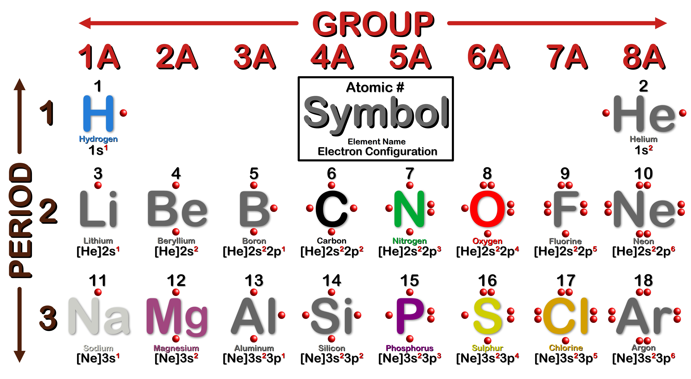
</figure>

<b><u>Figure 1</u>:</b> <b>Periodic Table.</b>

<!------------------------------------------------->

<!------------------------------------------------->

<!------------------------------------------------->

**  2.2.1 ELECTRON CONFIGURATIONS OF FAMILIES (PT COLUMNS)  :** If we take a closer look at the electron configuration of <u>Families</u> or <u>Groups</u> (i.e. columns) of elements within the <b><a class="one" href="https://pubchem.ncbi.nlm.nih.gov/periodic-table/#property=ElectronConfiguration" target="_blank" title="Go to PT">PT</a></b>, such as the **Alkali Metals** (**Group 1**) or **Halogens** (**Group 7A** or **17**), we can begin to see why they share similar chemical properties (**Fig. 1**). For example **lithium** (3Li) and **sodium** (11Na), two members of the highly reactive **Alkali Metal** family, have the following electron configurations:

Li: <b>1𝓈</b>2<b>2𝓈</b>1 or <b>\[</b>He<b>\]</b><b>2𝓈</b>1
 
↑↓         ↑
 
<b>1𝓈</b>           <b>2𝓈</b>

Na: <b>1𝓈</b>2<b>2𝓈</b>2<b>2</b>𝓅6<b>3𝓈</b>1 or <b>\[</b>Ne<b>\]</b><b>3𝓈</b>1
 
↑↓         ↑↓       ↑↓   ↑↓   ↑↓         ↑
 
<b>1𝓈</b>           <b>2𝓈</b>         <b>2</b>𝓅x   <b>2</b>𝓅y   <b>2</b>𝓅z       <b>3𝓈</b>

Both of these **Alkali Metals** have a <u>single</u> electron within their <u>outer-most</u> energy level, which is why they occupy the 1st column (**Group 1**) of the <b><a class="one" href="https://pubchem.ncbi.nlm.nih.gov/periodic-table/#property=ElectronConfiguration" target="_blank" title="Go to PT">PT</a></b>. The presence of this lone electron is what makes these elements so chemically reactive, and consequently why they never exist (naturally) in pure elemental form. **Halogens** are another very chemically reactive family of elements that make up the **Group 7A** column of the <b><a class="one" href="https://pubchem.ncbi.nlm.nih.gov/periodic-table/#property=ElectronConfiguration" target="_blank" title="Go to PT">PT</a></b>. The electron configuration of two members of this family, namely **fluorine** (9F) and **chlorine** (17Cl), are shown below.

F: <b>1𝓈</b>2<b>2𝓈</b>2<b>2</b>𝓅5 or
<b>\[</b>He<b>\]</b><b>2𝓈</b>2𝓅5  
↑↓         ↑↓         ↑↓   ↑↓   ↑
 
 <b>1𝓈</b>           <b>2𝓈</b>           <b>2</b>𝓅x   <b>2</b>𝓅y   <b>2</b>𝓅z

Cl: <b>1𝓈</b>2<b>2𝓈</b>2<b>2</b>𝓅6<b>3𝓈</b>2<b>3</b>𝓅5 or <b>\[</b>Ne<b>\]</b><b>3𝓈</b>2<b>3</b>𝓅5
 
↑↓         ↑↓         ↑↓   ↑↓   ↑↓         ↑↓         ↑↓   ↑↓   ↑
 
  <b>1𝓈</b>           <b>2𝓈</b>           <b>2</b>𝓅x   <b>2</b>𝓅y   <b>2</b>𝓅z         <b>3𝓈</b>         <b>3</b>𝓅x     <b>3</b>𝓅y   <b>3</b>𝓅z

Above you can see that F and Cl have <u>seven</u> electrons within their <u>outer-most</u> energy levels, which is why **Halogens** occupy the **Group 7A** column of the <b><a class="one" href="https://pubchem.ncbi.nlm.nih.gov/periodic-table/#property=ElectronConfiguration" target="_blank" title="Go to PT">PT</a></b> (i.e. 17th column if you also include the transition metal block). All of the **Halogens** are just one electron “<i>shy</i>” of a complete **octet** of electrons within their outer-most shell. The **octet** electronic structure (e.g. members of the **Nobel Gas** family) is essentially what all elements are “<i>striving for</i>” since it ultimately confers energy stability (e.g. **Nobel gasses** such as He**lium**, Ne**on** and Ar**gon** are all largely chemically inert). The fact that **Alkali Metals** are ideal electron donors for **Halogens** also helps to explain why these naturally abundant elements produce many well known compounds (i.e. salts such as LiCl, NaCl, NaF).
 
    Looking at the electronic configuration of reactants and products in a typical chemical reaction between a **Halogen** and **Alkali Metal** is also telling. For example consider the reaction between Na (i.e. highly dangerous and volatile solid in elemental form) and Cl (i.e. highly reactive and poisonous gas) that produces common table salt (i.e. very stable and relatively safe and edible compound).

<b>11</b>Na: <b>\[</b>Ne<b>\]</b><b>3𝓈</b>1   →   <b>11</b>Na<b>+</b>: <b>\[</b>Ne<b>\]</b>   +   <b>1</b><i>e</i><b>-</b>
 
 
<b>17</b>Cl: <b>\[</b>Ne<b>\]3𝓈</b>2<b>3</b>𝓅5
  +   <b>1</b><i>e</i><b>-</b>   →   <b>17</b>Cl<b>-</b>:
<b>\[</b>Ne<b>\]3𝓈</b>2<b>3</b>𝓅6 or <b>17</b>Cl<b>-</b>: <b>\[</b>Ar<b>\]</b>
 
~~——————————————————————————–~~
 
Na (<i>s</i>)   +   Cl (<i>g</i>)   →   Na<b>+</b>☷Cl<b>-</b>(<i>s</i>) (table salt)

Showing the electron configuration of two common elements that readily react with one another clearly shows that the number of **valence electrons** (VE: outer-most sub-shell electrons) determines their chemical reactivity. Even though the number of VE is different for Na (**1**) and Cl (**7**), both elements clearly prefer a **Nobel Gas** type electron configuration (**octet rule**). The latter family of elements (e.g. He**lium**, Ne**on**, Ar**gon**) are well known for their chemically inert nature (i.e. **thermodynamically** stable state). For Na it is much easier to lose one electron (<b>\[</b>Ne<b>\]</b>+) than it is to gain 7 more electrons (<b>\[</b>Ar<b>\]</b>-7). For Cl it is quite the opposite since it only needs to gain one more electron to attain a **thermodynamically** more stable <b>\[</b>Ar<b>\]</b> electron configuration, albeit negatively charged. So **thermodynamically** speaking a full outer **valence shell** is energetically more stable than a partially filled one. Moreover because Na and Cl are **thermodynamically** more stable in the form of the <u>reaction product</u>, common table salt, the chemical reaction will also release a considerable amount of energy (mostly heat). How readily two elements or groups of elements (i.e. molecules) react with one another can be calculated by determining the amount of energy needed to drive each step of a chemical reaction. If the overall energy <u>output</u> is greater than the energy <u>input</u> (e.g. Na<b>+</b>☷Cl<b>-</b>(<i>s</i>)) the reaction is **exothermic** (i.e. heat released) while the opposite type of reaction (energy <u>output</u> \< energy <u>input</u>) is termed **endothermic** (i.e. heat absorbed). If we re-visit the **octet rule** (i.e. atoms prefer a **Noble Gas** electron configuration) one could theoretically argue that Na could also accept seven more electrons and Cl could also give up seven electrons to attain a full **valence shell** (i.e. **Noble Gas** electron configuration). However the resulting multi-charge species (Na-7☷Cl+7) would be highly improbable since atoms are far more **thermodynamically** stable when they have little or no charge (i.e. reduce **electrostatic** energy). **Richard Abegg** (1904) was the first chemist to realize that the difference between the maximum positive and negative valence of most <u>main group</u> elements is usually eight (i.e. **Abegg’s rule**).<b>[30](#ref-abegg_valenz_1904)</b> This revelation was later used by **Gilbert Lewis** (1916) to help formalize his own cubical atomic theory that contains his famous **Lewis** dot diagrams (i.e. dots used to represent VE).<b>[31](#ref-lewis_atom_1916)</b> The so called **Abegg’s rule** (aka: “<i>Abegg’s law of valence and counter-valence</i>”) was essentially a precursor to **redox** chemistry (i.e. element can both accept and donate electrons resulting in multiple valence states). Some important examples of **redox** chemistry were highlighted in the <b><a class="one" href="https://opc-project.netlify.app/project/prairie_soil_ecosystem/" target="_blank" title="Go to OPC Soil Ecology">OPC Soil Ecology</a></b> project when discussing <b><a class="one" href="https://opc-project.netlify.app/project/prairie_soil_ecosystem/" target="_blank" title="Go to OPC Soil Ecology">Biogeochemical Cycles</a></b>. So **Abegg’s Rule** essentially describes whether an atom acts as an electron donor or receiver, which determines its valence state. Since **oxidation** reactions are a good example of this principle consider the chemistry of C (**Group 4A** element). When it bonds with four atoms of H it forms methane gas:

<b>4</b> <b>1</b>H: <b>1𝓈</b>1   →   <b>4</b>H<b>+</b>   +  <b>4</b><i>e</i><b>-</b>
 
 
<b>6</b>C: <b>\[</b>He<b>\] 2𝓈</b>2<b>2</b>𝓅2   +   <b>4</b><i>e</i><b>-</b>   →   C<b>-4</b>: <b>\[</b>He<b>\] 2𝓈</b>2<b>2</b>𝓅6 or C<b>-4</b>: <b>\[</b>Ne<b>\]</b>
 
~~————————————————————————————–~~
 
C (<i>s</i>)   +   <b>2</b>H2 (<i>g</i>)   →   C<b>-4</b>☷(H<b>4</b>)<b>+4</b>(<i>g</i>)

The C in methane has a valence state of -4. This is typical of many hydrocarbons since C has a slightly stronger <b><a class="one" href="https://ptable.com/#Properties/ElectronAffinity" target="_blank" title="Go to Interactive PT">electron affinity</a></b> (EA = 1.263 **eV** or 349 **kJ/mol**, where one <i>e</i>**lectron** **V**olt is approximately 96.5 **kJ/mol**) than that of H (0.754 **eV**). This is an important property of chemical elements since it greatly influences their chemical behaviour (i.e. ability to accept or donate electrons). By convention EA is the <u>negative</u> value of the <u>energy change</u> (<b>Δ</b><b><i>H</i></b>) that occurs when an electron is accepted by a neutral atom in its gaseous state to form a singly charged negative ion species (i.e. **anion**). For example gaseous Cl is known to have the highest EA value of any element within the <b><a class="one" href="https://pubchem.ncbi.nlm.nih.gov/periodic-table/#property=ElectronConfiguration" target="_blank" title="Go to PT">PT</a></b> (i.e. -<b>Δ</b><b><i>H</i></b> = 349 **kJ/mol** or 3.617 **eV**). This reaction is shown below.

Cl (<i>g</i>)   +   <i>e</i><b>-</b>   →   Cl<b>-</b> (<i>g</i>)       <b>Δ</b><b><i>H</i></b> = -349 kJ/mol

Another way of measuring an atom’s affinity for electrons is to calculate its **ionization energy** (IE). This specifically measures the amount of energy a gaseous atom needs to absorb in its ground state to release an electron and become a positive ion species (i.e. **cation**). For Cl this would be represented as:

Cl (<i>g</i>)   →   Cl<b>+</b> (<i>g</i>)   +   <i>e</i><b>-</b>       <b>Δ</b><b><i>H</i></b> = 1251.2 kJ/mol

The <b>Δ</b><b><i>H</i></b> term in the above expressions is known as the <u>Heat</u> or <u>Enthalpy of reaction</u>. It’s a **thermodynamic** unit of measurement for the amount of energy released or absorbed during a chemical reaction. Typically the <b>Δ</b><b><i>H</i></b>°rxn notation is used when reaction conditions are standardized (i.e. 25° C and 1 atm of pressure). One major advantage of this type of calculation is that <b>Δ</b><b><i>H</i></b> is a <u>state function</u>, which means you can calculate it by simply subtracting the <b>Δ</b><b><i>H</i></b> values from the <u>final</u> and <u>initial</u> states (i.e. <b>Δ</b><b><i>H</i></b> = <b>Δ</b><b><i>H</i></b>products - <b>Δ</b><b><i>H</i></b>reactants). So if the reaction proceeds through multiple steps one can simply sum up all of the standardized <b>Δ</b><b><i>H</i></b> values from each step to calculate the overall <b>Δ</b><b><i>H</i></b>°rxn value of the entire chemical system (i.e. **Hess’s Law**).<b>[32](#ref-Hess_1840)</b> When the overall <b>Δ</b><b><i>H</i></b> is a negative value the reaction is generally considered favourable since the products contain less energy than the reactants and therefore more stable. Alternatively, if energy is required to convert the reactants into products than the <b>Δ</b><b><i>H</i></b> value will be positive (i.e. **endothermic** reaction). Since thermodynamic calculations are not always easy perhaps a simple analogy may help. Consider a boulder sitting on the edge of a steep cliff or hill. Having the boulder spontaneously fall down the cliff is far more likely than having it spontaneously move up the hill. The latter represents a major energy barrier that requires a considerable amount of input energy to overcome. On the other hand a boulder perched on the edge of a cliff represents an unstable system, which is likely to undergo a rapid correction or change (i.e. cliff gives way). When the rock eventually tumbles to the bottom of the cliff its potential energy will be much lower. Atoms with partially filled electron orbitals also represent energetically unstable systems. Conversely, a singly charged ion species with a filled valence shell is relatively more stable compared to its previous open-shell configuration.  
 
    Returning to the chemical reaction between C and H one can see that C is essentially accepting electrons (i.e. being <u>reduced</u>), albeit not in the same manner as what happens between Na and Cl. Notably the EA value of Cl (3.617 **eV**) is 3.069 **eV** greater than that of Na (0.548 **eV**). By comparison the EA value of C (1.263 **eV**) is only 0.509 **eV** greater than that of H (0.754 **eV**). The difference in the EA values of C and H is relatively small, which means that the electrons are much more likely to be shared between these two atoms (i.e. nature of **covalent bonds**). On the other hand the much stronger EA of Cl when compared to Na means that the electron donated by the latter element is far more likely to be found closer to the nucleus of Cl resulting in a more clear cut separation of charge (i.e. nature of **ionic bonds**). However if C reacts with O**xygen** (O), which is a typical <u>oxidation reaction</u>, than the electron configuration exercise would yield the following:

<b>2</b> O: <b>\[</b>He<b>\]</b><b>2𝓈</b>2<b>2</b>𝓅4   +   <b>4</b> <i>e</i><b>-</b>   →   <b>2</b> O<b>-2</b>: <b>\[</b>He<b>\]</b><b>2𝓈</b>2<b>2</b>𝓅6 or <b>2</b> O<b>-2</b>: <b>\[</b>Ne<b>\]</b>
 
 
<b>6</b>C: <b>\[</b>He<b>\] 2𝓈</b>2<b>2</b>𝓅2   →   <b>4</b><i>e</i><b>-</b>   +   C<b>+4</b>: <b>\[</b>He<b>\]</b>
 
~~——————————————————————————-~~
 
C (<i>s</i>)   +   O2 (<i>g</i>)   →   O<b>-2</b>⚏C<b>+4</b>⚏O<b>-2</b>(<i>g</i>)

Here we can see that the valence state of C is very different (i.e. +4). This is due to the differences in the EA values of C (1.263 **eV**) and O (1.461 **eV**). In this situation the greater EA value of O means that the bonding electrons are more likely found closer to the nucleus of O than that of C. However, like the previous chemical reaction of C, the difference in EA values of the two reactants is relatively small (i.e. <b>Δ</b>EA = 1.461 - 1.263 = 0.198 **eV**). So the bonding character of these electrons is more **covalent** (i.e. sharing) and not **ionic**. Although EA is related to the character of a chemical bond, perhaps the more preferred way of characterizing chemical bonds involves a quantity known as <b><a class="one" href="https://goldbook.iupac.org/terms/view/E01990" target="_blank" title="Go to IUPAC Gold Book">electronegativity</a></b> (Χ). The actual concept that positive and negative electrical charges may lie at the heart of chemical bonding dates back to the turn of the 19th century with some of the early pioneers of chemistry such **Humphrey Davy** (1807), **Amedeo Avogadro** (1809) and **Jöns Berzelius** (1811).<b>[33](#ref-davy_i_1807),[34](#ref-jensen_electronegativity_2003)</b> For example **Berzelius** devised his own electro-chemical theory based on the chemical affinities of acids and bases. He also proposed a universal scale for <b><a class="one" href="https://goldbook.iupac.org/terms/view/E01990" target="_blank" title="Go to IUPAC Gold Book">electronegativity</a></b>, a term he originally coined. By the early 20th century both **Linus Pauling** (1932) and **Robert Mulliken** (1934) created the first quantitative measurements of <b><a class="one" href="https://ptable.com/#Properties/Electronegativity" target="_blank" title="Go to Interactive PT">electronegativity</a></b> (Χ).<b>[35](#ref-pauling_nature_1932),[36](#ref-mulliken_new_1934)</b> For **Mulliken** calculating Χ<i>M</i> involved averaging the IE and EA values of an element:

`$$\large \chi_{\normalsize _M} \normalsize \phantom{.} = \phantom{.} \large \frac{\text{IE} \normalsize \phantom{.} + \phantom{.} \large \text{EA}}{2}$$`

Alternatively **Pauling** created a dimension-less quantity (<i>r</i>elative scale) based on <u>bond dissociation energies</u> (i.e. measures strength of a chemical bond using standardized <b>Δ</b><b><i>H</i></b><b>°</b> values: <b>A</b>—<b>B</b> → <b>A</b>⋅ + <b>B</b>⋅). Fortunately the <b><a class="one" href="https://ptable.com/#Properties/Electronegativity" target="_blank" title="Go to Interactive PT">electronegativity</a></b> values of **Mulliken** (Χ<b>M</b>) and **Pauling** (Χ<i>r</i>) are related mathematically by the following simple expression:

`$$\large \chi_{r} \normalsize \phantom{.} = \phantom{.} 3.48 \left[ \frac{\text{IE} \; + \; \text{EA}}{2} \; - \; 0.602 \right]$$`

**Pauling’s** more familiar Χ<i>r</i> values can be easily used to determine the <u>ionic character</u> of a chemical bond by simply calculating the ratio of Χ<i>r</i> values for two bonding atoms:

`$${\tag 1} \\ \large \% \, \text{Ionic} \normalsize \phantom{.} = \phantom{.} \large \left[ \frac{\chi_{r_{_\text{high}}} \normalsize \phantom{.} - \phantom{.} \large \chi_{r_{_\text{low}}}}{\chi_{r_{_\text{high}}}} \right] \normalsize \times 100$$`

Based on <b>Eqn. 1</b> values ≥50% would signify an **ionic bond**, while values that fall below 50% would be classified as **polar covalent**. Only values close to 0% (i.e. ≤5%) would be classified as a “<i>true</i>” **covalent** bond (e.g. diatomic molecules like Cl2). For example the ionic character of the chemical bond between Na (Χ<b><i>r</i></b> = 0.93) and Cl (Χ<b><i>r</i></b> = 3.16) is relatively high (~70.6%). By comparison the chemical bond between O (Χ<b><i>r</i></b> = 3.44) and H (Χ<b><i>r</i></b> = 2.2) is polar covalent (~36% ionic). Based on these simple calculations one can begin to understand the chemical behaviour of many compounds. For example, the distinct polar covalent nature of the bond between O and H explains why molecules that contain H<b>ydr</b>O<b>xyl</b> groups (i.e. <b>R</b>-OH), such as sugars and alcohols, readily interact with water (i.e. high water solubility). The partial charge separation of **polar covalent bonds** (i.e. dipole moments: <b>δ</b>-‐‐‐<b>δ</b>+) create very distinctive chemical-physical properties (e.g. bulk water has an extensive network of dipole-dipole interactions that produces high surface tension, a unique low density crystalline structure, and high heat capacity).  
    Clearly the electron affinity of an atom directly affects the strength of its chemical bonds. For example, common di-atomic molecules like N2 (g) and H2 (g) share their bonding electrons equally since they are composed of identical atoms. However, in the case of NaCl, the lone VE of Na is essentially donated to Cl due to the strong ionic character (70.6%) of the bond. Nevertheless most biomolecules are made up of **covalent bonds** that have varying degrees of **bond polarity**. For example, atoms that are held together by <u>non-polar</u> **covalent bonds** share electrons equally, whereas atoms held together by <u>polar</u> **covalent bonds** do not. In the latter case electrons are preferentially attracted to one of the atoms due to their markedly different Χ<i>r</i> values (e.g. <b>R–</b>O<b>δ-</b><b>—</b>H<b>δ+</b>). It should therefore come as no surprise that elements with low Χ<i>r</i> (i.e. weak attraction for shared electrons in bonds), IE (i.e. low energy threshold to remove a valence electron) and EA (i.e. release little to no energy when gaining an extra electron) values are good electron donors and also good electrical conductors (e.g. Alkali metals). On the other hand elements with relatively high Χ<i>r</i>, IE and EA values are good electron acceptors (e.g. oxidants in **redox** reactions) and therefore poor electrical conductors (e.g. non-metals like **Halogens**).

**  2.2.2 ELECTRON CONFIGURATIONS OF PERIODS (PT ROWS)  :** The chemical properties of elements that make up the **Periods** or <u>rows</u> of the <b><a class="one" href="https://ptable.com/#Properties/Electronegativity" target="_blank" title="Go to Interactive PT">PT</a></b> show distinctive trends in their chemical and physical properties. Most of the changes in chemical behaviour are due to the fact that each **Period** represents a different **energy level**. So as you move across a **Period** (i.e. increasing atomic number) more electrons are being added to a given **energy level**, which changes its chemical and physical behaviour. For example, as you move from left-to-right across a **Period** the atomic number (i.e. # **protons**) increases. The additional nuclear charge increases the electrostatic force exerted on the outer electrons and as a result reduces the size of the atomic radius (Note: often measured in **angstroms**, or `\(\mathring{\text{A}}\)`, where `\(1 \, \mathring{\text{A}} \; = \; 1 \times 10^{-10} \, \text{m} \; = \; 0.1 \, \text{nm}\)`). In addition the atomic radius of a given element also changes when its electron configuration changes, such as when ions are formed. For example, consider NaCl.

Na: <b>\[</b>Ne<b>\] 3𝓈</b>1 (<b>190 pm</b>)   →   Na<b>+</b>: <b>\[</b>Ne<b>\]</b> (<b>102 pm</b>)   +   <b>1</b><i>e</i><b>-</b>
 
 
Cl:<b>\[</b>Ne<b>\]</b><b>3𝓈</b>2<b>3</b>𝓅5 (<b>79 pm</b>)   +   <b>1</b><i>e</i><b>-</b>   →   Cl<b>-</b>: <b>\[</b>Ar<b>\]</b> (<b>181 pm</b>)

For **cations** like Na<b>+</b> the loss of a negatively charged electron decreases the overall repulsive electrostatic forces within a given **shell** (`\(n = 3\)`), while simultaneously increasing its effective nuclear charge (i.e. reduced electron “<i>shielding</i>” effect by inner shell electrons) resulting in a smaller atomic <u>radius</u> (<b>190 pm</b> → <b>102 pm</b>). On the other hand for **anions** like Cl<b>-</b> the additional electron increases its atomic radius (<b>79 pm</b> → <b>181 pm</b>) due to increased repulsive electrostatic forces and a reduced <u>effective</u> nuclear charge (i.e. increased electron “<i>shielding</i>” effect). In both situations the volume of space occupied by the electrons is fundamentally altered.
 
    Another notable change in the elements as you move across a **Period** from left to right is the transition from **metals** (i.e. electron donors) to **non-metals** (i.e. electron acceptors). This transition simply reflects the underlying changes in their electronic structure and associated electron affinities (i.e. <b>IE</b> and <b>EA</b>). Perhaps a more informative approach is to compare the properties of **Period** elements that undergo the same chemical reaction such as O**xidation**. For example, various oxides of **Period 3** elements (i.e. Na, Al, S). The electron configuration of the O**xidation** reaction involving Na can be expressed as:

<b>2</b> O: <b>\[</b>He<b>\]</b> <b>2𝓈</b>2<b>2</b>𝓅4   +   <b>4</b><i>e</i><b>-</b>   →   <b>2</b> O<b>-2</b>: <b>\[</b>Ne<b>\]</b>
 
 
<b>4</b> Na: <b>\[</b>Ne<b>\]</b><b>3𝓈</b>1   →   <b>4</b> Na<b>+</b>: <b>\[</b>Ne<b>\]</b>   +   <b>4</b> <i>e</i><b>-</b>
 
~~——————————————————————————-~~
 
<b>4</b> Na (<i>s</i>)   +   O<b>2</b> (<i>g</i>)   →   <b>2</b> Na<b>+</b>⚏O<b>-2</b>⚏Na<b>+</b> (<i>s</i>)

The strong ionic character (73%) of the chemical bond between Na (Χ<b><i>r</i></b> = 0.93) and O (Χ<b><i>r</i></b> = 3.44) results in a high melting point (1275°C). This ionic property of sodium oxide (aka <b>soda</b>) makes it very useful **flux** reagent in glass making (i.e. it lowers the melting point of silica by disrupting the three-dimensional network of SiO<b>4</b> molecules). In fact the vast majority of commercial windowpanes and glass containers (bottles and jars) are made of <u>soda-lime glass</u> (i.e. 69-73% SiO<b>2</b>, 12-15% Na<b>2</b>O and 8-12% CaO).<b>[37](#ref-gerace_characterization_2024)</b>
 
    Moving across the **Period** to Al (**Group 13** or **3A**) we can now examine its changing electron configuration as it undergoes an O**xidation** reaction.

<b>6</b> O: <b>\[</b>He<b>\]</b> <b>2𝓈</b>2<b>2</b>𝓅4   +   <b>12</b><i>e</i><b>-</b>   →   <b>6</b> O<b>-2</b>: <b>\[</b>Ne<b>\]</b>
 
 
<b>4</b> Al:<b>\[</b>Ne<b>\]</b><b>3𝓈</b>2<b>2</b>𝓅1   →   <b>4</b> Al<b>+3</b>: <b>\[</b>Ne<b>\]</b>   +   <b>12</b><i>e</i><b>-</b>
 
~~——————————————————————————–~~
 
<b>4</b> Al (<i>s</i>)   +   <b>3</b> O<b>2</b> (<i>g</i>)   →   <b>2</b>
(Al<b>+3</b>)<b>2</b>☷(O<b>-2</b>)<b>3</b>
(<i>s</i>)

The chemical bonds of <b><a class="one" href="https://pubchem.ncbi.nlm.nih.gov/compound/Aluminum-Oxide" target="_blank" title="Go to PubChem">aluminum oxide</a></b> have a strong ionic character (53%) much like sodium oxide. Moreover, the structure of Al<b>2</b>O<b>3</b> and Na<b>2</b>O<b>3</b> contains a strong O**xide ion** (O<b>-2</b>). For Al<b>2</b>O<b>3</b> the extended network of regularly arranged O**xide anions** and trivalent Al results in a high melting point (2030°C) and a high boiling point (2977°C). A well known mineral made of Al<b>2</b>O<b>3</b> is <b><a class="one" href="https://www.mindat.org/min-1136.html" target="_blank" title="Go to Mindat.org">corundum</a></b>, which has many <b><a class="one" href="https://pubchem.ncbi.nlm.nih.gov/compound/Aluminum-Oxide#section=Uses" target="_blank" title="Go to PubChem">commercial and industrial applications</a></b> (e.g. hardness: 8.8 on **Mohs’ scale** which makes it an ideal abrasive). However <b><a class="one" href="https://www.mindat.org/min-1136.html" target="_blank" title="Go to Mindat.org">corundum</a></b> is especially admired for its rare vitreous gemstones (i.e. rubies, sapphires). The vibrant colours of rubies and sapphires is due to the presence of trace amounts of **metal** impurities (i.e. minor amounts of Fe, Cr, and V substitute for Al). Deep red varieties known as rubies are considered the rarest of all known gemstones. All non-red varieties of this gemstone are known as sapphires, which can be pink, blue, green, yellow, or violet.
 
    Finally consider the electron configuration of S**ulphur** as it undergoes an O**xidation** reaction. Here, as in the other two O**xidation** reactions described above, the -2 oxidation state of O is maintained to allow for comparisons. Even though O and S belong to the same **Family** (**Group 6A**), and thus require only 2 more electrons to fill their respective outer shells, O plays the role of <u>electron acceptor</u> (i.e. o**xidant**). This is due to their relative **electro-negativity** values (i.e. O Χ<b><i>r</i></b> = 3.44; while S Χ<b><i>r</i></b> = 2.58). Therefore S plays the role of <u>electron donor</u> (i.e. **reductant**). With this in mind consider the following expressions.

<b>2</b> O: <b>\[</b>He<b>\]</b> <b>2𝓈</b>2<b>2</b>𝓅4   +   <b>4</b><i>e</i><b>-</b>   →   <b>2</b> O<b>-2</b>: <b>\[</b>Ne<b>\]</b>
 
 
S:<b>\[</b>Ne<b>\]</b><b>3𝓈</b>2<b>3</b>𝓅4   →   S<b>+4</b>: <b>\[</b>Ne<b>\]</b><b>3𝓈</b>2   +   <b>4</b><i>e</i><b>-</b>
 
~~——————————————————————————–~~
 
S (<i>s</i>)   +   <b>2</b> O<b>2</b> (<i>g</i>)   →   O<b>-2</b>⚏S<b>+4</b>⚏O<b>-2</b> (<i>g</i>)

The chemical bond between S**ulphur** (Χ<b><i>r</i></b> = 2.58) and O**xygen** (Χ<b><i>r</i></b> = 3.44) has low ionic character (25%) and therefore classified as **polar covalent**. Having elemental S function as an electron donor is characteristic of its multi-valent nature, which was highlighted in the <b><a class="one" href="https://opc-project.netlify.app/project/prairie_soil_ecosystem/" target="_blank" title="Go to OPC Soil Ecology">OPC Soil Ecology</a></b> project section on <b><a class="one" href="https://opc-project.netlify.app/project/prairie_soil_ecosystem/" target="_blank" title="Go to OPC Soil Ecology">Biogeochemical Cycles</a></b>. Although the individual bonds are polar the overall net charge of <b><a class="one" href="https://pubchem.ncbi.nlm.nih.gov/compound/Sulfur-Dioxide" target="_blank" title="Go to PubChem">Sulphur dioxide</a></b> is zero. Nevertheless the structure of the molecule is slightly bent owing to the repulsive **electrostatic forces** exerted by the lone pair of electrons within the <b>3𝓈</b>2 orbital of S. Its non-linear shape combined with the asymmetrical charge distribution associated with the <u>polar</u> **covalent bonds** (i.e. dipole moment: <b>δ</b>-‐‐‐ <b>δ</b>+) results in weak inter-molecular attractions. Physically the end result is a gaseous molecule with a very low melting point (-75.5°C) and low boiling point (-10°C).

**  3. CHEMICAL BONDS  :** One of the early pioneers of electro-chemical theory was **Gilbert Lewis**. He was the first to postulate that a chemical bond is based on the sharing of pairs of electrons.<b>[31](#ref-lewis_atom_1916),[38](#ref-lewis_valence_1913),[39](#ref-lewis_introductory_1923)</b> In his classic paper entitled “<i>The Atom and the Molecule</i>” (1916) **Lewis** provides a clear picture of how electrons form chemical bonds using his well known <u>electron dot diagrams</u>.

> “<i>In order to express the idea of chemical union in symbols I would suggest the use of a colon, or two dots arranged in some other manner, to <u>represent the two electrons which act as the connecting links between the two atoms</u>. Thus we may write</i> Cl<b>2</b> <i>as</i> Cl <b>:</b> Cl <i>If in certain cases we wish to show that one atom in the molecule is on the average negatively charged we may bring the colon nearer to the negative element….it will be noted that, since in the hydrogen-helium row we have the rule of two in place of the rule of eight, the insertion of one electron into the shell of the hydrogen atom is entirely analogous to the <u>completion of the cube</u> in the case of the halogens….It is evident that the type of union which we have so far pictured, although it <u>involves two electrons held in common by two atoms</u>, nevertheless <u>corresponds to the single bond</u> as it is commonly used in graphical formulae</i>.”<b>[31](#ref-lewis_atom_1916)</b>

All chemistry students are well acquainted with his <u>electron dot diagrams</u>, particularly as it relates to his electronic theory of acids and bases (i.e. **Lewis** acids and bases being electron donors and acceptors, respectively). In the paper **Lewis** (1916) also elaborated on the nature of polar and non-polar molecules in terms of the ability of an atom to attract electrons.

> “<i>We may very <u>safely assume</u> that the essential difference between the <u>polar</u> and the <u>nonpolar molecule</u> is that, in the former, one or more <u>electrons</u> are held by sufficiently weak constraints so that they may become separated from their former positions in the atom, and in the extreme case pass altogether to another atom, thus producing in the molecule a <u>bipole</u> or multipole of high <u>electrical moment</u>. Thus in an extremely polar molecule, such as that of sodium chloride, it is probable that at least in the great majority of molecules the chloride atom has acquired a unit <u>negative charge</u> and therefore the sodium atom has acquired a unit <u>positive charge</u>, and that the <u>process of ionization</u> consists only in a further <u>separation</u> of these charged parts. If then we consider the nonpolar molecule as one in which the electrons belonging to the individual atom are held by such constraints that they do no move far from their normal positions, while in the polar molecule the electrons, being more mobile, so move as to separate the molecule into positive and negative parts, then all the distinguishing properties of the two types of compounds become necessary consequences of this assumption</i>.”<b>[31](#ref-lewis_atom_1916)</b>

He also famously coined the term **electrophile** (i.e. electron “<i>loving</i>”), one of the most common terms used in chemistry, which helps to convey the importance of electron mobility with regards to the physical and chemical properties of molecules. For example **Lewis** (1916) highlights how “<i>free</i>” or loosely held electrons contribute to the **dielectric** nature of molecules.

> “<i>When a molecule owing to the displacement of an electron, or electrons, becomes a bipole (or multipole) of high electrical moment, that is, when its charged parts are separated by an appreciable distance, its force of attraction for another molecular bipole will be felt over a considerable intervening distance, and two or more such bipoles will frequently be drawn together ….molecules of a polar substance will therefore not only exhibit an unusually high intermolecular attraction at a distance, but will frequently combine with one another and show the phenomenon known as association ….We come then to the consideration of the electrical properties which distinguish polar from nonpolar substances, or, in accordance with the terminology I formerly used, which distinguishes good <u>electrophiles</u> from poor electrophiles. The first difference is in the <u>dielectric constant</u> ….In polar molecule the constraints which operate against a separation of the charges, being already weak, may be further stretched in the electric field, and what is more important, the biopoles (or multipoles) which already exist in the polar substance may, by rotation, orient themselves in the electric field, thus producing a large displacement current and therefore a high dielectric constant</i>.”<b>[31](#ref-lewis_atom_1916)</b>

Materials that have low **dielectric** constants, such as glass, do not contain free electrons or polar bonds that can be manipulated by an external electrical field (i.e. good insulators). For example glass, which is essentially <b><a class="one" href="https://www.mindat.org/min-10916.html" target="_blank" title="Go to MinDat.org">silica dioxide</a></b> (SiO<b>2</b>, or simply **silica**), is a good insulator and largely chemically resistant. The lack of chemical reactivity is due to the strong **covalent bonds** between Si and the tetrahedral co-ordinated O atoms (**Note:** the use of the term **silica dioxide** is due to its three dimensional tetrahedral unit structure where each O atom within a SiO<b>4</b> unit is shared with a neighbouring unit resulting in an overall element ratio of 1:2). On the other hand molecules with high **dielectric constants** have highly polar bonds that can be manipulated by an external electrical field (i.e. **dielectric polarization**). Today stable **dielectric** materials capable of high-energy densities are in great demand (i.e. **electrostatic energy** storage devices).
 
    The <b><a class="one" href="http://hyperphysics.phy-astr.gsu.edu/hbase/Chemical/lewis.html#c2" target="_blank" title="Go to HyperPhysics">Lewis dot diagram</a></b> is one of the most memorable contributions of **Lewis**. According to **Lewis** a single pair of electrons makes up a chemical covalent bond, which is certainly consistent with previous discussions about the **quantum** nature of electron orbitals (i.e. **PEP**). Also chemical bonds are formed by outer shell electrons, otherwise known as **valence electrons** (VE). This makes sense if you simply consider an atom’s internal or core electronic structure (i.e. non-valence electrons found within the inner shells). The **electrostatic** forces generated by this core structure would obviously limit the region of contact between two neighbouring atoms. Since chemical bonds are all about VE it makes sense to highlight them using dots that are symmetrically arranged, as per **Lewis’** cubic theory, around an element’s symbol. As noted by **Lewis** there is a limit to the number of electrons and hence dots that can be arranged around each element, which corresponds to its place (i.e. **Group** or **Family**) within the <b><a class="one" href="http://hyperphysics.phy-astr.gsu.edu/hbase/pertab/perlewis.html#c1" target="_blank" title="Go to HyperPhysics">PT</a></b> (Note: with the exception of He). This is much less confusing than writing out its detailed electronic configuration. In fact **Lewis** dot diagrams are often added to the **Periodic Table** (**Fig. 1**). For example, there is a dot for each of the four VE of C. However, when it comes to heavier elements (e.g. transition metals) a simple **Lewis dot** diagram is not possible because of their complicated, partially filled sub-shells.

  **3.1 IONIC BONDS & LEWIS STRUCTURES**  **:** A chemical bond with <u>ionic character</u> (<b>Eqn. 1</b>) involves two atoms (i.e. **metal** and non-metal) with very different **electronegativity values** (i.e. Χ<b><i>r</i></b>). This difference in electron affinities between the two atoms is such that the electrons from a **metal** are donated to the non-metal. The resulting separation of charge creates an attractive **electrostatic** force that holds the **anion** and **cation** together. For example, in NaCl (table salt) the **sodium** atom donates its one VE (Na: <b>\[</b>Ne<b>\]</b><b>3𝓈</b>1) to **chlorine** (Cl: <b>\[</b>Ne<b>\]</b><b>3𝓈</b>2<b>3</b>𝓅5), which has seven dots for each of its VE (**Fig. 2**). Of course atoms making up an ionic compound do not necessarily contain the same charge. For example in **sodium oxide** (Na<b>2</b>O) each **sodium** atom donates one VE to the divalent O**xygen** atom (O: <b>\[</b>He<b>\]</b><b>2𝓈</b>2<b>2</b>𝓅4), which has six VE (**Fig. 2**). As a result O forms the O**xide anion**. Note that in both of these examples the **anions** have achieved a stable **Noble gas** electron configuration (i.e. **iso-electronic** with either Ne or Ar).

<!---------------------------------------------->

<!------------ FIG 2 - Ionic Bond  ------------->

<!---------------------------------------------->

<figure>

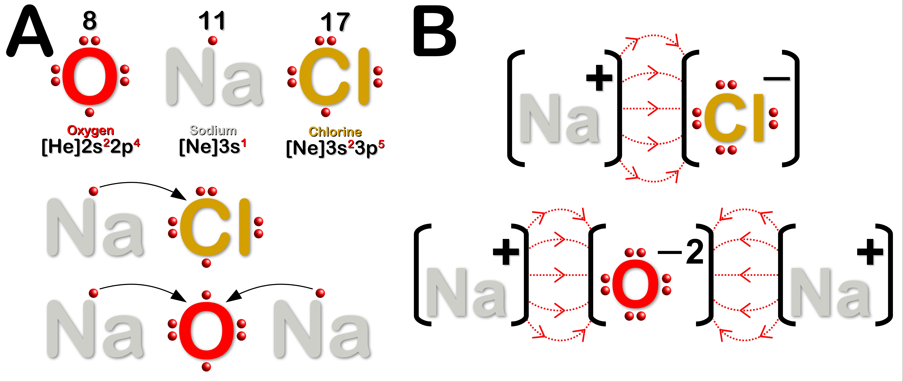
</figure>

<b><u>Figure 2</u>:</b> <b>Electrostatic Interactions - Ionic Bond.</b>

<!---------------------------------------------->

<!---------------------------------------------->

<!---------------------------------------------->

  **3.2 COVALENT BONDS & LEWIS STRUCTURES**  **:** When the <u>ionic character</u> of a chemical bond is low (<b>Eqn. 1</b>) its classified as a <u>non-ionic</u> **covalent bond**. However as noted previously there are two types of **covalent bonds**. When the Χ<b><i>r</i></b> values of the two atoms are the same, or very nearly so (i.e. less than 5% ionic character), than the chemical bond is classified as a “<i>true</i>” **covalent bond** (e.g. O<b>2</b>, **Fig. 3**). However if the ionic character of the bond is somewhere between these two extremes (i.e. 5% \< Χ<b><i>r</i></b> \< 50%) then it is considered a <u>polar</u> **covalent bond**. For these types of bonds the probability of finding an electron is higher closer to the atom with the highest Χ<b><i>r</i></b> value, or what **Lewis** would term the more **electrophilic** atom. This type of unequal sharing of electrons produces small dipole moments (<b>δ</b>-‐‐ <b>δ</b>+), and if the molecule has a net charge imbalance (e.g. net dipole moment due to asymmetric structure) then these molecules can interact with one another or other like polar molecules. Regardless of the type of **covalent bond** each shared electron pair is depicted by a single straight line. If the two bonding atoms share multiple electron pairs (i.e. <u>double</u> or <u>triple</u> **covalent bonds**) than there may be more than one line connecting the two atoms (e.g. N<b>2</b> (<i>g</i>) → <b>⁚</b>N☰N<b>⁚</b> (<i>g</i>)). **Lewis dot diagrams** also depict non-bonding electrons that are referred to as **lone pairs** of electrons (e.g. <b>⁚</b>N☰N<b>⁚</b> (<i>g</i>)). These **lone pairs** of electrons can greatly affect the chemical behaviour and shape of molecules (e.g. H<b>2</b>O).
 

<!-------------------------------------------------------------->

<!------------ FIG 3 - Covalent Bonds & ES Dipoles ------------->

<!-------------------------------------------------------------->

<figure>

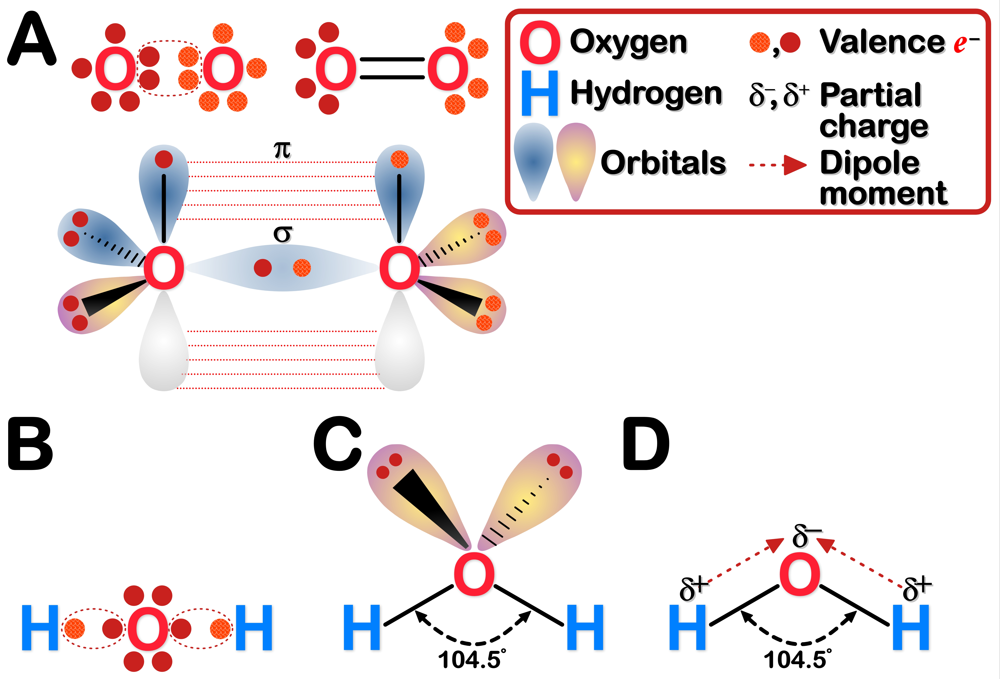
</figure>

<b><u>Figure 3</u>: <b>Covalent Bonds & Dipole Moments.</b></b>

<!------------------------------------->

<!------------------------------------->

<!------------------------------------->

    Differences in **electro-negativity** not only help to explain the <u>polar</u> nature of **covalent bonds**, but also the different **oxidation states** of elements that commonly undergo **redox** chemical reactions. For example consider a simple water molecule and the polar nature of its covalent bonds (**Fig. 3**). The **Group 6A** O atom is more **electrophilic** (i.e. Χ<b><i>r</i></b> = 3.44) than the two H atoms (i.e. Χ<b><i>r</i></b> = 2.2). As a result there is a shift in the electron density distribution such that the bonding electrons are more likely to be found closer to O than H. Occasionally one of these polar bonds undergoes ionization giving rise to a H**ydr**O**xyl anion** (OH<b>-</b>) and H<b>+</b> (**Note:** technically H<b>+</b> usually becomes incorporated into a neighbouring water molecule to become a **hydronium** ion: H<b>3</b>O<b>+</b>). This type of separation of charge within a water molecule occurs all the time, albeit at low levels (**Note:** water dissociation constant = <b>K<i>w</i></b> = \[H<b>3</b>O<b>+</b>\]\[OH<b>-</b>\] = \[<b>10-7</b> <b>M</b>olar\]\[<b>10-7</b> <b>M</b>olar\] = <b>10-14</b> <b>M</b>2, see discussions on **pH** in <b><a class="one" href="https://opc-project.netlify.app/project/prairie_soil_ecosystem/#Fig4CBS" target="_blank" title="Go to OPC Soil Ecology">Soil Ecology</a></b> section). So we can assign an **oxidation number** of -2 to O (electron acceptor) and +1 to H (electron donor). The charge of O is certainly consistent with its **Group 6A** designation (O: <b>\[</b>He<b>\]</b> <b>2𝓈</b>2<b>2</b>𝓅4) since it needs 2 more electrons to attain a more stable Noble gas electronic configuration (i.e. **octet** rule). Once all the electrons have been assigned to the atoms it’s important to check the <u>formal charge</u> of each atom, which amounts to making sure the number of electrons assigned to an atom (i.e. dots) matches its expected valence state (i.e. **Group** number). A quick way to calculate the formal charges is:

`$$\tag{2}$$`

`$$\large \text{Formal Charge} \normalsize \phantom{.} = \phantom{.} VE \; - \; \bigg( L \; + \; \frac{1}{2}B \normalsize \bigg) \\$$`

In the above expression <i>VE</i> represents the number of V**alence** E**lectrons** in the <u>free</u> atom (i.e. **Group** number), <i>L</i> is the number of **electrons** present on the bonded atom as **lone pairs**, and <i>B</i> is the number of **bonding electrons** on the atom. So if the atom has more electrons when it’s part of a molecule than when it’s free (i.e. neutral elemental form), then the atom will have a formal negative charge (i.e. **anion**). Conversely if the molecular electron assignment for an atom results in fewer electrons than its normal neutral elemental form, then the atom will have a formal positive charge (i.e. **cation**). For example the formal charge of C and O when part of CO<b>2</b> would be:

`$$\tag{2.1}$$`

`$$\\ \large \text{First Lewis Structure} \normalsize \phantom{..} \Longrightarrow \phantom{.} \overbrace{:\stackrel{..}{\text{O}}}^0 = \overbrace{\text{C}}^0 = \overbrace{\stackrel{..}{\text{O}}:}^0 \\ \large \text{C Formal Charge} \normalsize \; = \; V \; - \; \bigg( L \; + \; \frac{1}{2}B \bigg) \phantom{.} = \phantom{.} 4 \, - \, \bigg ( 0 \; + \; \frac{1}{2} \cdot 8 \bigg) \phantom{.} = \phantom{.} 0 \\ \large \text{O Formal Charge} \normalsize \phantom{.} = \phantom{.} V \; - \; \bigg( L \; + \; \frac{1}{2}B \bigg) \phantom{.} = \phantom{.} 6 \; - \; \bigg( 4 \; + \; \frac{1}{2} \cdot 4 \bigg) \phantom{.} = \phantom{.} 0$$`

 

So the **Lewis Structure** proposed in <b>Eqn. 2.1</b> has no formal charges assigned to any of the bonded atoms. This structure would be preferred since the absence of any formal charges means it’s a stable arrangement (i.e. no **electrostatic energy** gradients). A possible alternative **Lewis Structure** is offered below (<b>Eqn. 2.2</b>). Even though each atom has an **octet** of electrons there are formal charges assigned to the C atom as well as one of the O atoms, which makes it energetically unstable.

`$$\tag{2.2}$$`

`$$\\ \begin{align*} \large \text{Second Lewis} & \large \text{ Structure} \normalsize \phantom{..} \Longrightarrow \phantom{..} \overbrace{: \stackrel{..}{\text{O}}}^0 = \overbrace{\text{O}}^{+2} = \overbrace{\stackrel{..}{\text{C}}:}^{-2} \\[5px] \large \text{C Formal Charge} \normalsize \phantom{.} & = \phantom{.} V \; - \; \bigg( L \; + \; \frac{1}{2}B \bigg) \phantom{.} = \phantom{.} 4 \; - \; \bigg( 4 \; + \; \frac{1}{2} \cdot 4 \bigg) \phantom{.} = \phantom{.} - 2 \\ \large 1^{st} \, \text{O Formal Charge} \normalsize \phantom{.} & = \phantom{.} V \; - \; \bigg( L \; + \; \frac{1}{2}B \bigg) \phantom{.} = \phantom{.} 6 \; - \; \bigg( 4 \; + \; \frac{1}{2} \cdot 4 \bigg) \phantom{.} = \phantom{.} 0 \\ \large 2^{nd} \, \text{O Formal Charge} \normalsize \phantom{.} & = \phantom{.} V \; - \; \bigg( L \; + \; \frac{1}{2}B \bigg) \phantom{.} = \phantom{.} 6 \; - \; \bigg( 0 \; + \; \frac{1}{2} \cdot 8 \bigg) \phantom{.} = \phantom{.} + 2 \end{align*}$$`

 

  **3.3 RESONANCE STRUCTURES**  **:** Drawing **Lewis Structures** with the aid of a few simple rules helps to explain **chemical bonding** for many molecules. However there are many aspects of **chemical bonding** that they can not explain (e.g. varying bond lengths, bond strengths, bond angles and interactions in different chemical environments). For example, unlike the above structures of CO<b>2</b> there are many other molecules that have more than one possible stable structure (e.g. simple carboxylates, complex aromatic compounds). These equally probable structures are called **resonance structures**. The concept of **resonance** has been mentioned previously in other project sections (e.g. **Phenolics** and **Free Radical Scavenging** sections of <b><a class="one" href="https://opc-project.netlify.app/project/pnps/#Phenolics" target="_blank" title="Go to OPC PNP">PNP</a></b>) since it has a profound affect on biological systems. However the fact that they are equally likely structures once again forces us to confront the quantum reality of molecules. In many ways **resonance structures** represent some sort of **quantum** meta-state (i.e. invoking **superposition**), that we use to minimize the **electrostatic energy gradients** (i.e. established dipole moments) that would otherwise appear if electrons take up fixed positions within any one of the possible structures (i.e. thermodynamically “<i>costly</i>” and therefore unstable). In fact it’s possible to view all molecules as **resonance** hybrids of purely **covalent** and **ionic** structures (i.e. **quantum** fluctuations or some sort of molecular “<i>breathing</i>”). For example consider the relatively simple diatomic molecule H<b>2</b> (**Fig. 4**).

<!---------------------------------------------------------->

<!------------ FIG 4 - H2 Resonance Structures ------------->

<!---------------------------------------------------------->

<figure>

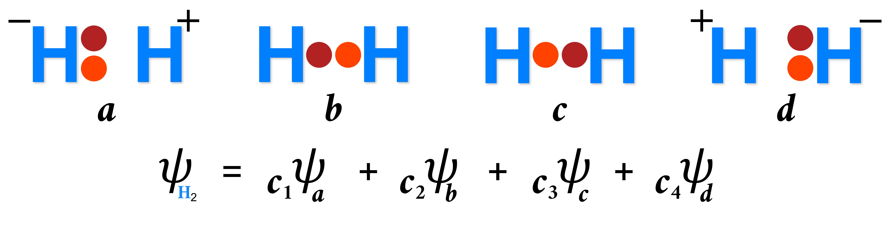
</figure>

<b><u>Figure 4</u>:</b> H<b>2 Resonance Structures.</b> The quantum state with the lowest total energy value and maximum stability is called the <b>normal state</b> (`\(\psi_{\text o}\)`). It’s possible that `\(\psi_{\text o}\)` is represented by multiple structures that collectively give the total quantum system maximum stability. Only structures that contribute significantly to the overall energy stability of the system should be considered. For the hydrogen molecule (H<b>2</b>) above multiple possible quantum states or structures and their associated numerical coefficients can represent the overall system. Fortunately only the <u>coefficient ratios</u> (e.g. <b>b/c</b>) are of interest here since the <u>wave function</u> (`\(\psi\)`) is the same for all these structures (i.e. same atomic orbital). So calculating the energy of `\(\psi\)` as a function of the coefficient ratios can determine the energy minimum of the system (i.e. maximum stability). If the value of <b>a/b</b> is very large, then the best <u>wave function</u> for `\(\psi\)` would be `\(\psi_{\text a}\)`. Thus the normal state, or `\(\psi_{\text o}\)`, would be represented by structure <b>a</b> as apposed to structure <b>b</b>. For example, given the following hypothetical coefficient ratios: <b>b/c</b> = 1, <b>a/b</b> = 0.02, and <b>d/b</b> = 0.02, one can assume that <b>b</b> and <b>c</b> are identical with respect to their energy contributions. Moreover, in this scenario structures <b>a</b> and <b>d</b> contribute very little to the overall energy stability of the normal state (i.e. very unlikely structures). Therefore `\(\psi_{\text o}\)` is best represented by both `\(\psi_{\text b}\)` and `\(\psi_{\text c}\)` (i.e. theoretically consider all possible states including the exchange of electrons, although electrons are essentially indistinguishable from each other). It’s important to note that `\(\psi_{\text o}\)` is formed in part by all structures that make significant contributions to the overall stability of the quantum system, and not some sort of hybrid or intermediate structure. The overall quantum state somehow <u>resonates</u> between all of the key stable structures. The main point here is that the <b>total energy</b> of this <u>resonating</u> system is less than the energy associated with each individual structure (e.g. `\(\text{Energy of } \psi_{\text o} < \text{Energy of } \psi_{\text b} \text{ or } \psi_{\text c}\)`). The energy minimum (`\(\psi_{\text o}\)`) arises from the interactions (i.e. <i>resonance</i>) of the most stable structures (i.e. <b>resonance energy</b>). Incorporating the ionic structures into the overall wave function (i.e. `\(\psi_{\text a}\)` and `\(\psi_{\text d}\)`) stems from the de-localized nature of the electron, which can result in partial charge separation. However, as noted previously, such <b>electrostatic energy gradients</b> are energetically “<i>costly</i>”. Of course the <b>resonance</b> phenomena described above pertains to electrons between two identical nuclei. Even though the concept of a <b>resonance hybrid</b> is a convenient mathematical approximation, all of the experimental data (i.e. bond strength, bond length) strongly supports this resonance model.

<!----------------------------------------->

<!----------------------------------------->

<!----------------------------------------->

The above structures depict a kind of simple oscillating-like charge (Recall: <b><a class="one" href="https://opc-project.netlify.app/project/opcchemprimer2_atom/#SHOmodel" target="_blank" title="Go to ChemPrimer2">simple oscillator model</a></b>). However structures with charge separation are thermodynamically “<i>costly</i>” (i.e. **electrostatic energy gradients**) and therefore unlikely to contribute to the hybrid **resonance** structure. In fact one could safely assume that the two symmetric ionic structures (i.e. `\(a\)` and `\(d\)`) would cancel each other out on average, resulting in a “<i>true</i>” **covalent** bond represented by both `\(b\)` and `\(c\)`. Unfortunately this type of scenario would not apply to molecules that contain different elements (e.g. HCl, NO<b>3-</b>). For example each of the **Lewis Structures** depicted for <b><a class="one" href="https://pubchem.ncbi.nlm.nih.gov/compound/Hydrochloric-Acid" target="_blank" title="Go to PubChem">hydrochloric acid</a></b> (HCl) do not contribute equally to the hybrid **resonance** structure. Namely the relatively low energy ionic structure H<b>+</b>‐‐Cl<b>-</b> is far more likely to contribute to the hybrid **resonance** structure than the unstable ionic structure H<b>-</b>–Cl<b>+</b>. Based on the differences in the **electro-negativity** of these elements (i.e. Cl Χ<b><i>r</i></b> = 3.16, H Χ<b><i>r</i></b> = 2.2) it’s clear that Cl has a greater affinity for electrons than H. In this scenario one would expect a small net **electrostatic** charge imbalance (i.e. dipole moment) to be associated with the molecule, even though the formal charge assigned to each atom (according to the rules) is zero.

<!---------------------------------------------------------->

<!------------ FIG 5 - HCl Resonance Structures------------->

<!---------------------------------------------------------->

<figure>

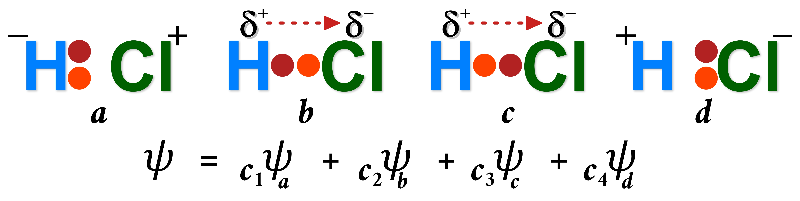
</figure>

<b><u>Figure 5</u>:</b> HCl <b>Resonance Structures.</b>

<!-------------------------------------------------------------------->

<!-------------------------------------------------------------------->

<!-------------------------------------------------------------------->

    In the case of the **nitrate ion** NO<b>3-</b> (**Fig. 6**) there are three possible **Lewis Structures** each containing two single bonds and one double bond. However, experiments have clearly shown that all three bonds within this **nitrate ion** are <u>equivalent</u> in length (i.e. 124 **pm**) and strength. In fact experiments show that the real bonds are intermediate in value when compared to single (e.g. 140 **pm**) and double bonds (e.g. 120 **pm**). Although the three **Lewis Structures** are equally probable they still do not correctly represent the real bonds of this molecule. The only short term solution is to invoke the **superposition** principle and draw a hybrid **resonance** structure with three equivalent bonds represented by dashed lines (**Fig. 6B**). These dashed lines highlight the dynamic nature of electrons (i.e. **de-localized**). This type of hybrid **resonance structure** is common among compounds that contain alternating single and double bonds (i.e. <u>conjugated</u> double bond system), such as <b><a class="one" href="https://opc-project.netlify.app/project/pnps/#Phenolics" target="_blank" title="Go to PNP">Phenolics</a></b>. The increased <u>mobility</u> of electrons (i.e. **de-localized**) within **resonance structures** results in their movement along the length of the entire molecule, which is an important feature of many biomolecules (e.g. <b><a class="one" href="https://opc-project.netlify.app/project/pnps/#Phenolics" target="_blank" title="Go to PNP">Phenolics</a></b>, <b><a class="one" href="https://opc-project.netlify.app/project/pnps/#Fig_VitCE" target="_blank" title="Go to PNP">antioxidants</a></b>).

<!--------------------------------------------------------------->

<!------------ FIG 6 - Nitrate Resonance Structures ------------->

<!--------------------------------------------------------------->

<figure>

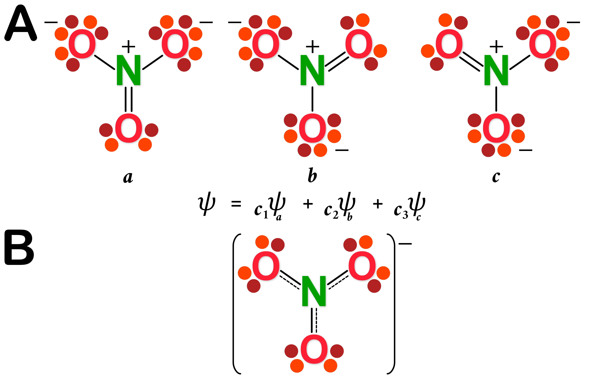
</figure>

<b><u>Figure 6</u>:</b> NO3-1 <b>Resonance Structures.</b>

<!-------------------------------------------------------------------->

<!-------------------------------------------------------------------->

<!-------------------------------------------------------------------->

  **3.4 CHEMICAL BOND ENERGY**  **:** Another useful way of characterizing chemical bonds is to take a thermodynamic approach. This involves measuring the changes in thermal energy, otherwise known as the **Heat of Enthalpy** change (<b>Δ</b><b><i>H</i></b>), associated with chemical reactions using an instrument known as the **calorimeter**. Because **work** and **energy** are essentially the same thing (i.e. same units of measure: **Joule** = 1 Newton⋅metre) it’s possible to directly quantify the amount of **chemical bond energy** based on the work it performs in a carefully controlled environment (e.g. heat energy flowing into or out of a chemical system can perform work on its surrounding environment, like a change in pressure or volume). So it’s possible to view chemical **work** and chemical **energy** as being equivalent. In fact most people understand the connection between the potential energy contained within food **calories** (i.e. 1 **cal** = 4.187 **Joules**) and the ability of cells to metabolize them (i.e. “<i>burn</i>” them, much in the same way that **calorimeters** work) to generate the necessary **energy** for basic metabolic functions (i.e. **work**).
 
    When chemical reactions do take place thermodynamic functions can tell us the amount of heat gained or lost by the surrounding system under <u>standardized</u> conditions (e.g. constant temperature, pressure, or volume). So the heat released or absorbed by a chemical reaction within the confines of a carefully controlled environment (i.e. **calorimeter**, is essentially a closed system with regards to mass) provides a direct measure of the changes in the flow of heat **energy**. Based on thermodynamic principles (i.e. conservation of **energy**) we can define the **internal energy** of our chemical system (<i>U</i>) as the sum of its <u>kinetic</u> and <u>potential</u> energies.<b>[13](#ref-mcquarrie_physical_1997)–[15](#ref-Ball_physical_2014)</b> The change in the **internal energy** of a chemical system can be expressed mathematically as:

`$$\tag{3} \\ \large \Delta U \normalsize \phantom{.} = \phantom{.} \large q \normalsize \phantom{.} + \phantom{.} \large w$$`

<b>Δ</b><i>U</i> represents the change in the <b>internal energy</b> of our system, <i>q</i> represents <u>heat</u>, and <i>w</i> represents <u>work</u>. The values generated by this equation can be either negative or positive. By convention if the magnitude of the value is negative that indicates an outward flow with respect to our chemical system (i.e. heat flowing out of molecules into the surrounding). These types of reactions are referred to as <b>exothermic</b> (i.e. heat is <u>released</u> by a chemical reaction). On the other hand if heat flows into the chemical system it is referred to as <b>endothermic</b>. If we use a <b>calorimeter</b> to measure the heat released by a chemical reactions we can simply relate the flow of energy of our system mathematically as:

`$$\tag{4}$$`

`$$\\ \begin{align*} - \large q \normalsize \phantom{.} & = \phantom{.} \large q_{\text{cal}} \\ \large q_{cal} \normalsize \phantom{.} = \phantom{.} \large \text{C}_{cal} \cdot \Delta \text{T} \normalsize \phantom{..} \Longrightarrow \phantom{.} - \large q \normalsize \phantom{.} & = \phantom{.} \large \text{C}_{cal} \cdot \Delta \text{T} \normalsize \phantom{..} \Longrightarrow \phantom{..} \large \text{C}_{cal} \normalsize \phantom{.} = \phantom{.} \large \frac{-q}{\Delta \text{T}} \\[5px] \large \text{C}_{specific} \normalsize \phantom{.} = \phantom{.} \large \frac{\text{C}_{cal}}{m} \normalsize \phantom{..} \Longrightarrow \phantom{..} - \large q \normalsize \phantom{.} & = \phantom{.} \large m \cdot \text{C}_{s} \cdot \Delta \text{T} \normalsize \phantom{..} \Longrightarrow \phantom{..} \large \text{C}_{s} \normalsize \phantom{.} = \phantom{.} \large \frac{-q}{m \cdot \Delta \text{T}} \\ \end{align*}$$`

As shown above the heat <u>gained</u> (qcal) by the <b>calorimeter</b> is lost (-q) by the chemical system (Note: conservation of energy). The value of qcal can be found by first determining the <b>heat capacity</b> of the <b>calorimeter</b> (i.e. Ccal = <b>calorimeter constant</b>) experimentally prior to carrying out the chemical reaction of interest. Note that Ccal is simply the ratio of the heat released by the reaction to the rise in temperature produced. If the heat capacity is large that means the supply of heat will only produce a <u>small</u> change in temperature. Regardless, if we know the <b>heat capacity</b> of the <b>calorimeter</b> then we can measure the change in temperature and thus calculate how much heat was lost or gained during a chemical reaction. Often times <b>heat capacity</b> is standardized with respect to the sample in terms of either its mass (i.e. Cspecific = C/m) or the number of moles (i.e. Cspecific = C/n). For example, the <b>specific heat capacity</b> of water at room temperature is 4.18 <b>J</b>⋅<b>°C</b>-1⋅<b>gm</b>-1, which is a relatively high value compared to most other compounds. This is due to the amount of energy required to disrupt the network of attractive <b>electrostatic gradients</b> within liquid water (i.e. inter-molecular network of H <b>bonds</b>: <b>R-</b>H<b>δ</b>+‐‐‐ <b>δ</b>-O<b>-R</b>) in order to increase its <b>kinetic energy</b> (i.e. raise its temperature). The <b>calorimeter</b> itself can be a rather simple piece of apparatus (e.g. Styrofoam insulated cup with a thermometer), but many labs often use a more expensive piece of equipment known as a “<i>bomb</i>” <b>calorimeter</b>. This device is made of a sealed metal container immersed in water, which can control the pressure of a chemical reaction.<b>[13](#ref-mcquarrie_physical_1997)–[15](#ref-Ball_physical_2014)</b>

    A thermodynamic expression that can measure changes in energy at constant pressure is called <b>Enthalpy</b> (<b><i>H</i></b>). Its a state function (i.e. internal energy of our isolated chemical system is <u>constant</u>) that can be represented mathematically as:

`$$\tag{5}$$`

`$$\begin{align*} \large \text{At constant} \phantom{.} P \normalsize \phantom{..} & \Longrightarrow \phantom{..} \large \Delta H \normalsize \phantom{.} = \phantom{.} \large \Delta U \normalsize \; + \; \large P \, \Delta V \\[10px] \large \text{Input } Eqn. \phantom{.} 3 \normalsize \phantom{..} & \Longrightarrow \phantom{..} \large \Delta H \normalsize \phantom{.} = \phantom{.} \large q \normalsize \; + \; \large w \normalsize \; + \; \large P \, \Delta V \end{align*} \\$$`

`$$\tag{6}$$`

`$$\large w \normalsize \phantom{.} = \phantom{.} - \large P_{external} \, \Delta V \\$$`

`$$\tag{7} \\ \large \text{Combine Eqn.} \, 5 \; \text{and} \; 6 \normalsize \phantom{..} \Longrightarrow \phantom{..} \large \Delta H \normalsize \phantom{.} = \phantom{.} \large q \normalsize \; - \; \large P_{external} \, \Delta V \normalsize \; + \; \large P \, \Delta V \\[5px] \large \text{Constant Pressure} \normalsize \phantom{..} \Longrightarrow \phantom{..} \large \Delta H \normalsize \phantom{.} = \phantom{.} \large q \\[10px] \large \Delta H_{(equil.)} \normalsize \phantom{.} = \phantom{.} \large H_{(final \phantom{.} state)} \normalsize \; - \; \large H_{(initial \phantom{.} state)} \normalsize \phantom{.} = \phantom{.} \large q$$`

In <b>Eqn. 5</b> the values <b>Δ<i>U</i></b> and Δ<i>V</i> represent the change in <b>internal energy</b> and <b>volume</b>, respectively. The <b>work</b> (<i>w</i>) term from <b>Eqn. 3</b> represents the change in expansion or volume of the chemical system under constant pressure (i.e. <i>w</i> = -P(external) Δ<i>V</i>). The value is negative from the perspective of the chemical system since energy is flowing outward into the surrounding environment (e.g. water bath in <b>calorimeter</b>). The classic example is the work generated by a changing volume of gas within a piston cylinder (e.g. combustion process). As the gas expands the piston is pushed outward against the atmosphere under constant pressure (i.e. atmospheric pressure) resulting in <b>expansion work</b>. Liquids and solids also expand in the same way, but on a smaller scale. Overall you can see that the change in <b>enthalpy</b> of a chemical system under constant pressure (i.e. <b>expansion work</b> taken into account) is simply equal to the <b>heat energy</b> released or absorbed during the reaction. Also if there is no <b>expansion work</b> during a chemical reaction (<i>V</i> constant) then the <b>internal energy</b> (<i>U</i>) of the chemical system would simply be equal to <i>q</i> (i.e. heat transfer).

`$$\tag{8} \\ \large \Delta U \normalsize \phantom{.} (\text{constant } V, \phantom{.} w \phantom{.} = \phantom{.} 0) \phantom{..} \Longrightarrow \phantom{..} \large \Delta U \normalsize \phantom{.} = \phantom{.} \large q \normalsize \; + \; \large w \normalsize \phantom{.} = \phantom{.} \large q$$`

If we combine <b>Eqn. 4</b> and <b>Eqn. 8</b> we can come up with the following mathematical relationship:

`$$\tag{9} \large q \normalsize \phantom{.} = \phantom{.} \large \Delta U \normalsize \phantom{..} \Longrightarrow \phantom{..} \large \text{C}_{V} \normalsize \phantom{.} = \phantom{.} \large \frac{q}{\Delta T} \normalsize \phantom{.} = \phantom{.} \large \frac{\Delta U}{\Delta T}$$`

And if we combine <b>Eqn. 4</b> and <b>Eqn. 7</b> we can show the following mathematical relationship:

`$$\tag{10} \large q \normalsize \phantom{.} = \phantom{.} \large \Delta H \normalsize \phantom{..} \Longrightarrow \phantom{..} \large \text{C}_{p} \normalsize \phantom{.} = \phantom{.} \large \frac{q_p}{\Delta T} \normalsize \phantom{.} = \phantom{.} \large \frac{\Delta H}{\Delta T}$$`

So we can define the <b>heat capacity</b> (<i>C</i>) of a substance under constant volume (<i>C</i><b>V</b>) or pressure (<i>C</i><b>P</b>) as the change in the <b>internal energy</b> (<b>Δ<i>U</i></b>) or <b>Enthalpy</b> (<b>Δ<i>H</i></b>) per unit change in temperature, respectively. The fact that <i>C</i><b>V</b> and <i>C</i><b>P</b> values of solids are very similar is largely due to the fact that they generally produce little or no <b>expansion work</b> when heated. This can also be said for liquids, but obviously not for gases.

`$$\tag{11}$$`

`$$\\ \begin{align*} \large \text{Given:} \phantom{..} q_{cal} \normalsize \phantom{.} & = \phantom{.} - \large q \normalsize \phantom{....} \text{and} \phantom{....} \large \Delta H \normalsize \phantom{.} = \phantom{.} \large q \\[5px] \large \Delta H_{(rxn.)} \normalsize \phantom{.} = \phantom{.} & \large H_{(products)} \normalsize \; - \; \large H_{(reactants)} \normalsize \phantom{.} = \phantom{.} \large q \\[5px] \text{When} \; q \; \text{is negative} \normalsize & \phantom{.} \Longrightarrow \phantom{.} \large \Delta H \normalsize \, \lt \, \large 0 \normalsize \phantom{..} \text{(Exothermic reaction)} \\[5px] \text{When} \; q \; \text{is positive} \normalsize & \phantom{.} \Longrightarrow \phantom{.} \large \Delta H \normalsize \, \gt \, \large 0 \normalsize \phantom{..} \text{(Endothermic reaction)} \end{align*}$$`

Since <b>Δ<i>H</i></b> is a <u>state function</u> (i.e. defines the equilibrium state of a system) any change in the <b>Enthalpy</b> of a chemical system depends only on its <u>initial</u> and <u>final</u> states (e.g. reactant and products).<b>[13](#ref-mcquarrie_physical_1997)–[15](#ref-Ball_physical_2014)</b> So there is no limit to the number of intermediate steps you can choose to get to the final state. This would be analogous to a person standing at the top of a mountain trying to reach the bottom. At the top the person has more potential energy by virtue of their elevation (Recall: <b>PE = mgh</b>, where <b>h</b> is height). This difference in the <b>PE</b> is fixed and does not change regardless of the number of steps, or the actual route the person takes to reach the bottom. Differences in <b>PE</b> will always remain the same. Chemical reactions are very similar, with the <b>PE</b> of a molecule being defined by the number and strength of its chemical bonds either as a reactant or product. The actual number of chemical steps or reactions a molecule undergoes to transform from one form (i.e. reactant) into another (i.e. product) does not really matter since the energy difference between these two forms is fixed. Therefore it’s possible to visualize a reaction by breaking it up into multiple reaction steps where the standard <b>Enthalpy of formation</b> (Δ<i>H</i>of) is known for each step (i.e. <b>Hess’s Law</b>).<b>[32](#ref-Hess_1840)</b> These standardized Δ<i>H</i>of values represent the formation of 1 mole of a compound from its component elements. For example the most stable form of C at room temperature is <u>graphite</u>, which can react with O<b>2</b> to produce CO<b>2</b>:

`$$\tag{12}$$`

`$$\\ \large elements \normalsize \phantom{..} \Longrightarrow \phantom{..} \large compounds \normalsize \phantom{....} \large H^\text{o}_{\phantom{.} (rx.)} \normalsize \; = \; \large \Delta H^\text{o}_{f} \\[10px] \large \text{C}_{ \, (s, \, \text{gr} \, )} \normalsize \; + \; \large \text{O}_{2 {\,(g)}} \normalsize \phantom{..} \longrightarrow \phantom{..} \large \text{CO}_{2 {\, (g)}} \normalsize \phantom{....} \large \Delta H^\text{o}_{f} \normalsize \phantom{.} = \phantom{.} -393.51 \, \text{kJ}$$`

Like standardized <b>Δ<i>H</i>of</b> values (i.e. 1 <b>atm.</b> of pressure, 1 Molar), each initial pure substance must be in its <u>standard state</u> (i.e most <u>stable</u> form, at 1 <b>atm</b> and a specified °C). These standard states serve as reference points for all chemical reactions (<b>Δ<i>H</i>of</b> = 0). For example, since graphite (not diamond) is the most stable state of C under standard conditions then:

`$$\tag{13}$$`

`$$\\ \begin{align*} & \large \Delta H^{\text o}_f \normalsize \; (\text{C}, \, graphite) \phantom{.} = \phantom{.} 0 \phantom{....} \large \Delta H^{\text o}_f \normalsize \phantom{.} (\text{O}_{2 \, (g)}) \phantom{.} = \phantom{.} 0 \phantom{....} \large \Delta H^{\text o}_f \normalsize \phantom{.} (\text{H}_{2, \, (g)}) \phantom{.} = \phantom{.} 0 \\[5px] & \phantom{............} \large \text{C}_{\normalsize (s, \phantom{.} graphite)} \normalsize \phantom{..} \longrightarrow \phantom{..} \large \text{C}_{\normalsize (s, \, diamond)} \normalsize \phantom{....} \large \Delta H^{\text o}_f \normalsize \; = \; 1.9 \, \text{kJ} \\ & \phantom{......} \large \text{H}_{\normalsize 2 \phantom{.} (g)} \normalsize \; + \; \frac{1}{2} \large \text{O}_{\normalsize 2 \phantom{.} (g)} \normalsize \phantom{..} \longrightarrow \phantom{..} \large \text{H}_{\normalsize 2}\text{O}_{\normalsize (\ell)} \normalsize \phantom{....} \large \Delta H^{\text o}_f \normalsize \; = \; - 285.8 \, \text{kJ} \end{align*}$$`

The relatively large negative Δ<i>H</i>of value for liquid water means that the forward chemical reaction is thermodynamically very favourable. However even favourable reactions need an small kick start in order to take place, what chemists call <b>activation energy</b> (e.g. spark, UV light, effective collision). This is due to the fact that chemical bonds usually need to be broken in order to release chemical energy that can be used to fuel new bond formation (i.e. product). Nevertheless, it should be noted that there are barrier-less exothermic reactions (e.g. some free-radical chemistry, acid-base neutralization reactions).<b>[40](#ref-denny_barrierless_1999)</b> **Reactants** that do require bond-breaking events usually form one short-lived <b>transition states</b> during their transformation into **product**. However, with the appropriate set of Δ<i>H</i>of values it’s relatively easy to calculate Δ<i>H</i>orxn.. So for the following hypothetical chemical reaction: 

`$$\tag{14}$$`

`$$\\ a \, \text{A} \; + \; b \, \text{B} \phantom{..} \longrightarrow \phantom{..} c \, \text{C} \\[5px] \large \Delta H^{\text o}_{rxn.} \normalsize \phantom{.} = \phantom{.} \Big( c \cdot \Delta H^{\text o}_f \; (\text C) \Big) \; - \; \Big( a \cdot \Delta H^{\text o}_f \; (\text A) \; + \; b \cdot \Delta H^{\text o}_f \; (\text B) \Big)$$`

Note that in the above expression the small letters (a, b, c) are coefficients that account for the stoichiometry of the **reactants** and **products** (i.e. balanced equation = conservation of mass). A more general formula is presented below. So once we know all of the Δ<i>H</i>of values of the molecules involved in the reaction we can apply the formula to calculate Δ<i>H</i>orxn.. Often times a chemical reaction can not be carried out in one step, which is why a given reaction is broken down into a series of balanced reactions (i.e. **Hess’ Law**).<b>[32](#ref-Hess_1840)</b> The number of steps can vary since all that matters is the initial and final state functions (Δ<i>H</i>of(reactants) and Δ<i>H</i>of(products)).

`$$\tag{15}$$`

`$$\\ \large \Delta H^{\text o}_{\, \text{rxn.}} \normalsize \phantom{.} = \phantom{.} \overbrace{\sum n \cdot \Delta H^{\text o}_f \, (products)}^{\text{sum products}} \; - \; \overbrace{\sum n \cdot \Delta H^{\text o}_f \, (reactants)}^{\text{sum reactants}} \\$$`

For example, consider the following common biochemical reaction (i.e. oxidation of glucose):

`$$\tag{16} \large \text{C}_6 \text{H}_{12} \text{O}_{6 \; (s)} \normalsize \phantom{.} + \phantom{.} \large 6 \; \text{O}_{2 \; (g)} \normalsize \phantom{..} \longrightarrow \phantom{..} \large 6 \, \text{CO}_{2 \; (g)} \normalsize \phantom{.} + \phantom{.} \large 6 \; \text{H}_{2} \text{O}_{\phantom{.} (\ell)}$$`

`$$\tag{17}$$`

`$$\\ \begin{align*} \large \Delta H^{\text o}_f \normalsize \; (\text{C}_6 \text{H}_{12}\text{O}_{6 \; (s)}) \normalsize \phantom{.} & = \phantom{.} - 1273.3 \; \text{kJ} \phantom{......} \large \Delta H^{\text o}_f \normalsize \phantom{.} (\text{O}_{2 \; (g)}) \phantom{.} = \phantom{.} 0 \\[5px] \large \Delta H^{\text o}_f \normalsize \; (\text{CO}_{2 \; (g)}) \phantom{.} & = \phantom{.} - 393.5 \; \text{kJ} \phantom{.......} \large \Delta H^{\text o}_f \normalsize \; (\text{H}_2 \text{O}_{\; (g)}) \phantom{.} = \phantom{.} - 285.8 \; \text{kJ} \\[5px] \large \Delta H^{\text o}_{\text{rxn.}} \normalsize \phantom{.} & = \phantom{.} \Big( 6( - 393.5) \normalsize \; + \; 6( - 285.8) \Big) \; - \; \Big( 1 ( - 1273.3)  \; + \; 6(0) \Big) \\[5px] \large \Delta H^{\text o}_{\text{rxn.}} \normalsize \phantom{.} & = \phantom{.} \Big( - 4075.8 \; + \; 1273.3 \Big) \phantom{.} = \phantom{.} - 2802.6 \; \text{kJ} \end{align*}$$`

Plugging in the Δ<i>H</i>of values for the **products** and **reactants** into the Δ<i>H</i>orxn. formula (**Eqn. 15**) gives us a value of -2802.6 kJ per mole of glucose. The large negative value of Δ<i>H</i>orxn. indicates that it’s an <b>exothermic reaction</b> (i.e. a lot of chemical energy contained in one mole of glucose). We could also reverse the reaction and determine how much energy is required to make a mole of glucose using carbon dioxide and water (i.e. photosynthesis). Not surprisingly the answer would be +2802.6 <b>kJ</b>.

 

    It’s also possible to take a look at the energy required to break or make a specific chemical bond, otherwise known as **Bond Enthalpy** (Δ<i>H</i>oB). Since Δ<i>H</i>oB represents the <u>average</u> energy required to break one mole of a specific type of bond (i.e. gas phase), it therefore provides information about the stability of particular molecules (i.e. how susceptible it is to chemical attack). Applying **Hess’ Law** we can quantify the difference in the standard molar **Enthalpy** values of a molecule and its fragments:

`$$\tag{18} \large \Delta H_{\text{B}} \; \normalsize (\text{A-B}) \phantom{.} = \phantom{.} \Big( \large H^{\text o}_m \normalsize (\text A)_{\, (gas)} \; + \; \large H^{\text o}_m \normalsize (\text B)_{\,(gas)} \Big) \normalsize \; - \; \Big( \large H^{\text o}_m \normalsize (\text{A-B)}_{\, (gas)} \Big)$$`

As mentioned previously <u>breaking</u> bonds requires energy (Δ<i>H</i>o \> 0), while making or forming bonds releases energy (Δ<i>H</i>o \< 0). Although different molecules can have slightly different bond energies for a specific type of chemical bond, <u>average</u> bond energies generally provide good approximations of how favourable a specific bond making and breaking event is for a given molecule. For example, below are the average bond energies for several different types of chemical bonds found in many molecules.

`$$\begin{align*} \\ \large \Delta H^{\circ}_{\normalsize (\text{HO}-\text{H})} \normalsize \phantom{.} = \phantom{.} 502 \; \text{kJ} & \phantom{......} \large \Delta H^{\circ}_{\normalsize (\text{C}-\text{C})} \normalsize \phantom{.} = \phantom{.} 346 \, \text{kJ} \\[5px] \large \Delta H^{\circ}_{\normalsize (\text{C}=\text{C})} \normalsize \phantom{.} = \phantom{.} 602 \; \text{kJ} & \phantom{......} \large \Delta H^{\circ}_{\normalsize (\text{C} \equiv \text{C})} \normalsize \phantom{.} = \phantom{.} 835 \; \text{kJ} \end{align*} \\$$`

As alluded to above Δ<i>H</i>rxn. can be approximated using the specific <b>bond energy</b> values. For example based on the Δ<i>H</i>of (1 atm, 25 °C) data catalogued at the <b><a class="one" href="https://data.nist.gov/od/id/mds2-2124" target="_blank" title="Go to NIST">National Institute of Standards</a></b><b>[41](#ref-wagman_nbs_1982)</b> the <u>average</u> bond energy of C<b>–</b>H would be:

 

`$$\\ \Delta H^{\circ}_f \phantom{..} \text{CH}_4 \,_{(g)} \; = \; - 74.81 \; \text{kJ} \phantom{.....} \Delta H^{\circ}_f \phantom{..} \text C_{\, (g)} \; = \; 716.68 \, \text{kJ} \phantom{.....} \Delta H^{\circ}_f \phantom{..} \text H_{\, (g)} \; = \; 217.965 \, \text{kJ} \\[10px] \text C_{\, (g)} \; + \; 4 \, \text H_{\, (g)} \phantom{..} \rightarrow \phantom{..} \text{CH}_4 \,_{(g)} \\[5px] \Delta H^{\circ}_{(\text C - \text H)} \phantom{.} = \phantom{.} \frac{\Delta H^{\circ}_f \; (\text{CH}_4)_{\, (g)} \; - \; \Big[ \Delta H^{\circ}_f \; \text{C}_{\, (g)} \; + \; 4 \big( \Delta H^{\circ}_f \; \text H_{\, (g)} \big) \Big]}{\large 4} \phantom{.} = \phantom{.} - 415.838 \, \text{kJ} \\$$`

 

Based on the above calculations it is clear to see that there is a significant amount of energy contained within each C<b>–</b>H bond (i.e. 416 kJ/mol). In fact there is a version of **Hess’ Law** where you can use the chemical bond energies to calculate the amount of energy released or absorbed by a chemical reaction. For example, the combustion of methane would release the following amount of energy.

`$$\\ \text{Average Bond Energies (kJ/mol)} \\ \begin{align*} \text C – \text H \phantom{.} = \phantom{.} & 416 \phantom{.....} \text O = \text O \phantom{.} = \phantom{.} 498 \\ \text C = \text O \phantom{.} = \phantom{.} & 799 \phantom{......} \; \text O – \text H \phantom{.} = \phantom{.} 463 \end{align*} \\$$`

`$$\\ \text{According to Hess' Law} \\[10px] \Delta H_{rxn}^\circ \phantom{.} = \phantom{.} \sum \text{Bonds}_{\small \text{broken}} - \sum \text{Bonds}_{\small \text{formed}} \\[10px] \text{CH}_4 \; + \; 2 \, \text O_2 \phantom{.} \longrightarrow \phantom{.} \text{CO}_2 \; + \; 2 \, \text H_2 \text O \\[10px] \begin{align*} 4 \, \text{C–H  bonds (methane)} \; \Longrightarrow & \; 4 \times 416 = 1,664 \text{ kJ} \\ 2 \, \text{O=O bonds } (2 \, \text O_2) \; \Longrightarrow & \; 2 \times 498 = 996 \text{ kJ} \\[5px] 2 \, \text{C=O bonds } (\text{CO}_2) \; \Longrightarrow & \; 2 \times 799 = 1,598 \text{ kJ}\ \\ 4 \, \text{O–H bonds } (2 \, \text H_2 \text O) \; \Longrightarrow & \; 4 \times 463 = 1,852 \text{ kJ} \\ \end{align*} \\ \Delta H_{rxn}^\circ \phantom{.} = \phantom{.} \overbrace{2,660 \, \text{kJ/mol}}^{\text{Broken Bonds}} \; - \; \overbrace{3,450 \, \text{kJ/mol}}^{\text{Formed Bonds}} \phantom{..} \approx \; - 790 \, \text{kJ/mol} \\$$`

  **4. CHEMICAL BONDS & MOLECULAR GEOMETRY**  **:** The physical and chemical properties of molecules is largely a product of its <u>valence electrons</u> (VE) and its overall three dimensional shape or geometry. For example water is a bent molecule due to the repulsive electrostatic forces exerted by its **lone pairs** of electrons (**Fig. 3**). When the dipole moments (i.e. **electrostatic gradients**) associated with the two O**–**H bonds are superimposed onto its asymmetric geometry a <u>net dipole</u> moment emerges (i.e. polar molecule). This in turn promotes <u>inter-molecular</u> interactions that affect its physical and chemical behaviour (e.g. melting point, boiling point, density, reactivity). Focusing on the **electrostatic** forces associated with the outer VE is a relatively simple but effective approach to modelling the structure of small molecules. The **Valence Shell Electron Pair Repulsion** (**VSEPR**) model is a logical extension of **Lewis Structures** since the **electrostatic** forces are not fully accounted for by a simple **Lewis** dot diagram.<b>[42](#ref-gillespie_inorganic_1957)–[44](#ref-gillespie_teaching_2004)</b> **VSEPR** uses an **AX<i>n</i>E<i>m</i>** classification system where **A** is the central atom surrounded by <i>n</i> bonded atoms (**X**) and potentially <i>m</i> **lone pairs** of electrons (**E**). The total number of bonding or lone electron pairs (**n** + **m**) is referred to as the <b><u>steric number</u></b> (e.g. **AX2E2** = 4). The simple empirical based approach of **VSEPR** is what makes it such an effective teaching tool. It assumes that <u>valence shell electrons</u>, be they **bonding** or **lone pairs**, determines the shape of molecules via their repulsive **electrostatic** interactions. So minimizing the overall repulsive **electrostatic** energy should optimize the distances separating neighbouring VE “<i>clouds</i>” or **domains**. The resulting shape or geometry, codified by **AX<i>n</i>E<i>m</i>**, is subject to some modifications due to the behaviour of the two <u>different types</u> of **electron domains**. Notably the **electrostatic repulsion** of **lone pairs** is <u>slightly stronger</u> than **bonding pairs** owing to their more de-localized nature, while the repulsion exerted by **bonding pairs** is stronger for multi-bonded atoms (i.e. triple \> double \> single bonds). Based on these assumptions the relative positions of the electron **domains** surrounding the central atom can be optimized.

  **4.1 VALENCE SHELL ELECTRON PAIR REPULSION (VSEPR)**  **:** Predicting the geometry of molecules based on the number and types of electron **domains** (i.e. VE, and **lone pairs**) surrounding its central atom, using a **Lewis Structure** is quite an effective technique. The general assumption is that both **bonding** and **lone** pairs of electrons within the outer-most shell repel each other resulting in optimal separation distances. This, in turn, helps to fix the geometry of the surrounding bonded atoms. While the **bonding domain** occupies a fairly defined space (i.e. restricted to inter-nuclear region), the **lone-pair domain** is slightly more <u>de-localized</u>, which means it has a slightly larger <u>angular spread</u> about the central atom. This results in greater **repulsive electrostatic** interactions with neighbouring VE **domains**.<b>[44](#ref-gillespie_teaching_2004)</b> This model largely ignores differences in bond length (i.e. single, double and triple bonds treated the same) when assigning molecular geometries. Overall there are two main groups, namely those without **lone pairs** of electrons (e.g. **AXn**) and those with **lone pairs** (e.g. **AXnEn**). Although there are many molecules with non-bonding **electron domains** its important to keep in mind that the shape of the molecule is ultimately dictated by the position of the bonded atoms. The figure below describes some of the most common **VSEPR** based molecular geometries (Note: other shapes have been omitted for brevity).

 

<!--------------------------------------------------->

<!------------ FIG 7 - VSEPR GEOMETRIES ------------->

<!--------------------------------------------------->

<figure>

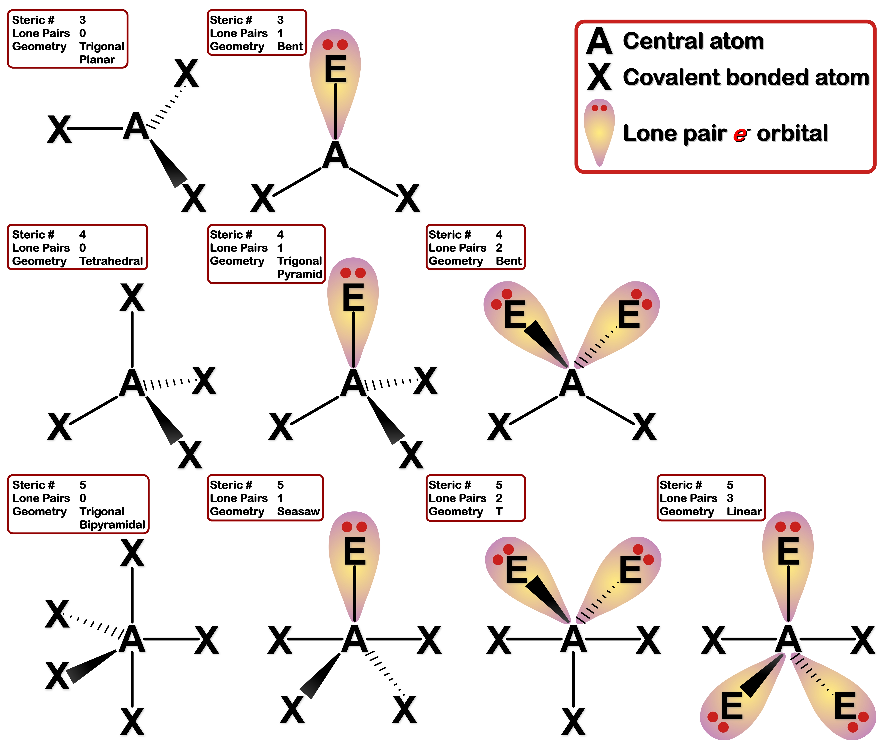
</figure>

<b><u>Figure 7</u>:</b> <b>VSEPR Geometries.</b> For a more interactive experience please consult the University of Colorado’s <b><a class="one" href="https://phet.colorado.edu/sims/html/molecule-shapes/latest/molecule-shapes_all.html" target="_blank" title="Go to PhET">PhET Simulations</a></b>.

<!-------------------------------------------------------------------->

<!-------------------------------------------------------------------->

<!-------------------------------------------------------------------->

**(i) AX2:** These linear molecules are the simplest molecular geometries. The two **bonding pairs** of electrons are positioned on opposite sides of the central atom. A good example of this type of geometry is CO<b>2</b>, which has two double bonded oxygen atoms. The high electron densities associated with the double bonds ensures optimal separation (i.e. 180° angle).
 
**(ii) AX3:** Molecules with three bonding pairs of electrons are arranged in a trigonal-planar fashion. The most stable positions coincide with the vertices of an equilateral triangle with a predicted 120° angle of separation. So all four atoms occupy the same imaginary plane (i.e. flat molecule). A good example of this type of **VSEPR** geometry is the carbonate ion (CO<b>3-2</b>), which plays an important role in cellular physiology and **biogeochemical cycles** (i.e. <b><a class="one" href="https://opc-project.netlify.app/project/prairie_soil_ecosystem/#Fig4CBS" target="_blank" title="Go to Soil Ecosystem">carbonate</a></b> chemistry).
 
**(iii) AX4:** This is one of the more familiar **VSEPR** groups since it includes tetra-valent elements like C (i.e. organic chemistry) and Si (i.e. geochemistry). These types of molecules have four bonding pairs of electrons (e.g. methane, CH<b>4</b>) that have bond angles of 109.5°. For methane the four H atoms occupy positions corresponding to the vertices of an imaginary tetrahedron (i.e. polygon with four equilateral triangular faces).
 
**(iv) AX5:** This trigonal bi-pyramid molecular structure (i.e. fusion of two three sided pyramids) is one of the more uncommon **VSEPR** shapes found in nature. Although there are few if any biomolecules with this type of covalent geometry, there are examples of metal co-ordinated complexes that take on a trigonal-bipyramidal geometry. One specific example is a metallo-enzyme known as **carbonic anhydrases**.<b>[45](#ref-supuran_carbonic_2003)</b>

<!-------------------------------------------->

<!------------ FIG 8 - VSEPR AX5 ------------->

<!-------------------------------------------->

<figure>

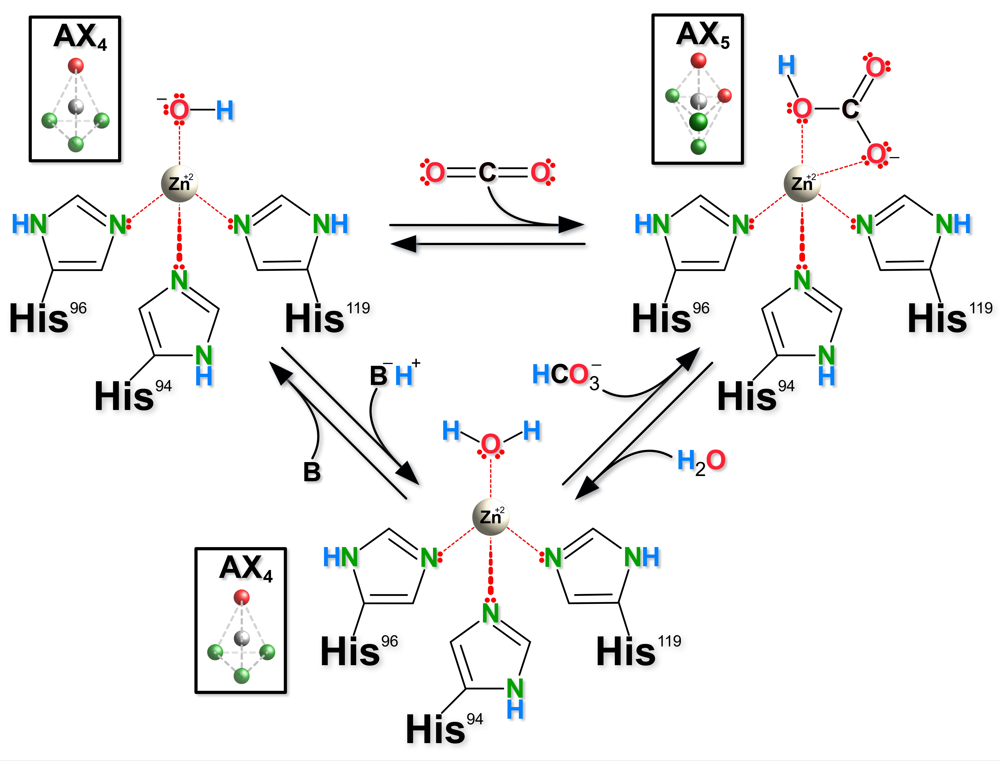
</figure>

<b><u>Figure 8</u>:</b> <b>Carbonic Anhydrase Active Site Geometry.</b>

<!-------------------------------------------------------------------->

<!-------------------------------------------------------------------->

<!-------------------------------------------------------------------->

Normally the active site of this enzyme (**Fig. 8**) co-ordinates the binding of a Zn**+2** cation using **electrostatic** interactions provided by a water group (**lone pair** of electrons in O) and three histidine residues (**lone pairs** of electrons belonging to N within each **histidine** side chain). However this normal <u>tetrahedral geometry</u> is disrupted when a **sulfonamide** <u>inhibitor</u> is introduced to the active site (**Fig. 9**). In its de-protonated state the soluble **sulfonamide** moiety replaces the water group and co-ordinates Zn**(II)** binding using two **lone pairs** of electrons belonging to O and S (i.e. bi-dentate binding mode). The introduction of an additional binding site to co-ordinate metal binding distorts the normal tetrahedral geometry in favour of a <u>trigonal-bipyramidal</u> geometry.<b>[46](#ref-wischeler_bidentate_2010)</b>

<!-------------------------------------------->

<!------------ FIG 9 - VSEPR AX6 ------------->

<!-------------------------------------------->

<figure>

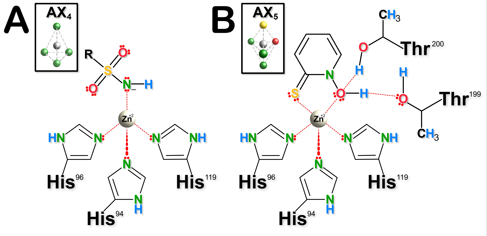
</figure>

<b><u>Figure 9</u>:</b> <b>Carbonic Anhydrase Inhibitors.</b>

<!-------------------------------------------------------------------->

<!-------------------------------------------------------------------->

<!-------------------------------------------------------------------->

A more classical example of this geometry is **phosphorus penta-chloride** (PCl**5**). This inorganic molecule has a central P atom which shares 5 bonding pairs of electrons with 5 Cl atoms. The surrounding Cl atoms occupy positions corresponding to the vertices of an imaginary trigonal bi-pyramid. Two atoms lie directly above and below the shared triangular base (i.e. 180° angle of separation), while the three equatorial atoms are separated by a bond angle of 120°.  
**(v) AX6:** Biomolecules with six bonding pairs of electrons are exceptionally rare species. These electron domains are positioned around a central atom as if they occupy the vertices of an imaginary octahedral polygon. The chemistry of biomolecules (i.e. C chemistry) is generally governed by the <u>octet rule</u>. Only elements found in the third period of the PT (e.g. S, P) have available 𝒹 orbitals that can accommodate more than eight electrons and form six bonds. However most of these are inorganic molecules (e.g. SF6). Nevertheless there are a number of vital biomolecules that form transition metal co-ordinated complexes that take on an octahedral shape (i.e. <b>AX<syb>6</b>). One example is the <b><a class="one" href="https://www.youtube.com/watch?v=l2_3ZMQUKC0" target="_blank" title="Siderophore video">siderophore</a></b> <b><a class="one" href="https://virtual-museum.soils.wisc.edu/display/ferrichrome/" target="_blank" title="Go to Virtual Museum of Minerals & Molecules">Ferrichrome</a></b> (**Fig. 10**).<b>[47](#ref-zalkin_crystal_1964),[48](#ref-winkelmann_ecology_2007)</b> This compound is produced by fungi to sequester extracellular sources of vital <b>iron</b> (Fe).

<figure id="FRight350">

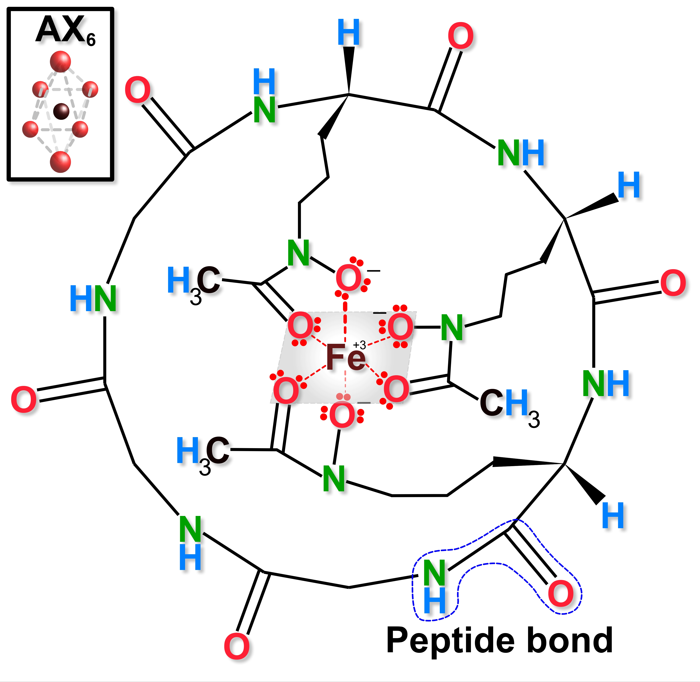
<figcaption>

<b>Figure 10</u>: Ferrichrome Siderophore.</b>
</figcaption>

</figure>

<figure id="FRight450">

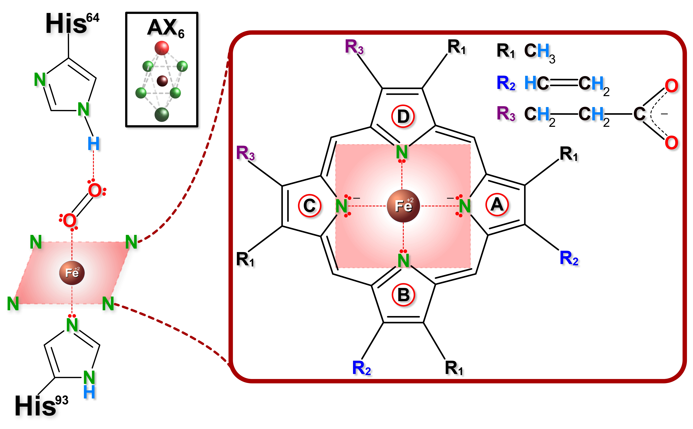
<figcaption>

<b>Figure 11: Heme (Protoporphyrin Fe complex)</b>
</figcaption>

</figure>

   Many other higher organisms also produce Fe sequestering molecules to carry out important biochemical processes (e.g. carrier proteins, enzymes that fight infection). Although the amounts of Fe and other transition metals (e.g. Co, Mn) present within living cells are very small, these cations catalyze reactions by virtue of their multi-valent nature (i.e. <b>redox</b> chemistry).<b>[49](#ref-montesdeoca_metal_2026)</b> They serve as important electron carriers within mitochondria (e.g. cytochrome c), as well as key catalysts in numerous biochemical reactions (e.g. catalases, peroxidases). Some of the more notable biomolecules that use Fe are **cytochromes** and **haemoglobins** (Hb). Both employ a <u>planar</u> tetra-dentate **porphyrin** ring (i.e. <u>four</u> **lone pairs** of electrons from four N atoms) as a prosthetic group to co-ordinate Fe**+2**/Fe**+3** binding. **Haemoglobins** use **porphyrins** and the side chains of centrally located amino acid residues to facilitate the binding of Fe. The former has four N that border a central hole that accommodates an iron cation (**Fig. 11**). Another more common name for the Fe **porphyrin** complex is **heme**. However, perhaps the most abundant octahedral shaped molecules in nature are the <b><a class="one" href="https://opc-project.netlify.app/project/prairie_soil_ecosystem/#Fig5SPhy" target="_blank" title="Go to Soil Ecology">alumina hydroxide</a></b> groups found in clay minerals.<b>[50](#ref-Thair_Clays_2008),[51](#ref-bergaya_clays_2011)</b> The octahedral geometry of these inorganic metal hydroxides are held together by ionic bonds. The angles of separation between the central and peripheral atoms is 90° for the equatorial positioned atoms (square base) and 180° for the axial oriented atoms that occupy the “<i>peaks</i>” of the two imaginary four sided pyramids.  
**(vi) AX2E:** This is the first of a series of molecular geometries involving non-bonding valence shell electrons. One of the assumptions of the **VSEPR** model is that all bonding electron pairs (i.e. single, double, triple) are treated as simple single bonds. For example, sulphur dioxide (SO**2**) has two double bonded oxygen atoms as well as one **lone pair** of electrons surrounding the central sulphur atom. One may assume that the planar arrangement of the three electron **domains** (i.e. two bonding and one **lone pair**) results in a 120° angle of separation between the two O atoms. However the **lone pair** electron **domain** exerts a strong repulsive force on the two neighbouring O atoms resulting in an angle of separation of <u>less than</u> 120° (i.e. slightly bent boomerang-like shape). 
**(vii) AX3E:** This is the second molecular geometry involving non-bonding VE. The presence of the four **electron domains** suggests a tetrahedral type of arrangement for the peripheral atoms. However the presence of slightly more repulsive **lone pair** results in a trigonal pyramidal arrangement for the bonded atoms. A good example of this molecular geometry is ammonia (NH**3**). Again the **lone pair** exerts a strong repulsive **electrostatic** force on the neighbouring bonding **electron domains**. The overall trigonal pyramidal shape of NH**3** has the central N atom occupying the peak of an imaginary pyramid, while the three H atoms occupy the vertices of the pyramid’s triangular base. The repulsive **electrostatic** forces of the **lone pair** of electrons reduces the bond angles separating the three H atoms to ~107° instead of 109.5°.
 
**(viii) AX2E2:** The four **electron domains** are arranged in a tetrahedral-like fashion around the central atom. The water molecule (H**2**O) is the simple example of this type of molecular geometry. The central O atom has two single bonded H atoms that are separated from each other by an angle of 104.5°. This reduced bond angle is due to the strong repulsive **electrostatic** forces exerted by two **lone pairs**. As a consequence the shape of a water molecule is noticeably asymmetric, which results in a net dipole moment (i.e. polar molecule).
 
    Overall **VSEPR** provides a relatively simple and effective way to model non-metallic molecular geometries that have one central atom. However, most biomolecules have multiple bonding “<i>centres</i>”. This introduces problems since the theory itself can not solve such complex multi-body systems. Nevertheless VSEPR can serve as a guide even though it is limited to one central atom at a time. Certainly larger structural patterns do emerge when computational tools are used to model molecules (e.g. <b><a class="one" href="https://jp-minerals.org/vesta/en/" target="_blank" title="Go to VESTA">VESTA</a></b>), such as the extended polygon-like geometries of <b><a class="one" href="https://opc-project.netlify.app/project/prairie_soil_ecosystem/#Fig5SPhy" target="_blank" title="Go to OPC Soil Ecology">clay minerals</a></b>.

  **4.2 VALENCE BOND THEORY (VBT)**  **:** VBT, unlike VSEPR, assumes that **valence electrons** (VE) occupy different types of atomic orbitals (AO) with different bonding properties (e.g. energies, lengths). It addresses these issues by introducing new concepts, specifically <u>resonance energy</u> and <u>hybridization</u> of AO to explain chemical bonding behaviour in a very localized and intuitive manner.<b>[52](#ref-heitler_wechselwirkung_1927)–[55](#ref-pauling_nature_1960)</b> For example based on the electronic configuration of C (\[He\] **2𝓈22**𝓅**2**) we know that it can form a maximum of four covalent bonds (i.e. **tetravalent**). These four VE are clearly assigned to two different types of atomic orbitals (i.e. 𝓈 and 𝓅) that vary in shape, length and orientation. Therefore one might suspect that a molecule like methane (CH**4**) must form different types of covalent bonds based on the different types of atomic orbitals. However experiments clearly show that all four covalent bonds in methane are essentially identical in bond length, strength and separation angle. As a result VBT proposes that four identical hybrid orbitals, called sp3 orbitals, are generated via the fusion of one 𝓈 and three 𝓅 type AO. As detailed below VBT also allows for fewer AO to undergo hybridization in order to explain multi-bond types (i.e. double and triple bonds).

I. Hybrid sp3 Orbitals: Given that all life is largely based on carbon chemistry it should therefore come as no surprise that virtually all large organic molecules are built using sp3 hybrid orbitals. Methane (CH4), being the simplest of all organic molecules, is a good example of this type of hybridization. The normal VE configuration of C (\[He\] **2𝓈22**𝓅**2**) is:

↑↓     ↑   ↑    
 
  2𝓈       2𝓅<b>x</b>   2𝓅<b>y</b>   2𝓅<b>z</b>

When the 𝓈 and 𝓅 atomic orbitals undergo hybridization the valence electrons take on the following electronic configuration:

↑ ↑ ↑ ↑
 
\\ ~~———————~~ /
 
4 sp3 orbitals

According to the VB theory the energy required to cause orbital hybridization is more than compensated for by the energy released when C**-**H bonds are formed (Recall: bond formation is an exothermic process, **Eqn. 18**). Since the four sp3 hybrid orbitals have identical bond strength and bond separation angles (i.e. 109.5°) the resulting molecular geometry has each covalent bond directed toward the corners of an imaginary regular <u>tetrahedron</u>. The same sp3 geometry is also found in many inorganic molecules like ammonia (NH3) and water (H2O). Both of these molecules have lone pairs of electrons occupying the hybrid orbital system. Their presence generates additional repulsive electrostatic forces that distort covalent bond angles. Specifically the normal 109.5° bond angles seen in methane are reduced to 107.3° and 104.5° for ammonia and water respectively. The electronic configuration of native N (\[He\]**2𝓈22**𝓅**3**) and O (\[He\]**2𝓈2**𝓅**4**) and their respective hybrid orbitals used to bond with H are shown below.

↑↓     ↑   ↑   ↑             ↑↓     ↑↓   ↑   ↑  
 
2𝓈       2𝓅<b>x</b>   2𝓅<b>y</b>   2𝓅<b>z</b>             2𝓈       2𝓅<b>x</b>   2𝓅<b>y</b>   2𝓅<b>z</b>

↑↓ ↑ ↑ ↑                   ↑↓ ↑↓ ↑ ↑
 
\\ ~~———————~~ /                 \\ ~~———————~~ /
 
4 sp3 orbitals (1 lone pair)       4 sp3 orbitals (2 lone pairs)

II. Hybrid sp2 Orbitals: Unsaturated organic molecules that have a planar geometry (e.g. benzene) are built using sp2 hybrid orbitals. Ethylene (C2H4) is the simplest example of this type of molecule. Although carbon has four valence electrons not all of them (under this scenario) take part in the hybridization process. As shown below the 2𝓅x and 2𝓅y orbitals combine with the 2𝓈 orbital while the 2𝓅z orbital remains unchanged during the hybridization process. For each carbon two of the three sp2 hybrid orbitals form bonds with the 1𝓈 orbitals of H atoms, while the remaining sp2 hybrid orbital of each C atom overlap with one another to form an additional covalent bond. The four sp2-𝓈 and lone sp2-sp2 covalent bonds are generated by end-to-end orbital overlap directly between the atoms, which is termed a sigma bond (i.e. `\(\large \sigma\)`). The remaining 2𝓅z orbital of each carbon atom also combine with one another, in a sideways manner, to form a new type of chemical bond known as a `\(\large \pi\)` bond. The electron density that defines this type of covalent bond is concentrated above and below the imaginary plane of the `\(\large \sigma\)`-bonding framework. So the resulting orbital overlap is, as mentioned above, accommodated in a <u>sideways</u> fashion. The overall configuration of the `\(\large \sigma\)` and `\(\large \pi\)` bonds is somewhat analogous to a “<i>hotdog-and-bun</i>”, with the `\(\sigma\)` bond serving as the “<i>hotdog</i>” and the `\(\large \pi\)` bond acting as the “<i>bun</i>” (refer to: **Fig. 21**).

Step 1. Ground State
 
↑↓     ↑   ↑    
 
2𝓈         2𝓅 orbitals  
 
 
Step 2. Promotion of electron:
 
↑     ↑   ↑   ↑
 
2𝓈         2𝓅 orbitals  
 
 
Step 3. Hybridization of 2𝓈 and two 2𝓅 orbitals:
 
↑ ↑ ↑     ↑
 
\\ ~~—————~~ /       pz  
 
  sp2            

III. Hybrid sp Orbitals: Linear molecules that contain carbon-carbon triple bonds have sp hybrid orbitals. Acetylene (C2H2) is the simplest organic molecule that has this type of hybrid bonding orbital. As shown below the 2𝓈 and 2𝓅x orbitals of carbon undergo hybridization, while its 2𝓅y and 2𝓅z orbitals remain unhybridized. The two sp hybrid orbitals form two different types of `\(\large \sigma\)` bonds, one overlapping end-to-end with a neighbouring 1𝓈 orbitals of H, and the other overlapping end-to-end with with the sp hybrid orbital of the adjacent carbon atom. The remaining 2𝓅y and 2𝓅z orbitals of each carbon overlap with one another, respectively, to form two `\(\large \pi\)` bonds. The two sp hybrid orbitals lie on opposite sides of each carbon atom resulting in a bond angle of 180°.

Step 1. Ground State
 
↑↓     ↑   ↑    
 
2𝓈         2𝓅 orbitals  
 
 
Step 2. Promotion of electron:
 
↑     ↑   ↑   ↑
 
2𝓈         2𝓅 orbitals  
 
 
Step 3. Hybridization of 2𝓈 and 2𝓅 orbitals:
 
↑ ↑     ↑     ↑
 
  \\ ~~——–~~ /     𝓅y       𝓅z    
 
sp                    

IV. Hybrid sp3d and sp3d2 Orbitals: Most elements associated with organic molecules are found within the first three periods of the PT (**Fig. 1**). These common elements generally follow the **octet rule**. However, some of the heavier elements (i.e. 3rd period and beyond) can make use of 𝒹 type orbitals during the hybridization process. One example of this is **phosphorus penta-chloride** (PCl**5**). The electron configuration of P (i.e. <b>\[</b>Ne<b>\]</b><b>3𝓈2</b><b>3𝓅3</b>) has <u>five</u> VE, as would be expected of a **Group V** element of the PT (**Fig. 1**). The **Lewis** structure of PCl**5** shows five covalent bonds (i.e. 10 electron pairs). Clearly the lone <b>3𝓈</b> and three <b>3</b>𝓅 orbitals are not enough to account for such a molecular structure (i.e. **AX5** trigonal bi-pyramid). The only other available orbitals within the 3rd energy level are 𝒹 type orbitals. The fact that the <b>3</b>𝒹 orbitals are relatively close in energy to the <b>3𝓈</b> and <b>3</b>𝓅 orbitals allows for the promotion of one <b>3𝓈</b> electron to a <b>3</b>𝒹 orbitals. Here the **octet rule** fails us since there are five bonding electron pairs. As shown below the P atom is sp3d hybridized in PCl**5**.

Step 1. Ground State
 
↑↓         ↑   ↑   ↑                          
 
3𝓈                   3𝓅                                       3𝒹                
 

Step 2. Promotion of electron:
 
↑         ↑   ↑   ↑         ↑                
 
3𝓈                   3𝓅                                       3𝒹                
 

Step 3. Hybridization of 3𝓈, 3𝓅 and 3𝒹 orbitals:
 
      ↑   ↑   ↑   ↑   ↑                              
 
\\ ~~————————————~~ /                             3𝒹          
 
sp3d                                              
 

SF**6** is another example of a hybridization scheme involving 𝒹 type orbitals. S, unlike P, is a member of the **Group VI** family of elements (**Fig. 1**). Its electron configuration (i.e. <b>\[</b>Ne<b>\]</b><b>3𝓈2</b><b>3𝓅4</b>) has <u>six</u> VE. The **Lewis** structure of SF**6** (i.e. **AX6** octahedral) shows six covalent bonds (i.e. 12 electron pairs), which also violates the **octet rule**. This unique electron configuration can not be accounted for by combining only <b>3𝓈</b> and <b>3</b>𝓅 orbitals. Here, like in the previous example, <b>3</b>𝒹 type orbitals are employed. However, unlike the previous example, more than one <b>3</b>𝒹 type orbital is used in the hybridization process. As shown below the S atom is sp3d2 hybridized in the SF**6** molecule.

Step 1. Ground State
 
↑↓         ↑↓   ↑   ↑                          
 
3𝓈                   3𝓅                                      3𝒹                
 

Step 2. Promotion of electrons:
 
↑         ↑   ↑   ↑         ↑   ↑            
 
3𝓈                   3𝓅                                      3𝒹                
 

Step 3. Hybridization of 3s, 3p and 3d orbitals:
 
  ↑   ↑   ↑   ↑   ↑   ↑                          
 
\\ ~~———————————————~~ /                         3𝒹          
 
sp3d2                                          
 

  **4.2.1 VBT & HYBRIDIZATION**  **:** **Walter Heitler** and **Fritz London** (1927), along with **Linus Pauling** (1931) and **John Slater** (1931) pioneered the use of quantum mechanics to model covalent bonds.<b>[52](#ref-heitler_wechselwirkung_1927)–[54](#ref-slater_directed_1931)</b> For **Pauling** (1931) the identical covalent bonds of carbon is due to <u>resonance hybridization</u> of the four atomic orbitals (AO). Even though the VE of carbon are found in different sub-shells (i.e. 𝓈 and 𝓅) they have to be assimilated somehow to account for the experimental evidence. **Heitler** and **London** (1927) provided the first important quantum model of valence bonds based on the assumption that covalent bonds are the product of electron orbital <u>overlap</u>. Since an electron orbital is defined by its <u>wave function</u> it therefore follows that the strength of a bond is dependent on the degree of <u>overlap</u> between atomic wave functions (i.e. constructive interference).<b>[53](#ref-pauling_nature_1931-1)</b>  
    According to **Pauling** hybrid orbitals provide atoms with greater “<i>reach</i>”, which helps facilitate orbital overlap. Greater orbital overlap means more energy exchange between atoms, which increases the strength and stability of the chemical bond.<b>[53](#ref-pauling_nature_1931-1),[55](#ref-pauling_nature_1960)</b> **Pauling** used this hybridization concept to describe the simultaneous covalent and ionic character of chemical bonds.

> “<i>With the aid of the quantum mechanics there is formulated a set of rules regarding electron-pair bonds, dealing particularly with the strength of bonds in relation to the nature of the single-electron <u>eigenfunctions</u> involved. It is shown that one single-electron eigenfuntion on each of two atoms determines essentially the nature of the electron-pair bond formed between them; this effect is accentuated by the phenomenon of concentration of the bond eigenfunctions….From <b>s</b> and <b>p</b> eigenfunctions the best bond eigenfunctions which can be made are four equivalent tetrahedral eigenfunction, giving bonds directed toward the corners of a regular tetrahedron.</i>.”<b>[53](#ref-pauling_nature_1931-1)</b>

Wave functions that describe stable chemical structures involve statistical calculations of possible quantum states (e.g. `\(\psi_{\text o} = a \phantom{.}\psi_1 + b \phantom{.} \psi_2\)`). The <u>ratio</u> of the <u>numerical</u> scalar factors (i.e. coefficients) associated with each wave function (e.g. a/b) can provide information about the contribution of each quantum state to the overall chemical structure.<b>[53](#ref-pauling_nature_1931-1),[55](#ref-pauling_nature_1960)</b> For example, if the scalar <u>ratio</u> a/b is large then `\(\psi_1\)` will contribute significantly to the overall structure. Conversely if a/b is very small then `\(\psi_2\)` will make the most significant contribution to the molecular structure. However, if the value of a/b is close to unity then both quantum states described by `\(\psi_1\)` and `\(\psi_2\)` contribute equally to the chemical structure. In the latter scenario the “true” chemical structure is said to be a <u>resonance hybrid</u> of these two quantum states.<b>[53](#ref-pauling_nature_1931-1),[55](#ref-pauling_nature_1960)</b> This quantum behaviour can be modelled mathematically by defining the wave function of the system as:

`$$\tag{19} \\ \large \psi_{_\text{o}} \normalsize \phantom{.} = \phantom{.}  a \, \large \psi_{_\text{I}} \normalsize \; + \; b \, \large \psi_{_\text{II}} \normalsize \; + \; c \, \large \psi_{_\text{III}} \normalsize \phantom{..} ..... \, c_n \large \psi_n$$`

**Werner Heisenberg** (1926) was the first to suggest that a chemical element <b>resonates</b> between different quantum states.<b>[56](#ref-heisenberg_uber_1926)</b> His use of a virtual <b><a class="one" href="https://opc-project.netlify.app/project/opcchemprimer2_atom/#SHOmodel" target="_blank" title="Go to ChemPrimer2">harmonic oscillator</a></b> to approximate an <b>anharmonic</b> system (i.e. deviates from a simple harmonic oscillator) is an important concept in quantum mechanics. For example the H<b>2</b> molecule is made up of 2 protons and 2 electrons. For convenience we can arbitrarily label the individual atoms **A** and **B**, and the individual electrons **a** and **b**. If the distance separating the two nuclei is relatively large then there is a slight attraction between the two neutral atoms (repulsive energy is negligible). However, when the inter-nuclear distance is small the repulsive **electrostatic** energy becomes dominant. Neither of these scenarios are favourable bonding states. However if we consider all <u>possible</u> quantum states then atom **A** could be coupled to electron **b**, while atom **B** could be coupled to electron **a**. Other possible configurations would include both electrons coupled to a single atom (i.e. structure 3 and 4). These different quantum states can be represented as follows:

`$$\tag{20}$$`

`$$\begin{align*} \large \text{Quantum State I:} \normalsize & \phantom{...} \text{structure 1} \phantom{..} \Longrightarrow \phantom{..} H^+_A \cdot e^-_a \phantom{.......} H^+_B \cdot e^-_b \\[5px] \large \text{Quantum State II:} \normalsize & \phantom{...} \text{structure 2} \phantom{..} \Longrightarrow \phantom{..} H^+_A \cdot e^-_b \phantom{.......} H^+_B \cdot e^-_a \\[5px] \large \text{Quantum State III:} \normalsize & \phantom{...} \text{structure 3} \phantom{..} \Longrightarrow \phantom{..} H^+_A \cdot e^-_a \cdot e^-_b \phantom{...} H^+_B \\[5px] \large \text{Quantum State IV:} \normalsize & \phantom{...} \text{structure 4} \phantom{..} \Longrightarrow \phantom{..} H^+_A \phantom{...........} H^+_B \cdot e^-_a \cdot e^-_b \end{align*}$$`

The contribution of each quantum state to the overall structure is directly related to their energy states (i.e. stability of each quantum state). If the electrostatic interactions are favourable such that they overcome the repulsive proton-proton forces then an energy minimum emerges that represents a <u>bound state</u> (i.e. stable chemical bond). This stable state is characterized by an optimal separation distance between the two bonding hydrogen atoms. If the atoms move toward each other the repulsive **electrostatic** energy rises exponentially. Conversely if the two atoms move away from each other than the attractive **electrostatic** energy slowly increases. So we can view the covalent bond of H**2** as being a hybrid **resonance** structure where the electrons <u>oscillates</u> between the two nuclei, which is somewhat analogous to a <b><a class="one" href="https://opc-project.netlify.app/project/opcchemprimer2_atom/#SHOmodel" target="_blank" title="Go to ChemPrimer2">simple harmonic oscillator</a></b>. The resulting overlap between the hybrid orbitals (i.e. <u>constructive interference</u> operating) creates a stable chemical bond.

  **4.2.2 VBT & Electronegativity**  **:** The concept of **electronegativity** can be mathematically represented in the form of two **eigenfunctions**. One defines the chemical bond between identical atoms (i.e. homo-diatomic molecule) and the other the chemical bond between two different atoms (i.e. hetero-diatomic molecule). The differences in these two chemical bonds can be largely attributed to their varying **electro-negative** character. For convenience we can arbitrarily designate our two diatomic molecules as **A–A** and **A–B**. Mathematically this can be represented as:

`$$\tag{21}$$`

`$$\\[10px] \begin{align*} \text{Homo-diatomic} \phantom{.} & \Longrightarrow \phantom{.} \large \psi_{(\text{AA})} \normalsize \phantom{.} = \phantom{.} \large a \, \psi_{(\text A -\text A)} \normalsize \phantom{.} + \phantom{.} \large b \, \psi_{(\text A^+ - \text A^-)} \normalsize \; + \; \large b \, \psi_{(\text A^{-} - \text A^+ )} \\[5px] \text{Hetero-diatomic} \phantom{.} & \Longrightarrow \phantom{.} \large \psi_{(\text{AB})} \normalsize \phantom{.} = \phantom{.} \large c \, \psi_{(\text A - \text B)} \normalsize \; + \; \large d \, \psi_{(\text A^+ - \text B^-)} \normalsize \; + \; \large e \, \psi_{(\text A^{-} - \text B^+)} \end{align*}$$`

The **eigenvalue** ratio **b/a**, which determines the contribution of the ionic structure(s), is very small for a purely covalent bonded homo-diatomic molecule **A–A**. However **A–B** has two different atoms with potentially very different **electro-negative** values. Here the <b>eigenvalue</b> ratio **d/c** and **e/c** will be very different when compared to **b/a**. The contribution made by ionic <b>resonance energy</b> (e.g. `\(\psi_{\text A^+ - \text B^-}\)`) combined with the energy of the normal covalent bonded state (`\(\psi_{\text A - \text B}\)`) is likely intermediate in value between **A–A** and **B–B**. According to this scenario the <u>arithmetic</u> mean of the `\(Energy \, (\text A - \text A)\)` and `\(Energy \, (\text B - \text B)\)` should approximate the normal covalent bond `\(Energy \, (\text A - \text B)\)`.<b>[55](#ref-pauling_nature_1960),[57](#ref-pauling_additivity_1932)</b> As a consequence **Pauling** devised an <i><u>additivity</u></i> concept where the actual bond energy of `\(Energy \, (\text A - \text B)\)` would always be greater than or equal to the <u>arithmetic</u> mean of the corresponding symmetrical bond energies.

`$$\tag{22}$$`

`$$\\ \large \Delta \normalsize \phantom{.} = \phantom{.} Energy \, (\text A - \text B) \; - \; \frac{1}{2} \Big( Energy \, (\text A - \text A) \; + \; Energy \, (\text B - \text B) \Big) \\[5px] \large Ionic \; Resonance \; Energy \; \normalsize (\text A - \text B) \normalsize \phantom{..} \Longrightarrow \phantom{..} \large \Delta \, \ge \, 0 \\$$`

However **Pauling** noted that not all molecules obey the <u>additivity</u> rule.<b>[55](#ref-pauling_nature_1960)</b> For example **alkali metals** form not only common salts, but also **hydrides** and homo-diatomic molecules (e.g. Li**–**Cl, Li**–**H, Li**–**Li). The covalent bonds holding together the homo-diatomic **alkali metals** are very weak, and the **metal hydrides** have ionic character (e.g. Li**–**H). Since the Δ values for some of these metal hydrides are negative an alternative <u>geometric mean</u> postulate was devised where the <u>geometric mean</u> (i.e. square root of the product) is used instead of the <u>arithmetic mean</u> for the ionic resonance energy calculations.

`$$\tag{23}$$`

`$$\\ \large \Delta' \normalsize \phantom{.} = \phantom{.} Energy (\text{A} - \text{B}) \; - \; \sqrt{\Big[ \, Energy(\text{A} - \text{A}) \; \Big] \Big[ \; Energy(\text{B} - \text{B}) \, \Big]} \\[5px] \large Ionic \; Resonance \; Energy \; \normalsize \text{(A} - \text{B)} \phantom{..} \Longrightarrow \phantom{..} \large \Delta' \normalsize \, \ge \, 0 \\$$`

So according to the *<u>geometric mean</u>* rule the ionic resonance energy of an asymmetrical covalent bond, like the one found in Li**–**H, can be defined by Δ′. In fact **Pauling** stated that Δ′ is likely a more satisfactory measure of covalent bond energy between different atoms. He also refined his calculations of <b>electronegativity</b> (Χ) by taking the square root value of Δ′ expressed in units of 30 kcal/mole (Note: previously used 1 eV units = 23 kcal/mol).

`$$\tag{24}$$`
`$$\\ \big| \large \chi_{_A} \normalsize \; - \; \large \chi_{_B} \normalsize \big| \normalsize \phantom{.} = \phantom{.} \large \sqrt{\frac{\Delta'}{30}} \\[10px] \large \Delta' \normalsize \phantom{.} = \phantom{.} \large 30 \normalsize \cdot \big| \large \chi_{_A} \normalsize \; - \; \large \chi_{_B} \normalsize \big|^{2} \\$$`

By combining the two equations above the covalent bond energy between two different atoms Energy(A-B) can be now be represented as the <u>difference</u> in the Χ values of two atoms (**Eqn. 25**). Because the new formula is based on <u>differences</u> in Χ values that means if you assign a reference value to a particular element (i.e. standard) then individual Χ values for all the other chemical elements can be calculated. Based on this logic **Pauling** assigned F**luorine**, the most **electro-negative** element within the Periodic Table, a ΧF value of 4.<b>[55](#ref-pauling_nature_1960)</b>

`$$\tag{25}$$`

`$$\\ \\[15px] \large \Delta' \normalsize \phantom{.} = \phantom{.} Energy \, (\text{A} - \text{B}) \; - \; \sqrt{ \Big[ \, Energy(\text{A} - \text{A}) \, \Big] \Big[ \, Energy(\text{B} - \text{B}) \, \Big] } \phantom{.} = \phantom{.} 30 \cdot \big| \chi_{_A} \; - \; \chi_{_B} \big|^{2} \\[10px] Energy (\text{A} - \text{B}) \phantom{.} = \phantom{.} \sqrt{ \, \Big[ Energy(\text{A} - \text{A}) \, \Big] \Big[ \; Energy(\text{B} - \text{B}) \, \Big]} \; + \; 30 \normalsize \cdot \big| \chi_{_A} \; - \; \chi_{_B} \big|^{2} \\$$`

  **4.2.3 VBT - σ & π Bonds**  **:** As discussed above orbital overlap is a measure of the amount of shared electron density between atoms that determines the strength of a covalent bond. Although the radial distance of an orbital is central to this concept, so too is the <u>direction</u> in which the bonding orbital is concentrated. This spatial information is described by the molecule’s <b><a class="one" href="https://opc-project.netlify.app/project/opcchemprimer2_atom/#SHfunc" target="_blank" title="Go to ChemPrimer2">Spherical harmonic</a></b> function (Y𝓁,m𝓁(θ, ϕ)). For example an electron in a 𝓈 orbital has an equal probability of being found at any point along its radially defined surface. However electrons occupying 𝓅 type orbitals are more highly concentrated along one of three **Cartesian** axes (i.e. 𝓅x, 𝓅y, 𝓅z). This spatial bias affects the extent of orbital overlap between two atoms. In fact because the radial part of 𝓈 and 𝓅 type orbitals are so similar any differences in their bond strength can be largely attributed to the directional characteristics of the hybrid orbitals (e.g. sp3 hybrid orbital = 25% 𝓈+ 75% 𝓅 orbital). Differences in their spatial geometry results in different bond energies: (i) 𝓈-𝓅 based bonds are ~1.73 times greater than a 𝓈-𝓈 based bond; (ii) 𝓅-𝓅 bond energy is ~3 times greater than that of 𝓈-𝓈 based bonds. Clearly the relative bond strength is enhanced by the hybridization process since the electron density of hybrid orbitals are often concentrated within the inter-nuclear bonding region (e.g. 75% 𝓅 type character of sp3 hybrid orbitals means more electron density within the inter-nuclear region where `\(\large \sigma\)`-bonding takes place).

<!----------------------------------------------------------->

<!------------ FIG 12 - S & P HYBRID ORIBITALS  ------------->

<!----------------------------------------------------------->

<figure>

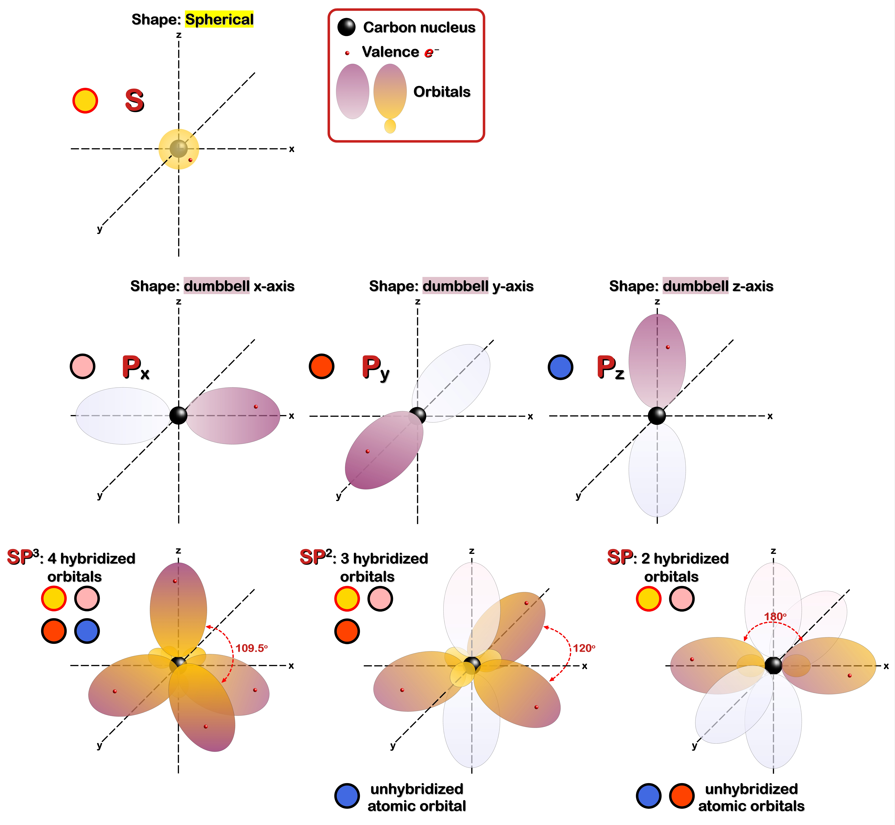
</figure>

<b><u>Figure 12</u>: Hybrid Molecular Orbitals.</b>

<!-------------------------------------------------------------------->

<!-------------------------------------------------------------------->

<!-------------------------------------------------------------------->

  **4.3 MOLECULAR ORBITAL THEORY (MOT)**  **:** MOT was pioneered by many important scientists, including (among others) **Fredrich Hund** (1926),<b>[18](#ref-hund_linienspektren_1927),[27](#ref-hund_zur_1926),[29](#ref-hund_zur_1928)</b>, **Robert S. Mulliken** (1926),<b>[58](#ref-mulliken_electronic_1926)–[61](#ref-mulliken_electronic_1932)</b> and **J.E. Leonnard-Jones** (1929).<b>[62](#ref-lennard-jones_electronic_1929),[63](#ref-lennard-jones_molecular_1949)</b> MOT uses wave functions to describe electrons in relation to the entire molecule (i.e. electronic structure and reactivity). Unlike VBT it does not restrict valence electrons (VE) to the inter-nuclear space between atoms, as typified by **Lewis** structures, but rather takes into account the delocalized nature of electrons. This key feature of MOT was previously touched upon when describing biomolecules with conjugated double bond systems like <b><a class="one" href="https://opc-project.netlify.app/project/pnps/#Phenolics" target="_blank" title="Go to Plant Natural Products">phenolics</a></b>. The most powerful explanatory tool of MOT is perhaps MO diagrams, which shows VE being placed within <u>pro-bonding</u> and <u>anti-bonding</u> MO in accordance with **Bohr’s** *Aufbau Principle*. MO are the result of the linear combination of atomic orbitals (LCAO). For example, the MO diagram of H<b>2</b> (**Fig. 13**), a relatively simple homo-nuclear diatomic molecule, shows two 1𝓈 atomic orbitals (AO) giving rise to two MO (i.e. <u>bonding</u> and <u>anti-bonding</u>). The bonding MO is the product of <u>constructive interference</u> (i.e. wave functions are in-phase), while the <u>anti-bonding</u> MO is a product of <u>destructive interference</u> (i.e. wave functions are out-of-phase). A simple mathematically representation of MO are shown below.

`$$\tag{26} \\ \large \text{Molecular Orbital} \normalsize \phantom{.} \Rightarrow \phantom{.} \psi_{\pm} \phantom{.} = \phantom{.} 1 \text s_{\text A} \; \pm \; 1 \text s_{\text B} \\[10px] \large \text{Linear Combination of Atomic Orbitals} \; \text{(LCAO)} \\[10 px] \overbrace{\large \psi_{+} \normalsize \phantom{.} = \phantom{.} \text{c}_1 \Big( \text{1s}_{\text A} \; + \; \text{1s}_{\text B} \Big)}^{Bonding} \phantom{...} \text{and} \phantom{...} \overbrace{\large \psi_{-} \normalsize \phantom{.} = \phantom{.} \text{c}_2 \Big( \text{1s}_{\text A} \; - \; \text{1s}_{\text B} \Big)}^{Anti-Bonding}$$`

Constructive interference of the 1𝓈 wave functions (i.e. in-phase) produces a `\(\large \sigma\)` (“sigma”) bond, while destructive interference of the 1𝓈 wave functions (i.e. out-of-phase) produces a `\(\large \sigma^*\)` (“sigma star”) anti-bonding MO (<b>Fig. 13</b>). The <u>electron density distribution</u> of these two types of MO are symmetrically arranged along a line connecting the two nuclei. Specifically the `\(\large \sigma\)` bonding orbital is concentrated between the two atoms, while the `\(\large \sigma^*\)` anti-bonding orbital forms a <u>node</u> (i.e. electron density is zero) in the same inter-nuclear region. An <u>exact</u> mathematically solution of the <u>electron density distribution</u> of a MO is possible, but only for the simplest quantum systems (i.e. H<b>2</b>+). Nevertheless MOT can explain some properties of molecules that VBT can not, such as the para-magnetism of molecular oxygen. As mentioned previously in <b><a class="one" href="https://opc-project.netlify.app/project/opcchemprimer2_atom/#MaxBorn" target="_blank" title="Go to ChemPrimer2">ChemPrimer2</a></b> <b>Max Born</b> (1926) provided a statistical interpretation of <b>Schrodinger’s</b> (1926) wave equation that calculates the probability of observing a particular experimental outcome. Specifically <b>Born</b> produced an <u>expectation value</u> using the absolute value of the square of the magnitude of the underlying wave function. This value is proportional to the <b>probability density</b> of finding a particle within a given region of space.<b>[3](#ref-born_zur_1926-1),[4](#ref-born_zur_1926),[64](#ref-pais_max_1982)</b> Such a relationship can be expressed mathematically as:

`$$\tag{27}$$`

`$$\\ \text{Probability (P):} \phantom{..} \text{P}(x \in [a, b]) \phantom{.} = \phantom{.} pdf \cdot dx \\ \Big( \text{Probability Density function:} \; pdf, \phantom{.} \text{Complex Conjugate wave function:} \; \large \psi^*_{\normalsize \text{(x,t)}} \normalsize \Big) \\[5px] pdf \cdot dx \phantom{.} = \phantom{.} \int^b_a \Big| \large \psi_{\normalsize \text{(x,t)}} \normalsize \Big|^2 \, dx \phantom{..} \Longrightarrow \phantom{.} \int_{-\infty}^{+\infty} \large \psi^*_{\normalsize \text{(x,t)}} \normalsize \, \large \psi^{\phantom{.}}_{\normalsize \text{(x,t)}} \normalsize \, dx \phantom{.} = \phantom{.} 1 \\ x \in [a, b] \phantom{.} \Longrightarrow \phantom{.} x \; \text{is an element of a region defined by} \; a \; \text{and} \; b$$`

As shown above (**Eqn. 27**) the probability of finding the electron in a given region of space (`\(dx\)`) is calculated by taking the definite integral of `\(\big|\psi_{\text{(x,t)}} \big|^2\)`. This squared quantity (i.e. product of the wave function and its complex conjugate) produces a <b>probability density function</b>. When this function is integrated over <u>all possible space</u> the solution is 1 (i.e. 100% probability of finding the electron somewhere). When these functions are <u>normalized</u> the magnitude of the coefficients (<b>Eqn. 28</b>) provide a measure of the <u>contribution</u> that each AO makes to the MO. For homo-nuclear molecules (e.g. O2) the magnitude of the coefficients are the same. However, in hetero-nuclear molecules (e.g. HCl) the magnitude and/or sign of the coefficient of each wave function are different since the AO they describe are not the same.

`$$\tag{28} \\ \large \text{Linear Combination of Atomic Orbitals} \; \text{(LCAO):} \\[10px] \overbrace{\large \psi_1 \normalsize \phantom{.} = \phantom{.} \text a_1 \, \text{2s} \; + \; \text b_1 \, \text{2p}_z}^{Bonding} \phantom{...} \text{and} \phantom{...} \overbrace{\large \psi_2 \normalsize \phantom{.} = \phantom{.} \text a_1 \, \text{2s} \; - \; \text b_1 \, \text{2p}_z}^{Anti-Bonding}$$`

If we take the square of `\(\psi_1\)` and expand it we get the following expression:

`$$\tag{29} \\ \large \psi_{\normalsize 1}^2 \normalsize \phantom{.} = \phantom{.} \big( \phantom{.} \text{a}_1 \, \text{2s} \; + \; \text{b}_1 \, \text{2p}_z \big)^2 \phantom{.} = \phantom{.} \big(\text{a}_1 \, \text{2s} \big)^2 \; + \; \big( \text{b}_1 \, \text{2p}_z \big)^2 \; + \; 2 \text{a}_1 \text{b}_1 \big( \text{2s} \, \text{2p}_z \big)$$`

This combination of atomic orbitals (**Eqn. 29**) produces an additional term:

`$$\tag{29.1} \\ 2 \text{a}_1 \text{b}_1 \big( \text{2s} \phantom{.} \text{2p}_z \big)$$`

If both coefficients are positive then this term will increase the **electron density** within the inter-nuclear region (i.e. <u>constructive</u> interference). However, if `\(\text{b}_1\)` is negative due to the phase of the <b>2</b>𝓅 orbital, then this term becomes <u>negative</u> resulting in the loss of **electron density** between the two nuclei (i.e. <u>destructive</u> interference). When destructive interference is optimal a **node** will appear between the two nuclei (i.e. zero electron density). As a consequence the Coulombic repulsion exerted by the two positively charged nuclei will increase since there are no inter-nuclear electrons to stabilize their bonding positions. Ultimately this unstable state will push the two atoms apart (i.e. anti-bonding MO).

<!---------------------------------------------------------->
<!------------ FIG 13 - MOT H2 Energy Diagram  ------------->
<!---------------------------------------------------------->

<figure>

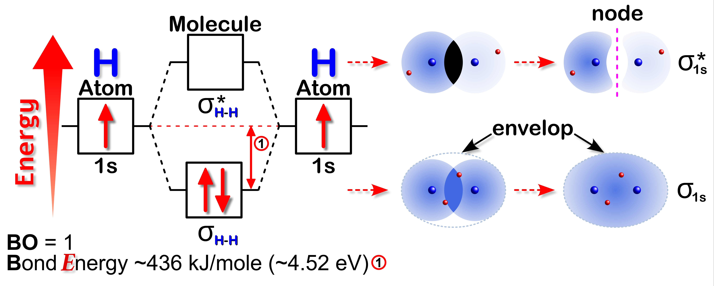
</figure>

<b><u>Figure 13</u>: MO Diagram of H2.</b> The energy diagram (left side) for the di-hydrogen molecule (H<b>2</b>) shows the <b>m</b>olecular <b>o</b>rbitals (MO) in the middle and the <b>a</b>tomic <b>o</b>rbitals (1𝓈 AO) on either side. In accordance with the <b><i>Aufbau</i> principle</b> electrons are placed in the lowest energy MO, which constitutes a sigma (`\(\large \sigma\)`) bonding orbital. Since the bonding MO is <u>lower</u> in energy than each of the two AO of H it therefore follows that the molecule is more <u>stable</u> than two separate H atoms. The <b>B</b>ond <b>O</b>rder (<b>BO</b> = \[# bonding electrons - \# anti-bonding electrons\]/2 = (2-0)/2 = 1) of the molecule is equal to <u>one</u> (i.e. single bond). The spherical electron density diagrams on the right correspond to the 1𝓈 energy level (Note: spherical shape of the 1𝓈 orbital has a single uniform phase since there are no <u>internal</u> <b>radial nodes</b>, a characteristic not shared by 2𝓈 or higher orbitals. However it can be arbitrarily assigned a positive or negative value to identify overall <u>phase</u> differences). The sign of the <u>wave function</u> (`\(\large \psi_{1 \text s}\)`) results in either the addition or subtraction of electron density within the inter-nuclear region. When the coefficients of two orbital wave functions have the same sign (i.e. overall positive value) the electrons density between the two atoms increases (shaded area), which attracts the two positively charged nuclei resulting in a more stable <u>energy</u> state. The positions of the bonded hydrogen nuclei is reminiscent of an <u>ellipse</u> (Note: <b>envelop</b> outline) with the two nuclei forming the two <u>foci</u>. Conversely electrons within an anti-bonding <b>MO</b> are pushed outward, which pulls the nuclei apart resulting in a region of zero electron density between the nuclei called a <b>node</b>. A change in the sign of an orbital wave function is represented by differences in <u>shading</u>. Should the atoms move closer together the repulsive electrostatic forces produced by the positively charged nuclei would increase resulting in an unstable state. The <b>MO</b> created by <b>LCAO</b> includes a <u>bonding</u> <b>MO</b> (`\(\large \sigma\)`) and an <u>anti-bonding</u> <b>MO</b> (`\(\large \sigma^{\normalsize *}\)`). Experiments have shown that it takes ~436 kJ (25 oC) to break apart one mole of H2 (<b>Note:</b> see <b><a class="one" href="https://cccbdb.nist.gov/ea2x.asp" target="_blank" title="Go to NIST">NIST</a></b> for standardized experimental energies of molecules).

<!-------------------------------------------------------------------->

<!-------------------------------------------------------------------->

<!-------------------------------------------------------------------->

Other diatomic molecules, like oxygen (O2 (<i>g</i>)) and nitrogen (N2 (<i>g</i>)), have MO diagrams that reveal specific bond orders (BO) and bond energies (BE). However the energy levels of the MO vary slightly as you move across the 2nd row or period of the PT. Notably the order of the energy levels is different for O and F when compared to the lighter elements of this period (i.e. Li through N). As illustrated below (**Fig. 14**) there is a noticeable change in the order of the `\(\large \sigma\)` and `\(\large \pi\)` bonding orbitals for the 2𝓅 atomic orbitals. Moreover these MO energy diagrams help to explain why these two diatomic molecules respond differently to magnetic fields that VBT and <b>Lewis</b> structures fail to explain. Specifically the <u>unpaired</u> electrons within the anti-bonding `\(\large \sigma^*\)` MO align with the magnetic field making O2 <b>paramagnetic</b> (i.e. weakly attracted to the magnetic field). In the case of N2 all of its MO have electron pairs with opposite spin, which results in no net magnetic moment. This makes N2 <b>diamagnetic</b> (i.e. weakly repelled by magnetic fields). The distinctive paramagnetic property of O2 is not explained by its <b>Lewis</b> structure, which actually shows two lone pairs of electrons (<b>Fig. 14</b>).

<!--------------------------------------------------->
<!--- FIG 14 - MOT homonuclear Diatomic Molecules --->
<!--------------------------------------------------->

<figure>

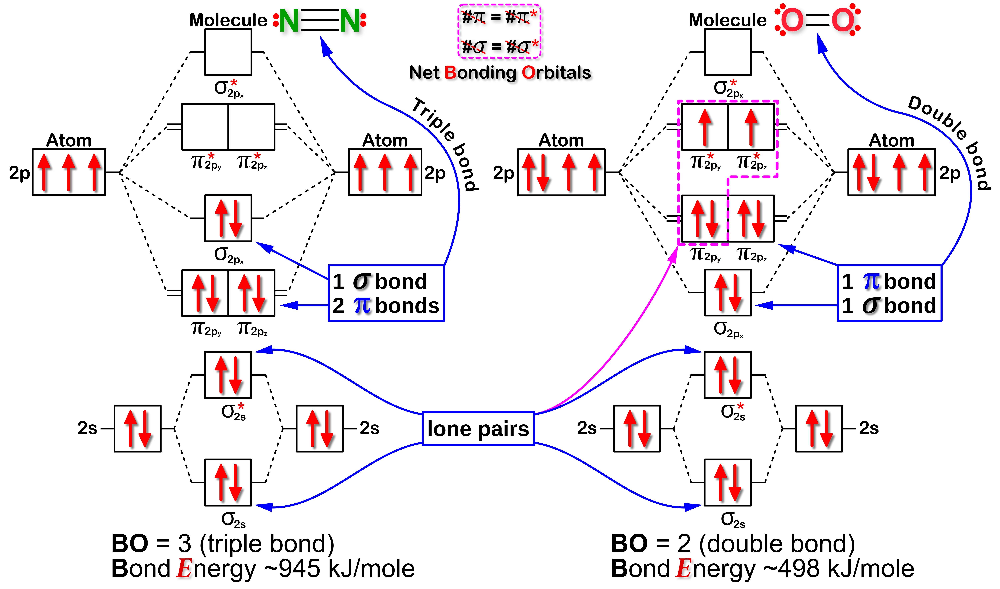
</figure>

<b><u>Figure 14</u>: MO Energy Diagrams of Homo-nuclear Diatomic Molecules.</b> Covalent bonds (i.e. single, double or triple) are identified by their Bonding Order (BO = \[# Bonding electrons in MO - \# non-Bonding electrons in MO\]/2). The relatively un-reactive nature of N<b>2</b> gas (i.e. ~78% of the air we breath) is due to the relatively large amount of <u>energy</u> needed to break the triple bond holding the N atoms together (i.e. BE ~ 945 kJ/mole). The BE and <u>bond length</u> changes as the BO increases (i.e. more electrons shared between two atoms). Unlike VBT or <b>Lewis</b> bonding models, MOT predicts the presence of two <u>unpaired</u> electrons in molecular oxygen, which in turn explains why O<b>2</b> is attracted by a magnetic field (i.e. <b>paramagnetic</b>). This unique property of O<b>2</b> represents an important energy barrier (i.e. “spin” barrier). For example, when O<b>2</b> reacts with a typical <b>diamagnetic</b> molecule (i.e. MO contain paired electrons), it has to change the spin state of one of its unpaired electrons. This activation step requires a considerable amount of energy, which forces oxygen to react <u>very slowly</u> (i.e. slow oxidizer). This is a “blessing” for all organic life forms since without this “spin” barrier oxygen would be highly reactive and therefore very poisonous to all life. In fact life as we know it would have likely not evolved, since an uninhibited oxygen would rapidly oxidize (i.e. “burn”) organic matter. In fact normal aerobic cellular metabolism does create toxic reactive intermediates of reduced oxygen, such as superoxide radical (•O-<b>2</b>) and hydroxyl radical (•OH). As discussed previously in the <b><a class="one" href="https://opc-project.netlify.app/project/pnps/#Fig_Oxygen" target="_blank" title="Go to Plant Natural Products">PNP project</a></b> these reactive oxygen species are neutralized by a variety of cellular anti-oxidant defences (e.g. vitamin C and E, superoxide dismutases and catalases). Nevertheless cellular enzymes have evolved ways of carefully harnessing the reactive power of oxygen using appropriate metal catalysts (i.e. metal oxides are tightly bound complexes).

<!------------------------------------------------------>

<!------------------------------------------------------>

<!------------------------------------------------------>

Drawing MO diagrams for more complex hetero-nuclear molecules, such as methane, is more challenging since the energy and symmetry of the AO are not always compatible (**Fig. 15**).

<!--------------------------------------------------->
<!--- FIG 15 - MOT homonuclear Diatomic Molecules --->
<!--------------------------------------------------->

<figure>

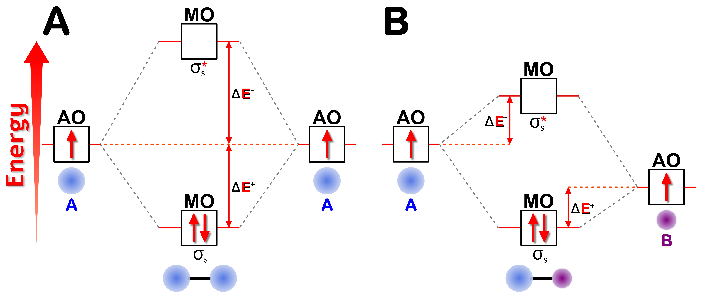
</figure>

<b><u>Figure 15</u>: MO Energy Diagram of Homo- and Hetero-nuclear Molecules.</b> The strength of the interaction or “mixing” of atomic orbitals (AO), which determines the stability of the molecular orbital (MO), is measured by the stabilization (<b>Δ</b>E<b>+</b>) and destabilization (<b>Δ</b>E<b>-</b>) energies of the <u>bonding</u> (e.g. <b>σs</b>) or <u>anti-bonding</u> (e.g. <b>σs</b>) MO, respectively. The greater the overlap or “mixing” of AO (i.e. overlap integral) the larger the <b>Δ</b>E<b>+</b> and <b>Δ</b>E<b>-</b> values. For hetero-atomic molecules (**B**) the bonding MO is located closer to the lower energy AO (i.e. atom B), while the anti-bonding MO is closest to the higher energy AO (i.e. atom A). Of course the electron density within the inter-nuclear region must be in phase (i.e. constructive interference) in order to allow for bonding to take place. Another important factor that determines whether the interaction between AO is successful or not is the size of the energy gap between the two AO. The smaller the energy gap the greater the interaction between AO. When the molecule has two spin-paired valence electrons occupying the lowest energy bonding orbitals (e.g. H<b>2</b>) each electron will be stabilized by <b>Δ</b>E<b>+</b> (i.e. total 2<b>Δ</b>E<b>+</b>). Since there are no electrons within the anti-bonding MO (i.e. <b>Δ</b>E<b>-</b> = 0) the two atoms will be more stable together as a molecule. However, if these two atoms have more than two valence electrons then the extra electrons will have to occupy the anti-bonding MO. The resulting de-stabilizing energy (i.e. <b>Δ</b>E<b>-</b> \> 0) will cancel out the stabilizing energy if <b>Δ</b>E<b>-</b> \> <b>Δ</b>E<b>+</b>. This is the reason why He<b>2</b> atoms do not exist under normal conditions.

<!------------------------------------------------------>

<!------------------------------------------------------>

<!------------------------------------------------------>

Changes in the energy levels of “mixed” orbitals can be difficult to plot for most poly-atomic molecules. Fortunately **Pauling’s** <u>hybridization</u> concept is very useful in describing local bonding orbitals within small molecules including delocalized conjugated bonding systems. This “mixing” of AO (i.e. **LCAO** technique) to make hybrid orbitals is a convenient and flexible way of approximating MO. This technique is not only very useful at describing bonding concepts (e.g. bonding and anti-bonding MO) and molecular structure, but also provides a practical way of calculating the contribution of specific AO to the overall MO (i.e. normalization coefficients). For example most, if not all, organic molecules contain one or more so called sp3 atomic orbitals. These model hybrid orbitals of C are made by “mixing” one part 2𝓈 with three parts 2𝓅. The sp3 orbital often interacts with the 1𝓈 orbital of H to produce a `\(\large \sigma\)` bonding and `\(\large \sigma^{\normalsize *}\)` anti-bonding molecular orbital. The four `\(\large \sigma\)` hybrid orbitals assume a tetrahedral like geometry, with each one “pointing” to a separate corner (i.e. vertex) of this regular polygon (**Fig. 19**). The following sections pictures MO from an AO hybridization point of view.

<!---------------------------------------------------->

<!------------- Fig. 16 Vector Diagram --------------->

<!---------------------------------------------------->

<figure id="FRight400">

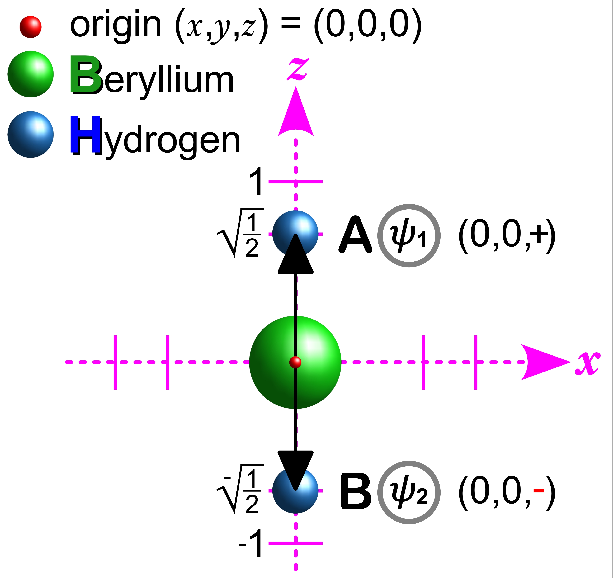
<figcaption>

<b>Figure 16: Vector Diagram for sp hybrid orbitals</b>
</figcaption>

</figure>

<!------------------------------------------------------>

<!------------------------------------------------------>

<!------------------------------------------------------>

**I. LCAO & sp Orbitals:** <b><a class="one" href="https://pubchem.ncbi.nlm.nih.gov/compound/139073" target="_blank" title="Go to PubChem">Beryllium hydride</a></b> (BeH2) is a good example of a hetero-nuclear poly-atomic molecule with sp molecular orbitals. This alkaline earth metal hydride is unique because Be forms covalent bonds with hydrogen. Heavier **Group 2A** metals (**Fig. 1**) typically form ionic bonds with hydrogen (e.g. CaH2). The geometry of free BeH2 is linear (VSEPR: **AX2** group) with two sp orbitals taking positions on opposite sides of the central metal atom (**Fig. 16**). The bonding orbitals of this compound can be represented by the following mathematical expression involving the linear combination of 2𝓈 and 2𝓅 atomic orbitals.

 

`$$\tag{30}$$`

`$$\\ \begin{align*} \large \psi_{\normalsize \text{BeH}_2} \normalsize \phantom{.} = & \phantom{.} \overbrace{\text a_1 \, \large \psi_{\normalsize \text{Be} \, (\text{2s})} \normalsize \; + \; \text b_1 \, \large \psi_{\normalsize \text{Be} \, (\text{2p}_z)}}^{\text{LCAO}} \normalsize \; + \; \text c_1 \, \large \psi_{\normalsize \text{H} \, (\text{1s})} \normalsize \; + \; \text c_2 \, \large \psi_{\normalsize \text{H} \, (\text{1s})} \\[5px] & sp \phantom{.} \text{orbitals:} \; \left[ \begin{array}{l} \large \psi_{\normalsize 1 (\text{sp})} \normalsize \phantom{.} = \phantom{.} \text{a}_1 \text{2s} \; + \; \text{b}_1 \text{2p}_z \\ \large \psi_{\normalsize 2 (\text{sp})} \normalsize \phantom{.} = \phantom{.} \text{a}_2 \text{2s} \normalsize \; + \; \text{b}_2 \text{2p}_z \end{array} \right. \end{align*}$$`

The value of the coefficients can be normalized for the two sp hybrid orbitals in **Eqn. 30** given a few logical assumptions. Firstly, since the two hybrid orbitals are on opposite sides of the central Be atom and directed in opposite directions, it is safe to assume that they do not overlap with one another (i.e. **non-degenerate** states). This obviously makes sense since each one is an independent or distinct quantum state (i.e. separate sets of VE). One important consequence of this is that non-overlapping orbitals can be mathematically evaluated in the following manner:

`$$\tag{31}$$`

`$$\\ \text{Orthogonal Conditions:} \phantom{..} \large \psi_1 \normalsize \, \ne \, \large \psi_2 \\ \text{(No orbital overlap)} \\ \text{Note: formal use of spherical co-ordinates} \\ \int^{\infty}_0 \int^{\pi}_0 \int^{2 \pi}_0 \large \psi^{*}_1 \normalsize \, \large \psi^{\phantom{.}}_2 \normalsize \, r^2 \, \text{sin} \theta \, dr \, d \theta \, d \phi \phantom{.} = \phantom{.} 0 \\ \text{For convenience let:} \phantom{.} \iiint \; = \; \int^{\infty}_{0} \int^{\pi}_{0} \int^{2\pi}_{0} \phantom{.} \text{and} \phantom{..} r^2 \, \text{sin} \theta \, dr \, d \theta \, d \phi \phantom{.} = \phantom{.} d \text v$$`

`$$\\ \begin{align*} & \text{Recall: for a normalized wave function} \phantom{.} \iiint \large \psi^{*} \psi^{\phantom{.}} \normalsize d \text v \phantom{.} = \phantom{.} 1 \\ & \iiint \big( \text{a}_1 \text{2s}^{*} \; + \; \text{b}_1 \text{2p}_z^{*} \big) \big(\text{a}_2 \text{2s} \; + \; \text{b}_2 \text{2p}_z \big) \, d \text{v} \phantom{.} = \phantom{.} 0 \\ & 0 \phantom{.} = \phantom{.} \text{a}_1 \text{a}_2 \iiint \overbrace{\text{2s}^{*} \text{2s} \, d \text{v}}^{1} \; + \; \text{a}_1 \text{b}_2 \iiint \overbrace{\text{2s}^{*} \text{2p}_z \, d \text{v}}^{0} \; + \; \text{b}_1 \text{a}_2 \iiint \overbrace{ \text{2p}_z^{*} \text{2s} \, d \text{v}}^{0} \\ & \phantom{.....} + \phantom{.} \text{b}_1 \text{b}_2 \iiint \overbrace{ \text{2p}_z^{*} \text{2p}_z \, d \text{v}}^{1} \\[5px] & 0 \phantom{.} = \phantom{.} \text{a}_1 \text{a}_2 \; + \; \text{b}_1 \text{b}_2 \\[5px] & ^{\dagger}\text{Given:} \phantom{..} | \text{a}_1 | \; = \; | \text{a}_2 | \phantom{.}, \phantom{.} | \text{b}_1 | \; = \; | \text{b}_2 | \phantom{....} ^{\dagger}\text{(Note: see Fig. 18)} \\ & \text{and b}_2 \; = \; \text{neg. value} \phantom{..} \text{(Note: see Fig. 16)} \\[5px] & \text{Therefore:} \phantom{..} \text{a}_1 \text{a}_2 \; - \; \text{b}_1 \text{b}_2 \phantom{.} = \phantom{.} 0 \phantom{..} \Longrightarrow \phantom{..} \text{a}_1 \text{a}_2 \phantom{.} = \phantom{.} \text{b}_1 \text{b}_2 \phantom{..} \Longrightarrow \phantom{..} |a| \phantom{.} = \phantom{.} |b| \end{align*}$$`

The negative value of b2 reflects the negative direction of the `\(\psi_2\)` 2𝓅z orbital relative to the `\(\psi_1\)` 2𝓅z orbital (**Fig. 16**). Using normalization arguments (Note: see **Fig. 18**) we can quantify the coefficients in the following manner.

`$$\tag{32}$$`
 

`$$\\ \text{Normalization conditions:} \phantom{.} \int^{\infty}_{0} \int^{\pi}_{0} \int^{2\pi}_{0} \large \psi_1^* \psi^{\phantom{.}}_1 \normalsize \phantom{.} r^2 \text{sin} \theta \phantom{.} dr \phantom{.} d \theta \phantom{.} d \phi \phantom{.} = \phantom{.} 1 \\ \text{For convenience let:} \phantom{.} \iiint \phantom{.} = \phantom{.} \int^{\infty}_{0} \int^{\pi}_{0} \int^{2\pi}_{0} \phantom{.} \text{and} \phantom{..} r^2 \text{sin} \theta \phantom{.} dr \phantom{.} d \theta \phantom{.} d \phi \; = \; d \text{v} \\ \iiint \big(\text{a}_1 \text{2s}^* \; + \; \text{b}_1 \text{2p}_z^* \big) \big(\text{a}_1 \text{2s} \; + \; \text{b}_1 \text{2p}_z \big) \phantom{.} d \text{v} \phantom{.} = \phantom{.} 1 \\ \begin{align*} 1 \phantom{.} = & \phantom{.} \text{a}_1 \text{a}_1 \iiint \overbrace{\text{2s}^* \text{2s} \phantom{.} d \text{v}}^{1} \; + \; \text{a}_1 \text{b}_1 \iiint \overbrace{\text{2s}^* \text{2p}_z \phantom{.} d \text{v}}^{0} \; + \; \text{b}_1\text{a}_1 \iiint \overbrace{\text{2p}^*_z \text{2s} \phantom{.} d \text{v}}^{0} \\ & + \phantom{.} \text{b}_1\text{b}_1 \iiint \overbrace{\text{2p}^*_z \text{2p}_z \phantom{.} d \text{v}}^{1}  \\ 1 \phantom{.} = & \phantom{.} \text{a}_1 \text{a}_1 \; + \; \text{b}_1 \text{b}_1 \phantom{..} \Longrightarrow \phantom{..} \text{a}_1^2 \; + \; \text{b}_1^2 \phantom{.} = \phantom{.} 1 \\ & \text{Given:} \phantom{..} \text{a}_1 \phantom{.} = \phantom{.} \text{b}_1 \phantom{..} \Longrightarrow \phantom{..} 2 \text{a}_1^2 \phantom{.} = \phantom{.} 1 \phantom{..} \Longrightarrow \phantom{..} \text{a}_1 \phantom{.} = \phantom{.} \text{b}_1 \phantom{.} = \phantom{.} \pm \frac{1}{\sqrt{2}} \\ & \text{All together:} \phantom{..} \text{a}_1 \phantom{.} = \phantom{.} \text{a}_2 \phantom{.} = \phantom{.} \text{b}_1 \phantom{.} = \phantom{.} \frac{1}{\sqrt{2}} \phantom{...} \text{and} \phantom{...} \text{b}_2 \phantom{.} = \phantom{.} -\frac{1}{\sqrt{2}} \end{align*}$$`

The final set of normalized sp hybrid orbital wave functions is shown below:

`$$\tag{33} \\ \begin{align*} \large \psi_{1 (\text{sp})} \normalsize \phantom{.} = \phantom{.} \text{a}_1 \text{2s} \; + \; \text{b}_1 \text{2p}_z \phantom{.} & = \phantom{.} \frac{1}{\sqrt{2}} \text{2s} \phantom{.} + \phantom{.} \frac{1}{\sqrt{2}} \text{2p}_z \\[5px] \large \psi_{2 (\text{sp})} \normalsize \phantom{.} = \phantom{.} \text{a}_2 \text{2s} \; + \; \text{b}_2 \text{2p}_z \phantom{.} & = \phantom{.} \frac{1}{\sqrt{2}} \text{2s} \phantom{.} - \phantom{.} \frac{1}{\sqrt{2}} \text{2p}_z \\[10px] \text{Overall:} \phantom{..} \large \psi_{(\text{sp})} \normalsize \phantom{.} & = \phantom{.} \frac{1}{\sqrt{2}} \bigg(\text{2s} \; \pm \; \text{2p}_z \bigg) \end{align*}$$`

<!------------------------------------------------->

<!--------------- Fig 17 sp2 vector --------------->

<!------------------------------------------------->

<figure id="FRight400">

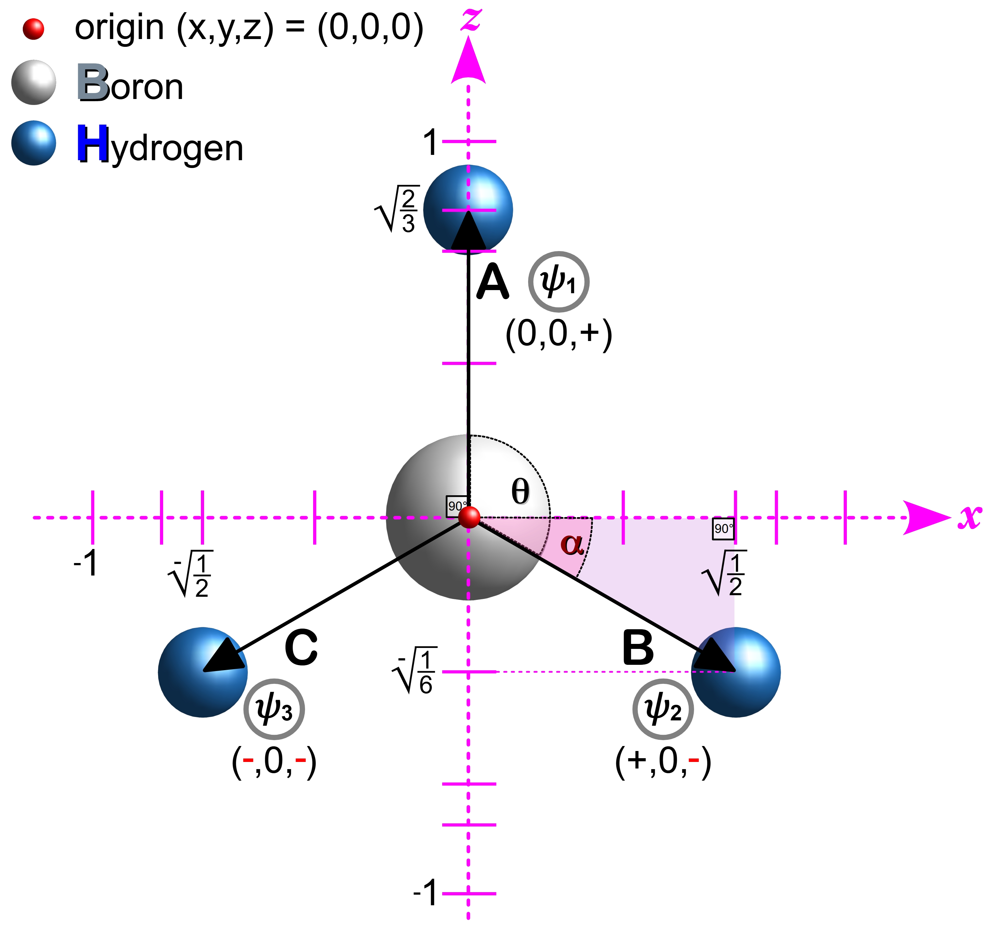
<figcaption>

<b>Figure 17: Vector Diagram for sp2 hybrid orbitals</b>
</figcaption>

</figure>

<!------------------------------------------------->

<!------------------------------------------------->

<!------------------------------------------------->

**II. LCAO & sp2 Orbitals:** **Borane**, also known as <b><a class="one" href="https://pubchem.ncbi.nlm.nih.gov/compound/6331" target="_blank" title="Go to PubChem">Boron trihydride</a></b> (BH3), is a good example of a hetero-nuclear poly-atomic molecule with sp2 hybrid orbitals. Its distinctive planar geometry and bond angles (i.e. 120°) makes it relatively easy to determine the values of the coefficients for each sp2 orbital wave function. Firstly, because all three hybrid orbitals lie in a two dimensional plane, arbitrarily denoted 𝓍-𝓏, there is no 𝓎-axis component to any of the hybrid orbitals. Also because the vector representing our first sp2 orbital can be arbitrarily assigned to the positive 𝓏-axis: `\((x,y,z) = (0,0,+)\)`, it will therefore have no 𝓍-axis component. This simplifies the sp2 orbital wave equations as shown below.

`$$\tag{34}$$`

`$$\\ \large \psi_{\text{BH}_3} \normalsize \phantom{.} = \phantom{.} \overbrace{\text a_1 \, \large \psi_{\text{B}_{2 \text s}} \normalsize \phantom{.} + \phantom{.} \text b_1 \, \large \psi_{\text{B}_{2 \text p_z}} \normalsize \phantom{.} + \phantom{.} \text c_1 \, \large \psi_{\text{B}_{2 \text p_x}}}^{\text{LCAO}} \normalsize \phantom{.} + \phantom{.} 3(\text d_1 \, \large \psi_{\text{H}_{1 \text s}}) \\[10px] \normalsize \text{sp2} \phantom{.} \text{orbitals: } \left[ \begin{array}{l} \large \psi_{1 (\text{sp2})} \normalsize \phantom{.} = \phantom{.} \text{a}_1 \text{2s} \; + \; \text{c}_1 \text{2p}_z \\ \large \psi_{2 (\text{sp2})} \normalsize \phantom{.} = \phantom{.} \text{a}_2 \text{2s} \; + \; \text{b}_2 \text{2p}_z \; + \; \text{c}_2 \text{2p}_x \\ \large \psi_{3 (\text{sp2})} \normalsize \phantom{.} = \phantom{.} \text{a}_3 \text{2s} \; + \; \text{b}_3 \text{2p}_z \; + \; \text{c}_3 \text{2p}_x \end{array} \right. \\$$`

<!---------------------------------------------------->

<!--------------- Fig 18 Normalized 1s --------------->

<!---------------------------------------------------->

<figure id="FRight400">

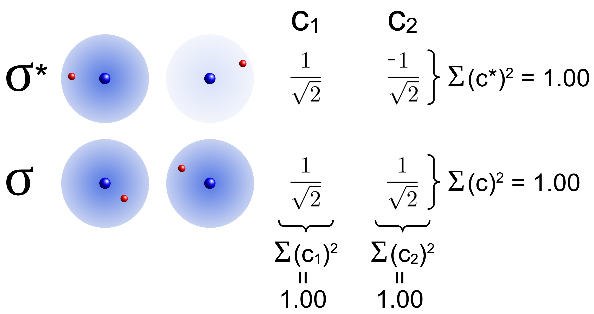
<figcaption>

<b>Figure 18: Normalized 1𝓈 Orbital Wave Functions</b>
</figcaption>

</figure>

<!---------------------------------------------------->

<!---------------------------------------------------->

<!---------------------------------------------------->

The key feature of <u>normalized</u> orbital wave functions (**Fig. 18**) is that the sum of the squares of the coefficients for a given set of atomic orbitals (e.g. 2𝓈) is equal to unity (e.g. `\(\text{a}_1^2 + \text{a}_2^2 + \text{a}_3^2 = 1\)`). Similarly the sum of the squares of the coefficients for a <u>single</u> normalized wave function is also equal to unity (e.g. `\(\text{a}_1^2 + \text{b}_1^2 + \text{c}_1^2 = 1\)`). In the case of the single 2𝓈 atomic orbital, which is shared equally between the three sp2 orbitals, we can safely assume that each a coefficient must be of equal value.

 

`$$\\ \begin{align*} \text{Given:} & \phantom{..} | \text{a}_1| \phantom{.} = \phantom{.} | \text{a}_2| \phantom{.} = \phantom{.} | \text{a}_3| \phantom{...} \text{and} \phantom{...} \text{a}_1^2 \phantom{.} + \phantom{.} \text{a}_2^2 \phantom{.} + \phantom{.} \text{a}_3^2 \phantom{.} = \phantom{.} 1 \\[5px] \text{Therefore:} & \phantom{..} 3\text{a}_1^2 \phantom{.} = \phantom{.} 1 \phantom{..} \Longrightarrow \phantom{..} \text{a}_1 \phantom{.} = \phantom{.} \text{a}_2 \phantom{.} = \phantom{.} \text{a}_3 \phantom{.} = \phantom{.} \frac{1}{\sqrt{3}} \end{align*}$$`

Since `\(\psi_{1 (\text{sp2})}\)` has only two coefficients the equations can be further simplified as shown below.

`$$\begin{align*} \text{Given:} & \phantom{..} \text{a}_1^2 \phantom{.} + \phantom{.} \text{b}_1^2 \phantom{.} = \phantom{.} 1 \phantom{..} \text{and} \phantom{..} \text{a}_1 \phantom{.} = \phantom{.} \frac{1}{\sqrt{3}}  \\[5px] \text{Therefore:} & \phantom{..} \frac{1}{3} \phantom{.} + \phantom{.} \text{b}_1^2 \phantom{.} = \phantom{.} 1 \phantom{..} \Longrightarrow \phantom{..} \text{b}_1 \phantom{.} = \phantom{.} \pm \sqrt{\frac{2}{3}} \end{align*}$$`

Given that our initial hybrid orbital `\(\psi_{1 (\text{sp2})}\)` is pointed in the positive direction (**Fig. 17**), we can therefore assign a positive value to b1. Moreover, given the notable symmetry of the sp2 orbitals we can also assign negative values of equal magnitude to the b coefficients for `\(\psi_{2 (\text{sp2})} \phantom{.} (+,0,\)` — `\()\)` and `\(\psi_{3 (\text{sp2})} \phantom{.} (-,0,\)` — `\()\)`. Also, since the sum of squares of the coefficients for the set of 2𝓅<b>z</b> orbitals must also be equal to unity, the value of b2 and b3 can be easily calculated.

`$$\begin{align*} \text{Given:} \phantom{..} | \text{b}_2 | \phantom{.} & = \phantom{.} | \text{b}_3 | \phantom{...} \text{and} \phantom{...} \frac{2}{3} \phantom{.} + \phantom{.} \text{b}_2^2 \phantom{.} + \phantom{.} \text{b}_3^2 \phantom{.} = \phantom{.} 1 \\ \text{Therefore:} \phantom{..} 2\text{b}_2^2 \phantom{.} & = \phantom{.} 1 \; - \; \frac{2}{3} \phantom{..} \Longrightarrow \phantom{..} \text{b}_2^2 \phantom{.} = \phantom{.} \frac{1}{6} \\ \text{Overall:} \phantom{..} \text{b}_2 \phantom{.} & = \phantom{.} \text{b}_3 \phantom{.} = \phantom{.} - \frac{1}{\sqrt{6}} \\ \end{align*}$$`

With the above information it’s also possible to quickly calculate the values of the remaining 2𝓅<b>x</b> orbital coefficients.

`$$\begin{align*} \text{Given:} \phantom{..} \text{c}_1 \phantom{.} = \phantom{.} 0, \phantom{.} | \text{c}_2 | \phantom{.} & = \phantom{.} | \text{c}_3| \phantom{..} \text{and} \phantom{..} \text{c}_1^2 \phantom{.} + \phantom{.} \text{c}_2^2 \phantom{.} + \phantom{.} \text{c}_3^2 \phantom{.} = \phantom{.} 1 \\[5px] \text{Therefore:} \phantom{..} 2\text{c}_2^2 \phantom{.} & = \phantom{.} 1 \phantom{...} \Longrightarrow \phantom{...} \text{c}_2 \phantom{.} = \phantom{.} \pm \frac{1}{\sqrt{2}} \\[5px] \text{Overall:} \phantom{..} \text{c}_2 \phantom{.} & = \phantom{.} \frac{1}{\sqrt{2}} \phantom{..} \text{and} \phantom{..} \text{c}_3 \phantom{.} = \phantom{.} - \frac{1}{\sqrt{2}} \end{align*}$$`

Plugging in all of the normalization coefficients to **Eqn. 34** produces the following set of sp2 wave functions.

`$$\tag{34.2}$$`

`$$\\ \begin{align*} \large \psi_{\normalsize 1 (\text{sp2})} \normalsize \phantom{.} & = \phantom{.} \frac{1}{\sqrt{3}} \text{2s} \phantom{.} + \phantom{.} \sqrt{\frac{2}{3}} \text{2p}_z \\[5px] \large \psi_{\normalsize 2 (\text{sp2})} \normalsize \phantom{.} & = \phantom{.} \frac{1}{\sqrt{3}} \text{2s} \phantom{.} - \phantom{.} \frac{1}{\sqrt{6}} \text{2p}_z \phantom{.} + \phantom{.} \frac{1}{\sqrt{2}} \text{2p}_x \\[5px] \large \psi_{\normalsize 3 (\text{sp2})} \normalsize \phantom{.} & = \phantom{.} \frac{1}{\sqrt{3}} \text{2s} \phantom{.} - \phantom{.} \frac{1}{\sqrt{6}} \text{2p}_z \phantom{.} - \phantom{.} \frac{1}{\sqrt{2}} \text{2p}_x \\ \end{align*}$$`

One way to confirm the values of these coefficients is to make use of a <u>vector</u> diagram (**Fig. 17**). Looking at this figure one can see that the magnitude (i.e. scalar quantity) of each sp2 orbital vector is represented by its length, which is made up of smaller component vectors. For example `\(\vec{\text B}\)` vector, which represents `\(\psi_{2 (\text{sp2})}\)`, is made by adding two smaller vectors that correspond to 2𝓅x and 2𝓅z. Since these three vectors constitute a right angle triangle trigonometry can be used to solve for the unknown angle `\(\alpha\)`. However another geometric approach using vectors is to use the **Dot Product** formula (**Eqn. 35**), which measures the angle between two vectors.

`$$\tag{35}$$`

`$$\\ \text{Dot Product:} \phantom{..} \vec{\text A} \cdot \vec{\text B} \phantom{.} = \phantom{.} | \text{a} | \times | \text{b} | \times \cos (\theta) \phantom{.} = \phantom{.} \text{a}_x \text{b}_x \phantom{.} + \phantom{.} \text{a}_y \text{b}_y \phantom{.} + \phantom{.} \text{a}_z \text{b}_z \\[10px] \cos \theta \phantom{.} = \phantom{.} \frac{\text{a}_x \text{b}_x \phantom{.} + \phantom{.} \text{a}_y \text{b}_y \phantom{.} + \phantom{.} \text{a}_z \text{b}_z}{ |\text{a} | \times | \text{b} |} \phantom{.} = \phantom{.} \frac{\Big(\text{a}_x \text{b}_x \phantom{.} + \phantom{.} \text{a}_y \text{b}_y \phantom{.} + \phantom{.} \text{a}_z \text{b}_z \Big)}{\Big( \sqrt{\text{a}_x^2 \phantom{.} + \phantom{.} \text{a}_y^2 \phantom{.} + \phantom{.} \text{a}_z^2} \, \Big) \Big( \sqrt{\text{b}_x^2 \phantom{.} + \phantom{.} \text{b}_y^2 \phantom{.} + \phantom{.} \text{b}_z^2} \, \Big)} \\$$`

Plugging the coefficients of `\(\psi_{1 (\text{sp2})}\)` and `\(\psi_{2 (\text{sp2})}\)` into **Eqn. 35** produces the expected bond `\(\measuredangle\)` of 120°. The same calculation can be carried out for the other two bond `\(\measuredangle\)` (i.e. between `\(\psi_{2 (\text{sp2})}\)` and `\(\psi_{3 (\text{sp2})}\)`, or `\(\psi_{1 (\text{sp2})}\)` and `\(\psi_{3 (\text{sp2})}\)`). Fortunately, using a simple symmetry argument it’s easy to see that all three bond angles for the sp2 must be equal to 120°.

`$$\tag{35.1}$$`

`$$\\ \begin{align*} \cos (\theta) \phantom{.} = & \phantom{.} \frac{\bigg( 0 \cdot \frac{1}{\sqrt{2}} \bigg) \phantom{.} + \phantom{.} \bigg( 0 \bigg) \phantom{.} + \phantom{.} \bigg( \sqrt{\frac{2}{3}} \bigg) \bigg( - \sqrt{\frac{1}{6}} \bigg)}{ \Bigg( \sqrt{0 \phantom{.} + \phantom{.} 0 \phantom{.} + \phantom{.} \sqrt{\frac{2}{3}}^2} \Bigg) \Bigg(\sqrt{ \bigg( - \sqrt{\frac{1}{6}} \bigg)^2 \phantom{.} + 0 \phantom{.} + \phantom{.} \sqrt{\frac{1}{2}}^2} \Bigg)} \\[5px] \cos (\theta) \phantom{.} = & \phantom{.} \frac{-\sqrt{\frac{1}{9}}}{\Bigg(\sqrt{\frac{2}{3}} \cdot \sqrt{\frac{2}{3}} \Bigg)} \phantom{.} = \phantom{.} - \sqrt{\frac{1}{9} \cdot \frac{9}{4}} \phantom{.} = \phantom{.} - \frac{1}{2} \\[5px] \theta \normalsize \phantom{.} = & \phantom{.} \cos^{-1} \Bigg( -\frac{1}{2} \Bigg) \phantom{.} = \phantom{.} 120^{\circ} \end{align*}$$`

As mentioned above the bond `\(\measuredangle\)` between `\(\psi_{1 (\text{sp2})}\)` and `\(\psi_{2 (\text{sp2})}\)` can be measured using simple trigonometry (i.e. `\(\tan\)` function). Since the normalization coefficients `\(\text{b}_2\)` and `\(\text{c}_2\)` represent the magnitude of the component vectors of `\(\vec{\text B}\)`, which forms a right angle triangle, then the `\(\tan\)` function can be used to calculate the missing part of the bond angle (i.e. `\(\measuredangle \alpha\)`).

`$$\tag{35.2}$$`

`$$\\ \text{tan} (\alpha) \phantom{.} = \phantom{.} \frac{opposite}{adjacent} \phantom{.} = \phantom{.} \frac{ - \frac{1}{\sqrt{6}}}{\frac{1}{\sqrt{2}}} \phantom{.} = \phantom{.} - \sqrt{\frac{1}{3}} \phantom{.} = \phantom{.} - 0.57735 \\[10px] \alpha \phantom{.} = \phantom{.} tan^{-1}( - 0.57735) \phantom{.} = \phantom{.} 30^{\circ} \\[10px] \text{Bond} \; \measuredangle \; \text{between} \; \large \psi_{\normalsize 1 (\text{sp2})} \normalsize \; \text{and} \; \large \psi_{2 (\normalsize \text{sp2})} \normalsize \phantom{.} = \phantom{.} \text{90}^{\circ} \; + \; \text{30}^{\circ} \phantom{.} = \phantom{.} \text{120}^{\normalsize}$$`

<!-------------------------------------------------->

<!--------------- Fig 19 sp3 vectors --------------->

<!-------------------------------------------------->

<figure id="FRight400">

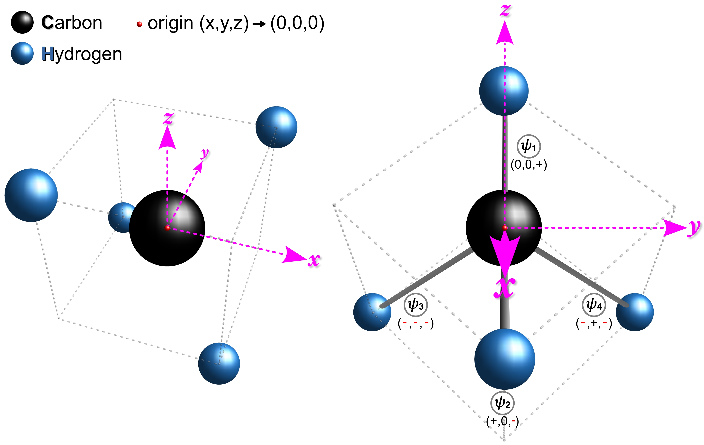

<figcaption>

<b>Figure 19: Vector Diagram for sp3 orbitals</b>
</figcaption>

</figure>

<!---------------------------------------------------->

<!---------------------------------------------------->

<!---------------------------------------------------->

**III. LCAO & sp3 Orbitals:** <b><a class="one" href="https://pubchem.ncbi.nlm.nih.gov/compound/Methane" target="_blank" title="Go to PubChem">Methane</a></b> (CH3) is the simplest example of a molecule containing sp3 molecular orbitals. The lone 2𝓈 and three 2𝓅 orbitals of C that are mixed to form four orbitals (**Eqn. 36**) have similar energy levels, but distinctive shapes and spatial orientations. The well known tetrahedral geometry of methane is a product of its 109.5° bond angles that provide maximum separation of the electron domains.

 
 
 

`$$\tag{36}$$`

`$$\\ \begin{align*} & \large \psi_{\normalsize \text{CH}_4} \normalsize \phantom{.} = \phantom{.} \overbrace{\text a_1 \, \large \psi_{\normalsize \text{C}_{2 \text s}} \normalsize \phantom{.} + \phantom{.} \text b_1 \, \large \psi_{\normalsize \text{C}_{2 \text p_z}} \normalsize \; + \; \text c_1 \, \large \psi_{\normalsize \text{C}_{2 \text p_x}} \normalsize \; + \; \text d_1 \, \large \psi_{\normalsize \text{C}_{2 \text p_y}}}^{\text{LCAO}} \normalsize \; + \; 4(\text e_1 \, \large \psi_{\normalsize \text{H}_{\text{1s}}}) \\[10px] & \text{sp3} \phantom{.} \text{orbitals:} \;  \left[ \begin{array}{l} \large \psi_{\normalsize 1 (\text{sp3})} \normalsize \phantom{.} = \phantom{.} \text{a}_1 \, \text{2s} \; + \; \text{b}_1 \, \text{2p}_z \; + \; \text{c}_1 \, \text{2p}_x \; + \; \text{d}_1 \, \text{2p}_y \\ \large \psi_{\normalsize 2 (\text{sp3})} \normalsize \phantom{.} = \phantom{.} \text{a}_2 \, \text{2s} \; + \; \text{b}_2 \, \text{2p}_z \; + \; \text{c}_2 \, \text{2p}_x \; + \; \text{d}_2 \, \text{2p}_y \\ \large \psi_{\normalsize 3 (\text{sp3})} \normalsize \phantom{.} = \phantom{.} \text{a}_3 \, \text{2s} \; + \; \text{b}_3 \, \text{2p}_z \; + \; \text{c}_3 \, \text{2p}_x \; + \; \text{d}_3 \, \text{2p}_y \\ \large \psi_{\normalsize 4 (\text{sp3})} \normalsize \phantom{.} = \phantom{.} \text{a}_4 \, \text{2s} \; + \; \text{b}_4 \, \text{2p}_z \; + \; \text{c}_4 \, \text{2p}_x \; + \; \text{d}_4 \, \text{2p}_y \end{array} \right. \end{align*} \\$$`

As shown in **Eqn. 36** we can combine the first four terms on the right side of the equation to produce four equivalent sp3 orbitals. Because each lobe of a 2𝓅 orbital points in opposite direction along a given Cartesian axis, the resulting orbital will end up concentrating its electron densities in one direction (i.e. towards one of the four vertices of an imaginary triangular pyramid). Moreover, since the four sp3 orbitals are <u>equivalent</u> the corresponding coefficient for the lone 2𝓈 orbital is the same for each molecular orbital (i.e. `\(\text a_1 = \text a_2 = \text a_3 = \text a_4\)`). Also since the 2𝓈 orbital is normalized and shared equally between these four orbitals then the sum of squares of this set of coefficients must be equal to unity (**Fig. 18**). As a result each `\(\text a\)`-type coefficient must be equal to `\(1 / \sqrt 4\)` (i.e. `\((1 / \sqrt 4)^2 + (1 / \sqrt 4)^2 + (1 / \sqrt 4)^2 + (1 / \sqrt 4)^2 = 1\)`). For convenience we can assign the first sp3 orbital as pointing upward toward the “peak” of our imaginary tetrahedron along the 𝓏-axis. This means this vector has no 𝓍 or 𝓎 components (i.e. c1 = 0, and d1 = 0), which simplifies the orbital wave function.

`$$\tag{37} \\ \begin{align*} \text{Let} \; \large \psi_{\normalsize 1 (\text{sp3})} \normalsize & \phantom{.} \Longrightarrow \phantom{.} \text{z-axis oriented orbital} \\[5px] \text{Given: } & \phantom{.} \text c_1 \; = \; 0 \phantom{..} \text{and} \phantom{..} \text d_1 \; = \; 0 \\ \large \psi_{\normalsize 1 (\text{sp3})} \normalsize & \; = \; \frac{1}{2} 2 \text s \; + \; \text b_1 \, 2 \text p_z \end{align*}$$`

In addition, we can apply the same normality test to `\(\psi_1{_{(\text{sp3})}}\)` (**Fig. 18**) to solve for b1. Since the sum of squares of a set of coefficients for a single normalized wave function equals unity (i.e. `\(a_1^2 + b_1^2 + c_1^2 + d_1^2 = 1\)`), it therefore follows that the contribution of 2𝓅z to the sp3 orbital is `\(\sqrt{3/4}\)`.

`$$\tag{38}$$`

`$$\\ \begin{align*} \int \large \psi^*_1{_{(\text{sp3})}} \, \psi^{\phantom{.}}_1{_{(\text{sp3})}} \normalsize \, d \text v \; = & \; \int \bigg( \frac{1}{2} \text{2s}^* \; + \; \text b_1 \, \text{2p}^*_z \bigg) \bigg( \frac{1}{2} \text{2s} \; + \; \text b_1 \, \text{2p}_z \bigg) \, d \text v \; = \; 1 \\ 1 \; = & \; \frac{1}{4} \int \overbrace{\text{2s}^* \, \text{2s} \, d \text v}^{1} \; + \; \frac{\text{b}_1}{2} \int \overbrace{\text{2s}^* \, \text{2p}_z \, d \text v}^{0} \; + \; \frac{\text{b}_1}{2} \int \overbrace{\text{2p}^*_z \, \text{2s} \, d \text v}^{0} \\ & + \; \text b_1^2 \int \overbrace{\text{2p}_z^* \, \text{2p}_z \, d \text v}^{1} \\ 1 \; = & \; \frac{1}{4} \; + \; \text b_1^2 \\ \text b_1 \; = & \; \pm \sqrt{1 \; - \; \frac{1}{4}} \; = \; \large \pm \frac{\sqrt 3}{2} \\ \end{align*}$$`

Plugging the positive value of b1 into **Eqn. 37** (Note position of orbital vector, **Fig. 19**) produces:

`$$\tag{39} \\ \large \psi_1{_{\normalsize (\text{sp3})}} \normalsize \phantom{.} = \phantom{.} \frac{1}{2} \text{2s} \; + \; \frac{\sqrt 3}{2} \text{2p}_z$$`

Having the `\(\psi_1{_{(\text{sp3})}}\)` orbital pointed directly upwards along the positive z axis means that the vectors representing the other three sp3 orbitals must be pointed directly at the vertices located at the base of our imaginary pyramid (**Fig. 19**). These vectors have 𝓍 and 𝓎 components that optimize their separation (i.e. reduce the electrostatic repulsion between neighbouring **electron domains**), which means there are multiple coefficient calculations per wave function.  
    The second vector representing `\(\psi_2{_{(\text{sp3})}}\)` lies in the 𝓍-𝓎 plane, separated from the first vector by a bond angle of ~109.5°. Although `\(\psi_2{_{(\text{sp3})}}\)` (**Eqn. 39.1**) has an additional vector component, the fact that it does not overlap with `\(\psi_1{_{(\text{sp3})}}\)` means that their electron densities are independent of each other (i.e. use <u>orthogonal</u> test).

`$$\tag{39.1}$$`

`$$\\ \begin{align*} \large \psi_1{_{(\text{sp3})}} \normalsize \phantom{.} = & \phantom{.} \frac{1}{2} \text{2s} \; + \; \frac{\sqrt 3}{2} \text{2p}_z \\ \large \psi_2{_{(\text{sp3})}} \normalsize \phantom{.} = & \phantom{.} \frac{1}{2} \text{2s} \; + \; \text b_2 \, \text{2p}_z \; + \; \text c_2 \, \text{2p}_x \end{align*}$$`

`$$\tag{40}$$`

`$$\\ \int^{\infty}_0 \int^{\pi}_0 \int^{2\pi}_0 \large \psi^*_1{\normalsize _{(\text{sp3})}} \normalsize\, \large \psi^{\,}_2{\normalsize _{(\text{sp3})}} \normalsize \, r^2 \, \text{sin} \, \theta \, dr \, d \theta \, d \phi \phantom{.} = \phantom{.} 0 \\[5px] \large \text{Let:} \phantom{.} \normalsize \iiint \; = \; \int^{\infty}_{0} \int^{\pi}_{0} \int^{2\pi}_{0} \phantom{..} \text{and} \phantom{...} r^2 \, \text{sin} \, \theta \, dr \, d \theta \, d \phi \phantom{.} = \phantom{.} d \text v \\[5px] \iiint \large \psi^*_1{\normalsize _{(\text{sp3})}} \, \psi^{\,}_2{\normalsize _{(\text{sp3})}} \normalsize \, d \text v \phantom{.} = \phantom{.} 0 \\$$`

Applying the “orthogonality” test (i.e. no shared electron density between two orbital wave functions = <u>empty</u> distribution function) in this way can quick find the solution to an unknown coefficients provided the calculus eliminates other unknown coefficients.

`$$\tag{40.1}$$`

 

`$$\begin{align*} \iiint \large \psi^*_1{_{(\text{sp3})}} \psi_2{_{(\text{sp3})}} \normalsize d \text v \phantom{.} = & \phantom{.} \iiint \Bigg( \frac{1}{2} 2 \text s^* \; + \; \frac{\sqrt 3}{2} 2 \text p^*_z \Bigg) \Bigg( \frac{1}{2} 2 \text s \; + \; \text b_2 2 \text p_z \; + \; \text c_2 2 \text p_x \Bigg) d \text v \phantom{.} = \phantom{.} 0 \\ 0 \phantom{.} = & \phantom{.} \frac{1}{4} \iiint \overbrace{2 \text s^* \; 2 \text s \; d \text v}^{1} \; + \; \frac{\text b_2}{2} \iiint \overbrace{2 \text s^* \; 2 \text p_z \; d \text v}^{0} \phantom{.} + \phantom{.} \frac{\text c_2}{2} \iiint \overbrace{2 \text s^* \; 2 \text p_x \; d \text v}^{0} \\ & + \phantom{.} \frac{\sqrt 3}{4} \iiint \overbrace{2 \text p^*_z \; 2 \text s \; d \text v}^{0} \; + \; \frac{\sqrt 3 \, \text b_2}{2} \iiint \overbrace{2 \text p^*_z \; 2 \text p_z \;  d \text v}^{1} \\ & + \phantom{.} \frac{\sqrt 3 \, \text c_2}{2} \iiint \overbrace{2 \text p^*_z \; 2 \text p_x \; d \text v}^{0} \\ 0 \phantom{.} = & \phantom{.} \frac{1}{4} \; + \; \frac{\sqrt 3}{2} \text b_2 \\ \text b_2 \phantom{.} = & \phantom{.} - \frac{1}{4} \times \frac{2}{\sqrt 3} \phantom{.} = \phantom{.} - \frac{1}{2 \sqrt 3} \\ \end{align*}$$`

The negative value for b2 (**Eqn. 40.1**) makes sense since the vector representing this function is pointed in the negative direction (**Fig. 19**). Obviously the next task is to calculate the c2 coefficient (**Fig. 40.2**).

`$$\tag{40.2}$$`

`$$\\ \begin{align*} \large \psi_1{_{(\text{sp3})}} \normalsize \phantom{.} = & \phantom{.} \frac{1}{2} \text{2s} \; + \; \frac{\sqrt 3}{2} \text{2p}_z \\[5px] \large \psi_2{_{(\text{sp3})}} \normalsize \phantom{.} = & \phantom{.} \frac{1}{2} \text{2s} \; - \; \frac{1}{2 \sqrt 3} \text{2p}_z \; + \; \text c_2 \text{2p}_x \end{align*}$$`

Solving for c2 can be done using the normality test on `\(\psi_2{_{(\text{sp3})}}\)` as was done previously for `\(\psi_1{_{(\text{sp3})}}\)` (**Eqn. 38**).

`$$\tag{41}$$`

`$$\begin{align*} \\ \text{(Note: for brevity } & \text{null orthogonal integral products are not shown)} \\ \int \large \psi^*_2{_{(\text{sp3})}} \; \psi^{\,}_2{_{(\text{sp3})}} \normalsize \; d \text v \phantom{.} = \phantom{.} & \int \Bigg( \frac{1}{2} \text{2s}^* \; - \; \frac{1}{2 \sqrt 3} \text{2p}^*_z \; + \; \text c_2 \text{2p}^*_x \Bigg) \Bigg( \frac{1}{2} \text{2s} \; - \; \frac{1}{2 \sqrt 3} \text{2p}_z \; + \; \text c_2 \text{2p}_x \Bigg) \phantom{.} = \phantom{.} 1 \\[5px] \int \large \psi^*_2{_{(\text{sp3})}} \; \psi^{\,}_2{_{(\text{sp3})}} \normalsize \; d \text v \phantom{.} = \phantom{.} & \frac{1}{4} \int \overbrace{\text{2s}^* \; \text{2s} \; d \text v}^{1} \; + \; \frac{1}{12} \int \overbrace{\text{2p}^*_z \; \text{2p}_z \; d \text v}^{1} \; + \; \text c_2^2 \int \overbrace{2 \text p^*_x \; 2 \text p_x \; d \text v}^{1} \phantom{.} = \phantom{.} 1 \\ \int \large \psi^*_2{_{(\text{sp3})}} \; \psi^{\phantom{.}}_2{_{(\text{sp3})}} \normalsize \; d \text v \phantom{.} = \phantom{.} & \frac{1}{4} \; + \; \frac{1}{12} \; + \; \text c_2^2 \phantom{.} = \phantom{.} 1 \phantom{...} \Longrightarrow \phantom{...} \text c_2^2 \phantom{.} = \phantom{.} \frac{2}{3} \phantom{...} \Longrightarrow \phantom{...} \text c_2 \phantom{.} = \phantom{.} \pm \sqrt{\frac{2}{3}} \end{align*}$$`

Completing the <u>normalization</u> process for two of the four hybrid orbital wave functions leaves us with the following wave functions:

`$$\tag{42}$$`

`$$\\ \begin{align*} \large \psi_1{\normalsize _{(\text{sp3})}} \normalsize \phantom{.} = & \phantom{.} \frac{1}{2} \text{2s} \; + \; \frac{\sqrt 3}{2} \text{2p}_z \\ \large \psi_2{\normalsize _{(\text{sp3})}} \normalsize \phantom{.} = & \phantom{.} \frac{1}{2} \text{2s} \; - \; \frac{1}{2 \sqrt 3} \text{2p}_z \phantom{.} + \phantom{.} \sqrt{\frac{2}{3}} \text{2p}_x   \end{align*} \\$$`

Having the complete set of normalization coefficients for both `\(\psi_1{_{(\text{sp3})}}\)` and `\(\psi_2{_{(\text{sp3})}}\)` it’s now possible to formally calculate the bond angle between these two hybrid orbitals (**Fig. 19**). Once again we can use the formula for the **Dot Product** of two vectors (**Eqn. 35**).

`$$\tag{43}$$`

`$$\\ \begin{align*} \cos (\theta) {\normalsize _{(\text{sp3})}} \phantom{.} = & \phantom{.} \frac{\Big( 0 \cdot \sqrt{\frac{2}{3}} \, \Big) \; + \; \Big( 0 \Big) \; + \; \Big( \frac{\sqrt 3}{2} \Big) \Big( - \frac{1}{2 \sqrt 3} \Big)}{\Big( \sqrt{ \, \frac{2}{3} \; + \; 0 \; + \; \frac{1}{12}} \, \Big) \Big(\sqrt{\, 0 \; + \; 0 \; + \; \frac{3}{4}} \, \Big)} \\ \cos (\theta) \phantom{.} = & \phantom{.} \frac{ - \frac{1}{4}}{\Bigg( \frac{3}{2 \sqrt 3} \cdot \frac{\sqrt 3}{2} \Bigg)} \phantom{.} = \phantom{.} - \frac{1}{4} \; \times \; \frac{4}{3} \phantom{.} = \phantom{.} - \frac{1}{3} \\ \theta \phantom{.} = & \phantom{.} \cos^{-1} \Big( - \frac{1}{3} \Big) \phantom{.} = \phantom{.} 109.47^{\circ} \; \approx \; 109.5^{\circ} \end{align*}$$`

The remaining two hybrid orbital wave functions, `\(\psi_3{_{(\text{sp3})}}\)` and `\(\psi_4{_{(\text{sp3})}}\)` (**Eqn. 44**), have additional coefficients to solve due to the additional 2𝓅y orbital component.

`$$\tag{44}$$`

`$$\\ \begin{align*} \large \psi_1{_{(\text{sp3})}} \normalsize \phantom{.} = & \phantom{.} \frac{1}{2} \text{2s} \; + \; \frac{\sqrt 3}{2} \text{2p}_z \\[5px] \large \psi_2{_{(\text{sp3})}} \normalsize \phantom{.} = & \phantom{.} \frac{1}{2} \text{2s} \; - \; \frac{1}{2 \sqrt 3} \text{2p}_z \; + \; \sqrt{\frac{2}{3}} \text{2p}_x \\[5px] \large \psi_3{_{(\text{sp3})}} \normalsize \phantom{.} = & \phantom{.} \frac{1}{2} \text{2s} \; + \; \text b_3 \text{2p}_z \; + \; \text c_3 \text{2p}_x \; + \; \text d_3 \text{2p}_y \\[5px] \large \psi_4{_{(\text{sp3})}} \normalsize \phantom{.} = & \phantom{.} \frac{1}{2} \text{2s} \; + \; \text b_4 \text{2p}_z \; + \; \text c_4 \text{2p}_x \; + \; \text d_4 \text{2p}_y \end{align*} \\$$`

Fortunately, multiple <u>normality</u> (**Eqn. 32**) and <u>orthogonal</u> tests (**Eqn. 31**) can be applied to these four <u>orthogonal</u> orbitals to calculate the remaining coefficients. For example, applying the orthogonal test to `\(\psi_3{_{(\text{sp3})}}\)` and `\(\psi_1{_{(\text{sp3})}}\)` generates a value for b3.

`$$\tag{45}$$`

 

`$$\\ \begin{align*} \iiint \large \psi^*_1{_{(\text{sp3})}} \, \psi^{\,}_3{_{(\text{sp3})}} \normalsize \, d \text v \phantom{.} = & \phantom{.} \bigg( \frac{1}{2} \text{2s}^* \; + \; \frac{\sqrt 3}{2} \text{2p}^*_z \bigg) \bigg(\frac{1}{2} \text{2s} \; + \; \text b_3 \text{2p}_z \; + \; \text c_3 \text{2p}_x \; + \; \text d_3 \text{2p}_y \bigg) \phantom{.} = \phantom{.} 0 \\ \text{(Note: for brev} & \text{ity null orthogonal integral products are not shown)} \\ 0 \phantom{.} = & \phantom{.} \frac{1}{4} \iiint \overbrace{\text{2s}^* \, \text{2s} \, d \text v}^{1} \; + \; \frac{\sqrt 3}{2} \text b_3  \iiint \overbrace{\text{2p}^*_z \, \text{2p}_z \, d \text v}^{1} \phantom{.} = \phantom{.} \frac{1}{4} \normalsize \; + \; \frac{\sqrt 3}{2} \text b_3 \\ \text b_3 \phantom{.} = & \phantom{.} - \frac{1}{4} \times \frac{2}{\sqrt 3} \phantom{.} = \phantom{.} - \frac{1}{2 \sqrt 3} \end{align*} \\$$`

Applying the <u>orthogonality</u> test to `\(\psi_3{_{(\text{sp3})}}\)` and `\(\psi_2{_{(\text{sp3})}}\)` quickly solves for `\(\text c_3\)` (**Eqn. 46**).

`$$\tag{46}$$`

`$$\\ \; \\[10px] \begin{align*} \iiint \large \psi^*_2{_{(\text{sp3})}} \, \psi_3^{\,}{_{(\text{sp3})}} \normalsize \, d \text v \phantom{.} = & \phantom{.} \bigg( \frac{1}{2} \text{2s}^* \; - \; \frac{1}{2\sqrt3} \text{2p}^*_z \; + \; \sqrt{\frac{2}{3}} \text{2p}^*_x \bigg) \bigg(\frac{1}{2} \text{2s} \; - \; \frac{1}{2\sqrt 3} \text{2p}_z \; + \; \text c_3 \, \text{2p}_x \\[5px] + & \; \text d_3 \text{2p}_y \bigg) \phantom{.} = \phantom{.} 0 \\[5px] \text{(Note: for brev} & \text{ity null orthogonal integral products are not shown)} \\ 0 \phantom{.} = & \phantom{.} \frac{1}{4} \iiint \overbrace{\text{2s}^* \, \text{2s} \, d \text v}^{1} \; + \; \frac{1}{12} \iiint \overbrace{\text{2p}^*_z \, \text{2p}_z \, d \text v}^{1} \; + \; \sqrt{\frac{2}{3}} \text c_3 \iiint \overbrace{\text{2p}^*_x \, \text{2p}_x \, d \text v}^{1} \\[5px] 0 \phantom{.} = & \phantom{.} \frac{1}{4} \; + \; \frac{1}{12} \; + \; \sqrt{\frac{2}{3}} \text c_3 \phantom{...} \Longrightarrow \phantom{...} \text c_3 \phantom{.} = \phantom{.} - \frac{1}{3} \times \sqrt{\frac{3}{2}} \phantom{.} = \phantom{.} - \frac{1}{\sqrt 6} \end{align*} \\$$`

The remaining coefficient for `\(\psi_3{_{(\text{sp3})}}\)` can now be easily solved by applying the normalization test on the wave function itself.

`$$\tag{47}$$`

`$$\\ \; \\ \begin{align*} \iiint \large \psi^*_3{_{(\text{sp3})}} \, \psi^{\,}_3{_{(\text{sp3})}} \normalsize \, d \text v \phantom{.} = & \phantom{.} \Bigg(\frac{1}{2} \text{2s}^* \; - \; \frac{1}{2 \sqrt 3} \text{2p}^*_z \; - \; \frac{1}{\sqrt 6} \text{2p}^*_x \; + \; \text d_3 \, \text{2p}^*_y \Bigg) \Bigg(\frac{1}{2} \text{2s} \; - \; \frac{1}{2 \sqrt 3} \text{2p}_z  \\ & - \; \frac{1}{\sqrt 6} \text{2p}_x \; + \; \text d_3 \, \text{2p}_y \Bigg) \phantom{.} = \phantom{.} 1 \\[5px] \text{(Note: for brevity } & \text{the null orthogonal integral products are not shown below)} \\ 1 \phantom{.} = & \phantom{.} \frac{1}{4} \iiint \overbrace{\text{2s}^* \, \text{2s} \, d \text v}^{1} \; + \; \frac{1}{12} \iiint \overbrace{\text{2p}^*_z \, \text{2p}_z \, d \text v}^{1} \; + \; \frac{1}{6} \iiint \overbrace{\text{2p}^*_x \, \text{2p}_x \, d \text v}^{1} \\[5px] & + \; \text d_3^2 \iiint \overbrace{\text{2p}^*_y \, \text{2p}_y \, d \text v}^{1} \\[5px] 1 \phantom{.} = & \phantom{.} \frac{1}{4} \; + \; \frac{1}{12} \; + \; \frac{1}{6} \; + \; \text d_3^2 \\[5px] \text d_3 \phantom{.} = & \phantom{.} \pm \sqrt{1 \; - \; \frac{6}{12}} \phantom{.} = \phantom{.} \pm \frac{1}{\sqrt 2} \end{align*}$$`

The final set of coefficients for `\(\psi_4{_{(\text{sp3})}}\)` can now be quickly calculated based on the previously mentioned normality conditions of the orbital coefficients (e.g. `\(\text{b}_1^2 + \text{b}_2^2 + \text{b}_3^2 + \text{b}_4^2 = 1\)`). Also based on the Cartesian co-ordinates of the orbital vectors (**Fig. 19**) the proper sign of each coefficient can be determined. For example the magnitude and sign of the 2𝓅z component of `\(\psi_4{_{(\text{sp3})}}\)` is:

`$$\tag{48}$$`

`$$\\ \Bigg( \frac{\sqrt 3}{2} \Bigg)^2 \; + \; \Bigg( - \frac{1}{2 \sqrt 3} \Bigg)^2 \; + \; \Bigg( - \frac{1}{2 \sqrt 3} \Bigg)^2 \; + \; \text b^2_4 \phantom{.} = \phantom{.} 1 \\ \begin{align*} \text b^2_4 \phantom{.} = & \phantom{.} 1 \; - \; \frac{3}{4} \; - \; \frac{1}{12} \; - \; \frac{1}{12} \phantom{.} = \phantom{.} \frac{1}{12} \\[5px] \text b_4 \phantom{.} = & \phantom{.} \pm \frac{1}{2\sqrt{3}} \\ \end{align*}$$`

Applying the same normality conditions to the remaining sets of atomic orbitals for `\(\psi_4{_{(\text{sp3})}}\)` completes the coefficient normalization process (**Eqn. 49**).

`$$\tag{49}$$`

`$$\\ \begin{align*} \large \psi_1{_{(\text{sp3})}} \normalsize \phantom{.} = & \phantom{.} \frac{1}{2} \text{2s} \; + \; \frac{\sqrt 3}{2} \text{2p}_z \\[5px] \large \psi_2{_{(\text{sp3})}} \normalsize \phantom{.} = & \phantom{.} \frac{1}{2} \text{2s} \; - \; \frac{1}{2 \sqrt 3} \text{2p}_z \; + \; \sqrt{\frac{2}{3}} \text{2p}_x \\[5px] \large \psi_3{_{(\text{sp3})}} \normalsize \phantom{.} = & \phantom{.} \frac{1}{2} \text{2s} \; - \; \frac{1}{2 \sqrt 3} \text{2p}_z \; - \; \frac{1}{\sqrt 6} \text{2p}_x \; - \; \frac{1}{\sqrt 2} \text{2p}_y \\[5px] \large \psi_4{_{(\text{sp3})}} \phantom{.} = & \phantom{.} \frac{1}{2} \text{2s} \; - \; \frac{1}{2 \sqrt 3} \text{2p}_z \; - \; \frac{1}{\sqrt 6} \text{2p}_x \; + \; \frac{1}{\sqrt 2} \text{2p}_y \end{align*} \\$$`

<!----------------------------------------------------------->

<!------------ FIG 20 - MOT CH4 Energy Diagram  ------------->

<!----------------------------------------------------------->

<figure>

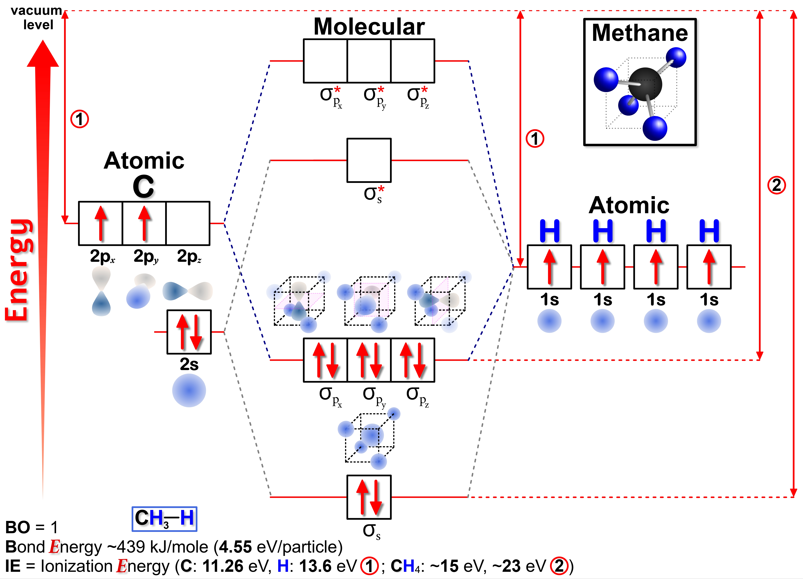
</figure>

<b><u>Figure 20</u>: Molecular Orbital (MO) Diagram of Methane.</b> According to VBT methane (CH4) is formed by combining four sp3 mixed atomic orbitals of C with four 1𝓈 orbitals provided by four H atoms. This combination of atomic orbitals lacks the symmetry seen in molecular H (**Fig. 13**). Differences in orbital shape (symmetry), orientation (i.e. direction) and energy largely determine the extent of orbital overlap or “mixing”. Unlike VBT the concept of AO hybridization is not used in MOT. Instead MOT relies on the concept of orbital “mixing” (i.e. with similar energies and symmetry) when combining AO in a linear fashion (**Eqn. 28**). As shown above methane (CH4) is formed by simply combining the eight AO of H and C (i.e. four 1𝓈, one 2𝓈 and three 𝓅 orbitals) to produce four bonding and four anti-bonding MO (**Note:** the orbital number is always conserved: \# MO = \# AO). Orbitals with similar symmetries and orientations can combine even if they belong to different energy levels (i.e. 1𝓈 and 2𝓈 orbitals). Although 𝓈 and 𝓅 orbitals have different shapes certain orientations of the latter orbital can produce productive interactions. The AO holding the eight VE are all fairly close in energy (Note: ionization energy values) suggesting that significant interactions are possible. The mini-cubic diagrams of the MO shows the orientation and phase of the AO that lead to constructive interference and bond formation (**Note:** phase alignment of 𝓈-𝓅 orbital interactions). Unlike `\(\large \sigma\)` bonds (i.e. located along inter-nuclear axis) involving only spherical orbitals (i.e. 1𝓈 and 2𝓈), `\(\large \sigma\)` bonds involving 1𝓈 and 2𝓅 orbitals have distinctive nodal planes along the inter-nuclear axis. The tetravalent nature of C is represented by the four 1𝓈 orbitals taking up positions at the corners of the tetrahedron. As always the VE are assigned to the lowest possible energy MO states first in accordance with the <i>Aufbau Principle</i>. The labels attached to the MO simply reflect their respective `\(\large \sigma\)` symmetries. Normally MO naming is based on <b>group theory</b> (symmetry) concepts. Specifically methane belongs to the <b><a class="one" href="https://www.chemtube3d.com/methane-tetrahedral-symmetry-td/" target="_blank" title="Go to ChemTube3D">Td point group</a></b>, which exhibits <b>a1</b> and <b>t2</b> type symmetries (i.e. <b><a class="one" href="https://www.chemtube3d.com/methane-tetrahedral-symmetry-td/" target="_blank" title="Go to ChemTube3D"><b>t</b>etrahedral group</a></b> with six dihedral mirror planes). The former is a single degenerate symmetric bonding orbital arising from 𝓈 orbital interactions, while <b>t2</b> represents a triply degenerate set of 𝓅 orbital interactions. The first Ionization Energy values (IE) for atomic C and H (i.e. energy required to release the first VE), as well as the IE for the two different types of `\(\large \sigma\)` MO are also shown for reference purposes. Applying <b><a class="one" href="https://www.pnnl.gov/explainer-articles/photoelectron-spectroscopy" target="_blank" title="Go to PNNL">Photo-electron spectroscopy</a></b> (<b>PES</b>) to methane reveals two distinct ionization peaks.<b>[65](#ref-baker_electronic_1968),[66](#ref-hamrin_ionization_1968)</b> Both peaks are relatively broad due to multiple quantized <b><a class="one" href="https://www.chem.purdue.edu/jmol/vibs/ch4.html" target="_blank" title="Go to Purdue U. Chemistry">vibrational states</a></b>. Integrating the two <b>PES</b> peaks reveals an intensity ratio of nearly 3:1, which is consistent with the orbital makeup of methane. Confirmation of the <b>Td</b> point group by <b>PES</b> (i.e. two distinct sets of degenerate orbitals) is at odds with the VBT, since the latter predicts 4 identical degenerate sp3 hybrid atomic orbitals for methane. However the four sp3-1𝓈 MO may simply represent an “idealized” form of orbital “mixing”.

<!-------------------------------------------------------------------->

<!-------------------------------------------------------------------->

<!-------------------------------------------------------------------->

 

**IV - 1. LCAO & Conjugated π Bond Systems:** The simplest organic molecule containing a double bond is **ethylene**, also known as **ethene** (C2H4). It is one of many organic molecules that contain one or more double (**alkenes**) and/or triple bonds (**alkynes**), a condition referred to as <u>unsaturated</u> (i.e. tetra-valence state not maximized for carbon). **Alkenes** and **alkynes** are chemically more reactive than their saturated counterparts, often undergoing addition reactions to become <u>saturated</u> (i.e. C:H ratio = 1:4). In the case of C2H4 each C atom forms three `\(\large \sigma\)` bonds via sp2 hybridization (<b>Fig. 19</b>), while the two remaining <u>unhybridized</u> 2𝓅z orbitals form a `\(\large \pi\)` bond through their sideways overlap both above and below the plane of the central C atoms.

  
<!------------------------------------------------>
<!------------ FIG 21 - MOT Ethylene ------------->
<!------------------------------------------------>

<figure>

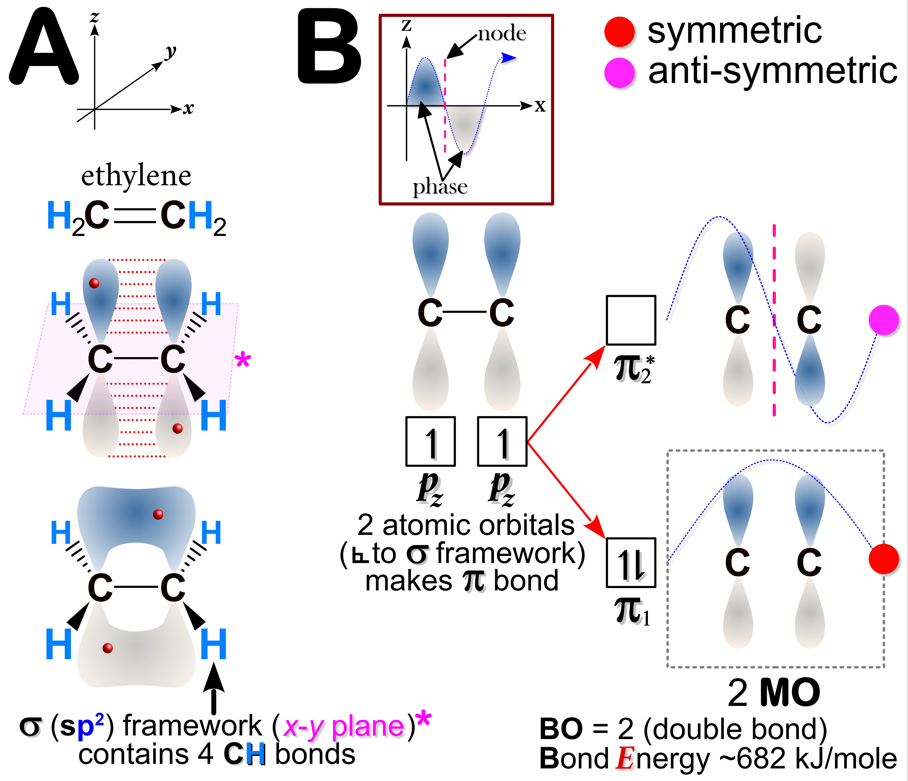
</figure>

<b><u>Figure 21</u>: Conjugated Double Bond System of Ethylene.</b>

<!------------------------------------------------------>

<!------------------------------------------------------>

<!------------------------------------------------------>

<!-------------------------------------------------->

<!------------ FIG 22 - Matrix Algebra ------------->

<!-------------------------------------------------->

<figure id="FRight350">

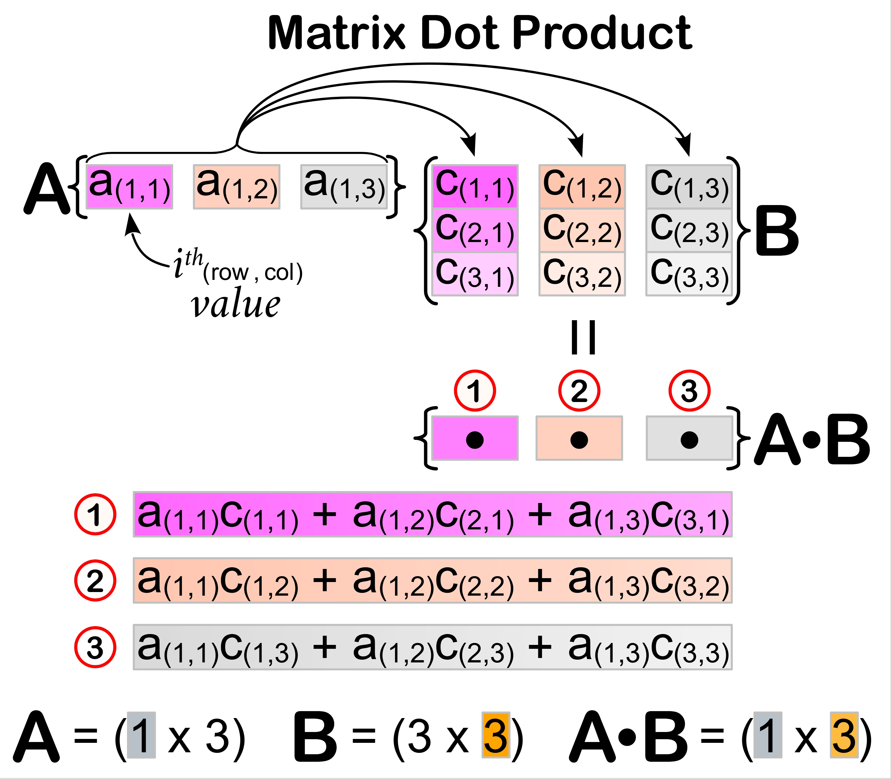
<figcaption>

<b>Figure 22</u>: Matrix Algebra - Dot Product.</b>
</figcaption>

</figure>

<!------------------------------------------------------>

<!------------------------------------------------------>

<!------------------------------------------------------>

`\(\large \pi\)` bonds are a product of the interaction or “mixing” of neighbouring 2𝓅z orbitals. As a result `\(\large \pi\)`-electrons are thought to move between the successive C atoms either above or below the planar network of `\(\large \sigma\)` bonds, otherwise known as the `\(\large \sigma\)` <b>framework</b>. According to **Erich Hückel** (1930) the MO of a conjugated `\(\large \pi\)`-bond system can be treated independently of the `\(\large \sigma\)` <b>framework</b>.<b>[67](#ref-huckel_quantentheoretische_1931)–[70](#ref-coulson_huckel_1978)</b> For **ethylene** this means the designated MO wave function (`\(\psi_{\pi}\)`) describing its delocalized `\(\large \pi\)`-electrons can be expressed using the familiar <b>LCAO</b> method, where the <b>nth</b> number of coefficient-weighted atomic orbitals are summed.

`$$\tag{50}$$`

`$$\\ \text{Let:} \; \large \psi_{\pi} \normalsize \; = \; \text{MO wave function}, \; \large \phi \normalsize \; = \; 2p_z \, \text{wave funtion}, \; c_n \; = \; \text{coefficient} \\ \large \psi_{\pi} \normalsize \phantom{.} = \phantom{.} c_1 \large \phi_1 \normalsize \phantom{.} + \phantom{.} c_2 \large \phi_2 \\[15px] \text{Algebraic Matrix Form:} \\ \text A \phantom{.} = \phantom{.} [c_1, c_2], \phantom{...} \text B \phantom{.} = \phantom{.} \left[\begin{array} \\ \large \phi_1 \\ \large \phi_2 \end{array} \right] \\ \large \psi_{\pi} \normalsize \phantom{.} = \phantom{.} \text{A} \times \text{B} \phantom{.} = \phantom{.} \overbrace{\large [c_1, c_2] \left[\begin{array} \\ \large \phi_1 \\ \large \phi_2 \end{array} \right]}^{\large \text{Dot Product}} \phantom{.} = \phantom{.} c_1 \large \phi_1 \normalsize \; + \; c_2 \large \phi_2 \\$$`

<b><a class="one" href="https://www.mathsisfun.com/algebra/matrix-introduction.html" target="_blank" title="Go to MathIsFun">Algebraic matrices</a></b>, like the one shown above, are routinely used to represent these types of orbital energy equations since the math that governs them (e.g. <b><a class="" href="https://www.mathsisfun.com/algebra/matrix-multiplying.html" target="_blank" title="Go to MathIsFun">Dot Product</a></b>) is extremely convenient when dealing with complex wave functions.  
    **Huckel** MO **theory** is a very useful way of understanding de-localized `\(\large \pi\)`-bond systems for a number of reasons. Firstly, the entire `\(\large \pi\)`-bond system can be treated separately from the `\(\large \sigma\)`-framework. Secondly, the de-localized electrons are thought to move “<i>freely</i>” within the conjugated `\(\large \pi\)`-bond system all under the influence of an electrostatic potential field. These <u>bound</u> or “trapped” `\(\large \pi\)`-electrons can be conveniently described using a sinusoidal wave function (**Recall:** Potential Energy <b><a class="one" href="https://opc-project.netlify.app/project/opcchemprimer2_atom/#InfSqW" target="_blank" title="Go to ChemPrimer2">Infinite Square Well</a></b> or electron in a box concept). The length of the trapped **sine wave** corresponds to the length of the molecule’s “<i>energy well</i>” as defined by the `\(\large \pi\)`-electron system, and where the sine wave meets the ends of the “<i>well</i>” a designated node appears (i.e. where wave function has zero electron density). The smallest possible wave length that fits the potential energy “<i>well</i>” would be a standard half-cycle (`\(\large \pi \normalsize \; \text{radians} = 180^{\circ}\)`). This low energy state would represent the bonding MO, whereas one complete wave cycle (`\(2 \large \pi \normalsize \; \text{radians} = 360^{\circ}\)`) would represent the next highest energy level, which in this case represents an anti-bonding MO (**Fig. 21**).  
    **Huckel’s** MO theory describes flat or planar molecules (i.e. sp2) with conjugated non-hybridized 2𝓅 orbitals that are perpendicular to the underlying `\(\large \sigma\)` framework. Molecules with multiple conjugated double bonds, such as **1,3-butadiene** (**Fig. 23**), allow `\(\large \pi\)`-electrons to move “<i>freely</i>” (i.e. de-localized) between multiple 2𝓅z orbitals. For **1,3-butadiene** this means the wave function representing the low energy bonding MO spans the entire length of the molecule (i.e. four contiguous 2𝓅z orbitals). Given the inverse relationship between wave length (`\(\lambda\)`) and energy (i.e. `\(\text E = h \nu\)`, where `\(\nu = 1/\lambda\)` and `\(h\)` is <b>Plank’s</b> constant) the bonding `\(\large \pi\)`-electrons represented by a long wave length function would have the lowest energy. For organic molecules like <b><a class="one" href="https://opc-project.netlify.app/project/pnps/#Fig_Ret" target="_blank" title="Go to PNP - Retinoid Cycle">carotenoids</a></b> that have extensive conjugated `\(\large \pi\)` bond systems (i.e. \>8 alternating double bonds), this means they can absorb photons with relatively long wavelengths (i.e. visible spectrum). As a result many of these types of molecules are quite colourful. These pigmented biomolecules are often put to good use, such as in the case of chlorophyll (photosynthesis) and retinoids (i.e. vision systems). According to MO theory the ability of molecules to absorb low energy photons is due to a relatively narrow energy gap between the highest occupied MO (HOMO) and the lowest unoccupied MO (LUMO). This so called <b>Frontier Orbital Gap</b> helps to explain many important properties of molecules (e.g. chemical reactivity, electrical conductivity, optical properties). For example relatively stable molecules have a large <b>Frontier Orbital Gap</b> since they only interact with high energy photons (e.g. UV, X-rays). And when an electron successfully interacts with a photon it can enter an “<i>excited</i>” state (i.e. pictured as “<i>jumping</i>” up into high energy MO). Normally such encounters are very short-lived and the “<i>excited</i>” electron quickly loses its extra energy often in the form of an emitted photon.  
    Going forward it’s important to keep in mind that **Huckel’s** MOT is semi-empirical in nature since the actual values of the base <b>Coulombic</b> (`\(\alpha\)`) and <b>Resonance</b> (`\(\beta\)`) energy integrals are actually experimental inputs. In fact the `\(\beta\)` energy values, as seen in the MO energy diagrams, are expressed as an increase or decrease in the base `\(\alpha\)` value. The relative values of `\(\alpha\)` and `\(\beta\)` change for each type of poly-atomic molecule, since different elements have their own characteristic electron affinity or <b><a class="one" href="https://ptable.com/#Properties/Electronegativity" target="_blank" title="Go to Interactive PT">electronegativity</a></b> (Χ). Although computational methods (e.g. **D**ensity **F**unctional **T**heory, or **DFT**) have largely replaced semi-empirical methods, **Huckel’s** MOT is still very useful because of its conceptual clarity when explaining `\(\large \pi\)`-electron systems.

<!----------------------------------------------------->

<!------------ FIG 23 - MOT 1,3-butadiene ------------->

<!----------------------------------------------------->

<figure>

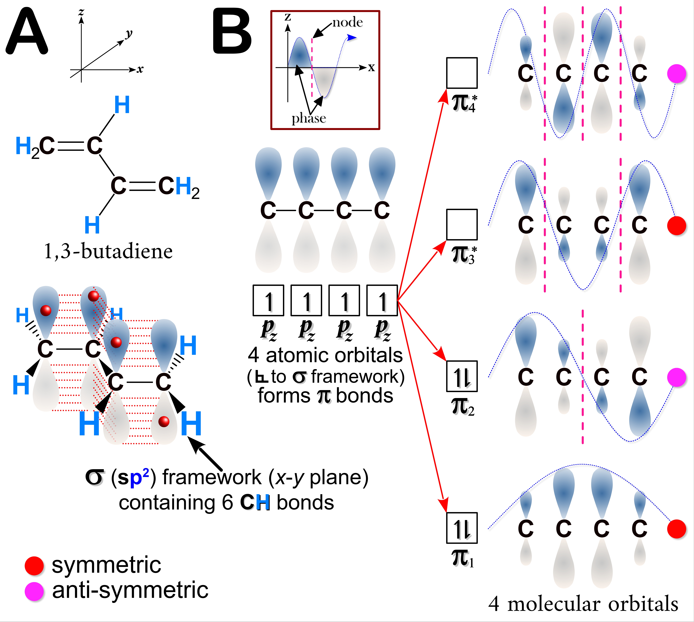
</figure>

<b><u>Figure 23</u>: MO Diagram of 1,3-butadiene.</b>

<!------------------------------------------------------>

<!------------------------------------------------------>

<!------------------------------------------------------>

It’s important to emphasis that **Huckel’s** MOT is based on several bold assumptions (**Eqn. 51**). Besides dealing with only `\(\large \pi\)`-electrons, it also makes a number of important assumptions about the calculus used to describe the energy of a MO, namely the <b>Coulombic</b> (`\(\text H_{i,j}\)`, for `\(i = j\)`), <b>Overlap</b> (`\(\text S_{i,j}\)`, for `\(i \ne j\)`), and <b>Resonance</b> (`\(\text H_{i,j}\)`, for `\(i \ne j\)`) integrals.

`$$\tag{51}$$`

`$$\text{Huckel MO assumptions:} \\ \Big[ \text{Note: semi-emperical method relies on experimental inputs} \Big] \\ \begin{align*} \large 1. & \normalsize \phantom{.} \text{Applies only to} \; \large \pi \normalsize \; \text{electron systems} \\ \large 2. & \normalsize \phantom{.} \text{Integral values } \left[ \begin{array}{l} \text{Coulombic:} \phantom{.} \text H_{ij} \phantom{.} = \phantom{.} \alpha \phantom{...} (\text{when } i = j, \, \text{emperical variable}) \\ \text{Resonance:} \phantom{.} \text H_{ij} \phantom{.} = \phantom{.} \beta \phantom{...} (\text{when } i \ne j, \, \text{emperical variable}) \\ \text{Resonance:} \phantom{.} \text H_{ij} \phantom{.} = \phantom{.} 0 \phantom{...} (\text{when } i \ne j, \, \text{non-bonded atoms}) \\ \text{Overlap:} \phantom{.} \text S_{ij} \phantom{.} = \phantom{.} 1 \phantom{...} (\text{when} \phantom{.} i = j) \\ \text{Overlap:} \phantom{.} \text S_{ij} \phantom{.} = \phantom{.} 0 \phantom{...} (\text{when} \phantom{.} i \ne j) \\ \end{array} \right. \\ \end{align*}$$`

The **Coulombic integral** (`\(\large \alpha\)`) describes the binding energy of a `\(\large \pi\)`-electron within an AO. In other words it’s the amount of energy required to remove an electron from the orbital and place it far from the nucleus where its potential energy would be zero (i.e. Vacuum level → `\(\text E_{\infty} = 0\)`). As a consequence the value of `\(\large \alpha\)` is always negative. The **Exchange** or **Resonance Integral** (`\(\large \beta\)`) describes the energy of a `\(\large \pi\)`-electron within a multi-nuclei field. It’s essentially a measure of the bond strength between two atoms, which increases with increasing AO overlap. So when the **Overlap Integral** (`\(\text S\)`) is zero then `\(\large \beta\)` must also be zero. Lastly the **Overlap Integral** (`\(\text S\)`), as the name suggests, describes the degree of physical overlap between bonding orbitals, such as two adjacent 2𝓅z AO. The nature of the integrals is largely explained by **Eqn. 29**, with each mapping to distinct spatial regions. The **Coulombic Integral** maps the long-range electrostatic repulsion or attraction between charge densities (e.g. `\(\big(\text{a}_1 \, \text{2s} \big)^2\)` and `\(\big( \text{b}_1 \, \text{2p}_z \big)^2\)`). The **Resonance** or **Exchange Integral** (`\(\large \beta\)`), as the name suggests, describes <u>non-classical</u> interactions within the shared inter-orbital region (i.e. `\(2 \text{a}_1 \text{b}_1 \big( \text{2s} \, \text{2p}_z \big)\)`). It is literally where electrons can be <u>exchanged</u> between orbitals. Lastly the **Overlap Integral** (`\(\text S\)`) physically maps to the inter-nuclear region where the atomic wave functions either positively or negatively interact with each other (i.e. `\(2 \text{a}_1 \text{b}_1 \big( \text{2s} \, \text{2p}_z \big)\)`), which determines the extent of covalent bonding (e.g. constructive interference = overlapping AO are <u>in phase</u>).  
    The above mathematical treatment is only made possible by another important assumption known as the **Born-Oppenheimer Approximation** (**BOA**).<b>[71](#ref-born_zur_1927)</b> Based on the differences in the mass of the electron and nucleus (`\(m_p / m_e \approx 1836\)`), it’s possible to assume that the motion of the nucleus is relatively static when compared to the motion of an electron. Fixing the nuclear geometry (i.e. ignoring the kinetic energy contribution of the nucleus) greatly simplifies the integral energy calculations for MO (i.e. fewer “<i>moving bodies</i>”). This is somewhat analogous to the movement of the planets in relation to the sun. Most people typically view the sun as a fixed object that governs planetary motions. However, the sun does in fact revolve around the centre of the Milky Way,<b>[72](#ref-oort_observational_1927)</b> which is ~27,000 **l**ight **y**ears away (i.e. 1 **ly** is ~9.5 × 1015 m), at ~220 km/sec.<b>[73](#ref-kerr_review_1986)</b> According to **Newtonian** mechanics (Time = `\(\text{d}/\vec v = (2 \large \pi \normalsize \, \text r)/\vec v\)`) this would mean the sun completes one rotation every ~232 million earth years. However, by assuming the sun does not move in relation to our orbiting planet is a reasonable hypothesis, certainly one that helped <b><a class="one" href="https://www.space.com/15684-nicolaus-copernicus.html" target="_blank" title="Go to Space.com">Nicolaus Copernicus</a></b> (1543) revolutionize our understanding of the universe.<b>[74](#ref-copernicus_nicolai_1543)</b> So assuming a fixed nuclear configuration at any given instant in time simplifies the wave equations (`\(\hat H \, \psi_{\text o} = \text E \, \psi_{\text o}\)`) used to describe orbital electrons within a multi-nuclei potential energy field.

`$$\\ \large \text{Hamiltonian Energy Relationship}  \\ \Big[ \, \hat H \, = \, \text{Hamiltonian operator}, \; V \, = \, \text{Potential Energy}, \; \large \psi_{\pi} \normalsize = \text{trial MO wave function} \Big] \\ \text E \cdot \large \psi \normalsize (x) \phantom{.} = \phantom{.} \overbrace{\Bigg( \frac{- \hbar^2}{2m} \cdot \frac{\partial^2}{\partial x^2} \; + \; V (x) \Bigg)}^{\large \hat H} \cdot \large \psi \normalsize (x) \phantom{...} \Longrightarrow \phantom{...} \text E_{\pi} \cdot \large \psi_{\pi} \normalsize \phantom{.} = \phantom{.} \hat H \cdot \large \psi_{\pi} \\ \\[10px] \text{Multiple by } \large \psi_{\pi} \normalsize \text{ then integrate and solve for } \text E_{\pi} \\[10px] \int \large \psi^*_{\pi} \normalsize \phantom{.} \text E_{\pi} \phantom{.} \large \psi^{\phantom{.}}_{\pi} \normalsize \, d \text v \phantom{.} = \phantom{.} \int \large \psi^*_{\pi} \normalsize \phantom{.} \hat H \normalsize \phantom{.} \large \psi^{\phantom{.}}_{\pi} \normalsize \, d \text v \phantom{...} \Longrightarrow \phantom{...} \overbrace{\text E_{\pi}}^{\text{constant}} \cdot \int \large \psi^*_{\pi} \psi^{\phantom{.}}_{\pi} \normalsize \, d \text v \phantom{.} = \phantom{.} \int \large \psi^*_{\pi} \normalsize \phantom{.} \hat H \phantom{.} \large \psi^{\phantom{.}}_{\pi} \normalsize \, d \text v  \\ \large \text E_{\pi} \normalsize \phantom{.} = \phantom{.} \frac{\int \large \psi^*_{\pi} \normalsize \phantom{.} \hat H \phantom{.} \large \psi^{\phantom{.}}_{\pi} \normalsize \, d \text v}{\int \large \psi^*_{\pi} \; \psi^{\phantom{.}}_{\pi} \normalsize \, d \text v} \phantom{.} = \phantom{.} \overbrace{\frac{\langle \large \psi^*_{\pi} \normalsize \; | \hat H | \; \large \psi^{\phantom{.}}_{\pi} \normalsize \rangle}{\langle \large \psi^*_{\pi} \normalsize \; | \; \large \psi^{\phantom{.}}_{\pi} \normalsize \rangle}}^{\large {\text{Dirac's simplified} \\ \text{Bra-Ket Notation}}} \\[40px] \text{LCAO:} \; \large \pi \normalsize \text{-electron system where} \; \large \psi_{\pi} \normalsize \, = \, \text{ MO wave function (e.g. ethylene)} \\ \text{Let} \; \large \phi \normalsize = \text{ 2p}_z \text{ AO wave function} \\ \large \psi_{\pi} \normalsize \phantom{.} = \phantom{.} c_1 \large \phi_{\normalsize 1} \normalsize \; + \; c_2 \large \phi_{\normalsize 2} \\ \begin{align*} \\ \large \text E_{\pi} \normalsize \phantom{.} = & \phantom{..} \frac{\int \big( c_1 \large \phi_{\normalsize 1} \normalsize \; + \; c_2 \large \phi_{\normalsize 2} \normalsize \big) \phantom{.} \hat H \phantom{.} \big( c_1 \large \phi_{\normalsize 1} \normalsize \; + \; c_2 \large \phi_{\normalsize 2} \normalsize \big) \phantom{.} d \text v}{\int \big( c_1 \large \phi_{\normalsize 1} \normalsize \; + \; c_2 \large \phi_{\normalsize 2} \normalsize \big)^2 \, d \text v} \\ \large \text{E}_{\pi} \normalsize \phantom{.} = & \phantom{..} \frac{\int \Big( c_1 \large \phi_{\normalsize 1} \normalsize \hat H c_1 \large \phi_{\normalsize 1} \normalsize \; + \; c_1 \large \phi_{\normalsize 1} \normalsize \hat H c_2 \large \phi_{\normalsize 2} \normalsize \; + \; c_2 \large \phi_{\normalsize 2} \normalsize \hat H c_1 \large \phi_{\normalsize 1} \normalsize \; + \; c_2 \large \phi_{\normalsize 2} \normalsize \hat H c_2 \large \phi_{\normalsize 2} \normalsize \Big) d \text v}{\int \big( c_1 \large \phi_{\normalsize 1} \normalsize \; + \; c_2 \large \phi_{\normalsize 2} \normalsize \big)^2 \phantom{.} d \text v} \\ \end{align*}$$`

`$$\text{Simplify expression using following terms:} \\ \text{Overlap Integral} \phantom{.} = \phantom{.} \int \large \phi_i \phi_j \normalsize \phantom{.} = \phantom{.} \text S_{ij} \phantom{..} \text{when: } i \ne j \\ \text{Coulombic Integral} \phantom{.} = \phantom{.}  \int \large \phi_i \normalsize \hat H \phi_j \phantom{.} = \phantom{.} \text H_{ij} \phantom{..} \text{when: } i = j \\ \text{Resonance Integral} \phantom{.} = \phantom{.} \int \large \phi_i \normalsize \hat H \large \phi_j \normalsize \phantom{.} = \phantom{.} \text H_{ij} \phantom{..} \text{when: } i \ne j \\$$`

Since the electronic energy of a trial wave function is always greater than or equal to the “<i>true</i>” ground state energy (i.e. basis of **Variational Principle**), then the best solution is to <u>minimize</u> the trial wave function with respect to each variable (i.e. coefficient). Mathematically this means setting the <b><a class="one" href="https://www.mathsisfun.com/definitions/partial-derivative.html" target="_blank" title="Go to MathIsFun">partial derivatives</a></b> to <u>zero</u> and then solving for the unknown variables (i.e. energy integrals and coefficients).

`$$\\ \text{E}_{\pi} \phantom{.} = \phantom{.} \frac{c_1^2 \text H^{\phantom{.}}_{11} + 2c_1 c_2 \text H^{\phantom{.}}_{12} + c_2^2 \text H^{\phantom{.}}_{22}}{c_1^2 \text S^{\phantom{.}}_{11} + 2c_1 c_2 \text S^{\phantom{.}}_{12} + c_2^2 \text S^{\phantom{.}}_{22}} \\ \phantom{.} \\ \text{Minimize } \text E_{\pi} \text{ (Variational Principle)} \\ \Big[ \text{E}_{\pi} \ge \text{E}_{\text o} \Longrightarrow \text{for best approximation minimize with respect to} \; c_1 \; \text{and} \; c_2 \Big] \\ \frac{\partial \text E_{\pi}}{\partial c_1} \phantom{.} = \phantom{.} 0 \phantom{...} \text{and} \phantom{...} \frac{\partial \text E_{\pi}}{\partial c_2} \phantom{.} = \phantom{.} 0 \\ \begin{align*} \overbrace{\text E_{\pi}}^{\text{constant}} \frac{\partial}{\partial c_1} \; \Big( c_1^2 \text S^{\phantom{.}}_{11} \; + \; 2c_1 c_2 \text S^{\phantom{.}}_{12} \; + \; c_2^2 \text S^{\phantom{.}}_{22} \Big) \phantom{.} = & \phantom{.} \frac{\partial}{\partial c_1} \Big( c_1^2 \text H^{\phantom{.}}_{11} \; + \; 2c_1 c_2 \text H^{\phantom{.}}_{12} \; + \; c_2^2 \text H^{\phantom{.}}_{22} \Big) \\ \text E_{\pi} \Big( 2 c_1 \text S_{11} \; + \; 2 c_2 \text S_{12} \Big) \phantom{.} = & \phantom{.} 2c_1 \text H_{11} \; + \; 2 c_2 \text H_{12} \\ c_2 \Big( \text E_{\pi} \text S_{12} \; - \; \text H_{12} \Big) \phantom{.} = & \phantom{.} c_1 \Big( \text H_{11} \; - \; \text E_{\pi} \text S_{11} \Big) \\ 0 \phantom{.} = & \phantom{.} c_1 \Big( \text H_{11} \; - \; \text E_{\pi} \text S_{11} \Big) \; + \; c_2 \Big( \text H_{12} \; - \; \text E_{\pi} \text S_{12} \Big) \\ \overbrace{\text E_{\pi}}^{\text{constant}} \frac{\partial}{\partial c_2} \phantom{.} \Big( c_1^2 \text S^{\phantom{.}}_{11} \; + \; 2c_1 c_2 \text S^{\phantom{.}}_{12} \; + \; c_2^2 \text S^{\phantom{.}}_{22} \Big) \phantom{.} = & \phantom{.} \frac{\partial}{\partial c_2} \Big( c_1^2 \text H^{\phantom{.}}_{11} \; + \; 2c_1 c_2 \text H^{\phantom{.}}_{12} \; + \; c_2^2 \text H^{\phantom{.}}_{22} \Big) \\ \text E_{\pi} \Big( 2 c_1 \text S_{12} \; + \; 2 c_2 \text S_{22} \Big) \phantom{.} = & \phantom{.} 2 c_1 \text H_{12} \; + \; 2 c_2 \text H_{22} \\ c_1 \Big( \text E_{\pi} \text S_{12} \; - \; \text H_{12} \Big) \phantom{.} = & \phantom{.} c_2 \Big( \text H_{22} \; - \; \text E_{\pi} \text S_{22} \Big) \\ 0 \phantom{.} = & \phantom{.} c_1 \Big( \text H_{12} \; - \; \text E_{\pi} \text S_{12} \Big) \; + \; c_2 \Big( \text H_{22} \; - \; \text E_{\pi} \text S_{22} \Big) \\ \end{align*}$$`

`$$\\ \begin{align*} \\ \overbrace{ \left. \begin{array}{l} \large 0 \normalsize \phantom{.} = & \phantom{.} \large c_1 \normalsize \Big( \large \text H_{11} \normalsize \phantom{.} - \phantom{.} \large \text E_{\pi} \text S_{11} \normalsize \Big) \phantom{.} + \phantom{.} \large c_2 \normalsize \Big( \large \text H_{12} \normalsize \phantom{.} - \phantom{.} \large \text E_{\pi} \text S_{12} \phantom{.} \Big) \\ \large 0 \normalsize \phantom{.} = & \phantom{.} \large c_1 \normalsize \Big( \large \text H_{12} \normalsize \phantom{.} - \phantom{.} \large \text E_{\pi} \text S_{12} \normalsize \Big) \phantom{.} + \phantom{.} \large c_2 \normalsize \Big( \large \text H_{22} \normalsize \phantom{.} - \phantom{.} \large \text E_{\pi} \text S_{22} \normalsize \Big) \\ \end{array} \right]}^{\large \text{Homogeneous Linear Equations}} \; \large \text{Secular Equations} \end{align*} \\$$`

The above **secular equations** are used to calculate the electronic energy of the MO, as well as the relative contribution that each AO makes (i.e. **coefficients**) to each MO wave function (i.e. bonding and anti-bonding MO). Since each **secular equation** is equal to zero (i.e. constant) they can also be classified as <u>homogeneous linear equations</u>. What’s <u>most important</u> here is that the **coefficients** <u>must be non-zero values</u> (i.e. non-trivial solutions). As a consequence the <b><a class="one" href="https://www.mathsisfun.com/algebra/matrix-determinant.html" target="_blank" title="Go to MathIsFun">secular determinant</a></b> (i.e. bracketed terms) must be <u>equal to zero</u> in order to satisfy the mathematical expression (i.e. <b>LS = RS</b>).

`$$\\ \text{System of Equations: Solve for } c_1 \\ \big[\text{Note: for brevity the integral expressions have been assigned letters} \big] \\ \begin{align*} \require{enclose} \enclose{circle}{1} \phantom{....} 0 \phantom{.} = & \phantom{..} c_1 \overbrace{\Big( \text H_{11} \; - \; \text E_{\pi} \text S_{11} \Big)}^{\text{X}} \; + \; c_2 \overbrace{\Big(\text H_{12} \; - \; \text E_{\pi} \normalsize \text S_{12} \Big)}^{\text Y} \\ \require{enclose} \enclose{circle}{2} \phantom{.} \phantom{....} 0 \phantom{.} = & \phantom{..} c_1 \overbrace{\Big( \text H_{12} \; - \; \text E_{\pi} \text S_{12} \Big)}^{\text Y} \; + \; c_2 \overbrace{\Big( \text H_{22} \; - \; \text E_{\pi} \text S_{22} \Big)}^{\text Z} \\ \require{enclose} \enclose{circle}{3} \phantom{.} = \phantom{.} \require{enclose} \enclose{circle}{1} \times \text Z \phantom{....}  0 \phantom{.} = & \phantom{..} c_1 \text{XZ} \; + \; c_2 \text{YZ}  \\ \require{enclose} \enclose{circle}{4} \phantom{.} = \phantom{.} \require{enclose} \enclose{circle}{2} \times \text Y \phantom{....}  0 \phantom{.} = & \phantom{..} c_1 \text{YY} \; + \; c_2 \text{ZY} \\ \require{enclose} \enclose{circle}{5} \phantom{.} = \phantom{.} \require{enclose} \enclose{circle}{3} \; - \; \require{enclose} \enclose{circle}{4} \phantom{....} 0 \phantom{.} = & \phantom{..} c_1 \text{XZ} \; + \; \require{cancel} \cancel{c_2 \text{ZY}} \; - \; \big( c_1 \text{YY} \; + \; \require{cancel} \cancel{c_2 \text{ZY}} \big) \\ 0 \phantom{.} = & \phantom{..} c_1 \big( \text{XZ} \; - \; \text{YY} \big) \\ 0 \phantom{.} = & \phantom{..} c_1 \overbrace{\Big[ \big( \text H_{11} \; - \; \text E_{\pi} \text S_{11} \big) \big( \text H_{22} \; - \; \text E_{\pi} \text S_{22} \big) \; - \; \big( \text H_{12} \; - \; \text E_{\pi} \text S_{12} \big) \big( \text H_{12} \; - \; \text E_{\pi} \text S_{12} \big)\Big]}^{\large \text{Secular Determinant} \; (|det|)} \\[10px] \large |det| \normalsize \phantom{.} = & \phantom{.} \large \text{XZ} \normalsize \; - \; \large \text{YY} \normalsize \phantom{.} = \large \left| \begin{array} \text H_{11} \; - \; \text E_{\pi} \text S_{11} & \phantom{..} \text H_{12} \; - \; \text E_{\pi} \text S_{12} \\ \text H_{12} \; - \; \text E_{\pi} \text S_{12} & \phantom{..} \text H_{22} \; - \; \text E_{\pi} \text S_{22} \end{array} \right| \normalsize \phantom{.} = \phantom{.} \large 0 \end{align*} \\$$`

The 2 × 2 matrix block (i.e. **secular determinant**) is the product of two 2𝓅z AO. Its diagonal elements (top left to bottom right) are the **Coulombic integrals**, while the off-diagonal elements (top right to bottom left) are the **Resonance** or **Exchange integrals**.

`$$\\ \large |det| \normalsize \phantom{.} = \phantom{.} \left| \begin{array} \\ \overbrace{\text H_{11}}^{\large \alpha} \; - \; \text E_{\pi} \overbrace{\text S_{11}}^{\large 1} & \phantom{..} \overbrace{\text H_{12}}^{\large \beta} \; - \; \text E_{\pi} \overbrace{\text S_{12}}^{\large 0} \\ \overbrace{\text H_{12}}^{\large \beta} \; - \; \text E_{\pi} \overbrace{\text S_{12}}^{\large 0} & \phantom{..} \overbrace{\text H_{22}}^{\large \alpha} \; - \; \text E_{\pi} \overbrace{\text S_{22}}^{\large 1} \end{array} \right| \phantom{.} = \phantom{.} \overbrace{\left| \begin{array} \\ \alpha \; - \; \text E_{\pi} & \beta \\ \beta & \phantom{.} \alpha \; - \; \text E_{\pi} \end{array} \right|}^{\large \text{New Matrix}^{\dagger}} \phantom{.} = \phantom{.} 0 \\[10px] \big[ \phantom{.}^{\dagger} \text{Note: see list of Huckel's assumptions in Eqn. 51} \phantom{.} \big] \\[5px] \text{Divide each matrix element by} \, \beta \, \text{and let:} \; \frac{\alpha \; - \; \text E_{\pi}}{\beta} \phantom{.} = \phantom{.} x \\ \large |det| \normalsize \phantom{.} = \phantom{.} \left| \begin{array} \\ x & \phantom{.} 1 \\ 1 & \phantom{.} x \end{array} \right| \phantom{.} = \phantom{.} 0 \\[10px] \text{Expand Determinant} \\ x^2 \;  - \; 1 \phantom{.} = \phantom{.} 0 \\ x \phantom{.} = \phantom{.} \pm \thinspace 1 \phantom{..} \Longrightarrow \phantom{..} 2 \phantom{.} \text{energy solutions} \\[10px] \begin{align*} \text{when } x = -1 \phantom{..} \Longrightarrow & \phantom{..} \frac{\alpha \; - \; \text E_{\pi}}{\beta} \phantom{.} \; = \; -1 \phantom{...} \Longrightarrow \phantom{...} \text E_{\pi} \phantom{.} = \phantom{.} \alpha \phantom{.} + \phantom{.} \beta \\ \text{when} \, x = 1 \phantom{..} \Longrightarrow & \phantom{..} \frac{\alpha \phantom{.} - \phantom{.} \text E_{\pi}}{\beta} \; = \; 1 \phantom{...} \Longrightarrow \phantom{...} \text E_{\pi} \phantom{.} = \phantom{.} \alpha \; - \; \beta \end{align*}$$`

The two <u>roots</u> of the **secular determinant** provide the energy of the `\(\large \pi\)`-electrons (i.e. energy *eigenvalues*). Inputting the actual (experimental) energy values for the **Coulombic integral** (i.e. `\(\alpha \approx 11.4 \, e \text V\)`) and **Resonance integral** (i.e. `\(\beta \approx 0.674 \, e \text V\)`) of a carbon 2𝓅z AO makes it possible to properly graph the energy levels of a `\(\large \pi\)`-electron system (**Fig. 24**). Following the *Aufbau* principle the first two `\(\large \pi\)`-electrons are placed in the lowest energy level (i.e. `\(\text E = \alpha \normalsize \; + \; \beta\)`), which represents the lone `\(\large \pi\)`-<b>bonding</b> MO (Note: `\(\beta\)` is negative since the vacuum level is zero). The total energy of the two `\(\large \pi\)`-electron system is `\(2(\alpha \; + \; \beta)\)`. To determine the values of the two coefficients (i.e. <b>c1</b> and <b>c2</b>) one needs to simply plug one of the energy values (e.g. `\(\text E_{\pi} = \alpha \; + \; \beta\)`) into the <b>secular equations</b> and then systematically solve for each coefficient.

`$$\text{Apply Huckel Approximations and Plug in Energy Value} \, (\alpha + \beta) \\ \begin{align*} 0 \phantom{.} = & \phantom{..} c_1 \Big( \overbrace{\text H_{11}}^{\large \alpha} \; - \; \text E_{\pi} \overbrace{\text S_{11}}^{\large 1} \Big) \; + \; c_2 \Big(\overbrace{\text H_{12}}^{\large \beta} \; - \; \text E_{\pi} \normalsize \overbrace{\text S_{12}}^{\large 0} \Big) \\ 0 \phantom{.} = & \phantom{.} c_1 \Big( \alpha \; - \; \text E_{\pi} \Big) \; + \; c_2 \beta \\ 0 \phantom{.} = & \phantom{.} c_1 \Big( \require{cancel} \cancel{\alpha} \; - \; \big[ \require{cancel} \cancel{\alpha} \; + \; \beta \big] \Big) \; + \; c_2 \beta \phantom{.} = \phantom{.} - c_1 \beta \; + \; c_2 \beta \\ c_1 \beta \phantom{.} = & \phantom{.} c_2 \beta \phantom{..} \Longrightarrow \phantom{..} c_1 \phantom{.} = \phantom{.} c_2 \\ \end{align*} \\[10px] \text{Apply Normalization Conditions} \\ \big[ \, \text{See Fig. 18} \, \big] \\ \sum c^2 \phantom{.} = \phantom{.} c_1^2 \; + \; c_2^2 \phantom{.} = \phantom{.} 1 \phantom{..} \Longrightarrow \phantom{..} 2c_1^2 \phantom{.} = \phantom{.} 1 \phantom{..} \Longrightarrow \phantom{..} c_1 \phantom{.} = \phantom{.} \frac{1}{\sqrt{2}} \phantom{.} = \phantom{.} c_2 \\ \text{Normalized Density Function} \; \big( \psi_{\pi}^2 \big) \\ \text{Since:} \phantom{..} c_1 \phantom{.} = \phantom{.} c_2 \phantom{..} \Longrightarrow \phantom{..} \large \psi_{\pi} \normalsize \phantom{.} = \phantom{.} c_1 \big( \large \phi_1 \normalsize \; + \; \large \phi_2 \normalsize \big) \\ \large \psi_{\pi}^2 \normalsize \phantom{.} = \phantom{.} c_1^2 \big( \large \phi_1 \normalsize \; + \; \large \phi_2 \normalsize \big)^2 \phantom{.} = \phantom{.} 1 \\[10px] c_1^2 \Big( \overbrace{\large \phi_1^2}^{\text S_{11} \; = \; 1} \; + \; 2 \overbrace{\large \phi_1 \, \phi_2}^{\text S_{12}^{\dagger} \; = \; 0} \; + \; \overbrace{\large \phi_2^2}^{\text S_{22} \phantom{.} = \phantom{.} 1} \normalsize \Big) \phantom{.} = \phantom{.} 1 \\ \Big[ \;^{\dagger} \text{Note: see list of Huckel's assumptions} \; \Big] \\ 2c_1^2 \phantom{.} = \phantom{.} 1 \phantom{..} \Longrightarrow \phantom{..} c_1 \phantom{.} = \phantom{.} \frac{1}{\sqrt{2}} \phantom{.} = \phantom{.} c_2 \\ \large \psi_{\pi} \normalsize \phantom{.} = \phantom{.} \frac{1}{\sqrt 2} \Big( \large \phi_1 \normalsize \; + \; \large \phi_2 \normalsize \Big) \\$$`

The energy diagram for a single `\(\large \pi\)` bond system (i.e. **ethylene**) shows two 2𝓅z AO forming one <b>bonding</b> (`\(\text E_{\pi} = \alpha + \beta\)`) and one <b>anti-bonding</b> (`\(\text E_{\pi^*} = \alpha - \beta\)`) <b>MO</b> (Note: both `\(\alpha\)` and `\(\beta\)` values are \< 0 <b>eV</b>, which is the energy value assigned to a free electron at rest in a perfect vacuum far removed from the nucleus).

<!------------------------------------------------------>

<!------------ FIG 24 - Huckel MOT Ethylene------------->

<!------------------------------------------------------>

<figure>

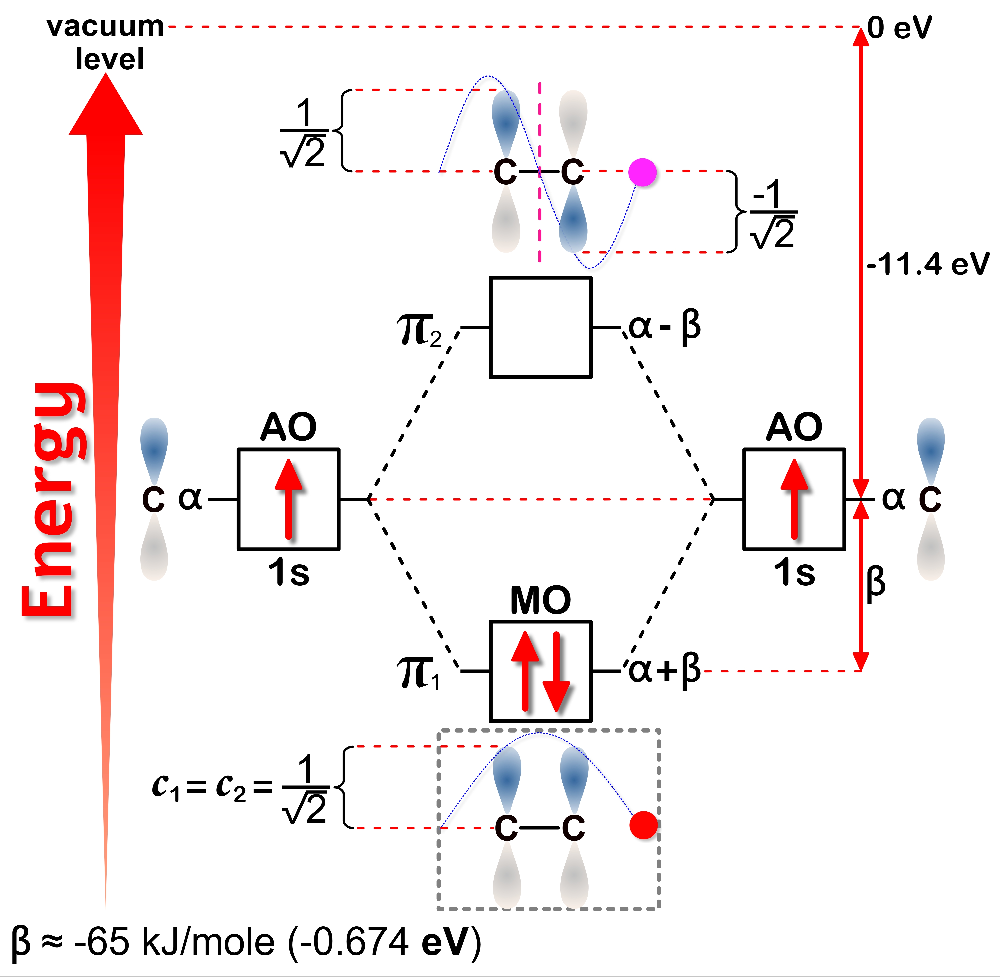
</figure>

<b><u>Figure 24</u>: Ethylene `\(\pi\)`-electron Orbital Diagram.</b>

<!------------------------------------------------------>

<!------------------------------------------------------>

<!------------------------------------------------------>

To appreciate the significance of a conjugated `\(\large \pi\)`-bond system we need to look at how it affects the stability and reactivity of a molecule, such as the relatively simple three carbon **Allyl** system.

`$$\large \overbrace{\text R - \text C = \text C  - \overset{\Large 1}{\text C} \text H_3}^{\large \text{Simple Alkene}} \\  \big[ \, \text{Allylic position} \; = \; \require{enclose} \enclose{circle}{1} , \phantom{..} \text{Allyl} \phantom{.} \text C - \text H \phantom{.} \text{bond energy} \, \approx \, 320 \, \text{kJ/mol} \, \big] \\[15px] \large \overbrace{\text R^{'} - \text C = \text C  - \overset{\Large 2}{\text C} \text H_2 - \text C = \large \text C - \text R^{''}}^{\large \text{Simple Diene}} \\  \big[ \, \text{Bis-allylic position} \; = \; \require{enclose} \enclose{circle}{2} , \phantom{..} \text{Bis-allylic} \phantom{.} \text C - \text{H} \phantom{.} \text{bond energy} \approx 314 \, \text{kJ/mol} \, \big] \\$$`

In organic chemistry an <b><a class="one" href="https://goldbook.iupac.org/terms/view/A00245" target="_blank" title="Go to IUPAC">allylic</a></b> carbon bond is known to be more prone to chemical attack than its <b><a class="one" href="https://goldbook.iupac.org/terms/view/A00222" target="_blank" title="Go to IUPAC">alkane</a></b> (saturated) counterparts. As discussed below being next to a conjugated `\(\large \pi\)`-bond makes <b>allylic</b> bonds relatively weaker and therefore more susceptible to reactive agents like free radicals. All three <b>Allyl</b> “<i>species</i>” contain a `\(\large \pi\)`-bond and an **allylic** carbon either in the form of: <b>(i)</b> a carbo-<b>cation</b> (i.e. system holds 2 `\(\large \pi\)` e<b>-</b>); <b>(ii)</b> a <b>radical</b> (i.e. system holds 3 `\(\large \pi\)` e<b>-</b>); or <b>(iii)</b> an <b>anion</b> (i.e. system holds 4 `\(\large \pi\)` e<b>-</b>). All three <b>allyl</b> “<i>species</i>” have three spatially aligned 2𝓅z orbitals (i.e. conjugated). The only major difference is the total number of `\(\large \pi\)`-electrons found within these three “<i>species</i>” (<b>Fig. 25</b>). Applying the <b>LCAO</b> method to the <b>Allyl</b> system produces three `\(\large \pi\)` MO, namely <b>(i)</b> one <u>bonding</u> (`\(\large \pi_{\normalsize 1}\)`), <b>(ii)</b> one <u>non-bonding</u> (`\(\large \pi_{\normalsize 2}\)`), and <b>(iii)</b> one <u>anti-bonding</u> MO (`\(\large \pi_{\normalsize 3}\)`). All three 2𝓅z orbitals that make up the `\(\large \pi_{\normalsize 1}\)` MO are in phase with one another, while the non-bonding `\(\large \pi_{\normalsize 2}\)` and anti-bonding `\(\large \pi_{\normalsize 3}\)` MO have one or two nodal planes, respectively, due to orbital phase shifts.

<!----------------------------------------------------------->

<!------------ FIG 25 - Huckel MOT Allyl System ------------->

<!----------------------------------------------------------->

<figure>

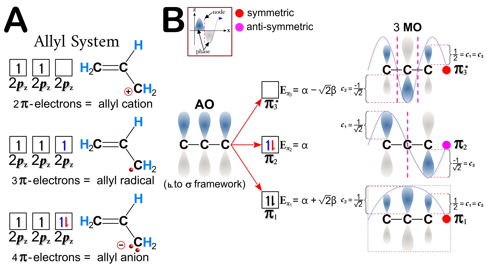
</figure>

<b><u>Figure 25</u>: Allyl Molecular Orbitals (MO).</b>

<!------------------------------------------------------>

<!------------------------------------------------------>

<!------------------------------------------------------>

Carrying out the energy calculations for the three contiguous 2𝓅z orbitals making up the **Allyl** system produces a **determinant** in the form a 3 × 3 matrix block.

`$$\\ \text{Let:} \; \large \psi_{\pi} \normalsize \; = \; \text{MO wave function}, \; \large \phi \normalsize \; = \; 2p_z \, \text{wave funtion}, \; c \; = \; \text{coefficient} \\ \large \psi_{\pi} \normalsize \phantom{.} = \phantom{.} c_1 \large \phi_1 \normalsize \; + \; c_2 \large \phi_2 \normalsize \; + \; c_3 \large \phi_3 \\[15px] \text{Algebraic Matrices:} \\ \text A \phantom{.} = \phantom{.} [c_1, \, c_2, \, c_3] \phantom{.....} \text B \phantom{.} = \phantom{.} \left[\begin{array} \\ \phi_1 \\ \phi_2 \\ \phi_3 \end{array} \right] \\ \large \psi_{\pi} \normalsize \phantom{.} = \phantom{.} \text{A} \times \text{B} \phantom{.} = \phantom{.} \overbrace{[c_1, \, c_2, \, c_3] \left[\begin{array} \\ \large \phi_1 \\ \large \phi_2 \\ \large \phi_3 \end{array} \right]}^{\large \text{Dot Product}} \phantom{.} = \phantom{.} c_1 \large \phi_1 \normalsize \; + \; c_2 \large \phi_2 \normalsize \; + \; c_3 \phi_3 \\$$`

`$$\text{Energy Expectation Value:} \\ \begin{align*} \large \text E_{\pi} \normalsize \phantom{.} = & \phantom{.} \frac{\int \big( c_1 \large \phi_1 \normalsize \; + \; c_2 \large \phi_2 \normalsize \; + \; c_3 \large \phi_3 \normalsize \big) \; \hat H \; \big( c_1 \large \phi_1 \normalsize \; + \; c_2 \large \phi_2 \normalsize \; + \; c_3 \large \phi_3 \normalsize \big) \, d \text v}{\int \big( c_1 \large \phi_1 \normalsize \; + \; c_2 \large \phi_2 \normalsize \; + \; c_3 \large \phi_3 \normalsize \big)^2 \phantom{.} d \text v} \\ \large \text{E}_{\pi} \normalsize \phantom{.} = & \phantom{.} \frac{\int \Big( c_1^2 \text H^{\phantom{.}}_{11} \; + \; c_2^2 \text H^{\phantom{.}}_{22} \; + \; c_3^2 \text H^{\phantom{.}}_{33} \; + \; 2 c_1 c_2 \text H^{\phantom{.}}_{12} \; + \; 2 c_1 c_3 \text H^{\phantom{.}}_{13} \; + \; 2 c_2 c_3 \text H^{\phantom{.}}_{23} \Big) d \text v}{\int \big( c_1^2 \text S^{\phantom{.}}_{11} \; + \; c_2^2 \text S^{\phantom{.}}_{22} \; + \; c_3^2 \text S^{\phantom{.}}_{33} \; + \; 2 c_1 c_2 \text S^{\phantom{.}}_{12} \; + \; 2 c_1 c_3 \text S^{\phantom{.}}_{13} \; + \; 2 c_2 c_3 \text S^{\phantom{.}}_{23} \big)^2 \, d \text v} \end{align*} \\$$`

 

`$$\\ \text{Minimize} \; \text E_{\large \pi} \; \text{(Variational Principle)} \\ \Big[ \, \text{E}_{\large \pi} \ge \text{E}_{\text o} \Longrightarrow \text{minimize with respect to} \; c_1 , \; c_2 \; \text{and} \; c_3 \, \Big] \\ \require{enclose} \enclose{circle}{1} \phantom{.} \frac{\partial \text E_{\large \pi}}{\partial c_1} \phantom{.} = \phantom{.} 0 , \phantom{..} \require{enclose} \enclose{circle}{2} \phantom{.} \frac{\partial \text E_{\large \pi}}{\partial c_2} \phantom{.} = \phantom{.} 0 , \phantom{..} \require{enclose} \enclose{circle}{3} \phantom{.} \frac{\partial \text E_{\large \pi}}{\partial c_3} \phantom{.} = \phantom{.} 0 \\ \begin{align*} \require{enclose} \enclose{circle}{1} \phantom{.} \frac{\partial \text E_{\large \pi}}{\partial c_1} \phantom{.} = \phantom{.} 0 \phantom{.} = & \phantom{.} c_1 \Big(\text H_{11} \; - \; \text E_{\large \pi} \text S_{11} \Big) \; + \; c_2 \Big( \text H_{12} \; - \; \text E_{\large \pi} \text S_{12} \Big) \; + \; c_3 \Big( \text H_{13} \; - \; \text E_{\large \pi} \text S_{13} \Big) \\ \require{enclose} \enclose{circle}{2} \phantom{.} \frac{\partial \text E_{\large \pi}}{\partial c_2} \phantom{.} = \phantom{.} 0 \phantom{.} = & \phantom{.} c_1 \Big( \text H_{12} \; - \; \text E_{\large \pi} \text S_{12} \Big) \; + \; c_2 \Big( \text H_{22} \; - \; \text E_{\large \pi} \text S_{22} \Big) \; + \; c_3 \Big( \text H_{23} \; - \; \text E_{\large \pi} \text S_{23} \Big) \\ \require{enclose} \enclose{circle}{3} \phantom{.} \frac{\partial \text E_{\large \pi}}{\partial c_3} \phantom{.} = \phantom{.} 0 \phantom{.} = & \phantom{.} c_1 \Big( \text H_{13} \; - \; \text E_{\large \pi} \text S_{13} \Big) \; + \; c_2 \Big( \text H_{23} \; - \; \text E_{\large \pi} \text S_{23} \Big) \; + \; c_3 \Big( \text H_{33} \; - \; \text E_{\large \pi} \text S_{33} \Big) \\ \end{align*} \\[15px] \overbrace{\left| \begin{array} \\ \text H_{11} \; - \; \text E_{\large \pi} \text S_{11} & \phantom{..} \text H_{12} \; - \; \text E_{\large \pi} \text S_{12} & \phantom{..} \text H_{13} \; - \; \text E_{\large \pi} \text S_{13} \\ \text H_{12} \; - \; \text E_{\large \pi} \text S_{12} & \phantom{..} \text H_{22} \; - \; \text E_{\large \pi} \text S_{22} & \phantom{..} \text H_{23} \; - \; \text E_{\large \pi} \text S_{23} \\ \text H_{13} \; - \; \text E_{\large \pi} \text S_{13} & \phantom{..} \text H_{23} \; - \; \text E_{\large \pi} \text S_{23} & \phantom{..} \text H_{33} \; - \; \text E_{\large \pi} \text S_{33} \end{array} \right|}^{\large |det|} \phantom{.} = \phantom{.} \large 0 \\ \overbrace{\left| \begin{array} \\ \large \alpha \normalsize \; - \; \large \text E_{\pi} & \phantom{.} \large \beta & \phantom{.} \large 0 \\ \large \beta & \large \alpha \normalsize \; - \; \large \text E_{\pi} & \phantom{.} \large \beta \\ \large 0 & \phantom{.} \large \beta & \large \alpha \normalsize \; - \; \large \text E_{\pi} \end{array} \right|}^{\large \text{New Matrix}^{\dagger}} \phantom{.} = \phantom{.} \large 0 \\ \big[ \phantom{.}^{\dagger} \text{Note: see list of Huckel's assumptions} \phantom{.} \big] \\$$`

`$$\\ \text{Divide elements (new matrix) by} \, \beta \, \text{and let} \, \frac{\alpha - \text E_{\pi}}{\beta} \; = \; x \\ \large |det| \normalsize \phantom{.} = \phantom{.} \left| \begin{array} \\ x & \phantom{.} 1 & \phantom{.} 0 \\ 1 & \phantom{.} x & \phantom{.} 1 \\ 0 & \phantom{.} 1 & \phantom{.} x \end{array} \right| \phantom{.} = \phantom{.} 0 \\ \text{Evaluate Determinant (Cofactor Expansion)} \\ \Big[\text{Note:} \; \text C_{i, \, j} \phantom{.} = \phantom{.} (-1)^{\overbrace{i \, + \, j}^{\large \text{Parity}}} \times \text M_{i, \, j} \phantom{.....} |det A|  \phantom{.} = \phantom{.} a_{1,1} \text C_{1,1} \; + \; a_{1,2} \text C_{1,2}  \; + \; a_{1,3} \text C_{1,3} \Big] \\ \begin{align*} \left| \begin{array} \\ x & \phantom{.} 1 & \phantom{.} 0 \\ 1 & \phantom{.} x & \phantom{.} 1 \\ 0 & \phantom{.} 1 & \phantom{.} x \end{array} \right| \phantom{.} = & \phantom{..} x \cdot  \overbrace{\left| \begin{array} \\ x & \phantom{.} 1 \\ 1 & \phantom{.} x \end{array} \right|}^{\large \text M_{(1,1)}} \; - \; 1 \cdot  \overbrace{\left| \begin{array} \\ 1 & \phantom{.} 1 \\ 0 & \phantom{.} x \end{array} \right|}^{\large \text M_{(1,2)}} \; + \; 0 \cdot \overbrace{\left| \begin{array} \\ 1 & \phantom{.} x \\ 0 & \phantom{.} 1 \end{array} \right|}^{\large \text M_{(1,3)}} \phantom{.} = \phantom{.} 0 \\[5px] 0 \phantom{.} = & \phantom{..} x \big( x^2 \, - \, 1 \big) \; - \; \big( x \, - \, 0 \big) \; + \; 0 \\[5px] 0 \phantom{.} = & \phantom{..} x^3 \; + \; 2x \phantom{...} \Longrightarrow \phantom{...} 3 \phantom{.} \text{roots} \phantom{.} \text{(Energy values)} \\ \end{align*} \\ x \phantom{..} = \phantom{..} 0 , \phantom{..} \pm \sqrt 2 \\$$`

Despite the increased size of the **secular determinant** for the **Allyl** system, it still produces a relatively simple set of root values. Moreover, the calculations are <u>recursive</u> in nature since this slightly <u>larger</u> matrix (i.e. <b><i>r</i></b>ow × <b><i>c</i></b>olumn = 3 × 3) is calculated by summing **C**o-factor <u>weighted</u> <b><a class="one" href="https://mathworld.wolfram.com/DeterminantExpansionbyMinors.html" target="_blank" title="Go to MathWorld">determinants</a></b> of sub-matrices or **M**inors (<b><i>r</i></b>-1 × <b><i>c</i></b>-1 = 2 × 2 matrix), otherwise known as **Laplacian** or **Co-factor expansion**. For the first row of elements the corresponding **M**inors would be: <b>M1,1</b>, <b>M1,2</b>, and <b>M1,3</b>. Ultimately the choice of row for making this calculation doesn’t matter since they all generate the same answer (Note: row with most zeros is easier to work with). However one very important feature of the **secular determinant** formula is the <u>alternating sign</u> of the weighted **M**inors, which is due to the negative unity constant and its exponent (i.e. parity of exponent determines + or - value of the unity constant).

`$$\\ \begin{align*} & \require{enclose} \enclose{circle}{1} \phantom{.} \text{when} \; x = - \sqrt 2 \phantom{..} \Longrightarrow \phantom{..} \frac{\alpha \; - \; \text E_{\large \pi}}{\beta} \phantom{.} = \phantom{.} - \sqrt 2 \phantom{..} \Longrightarrow \phantom{..} \text E_{\large \pi_{1}} \phantom{.} = \phantom{.} \overbrace{\alpha \; + \; \sqrt 2 \beta}^{\large \text{Bonding}} \\ & \require{enclose} \enclose{circle}{2} \phantom{.} \text{when} \; x \, = \, 0 \phantom{..} \Longrightarrow \phantom{..} \frac{\alpha \; - \; \text E_{\large \pi}}{\beta} \phantom{.} = \phantom{.} 0 \phantom{..} \Longrightarrow \phantom{..} \text E_{\large \pi_{2}} \phantom{.} = \phantom{.} \alpha \phantom{...} \text{(non-bonding level)} \\ & \require{enclose} \enclose{circle}{3} \phantom{.} \text{when} \; x = \sqrt 2 \phantom{..} \Longrightarrow \phantom{..} \frac{\alpha \; - \; \text E_{\large \pi}}{\beta} \phantom{.} = \phantom{.} \sqrt 2 \phantom{..} \Longrightarrow \phantom{..} \text E_{\large \pi_{3}} \phantom{.} = \phantom{.} \overbrace{\alpha \; - \; \sqrt 2 \beta}^{\large \text{Anti-Bonding}} \\ \end{align*}$$`

`$$\\ \text{Secular Equation Matrix} \\ \left| \begin{array} \\ \; x & \; 1 & \; 0 \; \\ \; 1 & \; x & \; 1 \; \\ \; 0 & \; 1 & \; x \; \end{array} \right| \; \times \overbrace{ \left| \begin{array} \\ \; c_1 \; \\ \; c_2 \; \\ \; c_3 \; \end{array} \right|}^{\text{coefficients}} \phantom{.} = \phantom{..} 0 \\ \begin{align*} \require{enclose} \enclose{circle}{1} & \phantom{..} c_1 \, x \; + \; c_2 \; + \; 0 \phantom{.} = \phantom{.} 0 \\ \require{enclose} \enclose{circle}{2} & \phantom{..} c_1 \; + \; c_2 \, x \; + \; c_3 \phantom{.} = \phantom{.} 0 \\ \require{enclose} \enclose{circle}{3} & \phantom{..} 0 \; + \; c_2 \; + \; c_3 \, x \phantom{.} = \phantom{.} 0 \end{align*} \\[20px] \text{Recall: Normalization Conditions} \\ \require{enclose} \enclose{circle}{\text N} \phantom{..} \large \sum c^2 \normalsize \phantom{.} = \phantom{.} 1 \phantom{.} = \phantom{.} c_1^2 \; + \; c_2^2 \; + \; c_3^2 \\$$`

`$$\\ \text{when} \phantom{.} x \phantom{.} = \phantom{.} 0 \\ \require{enclose} \enclose{circle}{1} \phantom{..} c_1 \, (0) \; + \; c_2 \; + \; 0 \phantom{.} = \phantom{.} 0 \phantom{..} \Longrightarrow \phantom{..} c_2 \phantom{.} = \phantom{.} 0 \\[15px] \require{enclose} \enclose{circle}{2} \phantom{..} c_1 \; + \; c_2 (0) \; + \; c_3 \phantom{.} = \phantom{.} 0 \phantom{..} \Longrightarrow \phantom{..} c_1 \; + \; c_3 \phantom{.} = \phantom{.} 0 \phantom{..} \Longrightarrow \phantom{..} c_1 \phantom{.} = \phantom{.} - \, c_3 \\[10px] \begin{align*} \large \sum_{i = 1}^N c^2 \normalsize \phantom{.} = & \phantom{..} c_1^2 \; + \; 0 \; + \; c_3^2 \phantom{.} = \phantom{.} 1 \phantom{..} \Longrightarrow \phantom{..} 2 c_1^2 \phantom{.} = \phantom{.} 1 \\  | c_1 | \phantom{.} = & \phantom{.} | c_3 | \phantom{.} = \phantom{.} \frac{1}{\sqrt 2} \\[10px] 1 \phantom{.} = & \phantom{..} \bigg( \frac{1}{\sqrt 2} \bigg)^2 \; + \; \bigg( \frac{-1}{\sqrt 2} \bigg)^2 \\[10px] c_1 \phantom{.} = & \phantom{.} \frac{1}{\sqrt 2} , \phantom{..} c_2 \phantom{.} = \phantom{.} 0 , \phantom{..} c_3 \phantom{.} = \phantom{.} \frac{-1}{\sqrt 2} \end{align*} \\$$`

`$$\text{when} \phantom{.} x \phantom{.} = \phantom{.} - \sqrt 2 \\ \begin{align*} & \require{enclose} \enclose{circle}{1} \phantom{..} - c_1 \, \sqrt 2 \; + \; c_2 \; + \; 0 \phantom{.} = \phantom{.} 0 \phantom{..} \Longrightarrow \phantom{..} c_2 = \sqrt 2 \, c_1 \\ & \require{enclose} \enclose{circle}{2} \phantom{..} c_1 \; - \; \sqrt 2 \, c_2 \; + \; c_3 \phantom{.} = \phantom{.} 0 \phantom{..} \Longrightarrow \phantom{..} c_1 \; + \; c_3 \phantom{.} = \phantom{.} \sqrt 2 \, c_2 \\ & \require{enclose} \enclose{circle}{3} \phantom{..} c_2 \; - \; \sqrt 2 \, c_3 \phantom{.} = \phantom{.} 0 \phantom{..} \Longrightarrow \phantom{..} c_2 \phantom{.} = \phantom{.} \sqrt 2 \, c_3 \\ & \require{enclose} \enclose{circle}{4} \phantom{.} = \phantom{.} \require{enclose} \enclose{circle}{1} \, \text{&} \, \require{enclose} \enclose{circle}{3} \phantom{..} \Longrightarrow \phantom{..} c_1 \phantom{.} = \phantom{.} c_3 \phantom{.} = \phantom{.} \frac{1}{\sqrt 2} c_2 \\ & \require{enclose} \enclose{circle}{\text N} \, \text{&} \, \require{enclose} \enclose{circle}{4} \phantom{..} \Longrightarrow \phantom{..} \bigg( \frac{1}{\sqrt 2} c_2 \bigg)^2 \; + \; c_2^2 \; + \; \bigg( \frac{1}{\sqrt 2} c_2 \bigg)^2 \phantom{.} = \phantom{.} 1 \\ \end{align*} \\ \require{enclose} \enclose{circle}{5} \phantom{...} 2 c_2^2 \normalsize \phantom{.} = \phantom{.} 1 \phantom{...} \Longrightarrow \phantom{...} c_2 \phantom{.} = \phantom{.} \frac{1}{\pm \sqrt 2} \\ \require{enclose} \enclose{circle}{5} \phantom{.} \text{&} \phantom{.} \require{enclose} \enclose{circle}{4} \phantom{...} c_1 \phantom{.} = \phantom{.} c_3 \phantom{.} = \phantom{.} \frac{1}{\sqrt 2} c_2 \phantom{.} = \phantom{.} \frac{1}{\sqrt 2} \cdot \frac{1}{\sqrt 2} \phantom{.} = \phantom{.} \frac{1}{2} \\ c_1 \phantom{.} = \phantom{.} \frac{1}{2} , \phantom{..} c_2^{\dagger} \phantom{.} = \phantom{.} \frac{1}{\sqrt 2} , \phantom{..} c_3 \phantom{.} = \phantom{.} \frac{1}{2} \\ \Big[ \phantom{.} ^\dagger \text{Note: since part of bonding MO = + phase} \Big] \\$$`

`$$\text{when} \phantom{.} x \phantom{.} = \phantom{.} \sqrt 2 \\ \begin{align*} & \require{enclose} \enclose{circle}{1} \phantom{..} \sqrt 2 \, c_1 \; + \; c_2 \; + \; 0 \normalsize \phantom{.} = \phantom{.} 0 \phantom{..} \Longrightarrow \phantom{..} c_2 = - \sqrt 2 \, c_1 \\ & \require{enclose} \enclose{circle}{2} \phantom{..} c_1 \; + \; \sqrt 2 \, c_2 \; + \; c_3 \phantom{.} = \phantom{.} 0 \phantom{..} \Longrightarrow \phantom{..} c_1 \; + \; c_3 \phantom{.} = \phantom{.} - \sqrt 2 \, c_2 \\ & \require{enclose} \enclose{circle}{3} \phantom{..} c_2 \; + \; \sqrt 2 \, c_3 \phantom{.} = \phantom{.} 0 \phantom{..} \Longrightarrow \phantom{..} c_2 \phantom{.} = \phantom{.} - \sqrt 2 \, c_3 \\ & \require{enclose} \enclose{circle}{4} \phantom{.} = \phantom{.} \require{enclose} \enclose{circle}{1} \, \text{&} \, \require{enclose} \enclose{circle}{3} \phantom{..} \Longrightarrow \phantom{..} c_1 \phantom{.} = \phantom{.} c_3 \phantom{.} = \phantom{.} \frac{-1}{\sqrt 2} c_2 \\ & \require{enclose} \enclose{circle}{\text N} \, \text{&} \, \require{enclose} \enclose{circle}{4} \phantom{..} \Longrightarrow \phantom{..} \bigg( \frac{-1}{\sqrt 2} c_2 \bigg)^2 \normalsize \; + \; c_2^2 \; + \; \bigg( \frac{-1}{\sqrt 2} c_2 \bigg)^2 \phantom{.} = \phantom{.} 1 \\ \end{align*} \\ \require{enclose} \enclose{circle}{5} \phantom{...} 2c_2^2 \phantom{.} = \phantom{.} 1 \phantom{...} \Longrightarrow \phantom{...} c_2 \phantom{.} = \phantom{.} \frac{1}{\pm \sqrt 2} \\ \require{enclose} \enclose{circle}{5} \, \text{&} \, \require{enclose} \enclose{circle}{4} \phantom{..} c_1 \phantom{.} = \phantom{.} c_3 \phantom{.} = \phantom{.} \Bigg( \frac{-1}{\sqrt 2} \Bigg) c_2 \phantom{.} = \phantom{.} \Bigg( \frac{-1}{\sqrt 2} \Bigg) \Bigg( \frac{-1}{\sqrt 2} \Bigg) \phantom{.} = \phantom{.} \frac{1}{2} \\ c_1 \phantom{.} = \phantom{.} \frac{1}{2} , \phantom{..} c_2^\dagger \phantom{.} = \phantom{.} \frac{-1}{\sqrt 2} , \phantom{..} c_3 \phantom{.} = \phantom{.} \frac{1}{2} \\ \Big[ \phantom{.} ^\dagger \text{Note: since part of anti-bonding MO } = - \text{ phase} \Big] \\$$`

One can check the calculations above by simply plugging the energy values into the expanded energy equation as exemplified below for the bonding MO `\(\psi_{\pi_1}\)`.

`$$\\ \large \psi_{\pi_1} \normalsize \phantom{.} = \phantom{..} \frac{1}{2} \large \phi_1 \normalsize \; + \; \frac{1}{\sqrt 2} \large \phi_2 \normalsize \; + \; \frac{1}{2} \large \phi_3 \normalsize \phantom{..} = \phantom{..} \frac{1}{2} \normalsize \Big( \large \phi_1 \normalsize \; + \; \sqrt 2 \large \phi_2 \normalsize \; + \; \large \phi_3 \normalsize \Big) \\$$`

`$$\\ \begin{align*} \text E_{\pi_1} \phantom{.} = & \phantom{.} \Big \langle \large \psi_{\pi_1} \normalsize \; | \hat H | \; \large \psi_{\pi_1} \normalsize \Big \rangle \normalsize \phantom{.} = \phantom{.} \Bigg \langle \normalsize \frac{1}{2} \Big( \large \phi_1 \normalsize \; + \; \sqrt 2 \large \phi_2 \normalsize \; + \; \large \phi_3 \normalsize \Big) \; | \hat H | \; \frac{1}{2} \Big( \large \phi_1 \normalsize \; + \; \sqrt 2 \large \phi_2 \normalsize \; + \; \large \phi_3 \normalsize \Big) \Bigg \rangle \\ = & \phantom{.} \frac{1}{4} \Bigg[ \; \overbrace{ \Big \langle \large \phi_1 \normalsize \; | \hat H | \; \large \phi_1 \normalsize \Big \rangle}^{\large \alpha \normalsize \, + \, \large \sqrt 2 \beta} \normalsize \; + \; 2 \Big( \; \sqrt 2 \; \overbrace{ \Big \langle \large \phi_1 \normalsize \; | \hat H | \; \large \phi_2 \normalsize \Big \rangle}^{\large \beta} \normalsize \; \Big) \; + \; 2 \normalsize \Big( \; \overbrace{ \Big\langle \large \phi_1 \normalsize \; | \hat H | \; \large \phi_3 \normalsize \Big \rangle}^{\large 0} \normalsize \; \Big) \; + \; 2 \Big( \, \overbrace{ \Big \langle \large \phi_2 \normalsize \; | \hat H | \; \large \phi_2 \Big \rangle}^{\large \alpha} \normalsize \; \Big) \\ & + \phantom{.} 2 \Big( \sqrt 2 \; \overbrace{\Big \langle \large \phi_2 \normalsize \; | \hat H | \; \large \phi_3 \normalsize \Big \rangle}^{\large \beta} \normalsize \; \Big) \; + \; \overbrace{ \Big \langle \large \phi_3 \normalsize \; | \hat H | \; \large \phi_3 \normalsize \Big \rangle}^{\large \alpha \normalsize \, - \, \large \sqrt 2 \beta} \normalsize \; \Bigg] \\ = & \frac{1}{4} \bigg[ \; \alpha \; + \; \require{cancel} \cancel{\sqrt 2 \beta} \; + \; 2 \sqrt 2 \beta \; + \; 2 \alpha \; + \; 2 \sqrt 2 \beta \; + \; \alpha \; - \; \require{cancel} \cancel{\sqrt 2 \beta} \; \bigg] \\ = & \frac{1}{4} \bigg[ \; 4 \alpha \; + \; 4 \sqrt 2 \beta \; \bigg] \phantom{.} = \phantom{.} \alpha \; + \; \sqrt 2 \beta \phantom{...} \Huge \checkmark \\ \end{align*}$$`

`$$\large \text{Ethylene } \Large \pi \large \text{-electron System} \\ \begin{align*} & \left. \begin{array} \\ \large \psi_{\pi_1} \normalsize \phantom{.} = \phantom{.} \frac{1}{\sqrt 2} \large \phi_1 \normalsize \; + \; \frac{1}{\sqrt 2} \large \phi_2 \normalsize \end{array} \right. \Bigg\} \phantom{..} \text E_{\large \pi_1} \phantom{.} = \phantom{.} \alpha \; + \; \beta \phantom{..} \text{(Bonding MO)} \\ & \left. \begin{array} \\ \large \psi_{\pi_2} \normalsize \phantom{.} = \phantom{.} \frac{1}{\sqrt 2} \large \phi_1 \normalsize \; - \; \frac{1}{\sqrt 2} \large \phi_2 \end{array} \right. \Bigg\} \phantom{..} \text E_{\large \pi_2} \phantom{.} = \phantom{.} \alpha \; - \; \beta \normalsize \phantom{..} \text{(Anti-Bonding MO)} \\ \end{align*} \\$$`

`$$\large \text{Allyl } \Large \pi \large \text{-electron System} \\ \begin{align*} & \left. \begin{array} \\ \large \psi_{\pi_1} \normalsize \phantom{.} = \phantom{.} \frac{1}{2} \large \phi_1 \normalsize \; + \; \frac{1}{\sqrt 2} \large \phi_2 \normalsize \; + \; \frac{1}{2} \large \phi_3 \normalsize \end{array} \right. \Bigg\} \phantom{..} \text E_{\large \pi_1} \phantom{.} = \phantom{.} \alpha \; + \; 2 \sqrt{\beta} \phantom{..} \text{(Bonding MO)} \\ & \left. \begin{array} \\ \large \psi_{\pi_2} \normalsize \phantom{.} = \phantom{.} \frac{1}{\sqrt 2} \large \phi_1 \normalsize \; + \; (0) \large \phi_2 \normalsize \; - \; \frac{1}{\sqrt 2} \large \phi_3 \normalsize \end{array} \right. \Bigg\} \phantom{..} \text E_{\large \pi_2} \phantom{.} = \phantom{.} \alpha \phantom{..} \text{(Non-bonded level)} \\ & \left. \begin{array} \\ \large \psi_{\pi_3} \normalsize \phantom{.} = \phantom{.} \frac{1}{2} \large \phi_1 \normalsize \; - \; \frac{1}{\sqrt 2} \large \phi_2 \normalsize \; + \; \frac{1}{2} \large \phi_3 \normalsize \end{array} \right. \Bigg\} \phantom{..} \text E_{\large \pi_3} \phantom{.} = \phantom{.} \alpha \; - \; \sqrt{\beta} \phantom{..} \text{(Anti-Bonding MO)} \\ \end{align*}$$`

The final coefficient weighted wave functions for the **Allyl** and **Ethylene** `\(\large \pi\)`-electron systems are listed above. This information helps us understand the behaviour of <u>de-localized</u> `\(\large \pi\)`-electron systems, particularly when it is compared to a <u>localized</u> `\(\large \pi\)`-electron system depicted in <b><a class="one" href="https://lewisstructures.net/" target="_blank" title="Go to LewisStructures.net">Lewis structures</a></b> (**Fig. 22**). Based on the calculations below the so called <u>De-localization Energy</u> for the 3 `\(\large \pi\)`-electron **Allyl** system is approximately `\(0.83 \, \beta\)`.

`$$\\ \large \text{De-localization Energy:} \normalsize \\ \Big[ \text{Note: De-localized versus localized Total } \large \pi \normalsize \text{-electron Energy} \Big] \\ \begin{align*} \text E_{\text{(de-localized)}} \phantom{.} = & \phantom{.} \text E_{\large \pi_1} \; - \; \Big( \text E_{\large \pi \normalsize (\text C_2 \text H_4)} \; + \; \alpha \Big) \\ = & \phantom{.} \Big( \overbrace{ 2 \Big[ \alpha \; + \; \sqrt 2 \beta \Big]}^{\large \text E_{\pi_1} \; 2 \, \pi e^-} \; + \; \require{cancel} \cancel{\alpha} \Big) \; - \; \Big( \overbrace{2 \Big[ \alpha \; + \; \beta \Big]}^{\large \text E_{\pi \normalsize (\text C_2 \text H_4)} \; 2 \, \large \pi \normalsize e^-} \; + \; \require{cancel} \cancel{\alpha} \Big) \\ = & \phantom{.} \Big( \require{cancel} \cancel{3 \alpha} \; + \; 2 \sqrt 2 \beta \Big) \; - \; \Big( \require{cancel} \cancel{3 \alpha} \; + \; 2 \beta \Big) \phantom{.} = \phantom{.} 2 \sqrt 2 \beta \; - \; 2 \beta \\ \approx & \phantom{.} 0.8284 \, \beta \\ \end{align*}$$`

The energy solutions generated by the **secular determinant** helps to explain some of the properties of the **Allyl** “<i>species</i>”. Of particular interest is the varying `\(\large \pi\)`-electron density and atomic charges, since they reveal potential reactive sites. For example, an atom with a partial <u>positive</u> charge will be preferentially targeted by a <b><a class="one" href="https://goldbook.iupac.org/terms/view/N04249" target="_blank" title="Go to IUPAC">nucleophile</a></b>, whereas an atom with a partial <u>negative</u> charge will be preferentially attacked by an <b><a class="one" href="https://goldbook.iupac.org/terms/view/E02020" target="_blank" title="Go to IUPAC">electrophile</a></b>. The <u>electronic</u> charge assigned to an atom (`\(j^{th}\)`) is simply the difference between its calculated electron density (`\(D_j\)`) and the expected electron density of a neutral one electron orbital (i.e. unity). For example, if the `\(j^{th}\)` atom has excess electronic density (`\(D_j > 1\)`) than subtracting it from the expected value will yield a negative charge (`\(Q\)`).

`$$\\ \large \text{Allyl } \Large \pi \large \; e^- \; \text{Density} \\ \big[ \, \text{Note: } n = \text{#}e^-, \phantom{..} \text c = \text{coefficient}, \phantom{..} k^{th} \; \text{MO}, \phantom{..} j^{th} \text{atom}, \phantom{..} Q_j = \text{atomic } e^- \text{ charge} \, \big ] \\ \large D_{j} \normalsize \phantom{.} = \phantom{.} \large \sum_{k \, = \, 1}^{N} n_k \; c_{k \, j}^2 \phantom{.....} \large Q_j \normalsize \phantom{.} \normalsize \phantom{.} = \phantom{.} \large 1 \normalsize \; - \; \large D_{j} \\$$`

`$$\large \text{Allyl Anion} \normalsize \; (4 \; \Large \pi \normalsize e^-) \\ \begin{align*} D_1 \normalsize \phantom{.} = & \phantom{.} \overbrace{ (2) \bigg( \frac{1}{2} \bigg)^2}^{\large i \; = \; \psi_{\pi_1}} \normalsize \; + \; \overbrace{ (2) \bigg( \frac{1}{\sqrt 2} \bigg)^2}^{\large i \; = \; \psi_{\pi_2}} \phantom{.} = \phantom{.} 1.5 \phantom{......} Q_1 \phantom{.} = \phantom{.} 1 \; - \; 1.5 \phantom{.} = \phantom{.} -0.5 \\ D_2 \phantom{.} = & \phantom{.} \overbrace{ (2) \bigg( \frac{1}{\sqrt 2} \bigg)^2}^{\large i \; = \; \psi_{\pi_1}} \normalsize \; + \; \overbrace{ (2) \bigg( 0 \bigg)^2}^{\large i \; = \; \psi_{\pi_2}} \normalsize \phantom{.} = \phantom{.} 1 \phantom{........} \, Q_2 \phantom{.} = \phantom{.} 1 \; - \; 1 \phantom{.} = \phantom{.} 0 \\ D_3 \phantom{.} = & \phantom{.} \overbrace{ (2) \bigg( \frac{1}{2} \bigg)^2}^{\large i \; = \; \psi_{\pi_1}} \normalsize \; + \; \overbrace{ (2) \bigg(\frac{-1}{\sqrt 2} \bigg)^2}^{\large i \; = \; \psi_{\pi_2}} \phantom{.} = \phantom{.} 1.5 \phantom{......} Q_3 \phantom{.} = \phantom{.} 1 \; - \; 1.5 \phantom{.}  = \phantom{.} -0.5 \\ \end{align*} \\$$`

`$$\large \text{Allyl Radical} \normalsize \; (3 \; \Large \pi \normalsize e^-) \\ \begin{align*} D_1 \phantom{.} = & \phantom{.} \overbrace{ (2) \bigg( \frac{1}{2} \bigg)^2}^{\large i \; = \; \psi_{\pi_1}} \normalsize \; + \; \overbrace{ (1) \bigg( \frac{1}{\sqrt 2} \bigg)^2}^{\large i \; = \; \psi_{\pi_2}} \normalsize \phantom{.} = \phantom{.} 1 \phantom{......} Q_1 \phantom{.} = \phantom{.} 1 \; - \; 1 \phantom{.} = \phantom{.} 0 \\ D_2 \phantom{.} = & \phantom{.} \overbrace{ (2) \bigg( \frac{1}{\sqrt 2} \bigg)^2}^{\large i \; = \; \psi_{\pi_1}} \normalsize \; + \; \overbrace{ (1) \bigg( 0 \bigg)^2}^{\large i \; = \; \psi_{\pi_2}} \phantom{.} = \phantom{.} 1 \phantom{.......} Q_2 \phantom{.} = \phantom{.} 1 \; - \; 1 \phantom{.} = \phantom{.} 0 \\ D_3 \phantom{.} = & \phantom{.} \overbrace{ (2) \bigg( \frac{1}{2} \bigg)^2}^{\large i \; = \; \large \psi_{\pi_1}} \normalsize \; + \; \overbrace{ (1) \bigg(\frac{-1}{\sqrt 2} \bigg)^2}^{\large i \; = \; \large \psi_{\pi_2}} \normalsize \phantom{.} = \phantom{.} 1 \phantom{......} Q_3 \phantom{.} = \phantom{.} 1 \; - \; 1 \phantom{.} = \phantom{.} 0 \\ \end{align*}$$`

`$$\\ \large \text{Allyl Cation} \normalsize \; (2 \; \Large \pi \large e^{\normalsize -} \normalsize ) \\ \begin{align*} D_1 \phantom{.} = & \phantom{.} \overbrace{ (2) \bigg( \frac{1}{2} \bigg)^2}^{\large i \; = \; \psi_{\pi_1}} \normalsize \phantom{.} = \phantom{.} 0.5 \phantom{......} Q_1 \phantom{.} = \phantom{.} 1 \; - \; 0.5 \phantom{.} = \phantom{.} + 0.5 \\ D_2 \phantom{.} = & \phantom{.} \overbrace{ (2) \bigg( \frac{1}{\sqrt 2} \bigg)^2}^{\large i \; = \; \psi_{\pi_1}} \normalsize \phantom{.} = \phantom{.} 1 \phantom{......}  Q_2 \phantom{.} = \phantom{.} 1 \; - \; 1 \phantom{.} = \phantom{.} 0 \\ D_3 \phantom{.} = & \phantom{.} \overbrace{ (2) \bigg( \frac{1}{2} \bigg)^2}^{\large i \; = \; \psi_{\pi_1}} \normalsize \phantom{.} = \phantom{.} 0.5 \phantom{......} Q_3 \phantom{.} = \phantom{.} 1 \; - \; 0.5 \phantom{.} = \phantom{.} + 0.5 \\ \end{align*}$$`

<!------------------------------------------------>

<!------------ FIG 26 - Allyl System ------------->

<!------------------------------------------------>

<figure id="FRight450b">

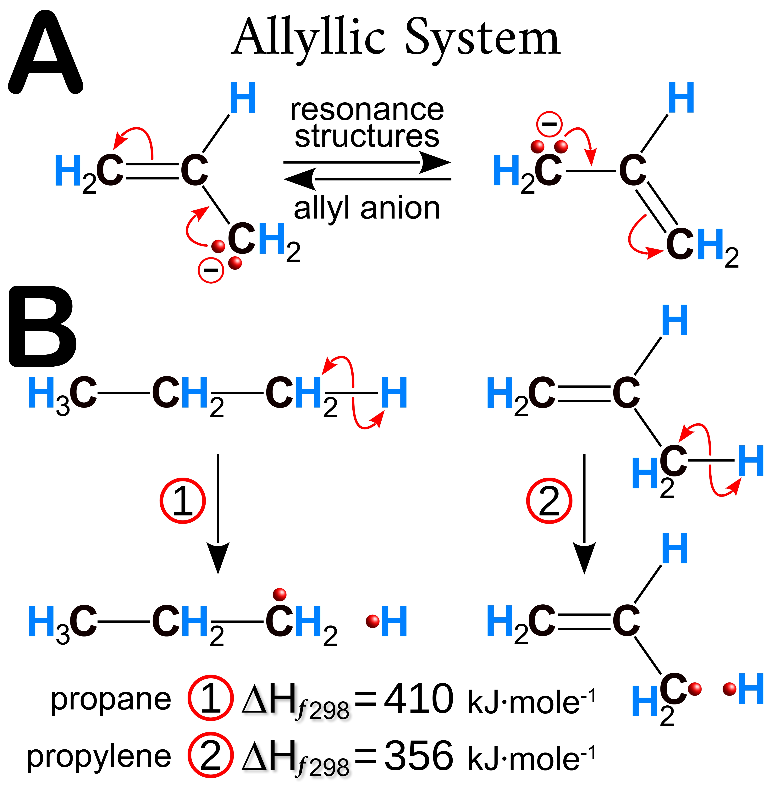
<figcaption>

<b><u>Figure 26</u>. Allyl Carbon Bond</b>
</figcaption>

</figure>

<!------------------------------------------------>

<!------------------------------------------------>

<!------------------------------------------------>

Both the **anionic** and **cationic** **Allyl** “species” spread their respective charges evenly across the two terminal carbon atoms. This is in direct contrast to the localized electronic structure depicted in **Lewis** structures (**Fig. 25A**). The increased stability conferred by its **de-localization energy** (**DE**) is the reason why **allylic** carbon bonds are weaker than their **alkane** counterparts as exemplified by **propylene** (**Fig. 26**) and **propane** (**Fig. 26B**). These differences in bond energy help to explain why **allylic** carbons are more prone to attack by chemically reactive species, which has major implications to the health of every cell in our body. For example <b><a class="one" href="https://opc-project.netlify.app/project/pnps/#Fig_VitCE" target="_blank" title="Go to PNP">polyunsaturated fatty acids</a></b> (**PUFA**), which is a major component of all cell membranes, are often damaged by **free radicals** because of their **bis-allylic** H atoms (i.e. carbon atoms located between two double bonds). Fortunately we have **anti-oxidants** like **vitamin E** that can quench or neutralize **free radicals** before they can do any damage to the cell membranes. The overall changes in the MO energy of the **Allyl** system is perhaps best illustrated via an energy level diagram (**Fig. 27**). Clearly, according to MOT, combining a lone 2𝓅z orbital with an existing `\(\large \pi\)`-bonded <b>ethylene</b> molecule produces a lower energy **allyl** bonding MO and a higher energy anti-bonding MO. The longer <u>wavelength</u> of the bonding MO is clearly proportional to its lower energy state (i.e. `\(\text E \; = \; h \, \nu, \phantom{.} \text{where } \nu \propto 1/\lambda\)`).

<!----------------------------------------------------------->

<!------------ FIG 27 - Huckel MOT Allyl System ------------->

<!----------------------------------------------------------->

<figure>

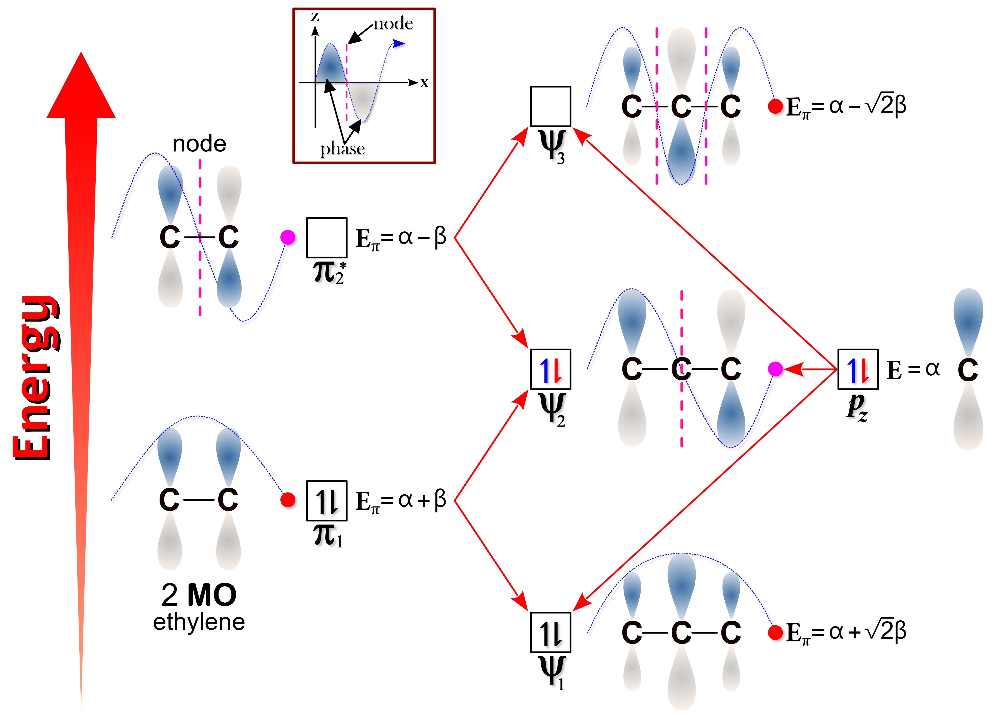
</figure>

<b><u>Figure 27</u>: Allyl MO Energy Diagram.</b>

<!----------------------------------------------------------->

<!----------------------------------------------------------->

<!----------------------------------------------------------->

For larger conjugated `\(\large \pi\)`-electron systems, like **1,3-butadiene**, its **Huckel** MO treatment involves the same steps described above for **ethylene** and **propylene**. Once the MO wave function is generated (**LCAO**) the **secular determinant** (i.e. 4 × 4 square matrix) can be calculated using the same recursive algebraic math.

`$$\\ \text{Let: } \large \psi_{\pi} \normalsize = \text{MO wave function}, \phantom{.} \large \phi \normalsize = 2p_z \; \text{wave funtion}, \phantom{.} c = \text{ coefficient} \\ \large \psi_{\pi} \normalsize \phantom{.} = \phantom{.} c_1 \large \phi_1 \normalsize \; + \; c_2 \large \phi_2 \normalsize \; + \; c_3 \large \phi_3 \normalsize \; + \; c_4 \large \phi_4 \\[15px] \large \text{Matrix Form:} \\ \text A \phantom{.} = \phantom{.} \Big[ \; c_1, \; c_2, \; c_3, \; c_4 \; \Big] \phantom{.....} \text B \phantom{.} = \phantom{.} \left[\begin{array} \\ \large \phi_1 \\ \large \phi_2 \\ \large \phi_3 \\ \large \phi_4 \end{array} \right] \\ \large \psi_{\pi} \normalsize \phantom{.} = \phantom{.} \text{A} \times \text{B} \phantom{.} = \phantom{.} \overbrace{ \Big[ \; c_1, \; c_2, \; c_3, \; c_4 \; \Big] \left[\begin{array} \\ \large \phi_1 \\ \large \phi_2 \\ \large \phi_3 \\ \large \phi_4 \end{array} \right]}^{\large \text{Dot Product}} \phantom{.} = \phantom{.} c_1 \large \phi_1 \normalsize \; + \; c_2 \large \phi_2 \normalsize \; + \; c_3 \large \phi_3 \normalsize \; + \; c_4 \large \phi_4 \\$$`

`$$\\ \begin{align*} \overbrace{ \left| \begin{array} \\ x & \phantom{.} 1 & \phantom{.} 0 & \phantom{.} 0 \\ 1 & \phantom{.} x & \phantom{.} 1 & \phantom{.} 0 \\ 0 & \phantom{.} 1 & \phantom{.} x & \phantom{.} 1 \\ 0 & \phantom{.} 0 & \phantom{.} 1 & \phantom{.} x \\ \end{array} \right| }^{\large |det|} \phantom{.} = & \phantom{.} 0 \phantom{.} = \phantom{.} x \overbrace{ \left| \begin{array} \\ x & \phantom{.} 1 & \phantom{.} 0 \\ 1 & \phantom{.} x & \phantom{.} 1 \\ 0 & \phantom{.} 1 & \phantom{.} x \\ \end{array} \right|}^{\large \text M_{(1,1)}} \; - \; 1 \overbrace{ \left| \begin{array} \\ 1 & \phantom{.} 1 & \phantom{.} 0 \\ 0 & \phantom{.} x & \phantom{.} 1 \\ 0 & \phantom{.} 1 & \phantom{.} x \\ \end{array} \right|}^{\large \text M^{'}_{(1,2)}} \normalsize \; + \; 0 \; - \; 0 \\ 0 \phantom{.} = & \phantom{.} x \left[ x \overbrace{ \Bigg| \begin{array} \\ x & \phantom{.} 1 \\ 1 & \phantom{.} x \\ \end{array} \Bigg| }^{\large \text M_{(1,1)}} \normalsize \; - \; 1 \overbrace{ \Bigg| \begin{array} \\ 1 & \phantom{.} 1 \\ 0 & \phantom{.} x \\ \end{array} \Bigg| }^{\large \text M_{(1,2)}} \normalsize \; + \; 0 \right] \; - \; 1 \left[ 1 \overbrace{ \Bigg| \begin{array} \\ x & \phantom{.} 1 \\ 1 & \phantom{.} x \\ \end{array} \Bigg| }^{\large \text M^{'}_{(1,1)}} \normalsize \; - \; 1 \overbrace{ \Bigg| \begin{array} \\ 0 & \phantom{.} 1 \\ 0 & \phantom{.} x \\ \end{array} \Bigg| }^{\large \text M^{'}_{(1,2)}} \normalsize \; + \; 0 \right] \\ 0 \phantom{.} = & \phantom{.} x \Bigg[ x \Big( x^2  \; - \; 1 \Big) \; - \; 1 \Big( x \; - \; 0 \Big) \Bigg] \; - \; 1 \Bigg[ 1 \Big( x^2 \; - \; 1 \Big) \; - \; 1 \Big( 0 \Big) \; + \; 0 \Bigg] \\ 0 \phantom{.} = & \phantom{.} \bigg( x^4 \; - \; x^2 \; - \; x^2 \bigg) \; - \; \bigg( x^2 \; - \; 1 \bigg) \\ 0 \phantom{.} = & \phantom{.} x^4 \; - \; 3x^2 \; + \; 1 \\ \end{align*}$$`

`$$\large \text{Let:} \phantom{..} y = x^2 \\ y^2 \; - \; 3y \; + \; 1 \phantom{.} = \phantom{.} 0 \phantom{...} \Longrightarrow \phantom{...} \text{Use Quadratic Formula:} \quad \large x \normalsize \; = \; \frac{-b \pm \sqrt{b^2 \, - \, 4ac}}{2a} \\ \large y \normalsize \phantom{.} = \phantom{.} \frac{3 \; + \; \sqrt{9 \; - \; 4}}{2} \phantom{.} = \phantom{.} 2.618 \phantom{.} = \phantom{.} x^2 \phantom{.....} \large y \normalsize \phantom{.} = \phantom{.} \frac{3 \; - \; \sqrt{9 \; - \; 4}}{2} \phantom{.} = \phantom{.} 0.382 \phantom{.} = \phantom{.} x^2 \\ x \phantom{.} = \phantom{.} - 1.618 \phantom{.} = \phantom{.} \frac{\alpha \; - \; \text E_{\large \pi_1}}{\beta} \phantom{..} \Longrightarrow \phantom{..} \text E_{\large \pi_1} \phantom{.} = \phantom{.} \alpha \; + \; 1.618 \, \beta \\ x \phantom{.} = \phantom{.} + 1.618 \phantom{.} = \phantom{.} \frac{\alpha \; - \; \text E_{\large \pi_4}}{\beta} \phantom{..} \Longrightarrow \phantom{..} \text E_{\large \pi_4} \phantom{.} = \phantom{.} \alpha \; - \; 1.618 \, \beta \\ x \phantom{.} = \phantom{.} - 0.618 \phantom{.} = \phantom{.} \frac{\alpha \; - \; \text E_{\large \pi_2}}{\beta} \phantom{..} \Longrightarrow \phantom{..} \text E_{\large \pi_2} \phantom{.} = \phantom{.} \alpha \; + \; 0.618 \, \beta \\ x \phantom{.} = \phantom{.} + 0.618 \phantom{.} = \phantom{.} \frac{\alpha \; - \; \text E_{\large \pi_3}}{\beta} \phantom{..} \Longrightarrow \phantom{..} \text E_{\large \pi_3} \phantom{.} = \phantom{.} \alpha \; - \; 0.618 \, \beta \\$$`

`$$\\ \begin{array} \\   \left. \begin{matrix}   \text E_{\large \pi_4} & \underline{\quad} & \phantom{.....} \alpha \; - \; 1.618 \, \beta   \phantom{\Huge X}   \\ \text E_{\large \pi_3} & \underline{\quad} & \alpha \; - \; 0.618 \, \beta   \\ \text E_{\large \pi_2} & \underline{\uparrow \downarrow} & \alpha \; + \; 0.618 \, \beta   \\ \text E_{\large \pi_1} & \underline{\uparrow \downarrow} & \alpha \; + \; 1.618 \, \beta &   \\   \end{matrix} \right\} &   \begin{array}{l}   \begin{align*} \large \text E_{\Large \pi \normalsize e^-} \normalsize \phantom{.} = & \phantom{.} 2(\alpha \; + \; 1.618 \, \beta) \; + \; 2(\alpha \; + \; 0.618 \, \beta) \\ = & \phantom{.} 4 \alpha \; + \; 4.472 \, \beta   \\   \end{align*}   \end{array} \end{array} \\$$`

`$$\\ \large \text{De-localization Energy:} \\ \Big[ \text{Note: De-localized versus Localized} \; 4 \pi e^- \; \text{Energy} \Big] \\ \begin{align*} \text E_{\text{(de-localized)}} \phantom{.} = & \phantom{.} \large \text E_{\pi \normalsize \, (\text{1,3-butadiene})} \normalsize \; - \; \large \text E_{\pi \normalsize \, (2 \; \text{ethylenes})} \\[4pt] = & \phantom{.} \bigg[ 4 \alpha \; + \; 4.472 \, \beta \bigg] \; - \; \bigg[ 2 \Big(2 \alpha \; + \; 2 \, \beta \Big) \bigg] \\ = & \phantom{.} \Big( \require{cancel} \cancel{4 \alpha} \; + \; 4.472 \, \beta \Big) \; - \; \Big( \require{cancel} \cancel{4 \alpha} \; + \; 4 \, \beta \Big) \phantom{.} = \phantom{.} 0.472 \, \beta \\ \approx & \phantom{.} 90 \; \text{kJ/mole} \\ \end{align*}$$`

`$$\\ \large \text{Secular Equation & Coefficients in Matrix Form:} \\ \overbrace{ \left| \begin{array} \\ \; x & \phantom{.} 1 & \phantom{.} 0 & \phantom{.} 0 \; \\ \; 1 & \phantom{.} x & \phantom{.} 1 & \phantom{.} 0 \; \\ \; 0 & \phantom{.} 1 & \phantom{.} x & \phantom{.} 1 \; \\ \; 0 & \phantom{.} 0 & \phantom{.} 1 & \phantom{.} x \; \end{array} \right|}^{\large |det|} \phantom{..} \cdot  \overbrace{ \left| \begin{array} \\ \; c_1 \; \\ \; c_2 \; \\ \; c_3 \; \\ \; c_4 \; \end{array} \right|}^{\large \text{coefficients}} \phantom{.} = \phantom{..} 0 \\$$`

`$$\\ \begin{align*} \require{enclose} \enclose{circle}{1} & \phantom{..} c_1 \, x \; + \; c_2 \; + \; 0 \; + \; 0 \phantom{.} = \phantom{.} 0 \phantom{...} \Longrightarrow \phantom{...} c_1 \, x \; + \; c_2 \phantom{.} = \phantom{.} 0 \\ \require{enclose} \enclose{circle}{2} & \phantom{..} c_1 \; + \; c_2 \, x \; + \; c_3 \; + \; 0 \phantom{.} = \phantom{.} 0 \phantom{...} \Longrightarrow \phantom{...} c_1 \; + \; c_2 \, x \; + \; c_3 \phantom{.} = \phantom{.} 0 \\ \require{enclose} \enclose{circle}{3} & \phantom{..} 0 \; + \; c_2 \; + \; c_3 \, x \; + \; c_4 \phantom{.} = \phantom{.} 0 \phantom{...} \Longrightarrow \phantom{...} c_2 \; + \; c_3 \, x \; + \; c_4 \phantom{.} = \phantom{.} 0 \\ \require{enclose} \enclose{circle}{4} & \phantom{..} 0 \; + \; 0 \; + \; c_3 \; + \; c_4 \; x \phantom{.} = \phantom{.} 0 \phantom{...} \Longrightarrow \phantom{...} c_3 \; + \; c_4 \; x \phantom{.} = \phantom{.} 0 \\ \end{align*} \\ \; \\ \large \text{Normalization Conditions} \\ \require{enclose} \enclose{circle}{\text N} \phantom{..} \large \sum_{i \, = \, 1}^{N} \normalsize c_i^2 \phantom{.} = \phantom{.} 1 \phantom{.} = \phantom{.} c_1^2  \; + \; c_2^2 \; + \; c_3^2 \; + \; c_4^2 \\$$`

`$$\\ \large \text{when } x  =  -1.618 \\ \begin{align*} \require{enclose} \enclose{circle}{1} & \phantom{..} -1.618 \, c_1 \, x \; + \; c_2 \phantom{.} = \phantom{.} 0 \phantom{..} \Longrightarrow \phantom{..} 1.618 \, c_1 \phantom{.} = \phantom{.} c_2 \\ \require{enclose} \enclose{circle}{2} & \phantom{..} c_1 \; - \; 1.618 \, c_2 \, x \; + \; c_3 \phantom{.} = \phantom{.} 0 \phantom{..} \Longrightarrow \phantom{..} c_1 \; + \; c_3 \phantom{.} = \phantom{.} 1.618 \, c_2 \\ \require{enclose} \enclose{circle}{3} & \phantom{..} 0 \; + \; c_2 \; + \; c_3 \, x \; + \; c_4 \phantom{.} = \phantom{.} 0 \phantom{..} \Longrightarrow \phantom{..} 1.618 \, c_3 \phantom{.} = \phantom{.} c_2 \; + \; c_4 \\ \require{enclose} \enclose{circle}{4} & \phantom{..} 0 \; + \; 0 \; + \; c_3 \; + \; c_4 \; x \phantom{.} = \phantom{.} 0 \phantom{..} \Longrightarrow \phantom{..} 1.618 \, c_4 \phantom{.} = \phantom{.} c_3 \\ \end{align*}$$`

`$$\\ \begin{align*} \require{enclose} \enclose{circle}{5} \phantom{.} = \phantom{.} \require{enclose} \enclose{circle}{1} \; + \; \require{enclose} \enclose{circle}{2} \phantom{..} \Longrightarrow \phantom{..} 1.618 \, (1.618 \, c_1) \phantom{.} = & \phantom{.} c_1 \; + \; c_3 \\ 2.618 \, c_1 \phantom{.} = & \phantom{.} c_1 \; + \; c_3 \\ 1.618 \, c_1 \phantom{.} = & \phantom{.} c_3 \\[5px] \require{enclose} \enclose{circle}{6} \phantom{.} = \phantom{.} \require{enclose} \enclose{circle}{4} \; + \; \require{enclose} \enclose{circle}{5} \phantom{..} \Longrightarrow \phantom{..} 1.618 \, c_4 \phantom{.} = & \phantom{.} c_3 \phantom{.} = \phantom{.} 1.618 \, c_1 \phantom{..} \Longrightarrow \phantom{..} c_4 \phantom{.} = \phantom{.} c_1 \\ \require{enclose} \enclose{circle}{7} \phantom{.} = \phantom{.} \require{enclose} \enclose{circle}{1} \; + \; \require{enclose} \enclose{circle}{6} \phantom{..} \Longrightarrow \phantom{..} 1.618 \, c_1 \phantom{.} = & \phantom{.} c_2 \phantom{..} \Longrightarrow \phantom{..} c_2 \phantom{.} = \phantom{.} c_3 \end{align*} \\ \; \\ \text{Express} \; \large \psi_{\pi_1} \normalsize \; \text{coefficients in terms of} \; c_1 \\ \large \psi_{\pi_1} \normalsize \phantom{.} = \phantom{.} c_1 \, \Big[ \large \phi_1 \normalsize \; + \; 1.618 \, \large \phi_2 \normalsize \; + \; 1.618 \, \large \phi_3 \normalsize \; + \; \large \phi_4 \normalsize \Big] \\$$`

`$$\large \text{Apply Normalization Conditions} \\ \begin{align*} \require{enclose} \enclose{circle}{\text N} \; \large \psi_{\pi_1} \normalsize \phantom{..} \Longrightarrow \phantom{..} 1 \phantom{.} = & \phantom{..} c_1^2 \, (1)^2 \; + \; c_1^2 \, (1.618)^2 \; + \; c_1^2 \, (1.618)^2 \; + \; c_1^2 \, (1)^2 \\[5px] 1 \phantom{.} = & \phantom{..} 7.236 \, c_1^2 \phantom{...} \Longrightarrow \phantom{...} c_1 \phantom{.} = \phantom{.} \pm \sqrt{\frac{1}{7.236}} \phantom{.} = \phantom{.} + 0.3717 \end{align*} \\ \, \\ \large \psi_{\pi_1} \normalsize \phantom{.} = \phantom{.} \, 0.372 \, \large \phi_1 \normalsize \; + \; (0.3717)(1.618) \, \large \phi_2 \normalsize \; + \; (0.3717)(1.618) \, \large \phi_3 \normalsize \; + \; 0.3717 \, \large \phi_4 \\[15px] \large \psi_{\pi_1} \normalsize \phantom{.} = \phantom{.} \, 0.3717 \, \large \phi_1 \normalsize \; + \; 0.6018 \, \large \phi_2 \normalsize \; + \; 0.6018 \, \large \phi_3 \normalsize \; + \; 0.3717 \, \large \phi_4 \\[10px] \Big[ \text{Bonding MO: all four} \; 2p_z \; \text{orbitals in phase} \Big] \\$$`

The same strategy shown above can be applied to the other `\(|det|\)` roots (i.e. `\(x = \{ +1.618, +0.618, -0.618 \}\)`) in order to calculate the coefficients for the other higher energy MO (results shown below).

`$$\\ \large \psi_{\pi_2} \normalsize \phantom{.} = \phantom{.} \, 0.6018 \, \large \phi_1 \normalsize \; + \; 0.3717 \, \large \phi_2 \normalsize \; - \; 0.3717 \, \large \phi_3 \normalsize \; - \; 0.6018 \, \large \phi_4 \\ \large \psi_{\pi_3} \normalsize \phantom{.} = \phantom{.} \, 0.6018 \, \large \phi_1 \normalsize \; - \; 0.3717 \, \large \phi_2 \normalsize \; - \; 0.3717 \, \large \phi_3 \normalsize \; + \; 0.6018 \, \large \phi_4 \\ \large \psi_{\pi_4} \normalsize \phantom{.} = \phantom{.} \, 0.3717 \, \large \phi_1 \normalsize \; - \; 0.6018 \, \large \phi_2 \normalsize \; + \; 0.6018 \, \large \phi_3 \normalsize \; - \; 0.3717 \, \large \phi_4 \\$$`

`$$\\ \large \pi \normalsize \; e^- \; \text{Density} \\ \Big[ \large \text{Note: } n \normalsize \, = \, \text{#}e^- , \phantom{.} \large \text c \normalsize \, = \, \text{coefficient}, \phantom{.} \large k^{th} \; \normalsize \text{MO}, \phantom{.} \large j^{th} \normalsize \text{atom}, \; \large Q_j \normalsize \, = \, e^- \text{ charge/atom} \Big] \\ \large D_{j} \normalsize \phantom{.} = \phantom{.} \large \sum_{k \, = \, 1}^{N} \normalsize n_k \; c_{k \, j}^2 \phantom{.....} \large Q_j \normalsize \phantom{.} = \phantom{.} 1 \; - \; \large D_{j} \\[30px] \text{1,3-butadiene} \; (4 \phantom{.} \large \pi \normalsize e^-) \\ \begin{align*} \large D_1 \normalsize \phantom{.} = & \phantom{.} \overbrace{ (2) \Big( 0.372 \Big)^2}^{ k \; = \; \large \psi_{\pi_1}} \normalsize \; + \; \overbrace{ (2) \Big( 0.6018 \Big)^2}^{ k \; = \; \large \psi_{\pi_2}} \normalsize \phantom{.} = \phantom{.} 1 \phantom{......} \large Q_1 \normalsize \phantom{.} = \phantom{.} 1 \; - \; 1 \phantom{.} = \phantom{.} 0 \\ \large D_2 \normalsize \phantom{.} = & \phantom{.} \overbrace{ (2) \Big( 0.6018 \Big)^2}^{ k \; = \; \large \psi_{\pi_1}} \normalsize \; + \; \overbrace{ (2) \Big( 0.372 \Big)^2}^{ k \; = \; \large \psi_{\pi_2}} \normalsize \phantom{.} = \phantom{.} 1 \phantom{......} \large Q_1 \normalsize \phantom{.} = \phantom{.} 1 \; - \; 1 \phantom{.} = \phantom{.} 0 \\ \large D_3 \normalsize \phantom{.} = & \phantom{.} \overbrace{ (2) \Big( 0.6018 \Big)^2}^{ k \; = \; \large \psi_{\pi_1}} \normalsize \; + \; \overbrace{ (2) \Big( - 0.372 \Big)^2}^{ k \; = \; \large \psi_{\pi_2}} \phantom{.} = \phantom{.} 1 \phantom{......} \large Q_1 \normalsize \phantom{.} = \phantom{.} 1 \; - \; 1 \phantom{.} = \phantom{.} 0 \\ \large D_4 \normalsize \phantom{.} = & \phantom{.} \overbrace{ (2) \Big( 0.372 \Big)^2}^{ k \; = \; \large \psi_{\pi_1}} \normalsize \; + \; \overbrace{ (2) \Big( - 0.6018 \Big)^2}^{ k \; = \; \large \psi_{\pi_2}} \phantom{.} = \phantom{.} 1 \phantom{......} \large Q_1 \normalsize \phantom{.} = \phantom{.} 1 \; - \; 1 \phantom{.} = \phantom{.} 0 \\ \end{align*}$$`

Similar to the previously described **Allyl radical** “<i>species</i>” the `\(\large \pi\)`-electron density of the lowest energy bonding MO of <b>1,3-butadiene</b> is spread evenly across the whole molecule. This <u>uniform</u> `\(\large \pi\)`-electron density (i.e. no localized charge) increases the stability of the molecule.

`$$\\ \large \text{Bond Order (BO)} \\ \Big[ \text{Note:} \phantom{..} n \; = \; \text{#}e^- , \phantom{..} \text c \; = \; \text{coefficient} , \phantom{..} k^{th} \, \text{MO} , \phantom{..} \text{bonded atoms} \; = \; a \; - \; b \Big] \\ \large \text{BO}_{(a-b)} \normalsize \phantom{.} = \phantom{.} \large \sum_{k \, = \, 1}^{N} \normalsize n_k^{\phantom{\,}} \; c_{(k \, a)} \; c_{(k \, b)} \\$$`

`$$\\ \large \text{BO: 1,3-butadiene} \\ \begin{align*} \large \text{BO}_{\normalsize (\text C_1 - \text C_2)} \normalsize \phantom{.} = & \phantom{.} \overbrace{ (2) \big( 0.372 \big) \big( 0.6018 \big)}^{\large k \; = \; \psi_{\pi_1}} \normalsize \; + \; \overbrace{ (2) \big( 0.6018 \big) \big( 0.372 \big)}^{\large k \; = \; \psi_{\pi_2}} \normalsize \phantom{.} \approx \phantom{.} 0.8955 \\ \large \text{BO}_{\normalsize (\text C_2 - \text C_3)} \normalsize \phantom{.} = & \phantom{.} \overbrace{ (2) \big( 0.6018 \big) \big( 0.6018 \big)}^{\large k \; = \; \psi_{\pi_1}} \normalsize \; + \; \overbrace{ (2) \big( 0.372 \big) \big( - 0.372 \big)}^{\large k \; = \; \psi_{\pi_2}} \normalsize \phantom{.} \approx \phantom{.} 0.4476 \\ \large \text{BO}_{\normalsize (\text C_3 - \text C_4)} \normalsize \phantom{.} = & \phantom{.} \overbrace{ (2) \big( 0.6018 \big) \big( 0.372 \big)}^{ \large k \; = \; \psi_{\pi_1}} \normalsize \; + \; \overbrace{ (2) \big( -0.372 \big) \big( 0.6018 \big)}^{\large k \; = \; \psi_{\pi_2}} \normalsize \phantom{.} \approx \phantom{.} 0.8955 \end{align*}$$`

`$$\\ \large \text{BO: Ethylene} \\ \large \text{BO}_{(\text C_1 - \text C_2)} \normalsize \phantom{.} = \phantom{.} \overbrace{ (2) \bigg( \frac{1}{\sqrt 2} \bigg) \bigg( \frac{1}{\sqrt 2} \bigg)}^{\large k \; = \; \psi_{\pi_{\normalsize 1}}} \phantom{.} = \phantom{.} 1 \\$$`

The **Bond Order** of both C1<b>-</b>C2 and C3<b>-</b>C4 (Note: σ bond order not included) is slightly weaker (~90% `\(\large \pi\)`-bond character) than the **Bond Order** of the lone `\(\large \pi\)` bond of <b>ethylene</b> (100% `\(\large \pi\)`-bond character). Perhaps more interesting is the middle C2<b>-</b>C3 covalent bond, which is depicted in its **Lewis** structure as a simple `\(\large \sigma\)`-bond. However, according to **Huckel’s** MO calculations this covalent bond has a significant amount of `\(\large \pi\)`-bond character (i.e. **45%**). Fortunately these calculations are consistent with the experimental evidence that shows the length of the middle C2<b>-</b>C3 bond (i.e. 1.454 Å) to be smaller than a typical single bond (i.e. 1.54 Å) and larger than a typical double bond (i.e. 1.338 Å).

 

`$$\\ \large \text{Coulson Formula} - \text{Huckle MO Energy} \; (\text E_{\pi}) \\ \large \text{Linear Planar Polyenes} \\[5px] k^{th} \; = \, \large \psi_{\pi} \normalsize \, \text{MO index} , \phantom{..} \alpha \, = \, \text{Coulomb Integral} \; \large \pi \normalsize e^- \\ \beta \, = \, \text{Resonance Integral} , \phantom{..} N \, = \, \# \, \text{C atoms} , \phantom{..} a^{\dagger} \, = \, \text{atomic position} \\ \text C_{k \, a^{\dagger}} \, = \, \text{Coefficient for} \; a^{\dagger} \; \text{AO in the} \; k^{th} \; \text{MO}  \\[10px] \text E_{\pi_k} \phantom{.} = \phantom{.} \alpha \; + \; 2 \beta \; cos \Bigg( \frac{k \; \large \pi}{ N \, + \, 1} \Bigg) \\[5px] \text C_{k \, a^{\dagger}} \; = \; \sqrt{\frac{2}{N \, + \, 1}} \; sin \Bigg( \frac{k \; a^{\dagger} \, \large \pi}{N \, + \, 1} \Bigg) \phantom{....} \text{where: } a^{\dagger} = 1, \, 2, \, 3, \, ...N \\$$`

 

<b>Coulson</b> (1939)<b>[75](#ref-coulson_electronic_1939)</b> also produced a formula for calculating the MO energies and AO weighting factors (i.e. **coefficients**) for <u>linear</u> **polyene** chains. For example, when used on **1,3-butadiene** it quickly produces the expected MO energies and coefficients as previous calculated.

`$$\\ \large \text{Coulson Energy Formula: 1,3-butadiene} \\[5px] \Big[ \text{Note:} \; ^{\dagger} \large \pi \normalsize \; \text{radians} \; = \; 180^{\circ} , \; N \; = \; 4 \Big] \\[5px] \text{MO Energy} \; \Big( \large \psi_{\pi_n} \normalsize \Big)  \\ \begin{align*} \large \text E_{\pi_1} \normalsize \phantom{.} = & \phantom{..} \alpha \; + \; 2 \, \beta \; cos \Bigg( \frac{1 \, \large \pi}{ 4 \, + \, 1} \Bigg) \phantom{.} = \phantom{.} \alpha \; + \; 2 \, \beta \; \overbrace{ cos \Bigg( \frac{ \large \pi }{5} \Bigg)}^{\large ^{\dagger} cos(36^{\circ})}  \\ = & \phantom{..} \alpha \; + \; 2 \, \beta \; \big( 0.8090 \big) \\ = & \phantom{..} \alpha \; + \; 1.618 \, \beta \\ \large \text E_{\pi_2} \normalsize \phantom{.} = & \phantom{..} \alpha \; + \; 2 \, \beta \; cos \Bigg( \frac{2 \, \large \pi}{4 \, + \, 1} \Bigg) \phantom{.} = \phantom{.} \alpha \; + \; 2 \, \beta \; \overbrace{ cos \Bigg( \frac{ 2 \large \pi }{5} \Bigg)}^{\large ^{\dagger} cos(72^{\circ})}  \\ = & \phantom{..} \alpha \; + \; 2 \, \beta \; \big( 0.3090 \big) \\ = & \phantom{..} \alpha \; + \; 0.618 \, \beta \\ \large \text E_{\pi_3} \normalsize \phantom{.} = & \phantom{..} \alpha \; + \; 2 \, \beta \; cos \Bigg( \frac{3 \, \large \pi}{4 \, + \, 1} \Bigg) \phantom{.} = \phantom{.} \alpha \; + \; 2 \, \beta \; \overbrace{ cos \Bigg( \frac{ 3 \large \pi }{5} \Bigg)}^{\large ^{\dagger} cos(108^{\circ})}  \\ = & \phantom{..} \alpha \; + \; 2 \, \beta \; \big( - 0.3090 \big) \\ = & \phantom{..} \alpha \; - \; 0.618 \, \beta \\ \large \text E_{\pi_4} \normalsize \phantom{.} = & \phantom{..} \alpha \; + \; 2 \, \beta \; cos \Bigg( \frac{4 \, \large \pi}{4 \, + \, 1} \Bigg) \phantom{.} = \phantom{.} \alpha \; + \;  2 \, \beta \; \overbrace{ cos \Bigg( \frac{ 4 \large \pi }{5} \Bigg)}^{\large ^{\large \dagger} cos(144^{\circ})}  \\ = & \phantom{..} \alpha \; + \; 2 \, \beta \; \big( - 0.8090 \big) \\ = & \phantom{..} \alpha \; - \; 1.618 \, \beta \\ \end{align*}$$`

`$$\\ \large \text{Coulson Coefficient} \normalsize \; \Big( \text C_{k \, a^{\dagger}} \Big) \; \large \text{Formula: 1,3-butadiene} \\ \begin{align*} \text C_{1 , \, 1} \phantom{.} = & \phantom{.} \sqrt{ \frac{2}{4 + 1} } \; sin \, \Bigg( \frac{1 \cdot 1 \cdot \large \pi }{4 + 1} \Bigg) \phantom{.} = \phantom{.} \sqrt{ \frac{2}{5} } \; \overbrace{sin \, \Bigg( \frac{ \large \pi }{5}}^{\large sin(36^{\circ})} \Bigg) \\ = & \phantom{.} \sqrt{\frac{2}{5}} \; \big( 0.5878 \big) \phantom{.} = \phantom{.} 0.371748 \phantom{.} \approx \phantom{.} 0.372 \\ \text C_{1 , \, 2} \phantom{.} = & \phantom{..} \sqrt{ \frac{2}{4 \; + \; 1} } \; sin \, \Bigg( \frac{ 1 \cdot 2 \cdot \large \pi}{4 \; + \; 1} \Bigg) \phantom{.} = \phantom{.} \sqrt{ \frac{2}{5} } \; \overbrace{sin \, \Bigg( \frac{2 \large \pi}{5}}^{\large sin(72^{\circ})} \Bigg) \\ = & \phantom{..} \sqrt{ \frac{2}{5} } \; \big( 0.9511 \big) \phantom{.} \approx \phantom{.} 0.6015 \\ \text C_{1 , \, 3} \phantom{.} = & \phantom{..} \sqrt{ \frac{2}{4 \; + \; 1} } \; sin \, \Bigg( \frac{1 \cdot 3 \cdot \large \pi}{4 \; + \; 1} \Bigg) \phantom{.} = \phantom{.} \sqrt{ \frac{2}{5} } \; \overbrace{sin \, \Bigg( \frac{3 \large \pi}{5}}^{\large sin(108^{\circ})} \Bigg) \\ = & \phantom{..} \sqrt{ \frac{2}{5} } \; \big( 0.9511 \big) \phantom{.} \approx \phantom{.} 0.6015 \\ \text C_{1 , \, 4} \phantom{.} = & \phantom{..} \sqrt{ \frac{2}{4 \; + \; 1} } \; sin \, \Bigg( \frac{1 \cdot 4 \cdot \large \pi}{4 \; + \; 1} \Bigg) \phantom{.} = \phantom{.} \sqrt{ \frac{2}{5} } \; \overbrace{sin \, \Bigg( \frac{4 \large \pi}{5}}^{\large sin(144^{\circ})} \Bigg) \\ = & \phantom{..} \sqrt{ \frac{2}{5} } \; \big( 0.5878 \big) \phantom{.} \approx \phantom{.} 0.372 \\ \end{align*}$$`

**Frost** and **Musulin** (1953) <b>[76](#ref-frost_mnemonic_1953)</b> also developed a very useful graphical tool to construct MO energy diagrams for cyclic planar carbon chains (**Fig. 28**). Known as the **Frost Circle** or **Polygon** method it predicts `\(\large \pi\)` MO energy levels for cyclic 2𝓅z orbital arrays using an appropriately sided regular polygon (e.g. 4 C = square, 6 C = hexagon). Once the <u>polygon</u> is oriented correctly with one corner pointing directly downwards a <u>circle</u> is then circumscribed around it (Note: radius is `\(2 \beta\)`). Each MO energy level corresponds to a point on the circle that intersects a corner of the polygon, and a horizontal line passing through the centre of the circle represents the 2𝓅z orbital energy level (i.e. `\(\alpha\)` value). Any energy level lying directly on the `\(\alpha\)` line corresponds to a <u>non-bonding</u> MO, while any energy level lying above or below the line is designated an anti-bonding or bonding MO, respectively. The lowest energy MO (i.e. `\(\alpha + 2 \beta\)`) at the bottom of the circle corresponds to in-phase 2𝓅z orbitals. For even numbered carbon chains there will be one anti-bonding MO occupying the highest energy level (i.e. top vertex), whereas odd numbered carbon chains will have one or more pairs of anti-bonding MO that share the same energy level (i.e. <b>degenerate</b> MO). This means that most MO come in <u>degenerate pairs</u>, with the notable exception of the lowest energy bonding MO and the highest energy anti-bonding MO for even numbered cyclic carbon chains. An unfortunate product of <b>degenerate</b> energy states is that they are often derived as <u>complex</u> wave functions, which means the infamous imaginary number <b>𝒾</b> appears in the energy calculations (e.g. <b>cyclopentadienyl</b> system). However, real coefficients eventually emerge by combining complex conjugate pairs using <b>Euler’s</b> famous formula, which maps them to real <b>sine</b> and <b>cosine</b> functions. This is demonstrated below for the <b>cyclopentadienyl</b> system, where taking the normal <b>secular determinant</b> approach proves difficult.

<!------------------------------------------------------>

<!------------ FIG 28 - HMOT Frost Circles ------------->

<!------------------------------------------------------>

<figure>

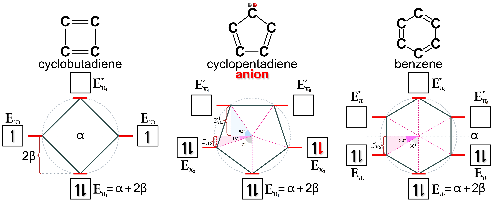
</figure>

<b><u>Figure 28</u>: Frost Circles / Polygon Method.</b> This graphical tool draws a regular polygon (# sides = \# carbons) within a circle. Points of contact between the polygon and circle represent the energy levels for the `\(\large \pi\)`-electron system. Each polygon is positioned such that one of its vertices comes in contact with the lowest point of the circle. Since the radius of the circle is `\(2\beta\)` the corresponding ground state energy of the system will be `\(\alpha + 2 \beta\)` (i.e. bottom energy level). The actual energy values of `\(\alpha\)` and `\(\beta\)` are empirically determined. The horizontal `\(\alpha\)` line running through the centre of circle marks the boundary (i.e. non-bonding level) between <b>bonding</b> and <b>non-bonding</b> MO. Simple trigonometric ratios produced by the geometric shapes allow for easy calculations of the MO energy levels. The three molecules illustrated above highlight some of the important <b>aromatic</b> (<b>Huckle’s rule: 4n + 2</b> `\(\large \pi\)`-electrons) features that make cyclic <b>polyenes</b> energetically stable. For example, the closed-shell character of the ground state wave function of <b>aromatic</b> molecules (e.g. cyclopentadienyl anion, benzene) results in a relatively wide energy gap between the <u>highest occupied</u> MO and the <u>lowest unoccupied</u> MO (i.e. HOMO–LUMO gap). This means valence electrons found in the HOMO have to interact with a more energetic photons in order to enter an excited state (i.e. “<i>jump up</i>” to the next highest energy level, which would be the LUMO). Conversely, the instability of an <b>anti-aromatic</b> state (<b>4n</b> = `\(\large \pi\)`-electrons</b>), as exemplified by <b>cyclobutadiene</b>, is due to its partially filled non-bonding orbitals. The unstable open-shell configuration, along with its notable structural strain causes **cyclobutadiene** to spontaneously distorts its own geometry resulting in bond-length alternations (i.e. takes on a rectangular geometry).<b>[77](#ref-dewar_self-consistent_1965)–[80](#ref-wu_is_2012)</b>

<!------------------------------------------------------>

<!------------------------------------------------------>

<!------------------------------------------------------>

To really appreciate the **Polygon** method consider the following **secular determinant** calculation for the **cyclopentadienyl** `\(\large \pi\)`-electron system, which is similar to the **Allyl** system in that it has three different chemical “<i>species</i>”, including: (i) a <b>cation</b> (`\(4 \large \pi\)`-electrons: \[C5H5\]+), (ii) a <b>radical</b> (`\(5 \large \pi\)`-electrons: \[C5H5\]⋅), and an <b>anion</b> (`\(6 \large \pi\)`-electrons: \[C5H5\]-). The actual <b>cyclopentadiene</b> molecule itself has five conjugated 2𝓅z orbitals, with four of them bearing only a single electron, which is typically depicted in **Lewis** structures. The variable number of electrons that occupy the remaining 2𝓅z orbital essentially defines the “<i>species</i>” of this five carbon system. Although it is only one more carbon atom than <b>cyclobutadiene</b>, its <b>secular determinant</b> is a bit more laborious to solve (i.e. five roots).

 

`$$\\ \begin{align*} 0 \phantom{.} = & \phantom{.} \overbrace{ \left| \begin{array} \\ x & \phantom{.} 1 & \phantom{.} 0 & \phantom{.} 0 & \phantom{.} 1 \\ 1 & \phantom{.} x & \phantom{.} 1 & \phantom{.} 0 & \phantom{.} 0 \\ 0 & \phantom{.} 1 & \phantom{.} x & \phantom{.} 1 & \phantom{.} 0 \\ 0 & \phantom{.} 0 & \phantom{.} 1 & \phantom{.} x & \phantom{.} 1 \\ 1 & \phantom{.} 0 & \phantom{.} 0 & \phantom{.} 1 & \phantom{.} x \\ \end{array} \right| }^{\large |det|} \phantom{.} = \phantom{.} x \overbrace{ \left| \begin{array} \\ x & \phantom{.} 1 & \phantom{.} 0 & \phantom{.} 0 \\ 1 & \phantom{.} x & \phantom{.} 1 & \phantom{.} 0 \\ 0 & \phantom{.} 1 & \phantom{.} x & \phantom{.} 1 \\ 0 & \phantom{.} 0 & \phantom{.} 1 & \phantom{.} x \\ \end{array} \right|}^{\large \text M_{(1,1)}^*} \; - \; 1 \overbrace{ \left| \begin{array} \\ 1 & \phantom{.} 1 & \phantom{.} 0 & \phantom{.} 0 \\ 0 & \phantom{.} x & \phantom{.} 1 & \phantom{.} 0 \\ 0 & \phantom{.} 1 & \phantom{.} x & \phantom{.} 1 \\ 1 & \phantom{.} 0 & \phantom{.} 1 & \phantom{.} x \\ \end{array} \right|}^{\large \text M_{(1,2)}^{\dagger}} \; + \; 1 \overbrace{ \left| \begin{array} \\ 1 & \phantom{.} x & \phantom{.} 1 & \phantom{.} 0 \\ 0 & \phantom{.} 1 & \phantom{.} x & \phantom{.} 1 \\ 0 & \phantom{.} 0 & \phantom{.} 1 & \phantom{.} x \\ 1 & \phantom{.} 0 & \phantom{.} 0 & \phantom{.} 1 \\ \end{array} \right|}^{\large \text M_{(1,5)}^{\ddagger}} \\ 0 \phantom{.} = & \phantom{.} x \left[ \, x \cdot \overbrace{\begin{array}{|c|} x & 1 & 0 \\ 1 & x & 1 \\ 0 & 1 & x \\ \end{array}}^{\large \text M_{(1,1)}^{**}} \; - \; 1 \cdot \overbrace{\begin{array}{|c|} 1 & 1 & 0 \\ 0 & x & 1 \\ 0 & 1 & x \\ \end{array}}^{\large \text M_{(1,2)}^{**}} \; \right] \; - \; 1 \left[ \, 1 \cdot \overbrace{\begin{array}{|ccc|} x & 1 & 0 \\ 1 & x & 1 \\ 0 & 1 & x \\ \end{array}}^{\large \text M_{(1,1)}^{\dagger \dagger}} \; - \; 1 \cdot \overbrace{\begin{array}{|c|} 0 & 1 & 0 \\ 0 & x & 1 \\ 1 & 1 & x \\ \end{array}}^{\Large \text M_{(1,2)}^{\dagger \dagger}} \; \right] \\ & \phantom{...} + \; 1 \left[ \, 1 \cdot \overbrace{\begin{array}{|c|} 1 & x & 1 \\ 0 & 1 & x \\ 0 & 0 & 1 \\ \end{array}}^{\large \text M_{(1,1)}^{\ddagger \ddagger}} \; - \; x \cdot \overbrace{\begin{array}{|c|} 0 & x & 1 \\ 0 & 1 & x \\ 1 & 0 & 1 \\ \end{array}}^{\large \text M_{(1,2)}^{\ddagger \ddagger}} \; + \; 1 \cdot \overbrace{\begin{array}{|c|} 0 & 1 & 1 \\ 0 & 0 & x \\ 1 & 0 & 1 \\ \end{array}}^{\large \text M_{(1,3)}^{\ddagger \ddagger}}  \; \right] \\ 0 \phantom{.} = & \phantom{.} x \left[ \, x \cdot \Bigg[ x \cdot \overbrace{\begin{array}{|c|} x & 1 \\ 1 & x \\ \end{array}}^{\large \text M_{(1,1)}^{***}} \; - \; 1 \cdot \overbrace{\begin{array}{|c|} 1 & 1 \\ 0 & x \\ \end{array}}^{\large \text M_{(1,2)}^{***}} \; \Bigg] \; - \; 1 \cdot \Bigg[ 1 \cdot \overbrace{\begin{array}{|c|} x & 1 \\ 1 & x \\ \end{array}}^{\large \text M_{(1,1)}^{***}} \; - \; 1 \cdot \overbrace{\begin{array}{|c|} 0 & 1 \\ 0 & x \\ \end{array}}^{\large \text M_{(1,2)}^{***}} \; \Bigg] \; \right] \\ & \phantom{...} - \; 1 \left[ \, 1 \cdot \Bigg[ x \cdot \overbrace{\begin{array}{|c|} x & 1 \\ 1 & x \\ \end{array}}^{\large \text M_{(1,1)}^{\dagger \dagger \dagger}} \; - \; 1 \cdot \overbrace{\begin{array}{|c|} 1 & 1 \\ 0 & x \\ \end{array}}^{\large \text M_{(1,2)}^{\dagger \dagger \dagger}} \; \Bigg] \; - \; 1 \cdot \Bigg[ -1 \cdot \overbrace{\begin{array}{|c|} 0 & 1 \\ 1 & x \\ \end{array}}^{\large \text M_{(1,2)}^{\dagger \dagger \dagger}} \; \Bigg] \; \right] \\ & \phantom{...} + \; 1 \left[ \, 1 \cdot \Bigg[ 1 \cdot \overbrace{\begin{array}{|c|} 1 & x \\ 0 & 1 \\ \end{array}}^{\large \text M_{(1,1)}^{\ddagger \ddagger \ddagger}} \; - \; x \cdot \overbrace{\begin{array}{|c|} 0 & x \\ 0 & 1 \\ \end{array}}^{\large \text M_{(1,2)}^{\ddagger \ddagger \ddagger}} \; + \; 1 \cdot \overbrace{\begin{array}{|c|} 0 & 1 \\ 0 & 0 \\ \end{array}}^{\large \text M_{(1,3)}^{\ddagger \ddagger \ddagger}} \; \Bigg] \right. \\ & \phantom{...} - \; x \, \left. \Bigg[ - x \cdot \overbrace{\begin{array}{|c|} 0 & x \\ 1 & 1 \\ \end{array}}^{\large \text M_{(1,2)}^{\ddagger \ddagger \ddagger}} \; + \; 1 \cdot \overbrace{\begin{array}{|c|} 0 & 1 \\ 1 & 0 \\ \end{array}}^{\large \text M_{(1,3)}^{\ddagger \ddagger \ddagger}} \; \Bigg] \; + \; 1 \; \Bigg[ - 1 \cdot \overbrace{\begin{array}{|c|} 0 & x \\ 1 & 1 \\ \end{array}}^{\large \text M_{(1,2)}^{\ddagger \ddagger \ddagger}} \; + \; 1 \cdot \overbrace{\begin{array}{|c|} 0 & 0 \\ 1 & 0 \\ \end{array}}^{\large \text M_{(1,3)}^{\ddagger \ddagger \ddagger}} \Bigg] \; \right] \\ 0 \phantom{.} = & \phantom{.} x \Bigg[ x \bigg[ x(x^2 \; - \; 1) \; - \; 1(x) \bigg] \; - \; 1 \bigg[ x^2 \; - \; 1 \bigg] \Bigg] \; - \; 1 \Bigg[ 1 \bigg[ x(x^2 \; - \; 1) \; - \; 1 (x) \; - \; 1 \bigg] \Bigg]  \\ & \phantom{..} + \; 1 \Bigg[ 1 \bigg[ 1 \bigg] \; - \; x \bigg[ x^2 \; - \; 1 \bigg] \; + \; 1 \bigg[ x \bigg] \Bigg] \\[10px] 0 \phantom{.} = & \phantom{.} (x^5 \; - \; 3x^3 \; + \; x) \; - \; ( x^3 \; + \; 2x \; + \; 1) \; + \; (1 \; - \; x^3 \; + \; 2x) \\[10px] 0 \phantom{.} = & \phantom{.} x^5 \; - \; 5x^3 \; + \; 5x \; + \; 2 \\ \end{align*}$$`

 

A **secular determinant** described by a fifth-degree polynomial has five <u>roots</u>, each corresponding to a specific energy level. One approach to finding these multiple roots is to carry out <b><a class="one" href="https://www.wtamu.edu/academic/anns/mps/math/mathlab/col_algebra/col_alg_tut37_syndiv.htm" target="_blank" title="Go to Virtual Math Lab">synthetic division</a></b> on the polynomial. This method is similar to long division, but far more simpler to carry out. According to the <b><a class="one" href="https://matterofmath.com/algebra/rational-root-theorem/" target="_blank" title="Go to MatterOfMath">Rational Root Theorem</a></b>, a logical candidate to start the division process would be the positive or negative value of the actual remainder (i.e. `\(x = \pm \frac{p}{q} = \pm 2\)`, where `\(p\)` = remainder constant, and `\(q\)` = coefficient of highest order term).

 

`$$\\ \large \text{Synthetic Division of} \\ \large \text{Cyclopentadiene Secular Determinant} \\[15px] x^5 \normalsize \; - \; 5x^3 \; + \; 5x \; + \; 2 \phantom{...} \Longrightarrow \phantom{...} \overbrace{x^5 \; + \; 0x^4 \; - \; 5x^3 \; + \; 0x^2 \; + \; 5x \; + \; 2}^{\large \underline{6 \, term} \; \text{Polynomial}} \\[20px] \begin{align*} & \phantom{...........................} \overbrace{5^{th} \; \phantom{..} 4^{th} \; \phantom{...} 3^{rd} \; \phantom{..} 2^{nd} \; \phantom{.} \, 1^{st} \; \phantom{..} rem.}^{\large \text{coefficients of} \; \underline{6 \, term} \; \text{Polynomial}} \\ & \left. \begin{array} \\ \text{Potential Root} \normalsize \phantom{.} \Longrightarrow \phantom{.} - 2 \\ \end{array} \right. \left. \begin{array}{|c} \\ 1 & \phantom{.} 0 & \, - 5 & \phantom{.} 0 & \phantom{..} 5 & \phantom{...} 2 \\ 1 & \; - 2 & \phantom{..} \; 4 & \phantom{.} \, 2 & - 4 & \phantom{.} -2 \\ \hline \end{array} \right. \\ & \phantom{..........................} \, \underbrace{1 \phantom{..} \, - 2 \phantom{..} \, - 1 \phantom{...} \, 2 \phantom{...} \; \; 1}_{\text{coefficients for 5 term Polynomial}} \phantom{.} \; \underbrace{0}_{^* \text{remainder}} \end{align*} \\ \overbrace{(x \; + \; 2)}^{ \; \, \Huge \checkmark \\ \; \text{root}} \, \overbrace{(x^4 \; - \; 2x^3 \; - \; x^2 \; + \; 2x \; + \; 1)}^{new \; \underline{5 \, term} \; \text{Polynomial}} \; = \; 0 \\$$`

Unfortunately the above calculation leaves us with a 4th degree polynomial that is not readily amenable to the same mathematical treatment (Note: there are <b><a class="one" href="https://www.emathhelp.net/calculators/algebra-2/polynomial-roots-calculator/" target="_blank" title="Go to eMathHelp">polynomial calculators</a></b> available on line). Nevertheless the new polynomial can be re-written as the <u>square</u> of a <b><a class="one" href="https://www.mathsisfun.com/algebra/quadratic-equation.html" target="_blank" title="Go to MathIsFun">quadratic equation</a></b>, with the latter being easily dealt with using the familiar <b><a class="one" href="https://www.mathsisfun.com/algebra/completing-square.html" target="_blank" title="Go to MathIsFun">completing the squares</a></b> technique.

`$$\\ \large \text{Complete the Square} \\[10px] \begin{align*} x^4 \; - \; 2x^3 \; - \; x^2 \; + \; 2x \; + \; 1 \; = & \phantom{..} (x^2 \; + \; k \, x \; + \; \ell) (x^2 \; + \; m \, x \; + \; n) \\ \; = & \phantom{..} (x^2 \; + \; k \, x \; + \; \ell)^2 \phantom{...} \Longleftarrow \text{where} \; k = m \; \text{and} \; \ell = n \\[10px] \large \text{Expand} & \; \large \text{Squared Polynomial:} \\ (x^2 \; + \; kx \; + \; \ell)^2 \; = & \; x^4 \; + \; 2 k x^3 \; + \; k^2 x^2 \; + \; 2 \ell x^2 \; + \; 2 k \ell x \; + \; \ell^2 \\ = & \; x^4 \; + \; 2 k x^3 \; + \; ( k^2 \; + \; 2 \ell ) x^2 \; + \; 2 k \ell x \; + \; \ell^2 \end{align*} \\[15px] x^4 \; - \; \overbrace{2x^3}^{\large *} \; - \; x^2 \; + \; \overbrace{2x}^{\large **} \; + \; 1 \phantom{..} = \phantom{..} x^4 \; + \; \overbrace{2 k x^3}^{\large *} \; + \; ( k^2 \; + \; 2 \ell ) x^2 \; + \; \overbrace{2 k \ell x}^{\large **} \; + \; \ell^2 \\[5px] \require{enclose} \enclose{circle}{1} \phantom{..} 2 k x^3 \; = \; - 2 x^3 \phantom{..} \Longrightarrow \phantom{..} 2 k \; = \; - 2 \phantom{..} \Longrightarrow \phantom{..} k \; = \; - 1^{\large ^\dagger} \\ \require{enclose} \enclose{circle}{2} \phantom{..} 2 \overbrace{ k }^{\dagger} \ell x \; = \; 2 x \phantom{..} \Longrightarrow \phantom{..} 2(-1) \ell \; = \; 2 \phantom{..} \Longrightarrow \phantom{..} \ell \; = \; - 1 \\[10px] (x^2 \; + \; kx \; + \; \ell)^2 \; = \; \overbrace{(x^2 \; - \; x \; -\; 1)}^{\text{2}^{nd} \, \text{order = 2 roots}} \, ^{\large 2{^\ddagger}} \phantom{...} \Huge \checkmark \normalsize \; \Longleftarrow \phantom{..} \text{Total of 4 Roots}^{\ddagger}$$`

`$$\\ \large \text{Quadratic Equation:} \normalsize \phantom{...} x \; = \; \frac{-b \; \pm \; \sqrt{b^2 \; - \; 4ac}}{2a} \\ a \; = \; 1 , \phantom{...} b \; = \; -1 , \phantom{...} c \; = \; -1 \\[5px] \left. \begin{array} & \large x \; = \; \frac{1 \, \pm \, \sqrt{( - 1)^2 \; - \; 4 (1)( - 1)}}{2(1)} \; = \; \frac{ 1 \, \pm \, \sqrt{5}}{2} \\ \end{array} \right] \; \text{Two pair} \\[5px] \begin{align*} & x \; = \; \overbrace{ \frac{\alpha - \text E_{\large \pi}}{\beta}}^{\text{Huckel's} \\ \, x \, \text{value}} \; = \; - 2 \phantom{..} \Longrightarrow \phantom{..} \text E_{\large \pi_1} \; = \; \alpha \; + \; 2 \, \beta \\ & x \; = \; \frac{1 \, - \, \sqrt{5}}{2} \; = \; \frac{\alpha - \text E_{\large \pi}}{\beta} \phantom{..} \Longrightarrow \phantom{..} \text E_{\large \pi_2} \; = \; \text E_{\large \pi_3} \; = \; \alpha \; + \; 0.61803 \, \beta \\ & x \; = \; \frac{1 \, + \, \sqrt{5}}{2} \; = \; \frac{\alpha - \text E_{\large \pi}}{\beta} \phantom{..} \Longrightarrow \phantom{..} \text E_{\large \pi_4} \; = \; \text E_{\large \pi_5} \; = \; \alpha \; - \; 1.618 \, \beta \end{align*} \\$$`

When the **Polygon** method is applied to the same problem it quickly becomes apparent why this geometric tool is so useful for calculating MO energy levels.

`$$\\ \large \text{Frost Circles / Polygon Method} \\ \Big[ \, \text{Note:} \phantom{.} sin \, (18^{\circ}) \; = \; 0.30902, \phantom{..} sin \, (30^{\circ}) \; = \; 0.5, \phantom{..} sin \, (54^{\circ}) \; = \; 0.80902, \phantom{..} sin \, (90^{\circ}) \; = \; 1 \, \Big] \\ \large \text{Let} \normalsize \; z_{\pi} \; = \; \text{unknown} \; \beta \; \text{value (Fig. 26)}  \\[15px] \begin{align*} \large 1. \phantom{.} \text{Cyclopentadiene} \phantom{..} & \\ z_{\large \pi_2} \; = \; z_{\large \pi_3} \; = & \phantom{..} 2 \beta \, (0.30902) \; = \; 0.618 \, \beta \\ z_{\large \pi_4}^* \; = \; z_{\large \pi_5}^* \; = & \; - 2 \beta \, (0.80902) \normalsize \; = \; - 1.618 \, \beta \\[5px] \text E_{\large \pi_1} \; = & \phantom{..} \alpha \; + \; 2 \beta \\ \text E_{\large \pi_2} \; = \phantom{..} \text E_{\large \pi_3} \; = & \phantom{..} \alpha \; + \; 0.618 \beta \\ \text E_{\large \pi_4}^* \; = \phantom{..} \text E_{\large \pi_5}^* \; = & \phantom{..} \alpha \; - \; 1.618 \beta \\[5px] \large 2. \phantom{.} \text{Benzene} \; (\text C_6 \text H_6) \phantom{..} \; & \\ z_{\large \pi_2} \; = \; z_{\large \pi_3} \; = & \phantom{..} 2 \beta \, (0.5) \; = \; \beta \\ z_{\large \pi_4}^* \; = \; z_{\large \pi_5}^* \; = & \; - \beta \\ z_{\large \pi_6}^* \; = \; - 2 \beta \phantom{..} & \\[5px] \text E_{\large \pi_1} \; = & \phantom{..} \alpha \; + \; 2 \beta \\ \text E_{\large \pi_2} \; = \phantom{..} \text E_{\large \pi_3} \; = & \phantom{..} \alpha \; + \; \beta \\ \text E_{\large \pi_4}^* \; = \phantom{..} \text E_{\large \pi_5}^* \; = & \phantom{..} \alpha \; - \; \beta \\ \text E_{\large \pi_6}^* \; = & \phantom{..} \alpha \; - \; 2 \beta \end{align*} \\$$`

Having calculated the energy levels for three cyclic hydrocarbons (**Fig. 28**) one can now determine the relative <u>stability</u> conferred by their respective conjugated `\(\large \pi\)`-electron systems (i.e. <b>Delocalization Energy</b>, or <b>DE</b>). As shown below the <b>DE</b> calculation is made using a hypothetical <u>localized</u> `\(\large \pi\)`-bond system as a control. For example, <b>cyclobutadiene</b>, which according to its **Lewis** structure has two localized `\(\large \pi\)` bonds, shows <u>no increase</u> in energy stability when compared to a localized `\(\large \pi\)`-bonding system (i.e. 2 ethylene molecules serves as <u>reference</u>). This is readily apparent from its MO energy diagram (**Fig. 28**), which shows two degenerate non-bonding MO each containing a single electron (i.e. forming a di-radical). The lone electron pair occupies a single bonding MO. <b>Huckel</b> classified cyclic hydrocarbons, like <b>cyclobutadiene</b>, that contain <b>4n</b> `\(\large \pi\)`-electrons as <b>anti-aromatic</b>, and those with <b>4n + 2</b> `\(\large \pi\)`-electrons <b>aromatic</b> (i.e. <b>Huckel’s rule</b>).<b>[67](#ref-huckel_quantentheoretische_1931)–[69](#ref-huckel_quantentheoretische_1932)</b> **Benzene**, the prototypical **aromatic** molecule, is more chemically stable than its saturated counterparts (e.g. resists typical **alkene** addition reactions) due to the increased stability conferred by its electronic structure. Its MO energy diagram clearly shows three electron pairs occupying three <u>low energy</u> bonding MO (i.e. below the α line), while its high energy anti-bonding orbitals remain empty. Similar to <b>benzene</b> the <b>cyclopentadienyl anion</b> is also <b>aromatic</b>, and as a result quite chemically stable when compared to other carbo-anions. Overall each ring system shown in **Fig. 28** has at least one pair of <u>degenerate</u> MO, which is a consequence of their high order rotational <u>symmetry</u>. As mentioned previously the concept of orbital symmetry has important consequences for the reactivity of chemical groups. For example the degeneracy of <b>benzene</b> is a product of its molecular symmetry because the energy of one electron 2𝓅z orbitals are a product of their spatial environment. The high degree of rotational symmetry of <b>benzene</b> (i.e. six fold rotational axis passing perpendicular through the centre of the ring generates rotations of 60°) allows each 2𝓅z orbital to occupy different orientations within the same spatial environment (i.e. rotate it 60° within the plane of the molecule produces an identical molecule). This means electrons are subjected to the same potential energy (i.e. degenerate) when occupying these different positions. Having no preferential rotational orientation means the six `\(\large \pi\)`-electron orbitals are delocalized across <u>equivalent</u> atoms and thus share the <u>same</u> energy at each of these positions.

`$$\\ \large \text{Delocalization Energy (DE)} \\[10px] \begin{align*} & \large 1. \; \text{Cyclobutadiene:}  \; ( \text C_4 \text H_4) \normalsize \phantom{..} (4 \; \large \pi \normalsize \, e^- \; \text{system} ) \\[5px] & \text E_{(\text C_4 \text H_4)} \; = \phantom{..} 2(\alpha \; + \; 2 \beta) \; + \; 2 \alpha \; = \; 4 \alpha \; + \; 4 \beta \\ & \text E_{(ref)} \; = \phantom{.} \text E_{2 [ \text C \; = \; \text C \large]} \; = \; 2(2 \alpha \; + \; 2 \beta) \; = \; 4 \alpha \; + \; 4 \beta \\[5px] & \text{DE}_{\large \pi} \; = \phantom{.} (4 \alpha \; + \; 4 \beta) \; - \; (4 \alpha \; + \; 4 \beta) \; = \; 0 \\[10px] & \large \text{2.1 Cyclopentadiene Cation:} \; \big[ \text C_5 \text H_5 \big]^{\, +} \normalsize \phantom{..} (4 \, \large \pi \normalsize \; e^- \; \text{system}) \\[5px] & \text E_{ (\text C_5^{\phantom{.}} \text H_5^{\, +})} \; = \phantom{.} \overbrace{ 2(\alpha \; + \; 0.618 \beta)}^{\large 2 \text E_{\large \pi_2}} \, + \, \overbrace{2(\alpha \; + \; 2 \beta)}^{\large 2 \text E_{\large \pi_1}} \; = \; 4 \alpha \; + \; 5.236 \beta \\ & \text E_{(ref.)} \; = \phantom{.} \overbrace{2 \alpha \; + \; 2 \beta}^{\large \text{Ethylene} \\ \; \; \text{(C=C)}} \; + \; \overbrace{2(\alpha \; + \; 0.618 \beta)}^{\large \text {2 E}_{\large \pi_2}} \; = \; 4 \alpha \; + \; 3.236 \beta \\[5px] & \text{DE} \; = \phantom{.} (4 \alpha \; + \; 5.236 \beta) \; - \; (4 \alpha \; + \; 3.236 \beta) \; = \; 2 \beta \\[10px] & \large \text{2.2 Cyclopentadiene Radical:} \; \big[ \text C_5 \text H_5 \big]^{\, \Large \cdot} \normalsize \phantom{..} (5 \, \large \pi \normalsize \; e^- \; \text{system}) \\ & \text E_{(\text C_5^{\phantom{.}} \text H_6^{\,})} \normalsize \; = \phantom{..} \overbrace{3(\alpha \; + \; 0.618 \beta)}^{\large 2 \text E_{\large \pi_2} \; + \; 1 \text E_{\pi_3}} \, + \, \overbrace{2(\alpha \; + \; 2 \beta)}^{\large 2 \text E_{\large \pi_1}} \; = \; 5 \alpha \; + \; 5.854 \beta \\ & \text E_{(ref.)} \; = \phantom{.} \overbrace{2 \alpha \; + \; 2 \beta}^{\large \text{Ethylene} \\ \; \; \text{(C=C)}} \; + \; \overbrace{3(\alpha \; + \; 0.618 \beta)}^{\large \text{3 E}_{\large \pi_2}} \; = \; 5 \alpha \; + \; 3.854 \beta \\[5px] & \text{DE} \; = \phantom{.} (5 \alpha \; + \; 5.854 \beta) \; - \; (5 \alpha \; + \; 3.854 \beta) \; = \; 2 \beta \\[10px] & \large \text{2.3 Cyclopentadiene Anion:} \; \big[ \text C_5^{\phantom{.}} \text H_5^{\,} \big]^- \normalsize \phantom{..} (6 \, \large \pi \normalsize \; e^- \; \text{system}) \\ & \text E_{(\text C_5^{\phantom{.}} \text H_5^-)} \; = \phantom{.} \overbrace{ 4(\alpha \; + \; 0.618 \beta)}^{\large 2 \text E_{\large \pi_2} \; + \; 2 \text E_{\large \pi_3}} \, + \, \overbrace{2(\alpha \; + \; 2 \beta)}^{\large 2 \text E_{\large \pi_1}} \; = \; 6 \alpha \; + \; 6.472 \beta \\ & \text E_{(ref.)} \; = \phantom{.} \overbrace{2 \alpha \; + \; 2 \beta}^{\large \text{Ethylene} \\ \; \; \text{(C=C)}} \; + \; \overbrace{4(\alpha \; + \; 0.618 \beta)}^{\large \text {4 E}_{\large \pi_2}} \; = \; 6 \alpha \; + \; 4.472 \beta \\[5px] & \text{DE} \; = \phantom{.} (6 \alpha \; + \; 6.472 \beta) \; - \; (6 \alpha \; + \; 4.472 \beta) \; = \; 2 \beta \\[10px] & \large 3. \; \text{Benzene:} \, (\text C_6 \text H_6) \normalsize \phantom{..} (6 \, \large \pi \normalsize \; e^- \; \text{system}) \\[5px] & \text E_{(\text C_6^{\phantom{.}} \text H_6^{\phantom{.}})} \; = \phantom{.} \overbrace{4(\alpha \; + \; \beta)}^{\large 2 \text E_{\large \pi_2} \; + \; 2 \text E_{\large \pi_3}} \, + \, \overbrace{2(\alpha \; + \; 2 \beta)}^{\large 2 \text E_{\large \pi_1}} \; = \; 6 \alpha \; + \; 8 \beta \\ & \text E_{(ref.)} \; = \phantom{.} \overbrace{3( 2 \alpha \; + \; 2 \beta)}^{\large 3 \, \text{Ethylene} \\ \; \; \; \text{(C=C)}} \; = \; 6 \alpha \; + \; 6 \beta \\[5px] & \text{DE} \; = \phantom{.} (6 \alpha \; + \; 8 \beta) \; - \; (6 \alpha \; + \; 6 \beta) \; = \; 2 \beta \end{align*} \\$$`

**Coulson** (1940) <b>[81](#ref-coulson_calculation_1940)</b> also introduced a formula for calculating `\(\large \pi\)`-electron energy levels and coefficients for unbranched cyclic <b>polyenes</b>. As shown below the energy formula is easy to implement for both odd and even numbered cyclic <b>polyenes</b> (e.g. <b>cyclopentadienyl</b> and <b>benzene</b>).

`$$\\ \large \text{1. Coulson's Energy Formula for Cyclic Polyenes} \\[10px] k^{th} \normalsize \; = \, \large \psi_{\pi} \normalsize \, \text{MO index}, \phantom{..} j^{th} \, = \, \text{atomic index}, \phantom{..} \alpha \, = \, \text{Coulomb Integral} \\ \beta \, = \, \text{Resonance Integral}, \phantom{..} N \, = \, \# \, \text{C atoms} \\[10px] \large \text E_{\large \pi_k} \normalsize \phantom{.} = \phantom{.} \alpha \; + \; 2 \beta \; cos \Bigg(\frac{2 \large \pi \; k}{N} \Bigg) \\[10px] k = 0, \; \pm 1, \; \pm 2 \phantom{..} ....\frac{N}{2} \phantom{.} \text{for even #} \; N \phantom{..} ....\frac{N-1}{2} \phantom{.} \text{for odd #} \; N \\$$`

`$$\\ \big[ \, \text{Note: Molecular Orbitals} \phantom{..} \Longrightarrow \phantom{..} \text{anti-bonding = MO*, bonding = MO} \, \big] \\ \begin{align*} & \text{e.g. Cyclopentadienyl System} \; \big[ \text C_5 \text H_5 \big] \\ & \large N \normalsize \phantom{.} = \phantom{.} 5 \phantom{..} \Longrightarrow \phantom{..} \large k \normalsize \phantom{.} = \phantom{.} 0, \; \pm 1, \; \pm 2 \, \Big] \; \text{Note: two degenerate pairs} \\ & \large k \normalsize \; = \; 0 \phantom{..} \Longrightarrow \phantom{..} \large \text E_{\text o} \normalsize  \phantom{.} = \phantom{.} \alpha \; + \; 2 \, \beta \, \overbrace{cos \bigg( \frac{2 \large \pi \normalsize \cdot 0}{5} \bigg)}^{\large cos(0) \; = \; 1} \; = \; \alpha \; + \; 2 \, \beta \; \Bigg] \; \text{MO} \\ & \large k \normalsize \; = \; \pm 1 \phantom{..} \Longrightarrow \phantom{..} \large \text E_{\pm 1} \normalsize \phantom{.} = \phantom{.} \alpha \; + \; 2 \, \beta \, \overbrace{cos \bigg( \frac{2 \large \pi \normalsize \cdot (\pm 1)}{5} \bigg)}^{ \large cos(\pm 72^{\circ}) \; = \; 0.309} \; = \; \alpha \; + \; 0.618 \, \beta \; \Bigg] \; \text{pair of MO}  \\ & \large k \normalsize \; = \; \pm 2 \phantom{..} \Longrightarrow \phantom{..} \large \text E_{\pm 2} \normalsize \phantom{.} = \phantom{.} \alpha \; + \; 2 \, \beta \, \overbrace{cos \bigg( \frac{2 \large \pi \normalsize \cdot (\pm 2)}{5} \bigg)}^{ \large cos(\pm 144^{\circ}) \; = \; -0.809} \; = \; \alpha \; - \; 1.618 \, \beta \; \Bigg] \; \text{pair of MO*}  \\[10px] & \text{e.g. Benzene} \; \big[ \text C_6 \text H_6 \big] \\ & \large N \normalsize \phantom{.} = \phantom{.} 6 \phantom{..} \Longrightarrow \phantom{..} \large k \normalsize \phantom{.} = \phantom{.} 0, \; \pm 1, \; \pm 2 \; +3 \, \Big] \; \text{Note: two degenerate pairs} \\ & \large k \normalsize \; = \; 0 \phantom{..} \Longrightarrow \phantom{..} \large \text E_{\text o} \normalsize \phantom{.} = \phantom{.} \alpha \; + \; 2 \, \beta \, \overbrace{cos \bigg( \frac{2 \large \pi \normalsize \cdot 0}{6} \bigg)}^{\large cos(0) \; = \; 1} \phantom{.} = \phantom{.} \alpha \; + \; 2 \, \beta \; \Bigg] \; \text{MO} \\ & \large k \normalsize \; = \; \pm 1 \phantom{..} \Longrightarrow \phantom{..} \large \text E_{(\pm 1)} \normalsize \phantom{.} = \phantom{.} \alpha \; + \; 2 \, \beta \, \overbrace{cos \bigg( \frac{2 \large \pi \normalsize \cdot (\pm 1)}{6} \bigg)}^{ \large cos(\pm 60^{\circ}) \; = \; 0.5} \phantom{.} = \phantom{.} \alpha \; + \; 1 \, \beta \; \Bigg] \; \text{pair of MO}  \\ & \large k \normalsize \; = \; \pm 2 \phantom{..} \Longrightarrow \phantom{..} \large \text E_{(\pm 2)} \normalsize \phantom{.} = \phantom{.} \alpha \; + \; 2 \, \beta \, \overbrace{cos \bigg( \frac{2 \large \pi \normalsize \cdot (\pm 2)}{6} \bigg)}^{ \large cos(\pm 120^{\circ}) \; = \; -0.5} \phantom{.} = \phantom{.} \alpha \; - \; 1 \, \beta \; \Bigg] \; \text{pair of MO*}  \\ & \large k \normalsize \; = \; + 3 \phantom{..} \Longrightarrow \phantom{..} \large \text E_{(+3)} \normalsize \phantom{.} = \phantom{.} \alpha \; + \; 2 \, \beta \, \overbrace{cos \bigg( \frac{2 \pi \cdot (3)}{6} \bigg)}^{ \large cos(\pm 180^{\text o}) \; = \; -1} \phantom{.} = \phantom{.} \alpha \normalsize \; - \; 2 \, \beta \; \Bigg] \; \text{MO*}  \\ \end{align*}$$`

**Coulson’s** coefficient formula is based on the **Bloch function** (i.e. wave function subjected to periodic modulation). According to **Felix Bloch’s** theorem (1929)<b>[82](#ref-bloch_uber_1929)</b> a wave function that experiences <u>periodic</u> changes in <u>potential energy</u> (e.g. electron moving within a periodic crystal lattice) takes the form of a <u>plane wave</u> (i.e. represented by the exponential function) and a periodic amplitude function. This periodic change in the electron’s potential satisfies the inherent translational symmetry of cyclic **polyenes** (i.e. electrons moving between repeating carbon atoms within a well defined ring structure). As a consequence the complicated `\(N \times N\)` **secular determinant** can be <u>replaced</u> by a single one dimensional equation, which takes the following mathematical form:

`$$\\ \large \text{Bloch Function} \\ \Big [ \, \phantom{.} \text C \normalsize \; = \; \text{constant} , \phantom{.} \large a \normalsize  \; = \; \text{lattice vector} , \phantom{.} \large k \normalsize \; = \; \text{wave vector}, \phantom{.} \large e \normalsize \; = \; \text{base of the natural log} \, \Big] \\ \large \text C \cdot \large \overbrace{\psi \normalsize (x)}^{ \phantom{..} \text{wave} \\ \text{function}} \normalsize \phantom{.} = \phantom{.} \large \psi \normalsize ( x \; + \; s \, a ) \; \bigg\} \; \text{where} \; s \; = \; 0 , \, 1 , \, 2 \; .... \phantom{.} s \in \mathbb Z \\ \large \psi \normalsize ( x \; + \; s \, a ) \; = \; \overbrace{\large e^{ika}}^{\large \text{ phase} \\ \large \text{ factor}} \, \large \psi \normalsize (x)$$`

The exponential function in the above expression is the phase factor, which accounts for each translational event of the electron (i.e. moving between `\(j^{th}\)` atomic sites), be it clockwise or counter-clockwise. The <b>lattice vector</b> variable is a vector that joins any two lattice <u>points</u>. For a crystal lattice, which is a super-structure of periodically arranged atoms, the so called **primitive lattice vector** is a set of distance vectors that characterize the three dimensional crystal medium. Similarly we can make the assumption that the periodically arranged carbon atoms within a **polyene** structure approximates a simple lattice with a characteristic translational symmetry (i.e. shifting between atoms by a defined amount, or **lattice constant**). The **wave vector**, or **k**-vector in the above formula, is a vector that characterizes the spatial periodicity and direction of the wave-like electron as it moves through its medium.

`$$\\ \large \text{2. Coulson's Coefficient Formula for Cyclic Polyenes} \\ k^{th} \; = \, \large \psi_{\pi} \normalsize \, \text{MO index} , \phantom{.} j^{th} \, = \, \text{atomic index} , \phantom{.} N \, = \, \text{# C atoms} \\ \large i \normalsize \; = \; \text{imaginary #} , \phantom{.} \large e \normalsize \, = \, \text{base of natural log} \\[15px] \overbrace{\large e^{ix} \normalsize \; = \; cos (x) \; + \; \large i \normalsize \, sin(x) \phantom{...} \large | \normalsize \phantom{...} \large e^{ - ix} \normalsize \; = \; cos (x) \; - \; \large i \normalsize \, sin(x)}^{\large \text{Euler's Formula}}$$`

`$$\\ \large \text C_{j \, k} \normalsize \phantom{.} = \phantom{.} \overbrace{\frac{1}{\sqrt N}}^{\large \text{Norm.} \\ \large \, \text{factor}} \; \overbrace{e^{\large i \normalsize \Big( \large \frac{2 \pi \normalsize j \, k}{N} \Big)}}^{\large \, \text{phase} \\ \large \, \text{factor}} \phantom{.} = \phantom{.} \frac{1}{\sqrt N} \Bigg[ \, \overbrace{cos \bigg( \frac{2 \large \pi \normalsize j \, k }{N} \bigg)}^{\large \text{Coefficient #1}} \; + \; \large i \normalsize \, \overbrace{sin \bigg( \frac{2 \large \pi \normalsize j \, k }{N}\bigg)}^{\large \text{Coefficient #2}} \, \Bigg] \\[10px] \large k \normalsize \phantom{.} = \phantom{.} 0 , \; \pm 1 , \; \pm 2 , \phantom{..} ....\frac{N}{2} \phantom{.} \text{for even #} \; N \phantom{..} ....\frac{N-1}{2} \phantom{.} \text{for odd #} \; N \\[10px] \begin{align*} & \large \text{when:} \normalsize \phantom{.} k \phantom{.} = \phantom{.} \overbrace{ 0 , \, 1 , \, 2 , \, ...}^{\large \text{single energy} \\ \large \phantom{......} \text{states}} \phantom{..} \Longrightarrow \phantom{..} \text{Normalization factor} \; = \; \frac{1}{\sqrt N} \\ & \large \text{when:} \normalsize \phantom{.} k \phantom{.} = \phantom{.} \overbrace{\pm 1 , \, \pm 2 , \, ...}^{\large \text{degenerate} \\ \large \phantom{....} \, \text{pairs}} \phantom{..} \Longrightarrow \phantom{..} \text{Normalization factor} \; = \; \sqrt{\frac{2}{N}} \end{align*} \\$$`

The exponential term in **Coulson’s** coefficient formula is the corresponding **phase factor** from **Bloch’s function**. It governs the phase changes in the `\(\large \pi\)`-electron wave function as it moves around the ring of atoms. Part of the **phase factor** is the **wave vector** <b><i>k</i></b>. This quantum number denotes the <u>bonding</u> (i.e. positive integer) or <u>anti-bonding</u> (i.e. negative integer) character of the MO. Of course the exponential wave function is properly normalized (i.e. `\(N^{-1/2}\)`) across all `\(N\)` carbon sites. Also the periodicity of the electron’s movement within the molecule provides the necessary boundary conditions that convert the continuous standing wave function into a discrete quantized value. This periodicity is defined by the `\(L\)`ength of the ring structure (i.e. `\(\psi_{(x)} = \psi_{(x + L)}\)`), which restricts the <b>wave vector</b> (`\(k\)`) to discrete integer values. Fortunately the <b>𝒾</b>maginary component of the formula (<b>𝒾</b>) only defines the <u>phase shift</u> and <u>does not</u> affect the <u>magnitude</u> of the orbital coefficients. This means the formula provides us with <u>two coefficient values for each degenerate energy level</u> (i.e. opposite signs for opposite phase shifts) and only one coefficient for non-degenerate energy levels (i.e. where: `\(sin(2 \large \pi \normalsize) = 0\)`). For example, the <u>aromatic</u> `\(6 \large \pi \normalsize e^-\)` <b>cyclopentadienyl anion</b> “<i>species</i>” (i.e. `\(\text{Huckel's rule:} \; 4n + 2 = 6\)` where `\(n = 1\)`) would have the following coefficient values for each of its bonding and anti-bonding MO:

`$$\\ \large \text{Coulson's Coefficient: Cyclopentadienyl anion} \; \big[ \text C_5 \text H_5 \big]^-  \\[5px] k^{th} \; = \, \large \psi_{\large \pi} \normalsize \, \text{MO index} , \phantom{..} j^{th} \, = \, \text{atomic index} , \phantom{..} N \, = \, \text{# carbon atoms} \\[10px] \begin{align*} \large 1. \normalsize \phantom{.} \large \psi_{(k \, = \, 0)} & \normalsize \phantom{.} \Longrightarrow \phantom{.} \large \psi_{\large \pi_1} \normalsize \; (\text{lowest energy bonding MO}) \\ \text C_{1} \phantom{.} = & \phantom{.} \text C_{2} \phantom{.} = \phantom{.} \text C_{3} \phantom{.} = \text C_{4} \phantom{.} = \phantom{.} \text C_{5} \phantom{.} = \phantom{.} \frac{1}{\sqrt 5} \overbrace{cos \bigg( \frac{2 \large \pi \normalsize \cdot j \cdot 0 }{5}}^{\large cos(0) \, = \, 1} \bigg) \phantom{.} = \phantom{.} \frac{1}{\sqrt 5} \end{align*}$$`

`$$\\ \begin{align*} \large 2. \normalsize \phantom{.} \large \psi_{(k \, = \, +1)} & \normalsize \phantom{.} \Longrightarrow \phantom{.} \large \psi_{\large \pi_2} \normalsize \; (\text{degenerate bonding MO}) \\[5px] \text C_{1} \phantom{.} = & \phantom{.} \sqrt{\frac{2}{5}} \; cos \bigg(\frac{2 \large \pi \normalsize \cdot 1 \cdot 1}{5} \bigg) \phantom{.} = \phantom{.} 0.632 \, cos \, (72^{\circ}) \phantom{.} = \phantom{.} 0.1954 \\ \text C_{2} \phantom{.} = & \phantom{.} 0.632 \, \overbrace{cos \, (144^{\circ})}^{\large \text{multiples} \\ \phantom{...} \text{of} \; 72^{\circ}} \phantom{.} = \phantom{.} - 0.5117 \phantom{.....} \text C_{3} \phantom{.} = \phantom{.} 0.632 \, cos \, (216^{\circ}) \phantom{.} = \phantom{.} - 0.5117 \\ \text C_{4} \phantom{.} = & \phantom{.} 0.632 \, cos \, (288^{\circ}) \phantom{.} = \phantom{.} 0.1954 \phantom{.......} \; \text C_{5} \phantom{.} = \phantom{.} 0.632 \, cos \, (360^{\circ}) \phantom{.} = \phantom{.} 0.6325 \end{align*}$$`

`$$\begin{align*} \large 3. \normalsize \phantom{.} \large \psi_{(k \, = \, -1)} & \normalsize \phantom{.} \Longrightarrow \phantom{.} \large \psi_{\large \pi_3} \normalsize \; (\text{degenerate bonding MO}) \\[5px] \text C_{1} \phantom{.} = & \phantom{.} 0.632 \, sin \, (72^{\circ}) \phantom{.} = \phantom{.} 0.6015 \phantom{........} \text C_{2} \phantom{.} = \phantom{.} 0.632 \, sin \, (144^{\circ}) \phantom{.} = \phantom{.} 0.3717  \\ \text C_{3} \phantom{.} = & \phantom{.} 0.632 \, sin \, (216^{\circ}) \phantom{.} = \phantom{.} - 0.3717 \phantom{....} \; \text C_{4} \phantom{.} = \phantom{.} 0.632 \, sin \, (288^{\circ}) \phantom{.} = \phantom{.} - 0.6015 \\ \text C_{5} \normalsize \phantom{.} = & \phantom{.} 0.632 \, sin \, (360^{\circ}) \phantom{.} = \phantom{.} 0 \end{align*}$$`

`$$\\ \begin{align*} \large 4. \normalsize \phantom{.} \large \psi_{(k \, = \, +2)} & \normalsize \phantom{.} \Longrightarrow \phantom{.} \large \psi^*_{\large \pi_4} \normalsize \; (\text{degenerate anti-bonding MO}) \\[5px] \large \text C_{1} \normalsize \phantom{.} = & \phantom{.} \sqrt{\frac{2}{5}} \; cos \bigg( \frac{2 \large \pi \normalsize \cdot 1 \cdot 2 }{5} \bigg) \phantom{.} = \phantom{.} 0.632 \, cos \, (144^{\circ}) \phantom{.} = \phantom{.} - 0.512 \\ \large \text C_{2} \normalsize \phantom{.} = & \phantom{.} 0.632 \, \overbrace{cos \, (288^{\circ})}^{\large \text{multiples} \\ \phantom{...} \text{of} \; 144^{\circ}} \phantom{.} = \phantom{.} 0.1954 \phantom{......} \large \text C_{3} \normalsize \phantom{.} = \phantom{.} 0.632 \, cos \, (432^{\circ}) \phantom{.} = \phantom{.} 0.1954 \\ \large \text C_{4} \normalsize \phantom{.} = & \phantom{.} 0.632 \, cos \, (576^{\circ}) \phantom{.} = \phantom{.} - 0.5117 \phantom{....} \large \text C_{5} \normalsize \phantom{.} = \phantom{.} 0.632 \, cos \, (720^{\circ}) \phantom{.} = \phantom{.} 0.6325 \end{align*}$$`

`$$\\ \begin{align*} \large 5. \phantom{.} \large \psi_{(k \, = \, -2)} & \normalsize \phantom{.} \Longrightarrow \phantom{.} \large \psi^*_{\large \pi_5} \normalsize \; (\text{degenerate anti-bonding MO}) \\ \large \text C_{1} \normalsize \phantom{.} = & \phantom{.} 0.632 \, sin \, (144^{\circ}) \phantom{.} = \phantom{.} 0.3717 \phantom{......} \large \text C_{2} \normalsize \phantom{.} = \phantom{.} 0.632 \, sin \, (288^{\circ}) \phantom{.} = \phantom{.} - 0.6015 \\ \large \text C_{3} \normalsize \phantom{.} = & \phantom{.} 0.632 \, sin \, (432^{\circ}) \phantom{.} = \phantom{.} 0.6015 \phantom{......} \large \text C_{4} \normalsize \phantom{.} = \phantom{.} 0.632 \, sin \, (576^{\circ}) \phantom{.} = \phantom{.} - 0.3717 \\ \large \text C_{5} \normalsize \phantom{.} = & \phantom{.} 0.632 \, sin \, (720^{\circ}) \phantom{.} = \phantom{.} 0 \end{align*}$$`

`$$\\ \large \text{Set of coefficient weighted MO wave functions:} \\ \begin{align*} & \large \psi_{\large \pi_1} \normalsize \phantom{.} = \phantom{.} \frac{1}{\sqrt 5} \Big[ \large \phi_1 \normalsize \; + \; \large \phi_2 \normalsize \; + \; \large \phi_3 \normalsize \; + \; \large \phi_4 \normalsize \; + \; \large \phi_5 \normalsize \Big] \\[5px] & \large \psi_{\large \pi_2} \normalsize \phantom{.} = \phantom{.} 0.1954 \, \large \phi_1 \normalsize \; - \; 0.5117 \, \large \phi_2 \normalsize \; - \; 0.5117 \, \large \phi_3 \normalsize \; + \; 0.1954 \, \large \phi_4 \normalsize \; + \; 0.6325 \, \large \phi_5 \\[5px] & \large \psi_{\large \pi_3} \normalsize \phantom{.} = \phantom{.} 0.6015 \, \large \phi_1 \normalsize \; + \; 0.3717 \, \large \phi_2 \normalsize \; - \; 0.3717 \, \large \phi_3 \normalsize \; - \; 0.6015 \, \large \phi_4 \\[5px] & \large \psi_{\large \pi_4} \normalsize \phantom{.} = \phantom{.} - 0.5117 \, \large \phi_1 \normalsize \; + \; 0.1954 \, \large \phi_2 \normalsize \; + \; 0.1954 \, \large \phi_3 \normalsize \; - \; 0.5117 \, \large \phi_4 \normalsize \; + \; 0.6325 \, \large \phi_5 \\[5px] & \large \psi_{\large \pi_5} \normalsize \phantom{.} = \phantom{.} 0.3717 \, \large \phi_1 \normalsize \; - \; 0.6015 \, \large \phi_2 \normalsize \; + \; 0.6015 \, \large \phi_3 \normalsize \; - \; 0.3717 \, \large \phi_4 \end{align*}$$`

<!------------------------------------------------------------>

<!---- FIG 29 - HMO Cyclopentadienyl System Coefficients ----->

<!------------------------------------------------------------>

<figure>

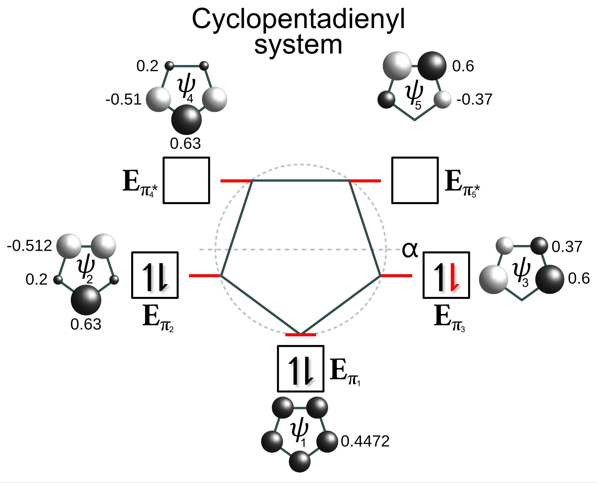
</figure>

<b><u>Figure 29</u>: Cyclopentadienyl System.</b> The relative size of each 2𝓅z orbital are shown proportional to the magnitudes of their coefficients. Only a select number of coefficients are shown while those not specified can be easily deduced by virtue of the molecule’s symmetry. The AO phases are <u>symbolized</u> by either shading (e.g. black = + phase) or the sign (`\(\pm\)`) attached to the coefficient. The total `\(\large \pi\)`-bonding energy of the cyclic <b>anion</b> “<i>species</i>” is `\(6 \alpha + 6.472 \, \beta\)`, which has three pairs of `\(\large \pi\)`-electrons filling three bonding orbitals. The <b>aromatic</b> (<b>Huckel’s Rule: 4n + 2 = 6</b>, with <b>n = 1</b>) closed shell configuration of \[C<b>5</b>H<b>5</b>\]- results in an increase in energy stability when compared to its open chain counterpart the <b>pentadienyl anion</b> (i.e. `\(6 \alpha + 5.464 \, \beta\)`). The <b>aromatic</b> property of this molecule widens the energy gap between the highest occupied MO (i.e. <b>HOMO</b>) and the lowest unoccupied MO (i.e. <b>LUMO</b>). This means more energetic photons are needed to excite valence electrons in order for them to make the quantum “<i>leap</i>” from <b>HOMO</b> to <b>LUMO</b>. Theoretically an infinitely large cyclic or open chain conjugated <b>polyene</b> would reduce the <b>HOMO-LUMO</b> gap to zero. Such a theoretical <b>polyene</b> would be analogous to a one dimensional metallic conductor. The alternating single and double bonds would essentially become equal in length creating a continuum of overlapping `\(\large \pi\)`-orbitals that would allow “<i>free</i>” flowing electrons. However, such a large <b>polyene</b> lattice is structurally unstable (i.e. <b>Peierls</b>—<b>Nabarro</b> stress or distortion).<b>[83](#ref-peierls_size_1940)–[85](#ref-lu_peierlsnabarro_2005)</b> Spontaneous periodic oscillations of the atomic positions break the uniformity of such an idealized `\(\large \pi\)`-electron medium. So in reality it would act more like a semiconductor (i.e. narrow band gap). Fortunately <b>doping</b> (i.e. introducing charge carriers) <b>polyenes</b> can create highly conductive materials.<b>[86](#ref-shirakawa_synthesis_1977)–[88](#ref-chiang_synthesis_1978)</b> In fact there is a considerable amount of research focused on creating new types of electronics (e.g. sensors, organic LEDs, PV cells) that exploit the semi-conducting properties of polymers that have large delocalized electron networks (e.g. films of polyacetylene).<b>[89](#ref-swager_50th_2017),[90](#ref-miao_cyclic_2021)</b>

<!------------------------------------------------------>

<!------------------------------------------------------>

<!------------------------------------------------------>

**IV - 2. LCAO & Conjugated π Bonds in Heteroatomic Systems:** Most biomolecules that contain conjugated `\(\large \pi\)`-bonds are made up of Carbon as well as other elements, particularly Nitrogen (e.g. <b><a class="one" href="https://www.rcsb.org/ligand/HEM" target="_blank" title="Go to RCSB-PDB">Heme</a></b> group of <b><a class="one" href="https://pdb101.rcsb.org/motm/41" target="_blank" title="Go to PDB-101">hemoglobin</a></b>)<b>[91](#ref-perutz_structure_1960)</b> and Oxygen (e.g. <b><a class="one" href="https://www.ebi.ac.uk/chebi/CHEBI:177831" target="_blank" title="Go to ChEBI">Furan fatty acids (FuFA)</a></b>).<b>[92](#ref-okada_antioxidant_1990)–[95](#ref-chang_emerging_2025)</b> Wave equations that describe orbitals belonging to different elements must therefore account for the differences in the electron affinity (i.e. **electronegativity**) of these different elements. Fortunately this can be accomplished using existing **Huckel** MO treatments by simply adjusting the **Coulombic** (`\(\alpha\)`) and **Resonance** (`\(\beta\)`) integrals using dimensionless empirical parameters (i.e. scalar coefficients). As shown below the values of `\(\alpha\)` and `\(\beta\)` are adjusted for a hetero-atom (**X**) with respect to the corresponding carbon (reference) values.

`$$\\ \large \alpha_{X} \; = \; \alpha_{\text C} \; + \; h_{X} \beta \phantom{......} \beta_{(\text C-X)} \; = \; k_X \beta_{(\text C - \text C)} \\[5px] \Big[ \, \text{Note:} \phantom{.} h_{\text X} \; \text{and} \phantom{.} k_X \; \text{are dimensionless empirical parameters} \, \Big] \\[15px] \left. \begin{array}{|c|c|c|} \hline \large \; \text{Atom} \; & \large \; h_X^{\dagger} \; & \large \; \text{Bond} \; & \large \; k_X^{\dagger} \; \\[10px] \hline {\phantom{......} \, - \stackrel{\Large ..}{\text N} \, = \\ \phantom{....} \, (\text{Pyridine})} & \large 0.5 & { \text C - \stackrel{\Large ..}{\text N} \, = \\ \text C = \stackrel{\Large ..}{\text N} - } & \large 1 \\[10px] \hline {\phantom{......} \, -\stackrel{\Large ..}{\underset{\text{|}}{\text N}}- \\ \phantom{.....} (\text{Pyrrole})} & \large 1.5 & \text C \, - \stackrel{\Large ..}{\underset{\text{|}}{\text N}}- & \large 0.8 \\[10px] \hline {\phantom{.....} \, -\overset{\Large ..}{\underset{\Huge ^{..}}{\text O}}- \\ \phantom{.....} (\text{Furan}) } & \large 2 & \text C - \overset{\Large ..}{\underset{\Huge ^{..}}{\text O}} \, - & \large 0.8 \\[10px] \hline {\, = \overset{\Large ..}{\underset{\Huge ^{..}}{\text O}}} & \large 1 & \text C = \overset{\Large ..}{\underset{\Huge ^{..}}{\text O}} & \large 1 \\[10px] \hline {\phantom{.....} -\text{CH}_3 \\ \phantom{.} (\text{Methyl Group})} & \large 2 & \text C \, - \text{CH}_3 & \large 0.7 \\ \hline \end{array} \right. \\$$`

                                    <b>†Ref:[96](#ref-streitwieser_molecular_1961),[97](#ref-streitwieser_molecular_1962)</b>

<!-------------------------------------------->

<!---- FIG 30 - HMO Heterocyclic Systems ----->

<!-------------------------------------------->

<figure id="FRight350b">

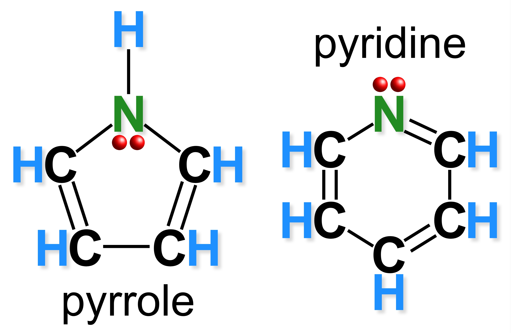
<figcaption>

<b>Figure 30: Heterocyclic Molecules</b>
</figcaption>

</figure>

<!-------------------------------------------->

<!-------------------------------------------->

<!-------------------------------------------->

The number of electrons a hetero-atom donates to a `\(\large \pi\)` system depends on the nature of its bonding. For example, the N atom of **pyrrole** (C4H5N, **Fig. 30**) has three of its five valence electron taking part in `\(\large \sigma\)` covalent bonding (i.e. two C and one H), and a lone pair of electrons occupying an unhybridized 2𝓅 orbital that is perpendicular to the plane of the ring. Because of this geometry the lone pair of electrons interacts with the 2𝓅z orbitals of the four carbon atoms resulting in an <b>aromatic</b> `\(\large \pi\)`-bonding system (i.e. delocalization energy stabilizes the structure). Chemically this means the lone pair is less likely to bond with H, which makes it a weak base (i.e. its <b><a class="one" href="https://chem.libretexts.org/Courses/Brevard_College/CHE_104%3A_Principles_of_Chemistry_II/07%3A_Acid_and_Base_Equilibria/7.12%3A_Relationship_between_Ka_Kb_pKa_and_pKb" target="_blank" title="Go to LibreTexts">conjugate acid</a></b> has a <i>pK</i>a ≈ 0.4). However, in the case of the 6-member ring <b>pyridine</b> (C5H5N), the lone pair of electrons held by N do not interact with the `\(\large \pi\)`-bonding system, since they occupy a sp2 hybridized orbital that lies within the plane of the ring (i.e. orthogonal to the `\(\large \pi\)`-bonding system). As a result there is only one electron residing within an unhybridized 2𝓅 orbital that can take part in `\(\large \pi\)`-bonding. Although its an <b>aromatic</b> `\(\large \pi\)`-electron system like <b>pyrrole</b>, unlike the latter the lone pair of electrons of N can interact “<i>freely</i>” with other electron “<i>loving</i>” molecules (i.e. <b>electrophiles</b>). As a result <b>pyridine</b> is more basic than <b>pyrrole</b> (i.e. its <b><a class="one" href="https://chem.libretexts.org/Courses/Brevard_College/CHE_104%3A_Principles_of_Chemistry_II/07%3A_Acid_and_Base_Equilibria/7.12%3A_Relationship_between_Ka_Kb_pKa_and_pKb" target="_blank" title="Go to LibreTexts">conjugate acid</a></b> <i>pK</i>a ≈ 5.25).  
    To find the MO energies of a hetero-cyclic system the adjusted integrals need to be incorporated into the <b>secular equation</b>. For the <b>Coulomb integral</b> (`\(\alpha_X = \int \phi_X \, \hat H \, \phi_X d \text v\)`), which measures the electron-attracting ability of an atom, this means its value must be related to the <b><a class="one" href="#VBTen" target="_blank" title="Go to Valence Bond Theory Section">electronegativity</a></b> of the atom (`\(\chi_{_X}\)`). Specifically we would compare the two bonded atoms within a conjugated `\(\large \pi\)`-system (e.g. C and N) based on their differences in electronegativity (i.e. `\(\alpha_{_X} - \alpha_{_B} = c \, [\chi_{_X} - \chi_{_B}]\)`). This, in turn, would be incorporated into the energy equation using a dimensionless constant (i.e. `\(h_{_X}\)`) of `\(\beta\)`, with `\(\alpha_{_B}\)` representing the reference carbon value (i.e. `\(\alpha_{_\text{C}}\)`).

`$$\\ \Big[ \large \text{Note:} \; \alpha_{_X} \normalsize \; = \; \text{hetero-atom coulomb integral}, \; \large \alpha_{_C} \normalsize \; = \; \text{reference carbon coulomb integral} \normalsize \Big] \\ \large \alpha_{_\text X} \normalsize \; - \; \large \alpha_{_\text C} \normalsize \; = \; \large h_{_\text X} \large \beta_{_\text{C}} \normalsize \phantom{...} \Longrightarrow \phantom{...} \large \alpha_{_\text X} \normalsize \; = \; \large \alpha_{_\text C} \normalsize \; + \; \large h_{_\text X} \large \beta_{_\text{C}} \\$$`

Clearly the **Coulombic integral** is dependent on the <b><a class="one" href="#VBTen" target="_blank" title="Go to Valence Bond Theory Section">electronegativity</a></b> of the hetero-atom. As for the **Resonance integral**, which measures the attraction of a bond for valence electrons, the value of `\(\beta_{_\text{X-C}}\)` is an empirical variable. Mathematically this relationship can be expressed as:

`$$\\ \large \beta_{_\text{(X-C)}} \normalsize \; = \; \large k_X \, \beta_{\text C} \\$$`

The tabulated `\(k_X\)` values shown above represent some of the most common types of bonds found in biomolecules.<b>[96](#ref-streitwieser_molecular_1961),[97](#ref-streitwieser_molecular_1962)</b> Of course the only way to see how hetero-atoms are accommodated by Huckel’s MO theory is by example. Once again we can take a closer look at **pyrrole**.

`$$\\ \begin{align*} \\ & \large 1. \; \text{Pyrrole:} \phantom{..} \alpha_{_{\text N}} \normalsize \; = \; \large \alpha \normalsize \; + \; \large 1.5 \, \beta , \phantom{..} \beta_{_{\text N}} \normalsize \; = \; \large 0.8 \, \beta \\[5px] \large |det| \normalsize \phantom{.} = & \phantom{.} \large \left| \begin{array} \\ \alpha_{_{\text N}} - \text E & \phantom{.} \beta_{_{\text N}} & \phantom{.} 0 & \phantom{.} 0 & \phantom{.} \beta_{_{\text N}} \\ \phantom{.} \beta_{_{\text N}} & \alpha_{_{\text N}} - \text E & \phantom{.} \beta_{_{\text N}} & \phantom{.} 0 & \phantom{.} 0 \\ \phantom{.} 0 & \phantom{.} \beta_{_{\text N}} & \alpha_{_{\text N}} - \text E & \phantom{.} \beta_{_{\text N}} & \phantom{.} 0 \\ \phantom{.} 0 & \phantom{.} 0 & \phantom{.} \beta_{_{\text N}} & \alpha_{_{\text N}} - \text E & \phantom{.} \beta_{_{\text N}} \\ \phantom{.} 0 & \phantom{.} \beta_{_{\text N}} & \alpha_{_{\text N}} - \text E & \phantom{.} \beta_{_{\text N}} & \phantom{.} 0 \\ \phantom{.} \beta_{_{\text N}} & \phantom{.} 0 & \phantom{.} 0 & \phantom{.} \beta_{_{\text N}} & \alpha_{_{\text N}} - \text E \end{array} \right| \normalsize \phantom{.} = \phantom{.} \large 0 \end{align*}$$`

`$$\begin{align*} & \phantom{.........................} \Large \Big \Downarrow \\[5px] \large 0 \normalsize \phantom{.} = & \phantom{.} \large \left| \begin{array} \\ \alpha + 1.5 \beta - \text E & \phantom{.} 0.8 \beta & \phantom{.} 0 & \phantom{.} 0 & \phantom{.} 0.8 \beta \\ \phantom{.} 0.8 \beta & \alpha - \text E & \phantom{.} \beta & \phantom{.} 0 & \phantom{.} 0 \\ \phantom{.} 0 & \phantom{.} \beta & \alpha - \text E & \phantom{.} \beta & \phantom{.} 0 \\ \phantom{.} 0 & \phantom{.} 0 & \phantom{.} \beta & \alpha - \text E & \phantom{.} \beta \\ \phantom{.} 0.8 \beta & \phantom{.} 0 & \phantom{.} 0 & \phantom{.} \beta & \alpha - \text E \\ \end{array} \right| \end{align*}$$`

`$$\begin{align*} & \phantom{.........................} \Large \Big \Downarrow \\[5px] & {\large \text{Recall: express energies relative to} \; \alpha \; \text{in units of} \; \beta} \\ & \phantom{..................} \large x \normalsize \; = \; \large \frac{\alpha - \text E}{\beta} \\[5px] & \phantom{.........................} \Large \Big \Downarrow \\[5px] \large 0 \normalsize \phantom{.} = & \phantom{.} \large \overbrace{\left| \begin{array} \\ \phantom{..} x + 1.5 & \phantom{...} 0.8 & \phantom{...} 0 & \phantom{...} 0 & \phantom{...} 0.8 \phantom{..} \\ \phantom{..} 0.8 & \phantom{...} x & \phantom{...} 1 & \phantom{...} 0 & \phantom{...} 0 \phantom{..} \\ \phantom{..} 0 & \phantom{...} 1 & \phantom{...} x & \phantom{...} 1 & \phantom{...} 0 \phantom{..} \\ \phantom{..} 0 & \phantom{...} 0 & \phantom{...} 1 & \phantom{...} x & \phantom{...} 1 \phantom{..} \\ \phantom{..} 0.8 & \phantom{...} 0 & \phantom{...} 0 & \phantom{...} 1 & \phantom{...} x \phantom{..} \\ \end{array} \right|}^{\Large \text{Hamiltonian Matrix}} \\ \end{align*} \\$$`

The above **Hamiltonian matrix** can be algebraically expanded to produce the 5th order polynomial for **pyrrole** (Note: for brevity the detailed algebra derivation is not shown).

`$$\\ \large x^5 \normalsize \, + \, \large 1.5x^4 \normalsize \,- \, \large 4x^3 \normalsize \,- \, \large 4.5x^2 \normalsize \, + \, \large 3x \normalsize \, + \, \large 1.5 \normalsize \; = \; \large 0 \\$$`

Finding the five roots to this characteristic polynomial, which represents the energies of the corresponding five MO, is not possible using general algebraic formulas. Instead chemists use symmetry arguments (i.e. **Group theory**) to generate new sets of wave functions known as **S**ymmetry **A**dapted **L**inear **C**ombinations, or **SALCs**.<b>[97](#ref-streitwieser_molecular_1962)</b> Although this ingenious method greatly simplifies the problem (i.e. generates two matrix blocks: 3×3 and 2×2) we can instead turn to a computer program called <b><a class="one" href="https://ctom-ism2.github.io/hulis/index.shtml" target="_blank" title="Go to HuLis">HuLis</a></b> to carry out the calculations for **pyrrole**.<b>[98](#ref-humbel_getting_2007)–[101](#ref-carissan_huckel-lewis_2008)</b> This free Java based program (Note: abbreviation of <b>Hu</b>ckel-<b>L</b>ew<b>is</b>) evaluates <b>Lewis resonance</b> structures using <b>Huckel</b> wave functions (**Fig. 31**).

<!------------------------------------->

<!---- FIG 31 - HMO Pyrrole HuLis ----->

<!------------------------------------->

<figure>

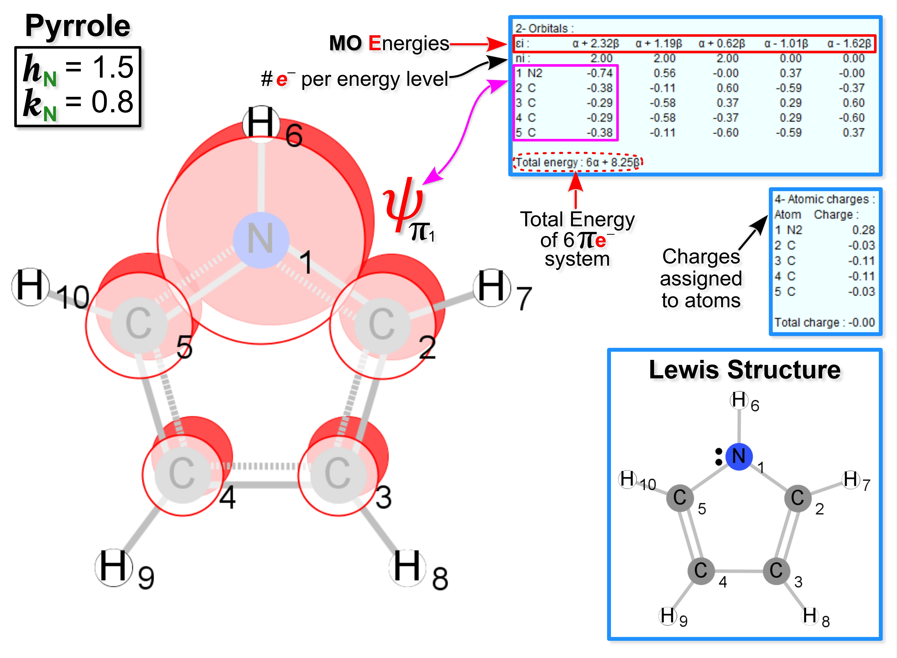
</figure>

<b><u>Figure 31</u>: HuLis (Huckel-Lewis) analysis of Pyrrole.</b> Shown above is the detailed <b>Huckel</b> MO analysis of <b>pyrrole</b> using the free <b><a class="one" href="https://ctom-ism2.github.io/hulis/index.shtml" target="_blank" title="Go to HuLis">HuLis</a></b> program.<b>[98](#ref-humbel_getting_2007)–[101](#ref-carissan_huckel-lewis_2008)</b> The results are displayed in tabular form, including (among others): <b>(i)</b> the energies of each MO wave function; <b>(ii)</b> the total energy of the `\(6 \large \pi\)`-electron <b>pyrrole</b> system (i.e. `\(6 \alpha + 8.25 \beta\)`); <b>(iii)</b> orbital coefficients for each bonding and anti-bonding MO wave function; and <b>(iv)</b> the formal net charges associated with each atom of the lowest energy bonding MO (`\(\psi_{\pi_1}\)`). The analysis was carried out using well known <b>hN</b> and <b>kN</b> values.<b>[96](#ref-streitwieser_molecular_1961),[97](#ref-streitwieser_molecular_1962)</b> A localized **Lewis** resonance structure of **pyrrole** is also shown (bottom right). One of the interesting findings is the positive charge assigned to N and the negative charges assigned to the C atoms (i.e. creates a dipole moment). A high electron density value was also assigned to N, which makes sense given its relatively high electronegativity value (i.e. pulls electrons away from neighbouring atoms such as the `\(\large \sigma\)` bonded H atom). So it would seem that the high electron density of N is off-set by its electron donating activity (i.e. lone pair donated to the delocalized `\(\large \pi\)`-electron system). The latter is of course responsible for the aromatic status of the molecule, which confers increased molecular stability. The theoretical <u>localized</u> valence charge assigned to N must simply represent the net electron activity of this molecule. The relatively electron “rich” carbon atoms can potentially act as nucleophiles during a chemical reaction (e.g. <u>substitution</u> of Cl for H). Conversely the electron “<i>poor</i>” N can potentially act as a relatively weak proton acceptor (i.e. weak base).

<b>  4.3.1 Approximating the Ground State Energy Level of Hydrogen  :</b> Generating <u>exact</u> analytical solutions for the ground-state energy (E<b>o</b>) of atoms and molecules with multiple electron-electron interactions is not possible (i.e. three body problem). Fortunately there are a number of <u>approximation methods</u> that are capable of estimating the ground state energy of a quantum system (e.g. Variational method, Perturbation theory). The **Variational Method** is particularly satisfying since it’s a relatively straight forward way of estimating the ground state (i.e. upper bound) using wave functions.<b>[13](#ref-mcquarrie_physical_1997),[102](#ref-griffiths_introduction_1994)</b> For example we known from previous discussions that E<b>o</b> can be expressed using the <b>Hamiltonian</b> operator:

`$$\tag{52}$$`

`$$\\ \large \hat H \psi^{\phantom{.}}_{\text o} = \text E_{\text o} \psi^{\phantom{.}}_{\text o} \\ \text{Integrate Density Function and Solve for} \; \text E_{\text o}  \\ \int \psi^*_{\text o} \, \hat H \, \psi^{\phantom{.}}_{\text o} \, d \text v \phantom{.} = \phantom{.} \int \psi^*_{\text o} \, \text E_{\text o} \, \psi^{\phantom{.}}_{\text o} \, d \text v \phantom{.} = \phantom{.} \text E_{\text o} \int \psi^*_{\text o} \, \psi^{\phantom{.}}_{\text o} \, d \text v \\ \large \text E_{\text o} \normalsize \phantom{.} = \phantom{.} \frac{\int \psi^*_{\text o} \, \hat H \, \psi^{\phantom{.}}_{\text o} \, d \text v}{\int \psi^*_{\text o} \, \psi^{\phantom{.}}_{\text o} \, d \text v}$$`

To approximate `\(\psi_{\text o}\)` we can start with a relatively simple <u>trial</u> wave function, arbitrarily called `\(\xi\)`, which also can be expressed using a **Hamiltonian** operator:

`$$\tag{53}$$`

`$$\large \text E_{\xi} \normalsize \phantom{.} = \phantom{.} \frac{\int \xi^* \, \hat H \, \xi^{\phantom{.}} \, d \text v}{\int \xi^* \, \xi^{\phantom{.}} \, d \text v} \phantom{...} \Longrightarrow \phantom{...} \text{Where:} \phantom{..} \overbrace{\text E_{\xi} \; \ge \; \text E_{\text o}}^{\large \text{Variational} \\ \phantom{....} \text{Principle}} \\[25px] \large \text E_{\xi} \, \normalsize (\alpha, \beta, \gamma ...) \phantom{.} \ge \phantom{.} \large \text E_{\text o}$$`

Although `\(\xi\)` is not equal to `\(\psi_{\text o}\)` we can <u>minimize</u> E<b>ξ</b> with respect to its <u>variational</u> parameter `\(\alpha\)` (**Eqn. 54**) to generate the best possible estimate of E<b>o</b>, albeit a slightly higher one (i.e. upper bound).  
    For example, what if the ground state energy of H was not known. To approximate it we could use a <u>trial</u> function like: `\(\xi_{(r)} = e^{- \alpha r^2}\)`. This **Gaussian function** is a logical choice since it closely approximates the potential energy of an electron as it changes with distance (i.e. V decays exponentially with increasing distance from the nucleus).<b>[13](#ref-mcquarrie_physical_1997),[102](#ref-griffiths_introduction_1994)</b> As discussed in later sections the use of multiple **Gaussian functions** turns out to be a very effective way of modelling electron orbitals (see **Information Box 4**).

`$$\tag{54} \\ \large \text{Trial Wave Function:} \\ \Big[ \, \text{Note:} \phantom{..} e \; = \; \text{base of natural log}, \phantom{.} r \; = \; \text{distance vector}, \phantom{.} \alpha \; = \; \text{variational parameter}\, \Big] \\ \large \xi_{(r)} \normalsize \phantom{.} = \phantom{.} \large e^{- \alpha r^2} \\$$`

To calculate E<b>ξ</b> obviously requires solutions to both the numerator and denominator of **Eqn. 53**. However, before carrying our the calculus lets first review what we do know about the problem, namely the **Hamiltonian** and the <b><a class="one" href="https://opc-project.netlify.app/project/opcchemprimer2_atom/#3DSE" target="_blank" title="Go to ChemPrimer2">wave equation</a></b>:

`$$\tag{55}$$`

`$$\text{Recall: } \text{Hamiltonian} \phantom{.} \text{Energy} \phantom{.} \text{relation} \\ \big[ \text{Note:} \; \mu \; = \; \text{reduced mass} \; \text{of p}^+ \, e^- \; \text{system} \big] \\ \\ \large \hat H \cdot \xi \phantom{.} = \phantom{.} \text E \cdot \xi \normalsize \\ \large \hat H \normalsize \phantom{.} = \phantom{.} - \frac{\hbar^2}{2 \mu r^2} \overbrace{\Bigg[ \frac{\partial}{\partial r} \bigg( r^2 \frac{\partial}{\partial r} \bigg) \; + \; \frac{1}{sin \theta} \frac{\partial}{\partial \theta} \bigg( sin \theta \frac{\partial}{\partial r} \bigg) \; + \; \frac{1}{sin^2 \theta} \frac{\partial^2}{\partial \phi^2} \Bigg]}^{\large \text{Laplacian Operator } (\nabla^2) \text{ Spherical coordinates}} \; + \; \overbrace{\text V}^{\large \text{PE}} \\ \phantom{.} \\ \text{Potential Energy (V) of } e^- \text{ interacting with } Z \text{e nuclear charge, with } Z \text{ = atomic #} \\ \large \text V \normalsize \phantom{.} = \phantom{.} -\frac{(Z \text e)^2}{4 \pi \epsilon_{\text o} r} \\ \phantom{.} \\ \text{Combined Hamiltonian and Trial Wave Function } \large \xi \normalsize \\ \big[ \, \text{Note:} \; \large \xi \; \normalsize \text{has only a} \; \large r \normalsize \text{adial variable since we are only dealing with a} \; 1s \; \text{orbital} \big] \\ \large \hat H \normalsize \cdot \large \xi \normalsize \phantom{.} = \phantom{.} \Bigg( - \frac{\hbar^2}{2 \mu r^2} \bigg[ \frac{\partial}{\partial r} \bigg( r^2 \frac{\partial}{\partial r} \bigg) \bigg] \phantom{.} - \phantom{.} \frac{\text e^2}{4 \pi \epsilon_{\text o} r} \Bigg) \phantom{.} e^{- \alpha r^2}$$`

In order to calculate the numerator of **Eqn. 53** we first need to calculate `\(\hat H \cdot \large \xi\)`. Fortunately the 1𝓈 orbital of H is only dependent on the `\(\large r\)`adial component (i.e. independent of `\(\theta\)` or `\(\phi\)`), which makes the calculation relatively straight forward.

`$$\large \hat H \cdot \xi \normalsize \phantom{.} = \phantom{.} - \frac{\hbar^2}{2 \mu r^2} \phantom{.} \overbrace{\frac{\partial}{\partial r} \bigg( r^2 \frac{\partial}{\partial r} \phantom{.} e^{- \alpha r^2} \bigg)}^{\large Partial \phantom{.} Differentials} \phantom{.} - \phantom{.} \frac{(Z\text e)^2}{4 \pi \epsilon_{\text o} r}  \phantom{.} e^{- \alpha r^2} \\[25px] \large \text{Note Calculus Product Rule:} \\ \text{Product Rule: } \frac{\partial}{\partial x} x e^{-ax^2} \phantom{.} = \phantom{.} x \Big( \frac{\partial}{\partial x}e^{-ax^2} \Big) \phantom{.} + \phantom{.} e^{-ax^2} \Big( \frac{\partial}{\partial x} x \Big) \\[25px] \large \text{Recall: Calculus of exponential functions} \\ \text{Exponential Functions: } \frac{\partial}{\partial x} e^{-ax^2} \phantom{.} = \phantom{.} \Big( -2ax \Big) e^{-ax^2} \\[35px] \boxed{\text{Step #1}} \, - \, \text{Calculate Partial Differentials:} \\ \begin{align*} \frac{\partial}{\partial r} \Bigg( r^2 \frac{\partial}{\partial r} \phantom{.} e^{- \alpha r^2} \Bigg) \phantom{.} = & \phantom{.} \frac{\partial}{\partial r} \Bigg( r^2 \phantom{.} \bigg[ -2 \alpha r \phantom{.} e^{- \alpha r^2} \bigg] \Bigg) \phantom{.} = \phantom{.} -2 \alpha \frac{\partial}{\partial r} \Bigg( r^3 \phantom{.} e^{- \alpha r^2} \Bigg) \\ = & -2 \alpha \Bigg[r^3 \big( -2 \alpha r \phantom{.} e^{- \alpha r^2}\big) \phantom{.} + \phantom{.} \big( 3r^2 \big) \phantom{.} e^{- \alpha r^2}  \Bigg] \\ = & \phantom{.} 4 \alpha^2 r^4 \phantom{.} e^{- \alpha r^2} \phantom{.} - \phantom{.} 6 \alpha r^2 \phantom{.} e^{- \alpha r^2} \\ \end{align*}$$`

`$$\boxed{\text{Step #2}} \, - \, \text{Combine Hamiltonian with Trial Function and simplify expression:} \\ \begin{align*} \large \hat H \cdot \xi \normalsize \phantom{.} = & \phantom{.} - \frac{\hbar^2}{2 \mu r^2} \phantom{.} \bigg( 4 \alpha^2 r^4 \phantom{.} e^{- \alpha r^2} \phantom{.} - \phantom{.} 6 \alpha r^2 \phantom{.} e^{- \alpha r^2} \bigg) \phantom{.} - \phantom{.} \frac{\text e^2}{4 \pi \epsilon_{\text o} r}  \phantom{.} e^{- \alpha r^2} \\\\ = & \phantom{.} - \frac{2 \alpha^2 \hbar^2 r^2}{\mu} \phantom{.} e^{- \alpha r^2} \phantom{.} + \phantom{.} \frac{3 \alpha \hbar^2}{\mu} \phantom{.} e^{- \alpha r^2} \phantom{.} - \phantom{.} \frac{\text e^2}{4 \pi \epsilon_{\text o} r}  \phantom{.} e^{- \alpha r^2} \\ \end{align*}$$`

`$$\boxed{\text{Step #3}} \, - \, \text{Integrate the Numerator over all 3 (spherical) dimensions:} \\ \Big[\text{Note Spherical Volume elements:} \phantom{..} d \text v \phantom{.} = \phantom{.} \overbrace{r^2 \phantom{.} dr}^{1} \phantom{.} \overbrace{sin \theta  \phantom{.} d \theta}^{2} \phantom{.} \overbrace{d \phi}^{3} \Big] \\ \iiint \xi^* \phantom{.} \hat H \phantom{.} \xi \phantom{.} d \text v \phantom{.} = \phantom{.} \overbrace{\int^{2 \pi}_{0} d \phi}^{360^{\circ} \, = \, 2 \large \pi} \phantom{..} \overbrace{\int^{\pi}_{0} sin \theta \phantom{.} d \theta}^{180^{\circ} \, = \, \large \pi} \phantom{.} \int^{\infty}_{0} \xi^* \phantom{.} \hat H \phantom{.} \xi \phantom{.} r^2 dr \\ \phantom{.} \\ \begin{align*} \iiint \xi^* \phantom{.} \hat H \phantom{.} \xi \phantom{.} r^2 dr \phantom{.} = & \phantom{.} 2 \pi \cdot \overbrace{\Big[ -cos(\pi) + cos(0) \Big]}^{2} \cdot \int^{\infty}_{0} e^{- \alpha r^2} \Bigg( - \frac{2 \alpha^2 \hbar^2 r^2}{\mu} \phantom{.} e^{- \alpha r^2} \phantom{.} + \phantom{.} \frac{3 \alpha \hbar^2}{\mu} \phantom{.} e^{- \alpha r^2} \\ \phantom{..} & - \phantom{.} \frac{\text e^2}{4 \pi \epsilon_{\text o} r} \phantom{.} e^{- \alpha r^2} \Bigg) r^2 dr \\ = & \phantom{.} 4 \pi \cdot \int^{\infty}_{0} \Bigg( - \frac{2 \alpha^2 \hbar^2 \, r^4}{\mu} \; + \; \frac{3 \alpha \hbar^2 \, r^2}{\mu} \; - \; \frac{\text e^2 \, r}{4 \pi \epsilon_{\text o}} \Bigg) e^{- 2 \alpha r^2} \, dr \\ = & \phantom{.} 4 \pi \bigg( \frac{- 2 \alpha^2 \hbar^2}{\mu} \bigg) \overbrace{\int^{\infty}_{0} r^4 \cdot e^{- 2 \alpha r^2} \, dr}^{\text{Consult Integral Tables}} \phantom{.} + \phantom{.} 4 \pi \bigg( \frac{3 \alpha \hbar^2}{\mu} \bigg) \overbrace{\int^{\infty}_{0} r^2 \cdot e^{- 2 \alpha r^2} \, dr}^{\text{Consult Integral Tables}} \; \\ & \phantom{.} - \require{cancel} \cancel{4 \pi} \bigg( \frac{\text e^2}{\require{cancel} \cancel{4 \pi} \epsilon_{\text o}} \bigg) \overbrace{\int^{\infty}_{0} r \cdot e^{- 2 \alpha r^2} \, dr}^{\text{Consult Integral Tables}} \\ \end{align*}$$`

`$$\large \text{Integral Tables:} \normalsize \\ \big[ \, \text{Note:  !! = double factorial sign means factorial uses same parity (i.e. odd or even) as} \; n \, \big] \\ \begin{align*} \require{enclose} \enclose{circle}{\dagger} \; & \boxed{\int^{\infty}_{0} x^n e^{-ax^2} dx} \phantom{.} = \phantom{.} \frac{(2k-1)!!}{2^{k + 1} a^k} \sqrt{\frac{\pi}{a}} \phantom{....} (\text{when:} \; n \phantom{.} = \phantom{.} 2k, \phantom{..} k = \text{integral}, \; \text{and} \; a>0) \\ \require{enclose} \enclose{circle}{\ddagger} \; & \boxed{\int^{\infty}_{0} x^n e^{-ax^2} dx} \phantom{.} = \phantom{.} \frac{1}{2} \Bigg( \frac{\frac{n + 1}{2}}{a^{\frac{n+1}{2}}} \Bigg) \phantom{....} (\text{when:} \; n \phantom{.} > -1, \; \text{and} \; a \phantom{.} > \phantom{.} 0) \\ \end{align*}$$`

`$$\begin{align*} \iiint \xi^* \phantom{.} \hat H \phantom{.} \xi \phantom{.} r^2 dr \phantom{.} = & \phantom{.} 4 \pi \bigg( \frac{- 2 \alpha^2 \hbar^2}{\mu} \bigg) \overbrace{\int^{\infty}_{0} r^4 \cdot e^{- 2 \alpha r^2} \, dr}^{\large \dagger} \phantom{.} + \phantom{.} 4 \pi \bigg( \frac{3 \alpha \hbar^2}{\mu} \bigg) \overbrace{\int^{\infty}_{0} r^2 \cdot e^{- 2 \alpha r^2} \, dr}^{\large \dagger} \\ & \phantom{..} - \bigg( \frac{\text e^2}{\epsilon_{\text o}} \bigg) \overbrace{\int^{\infty}_{0} r \cdot e^{- 2 \alpha r^2} \, dr}^{\large \ddagger} \\[10px] = & \phantom{.} 4 \pi \Bigg[ \frac{- 2 \alpha^2 \hbar^2}{\mu} \Bigg( \frac{3 \times 1}{(2^3)(2 \alpha)^2} \sqrt{\frac{\pi}{2 \alpha}} \Bigg) \phantom{.} + \phantom{.} \frac{3 \alpha \hbar^2}{\mu} \Bigg( \frac{1}{(2^2)(2 \alpha)} \sqrt{\frac{\pi}{2 \alpha}} \Bigg) \Bigg] \\ & \phantom{..} - \phantom{.} \frac{\text e^2}{\epsilon_{\text o}} \Bigg( \frac{1}{(2)(2 \alpha)} \Bigg) \\[10px] = & \phantom{.} 4 \pi \Bigg[ \frac{- 2 \alpha^2 \hbar^2}{\mu} \Bigg( \frac{3}{32 \alpha^2} \sqrt{\frac{\pi}{2 \alpha}} \Bigg) \phantom{.} + \phantom{.} \frac{3 \alpha \hbar^2}{\mu} \Bigg( \frac{1}{8 \alpha} \sqrt{\frac{\pi}{2 \alpha}} \Bigg) \Bigg] \\ & \phantom{..} - \phantom{.} \frac{\text e^2}{\epsilon_{\text o}} \Bigg( \frac{1}{4 \alpha} \Bigg) \\[10px] = & \phantom{.} 4 \pi \Bigg[ \frac{- 3 \hbar^2}{16 \mu} \sqrt{\frac{\pi}{2 \alpha}} \phantom{.} + \phantom{.} \frac{3 \hbar^2}{8 \mu} \sqrt{\frac{\pi}{2 \alpha}} \Bigg] \phantom{.} - \phantom{.} \frac{\text e^2}{4 \epsilon_{\text o} \alpha} \\[10px] = & \phantom{.} \frac{- 3 \hbar^2}{4 \mu} \sqrt{\frac{\pi^3}{2 \alpha}} \phantom{.} + \phantom{.} \frac{3 \hbar^2}{2 \mu} \sqrt{\frac{\pi^3}{2 \alpha}} \phantom{.} - \phantom{.} \frac{\text e^2}{4 \epsilon_{\text o} \alpha} \\[10px] = & \phantom{.} \frac{3 \hbar^2}{4 \mu} \sqrt{\frac{\pi^3}{2 \alpha}} \phantom{.} - \phantom{.} \frac{\text e^2}{4 \epsilon_{\text o} \alpha} \\ \end{align*}$$`

`$$\boxed{\text{Step #4}} \, - \, \text{Integrate Denominator} \\ \begin{align*} \int^{2 \pi}_{0} \int^{\pi}_{0} \int^{\infty}_{0} \xi^* \phantom{.} \xi \phantom{.} d \text v \phantom{.} = & \phantom{.} \overbrace{\int^{2 \pi}_{0} d \phi}^{2 \pi} \phantom{..} \overbrace{\int^{\pi}_{0} sin \theta \phantom{.} d \theta}^{2} \phantom{.} \int^{\infty}_{0} e^{-\alpha r^2} \phantom{.} e^{-\alpha r^2} \phantom{.} r^2 \phantom{.} dr \\  = & \phantom{.} 4 \pi \overbrace{\int^{\infty}_{0} e^{-2\alpha r^2} \phantom{.} r^2 \phantom{.} dr}^{\text{Consult Integral Table}^{\large \dagger}} \\ = & \phantom{.} 4 \pi \Bigg( \frac{1}{2 \alpha (2)^2} \sqrt{\frac{\pi}{2 \alpha}} \Bigg) \phantom{.} = \phantom{.} \frac{ \pi \phantom{.} \sqrt{\pi}}{2 \alpha \phantom{.} \sqrt{2 \alpha}} \phantom{.} = \phantom{.} \sqrt{\frac{\pi^3}{(2 \alpha)^3}} \\ \end{align*}$$`

`$$\boxed{\text{Step #5}} \, - \, \text{Plug values into } \text E_{\xi} \text{ and solve} \\ \begin{align*} \large \text E_{\xi} \phantom{.} \normalsize = & \phantom{.} \frac{\int \psi^*_{\xi} \phantom{.} \hat H \phantom{.} \psi^{\phantom{.}}_{\xi} \phantom{.} d \text v}{\int \psi^*_{\xi} \phantom{.} \psi^{\phantom{.}}_{\xi} \phantom{.} d \text v} \phantom{.} = \phantom{.} \phantom{.} \large \frac{\frac{3 \hbar^2}{4 \mu} \sqrt{\frac{\pi^3}{2 \alpha}} \phantom{.} - \phantom{.} \frac{\text e^2}{4 \epsilon_{\text o} \alpha}}{\sqrt{\frac{\pi^3}{(2 \alpha)^3}}} \\[5px] = & \phantom{.} \frac{3 \phantom{.} \hbar^2 \phantom{.} 2 \alpha}{4 \mu} \phantom{.} - \phantom{.} \frac{\text e^2}{4 \epsilon_{\text o} \alpha} \sqrt{\frac{(2 \alpha)^3}{\pi^3}} \phantom{.} = \phantom{.} \frac{3 \phantom{.} \hbar^2 \phantom{.} \alpha}{2 \mu} \phantom{.} - \phantom{.} \frac{\text e^2 \phantom{.} 2 \sqrt{2 \alpha}}{4 \epsilon_{\text o} \phantom{.} \pi^{\frac{3}{2}}}  \\[5px] = & \phantom{.} \frac{3 \phantom{.} \hbar^2 \phantom{.} \alpha}{2 \mu} \phantom{.} - \phantom{.} \frac{\text e^2 \sqrt{\alpha}}{\sqrt 2 \phantom{.} \epsilon_{\text o} \phantom{.} \pi^{\frac{3}{2}}} \\ \end{align*}$$`

`$$\boxed{\text{Step #6}} \, - \, \text{Minimize} \phantom{.} \large \text E_{\xi} \normalsize \phantom{.} \text{with respect to} \phantom{.} \alpha \\ \text{Note: To minimize a function set its first derivative to zero} \\ \begin{align*} \frac{\partial}{\partial \alpha} \large \text E_{\normalsize \xi} \normalsize \phantom{.} = & \phantom{.} 0 \\ \frac{\partial}{\partial \alpha} \bigg( \frac{3 \, \hbar^2 \phantom{.} \alpha}{2 \, \mu} \phantom{.} - \phantom{.} \frac{e^2 \sqrt{\alpha}}{\sqrt 2 \, \epsilon_{\text o} \phantom{.} \pi^{\frac{3}{2}}} \bigg) \phantom{.} = & \phantom{.} \bigg( \frac{3 \, \hbar^2}{2 \mu} \bigg) \frac{\partial}{\partial \alpha} \alpha \phantom{.} - \phantom{.} \Bigg( \frac{e^2}{\sqrt 2 \, \epsilon_{\text o} \, \pi^{\frac{3}{2}}} \Bigg) \frac{\partial}{\partial \alpha} \sqrt{\alpha} \phantom{.} = \phantom{.} 0 \\ 0 \phantom{.} = & \phantom{.} \frac{3 \phantom{.} \hbar^2}{2 \mu} \phantom{.} - \phantom{.} \Bigg( \frac{\text e^2}{\sqrt 2 \phantom{.} \epsilon_{\text o} \, \pi^{\frac{3}{2}}} \Bigg) \cdot \frac{1}{2} \alpha^{- \frac{1}{2}} \\ \frac{3 \phantom{.} \hbar^2}{2 \mu} \phantom{.} = & \phantom{.} \phantom{.} \frac{\text e^2}{2 \sqrt 2 \phantom{.} \sqrt{\alpha} \phantom{.} \epsilon_{\text o} \phantom{.} \pi^{\frac{3}{2}}} \phantom{.} = \phantom{.} \frac{\text e^2}{\sqrt{\alpha} \phantom{.} \epsilon_{\text o} \phantom{.} \big( 2 \pi \big)^{\frac{3}{2}}} \\ \sqrt{\alpha} \phantom{.} = & \phantom{.} \frac{2 \phantom{.} \mu \phantom{.} \text e^2}{3 \phantom{.} \hbar^2 \phantom{.} \epsilon_{\text o} \phantom{.} \big( 2 \pi \big)^{\frac{3}{2}}} \\ \alpha \phantom{.} = & \phantom{.} \frac{4 \phantom{.} \mu^2 \phantom{.} \text e^4}{9 \phantom{.} \hbar^4 \phantom{.} \epsilon_{\text o}^2 \phantom{.} \big( 2 \pi \big)^3} \phantom{.} = \phantom{.} \frac{\mu^2 \phantom{.} \text e^4}{18 \pi^3 \phantom{.} \hbar^4 \phantom{.} \epsilon_{\text o}^2} \phantom{.} = \phantom{.} \frac{8}{9 \pi} \cdot \frac{1}{(a_{\text o})^2} \\ \phantom{.} \\ \text{Recall Bohr's radius:} \phantom{..} a_{\text o} \phantom{.} = & \phantom{.} \frac{4 \pi \phantom{.} \epsilon_{\text o} \phantom{.} \hbar^2}{\text m_e \phantom{.} \text e^2} \phantom{.} \Longrightarrow \phantom{.} \frac{1}{(a_{\text o})^2} \phantom{.} = \phantom{.} \frac{\text m_e^2 \phantom{.} \text e^4}{16 \pi^2 \phantom{.} \hbar^4 \phantom{.} \epsilon_{\text o}^2} \\ \big[\text{Note:} \phantom{.} \mu \phantom{.} & \text{is interchangeable}   \phantom{.} \text{with} \phantom{.} \text m_e \big] \\ \end{align*}$$`

`$$\boxed{\text{Step #7}} \, - \, \text{Plug} \phantom{.} \alpha \phantom{.} \text{into} \phantom{.} \large \text E_{\normalsize \xi} \normalsize \phantom{.} \text{to estimate the upper bound of the ground-state energy of H} \\ \begin{align*} \large \text E_{\normalsize \xi \; (min.)} \normalsize \phantom{.} = & \phantom{.} \frac{3 \; \hbar^2}{2 \mu}(\alpha) \; - \; \frac{\text e^2}{\sqrt 2 \; \epsilon_{\text o} \; \large \pi^{\frac{3}{2}}} \normalsize \sqrt{\alpha} \phantom{.} = \phantom{.} \frac{3 \; \hbar^2}{2 \mu} \Bigg( \frac{\mu^2 \; \text e^4}{18 \; \hbar^4 \; \epsilon_{\text o}^2 \; \large \pi^{\normalsize 3}} \Bigg) \; - \; \frac{\text e^2}{\sqrt 2 \; \epsilon_{\text o} \; \large \pi^{\frac{3}{2}}} \sqrt{ \frac{\mu^2 \; \text e^4}{18 \; \hbar^4 \; \epsilon_{\text o}^2 \; \large \pi^{\normalsize 3}}} \\ = & \phantom{.} \frac{\mu \; \text e^4}{12 \; \hbar^2 \; \epsilon_{\text o}^2 \; \large \pi^{\normalsize 3}} \; - \; \frac{\mu \; \text e^4}{6 \; \hbar^2 \; \epsilon_{\text o}^2 \; \large \pi^{\normalsize 3}} \\ \Big[ \text{Note: } & \text E_h = \text{1 Hartree unit = 1 atomic unit of Energy} \approx 27.211 \; eV \Big] \\ = & \phantom{.} - \frac{\mu \; \text e^4}{12 \, \large \pi^{\normalsize 3} \; \epsilon_{\text o}^2 \; \hbar^2} \phantom{.} = \phantom{.} - \frac{4}{3 \large \pi} \overbrace{\Bigg( \frac{\mu \; \text e^4}{16 \, \large \pi^{\normalsize 3} \; \epsilon_{\text o}^2 \; \hbar^2} \Bigg)}^{\large 1 \text E_h} \\ = & \phantom{.} - \frac{4}{3 \large \pi} \text E_h \\ \end{align*}$$`

The <u>upper bound</u> estimate of the **ground-state** of H can now be compared to the well known exact analytical solution of H. As shown below our simple trial wave function produced a value that is approximately 15.1% higher than the actual ground-state energy level of H.

`$$\tag{56}$$`

`$$\\ \text{Calculated Error in Trial Wave function}: \\ \begin{align*} \large \text E_{\xi \phantom{.} (min.)} \normalsize \phantom{.} = & - \frac{4}{3 \large \pi} \text E_h \\ \large \text E_{\text{o (H)}} \normalsize = & \phantom{.} - \frac{1}{2} \overbrace{\Bigg( \frac{\mu \, \text e^4}{16 \, \large \pi^{\normalsize 2} \normalsize \, \hbar^2 \, \epsilon_{\text o}^2} \Bigg)}^{\large 1 \, \text E_h} \phantom{.} = \phantom{.} - \frac{1}{2} \text E_h \\ \frac{ \text E_{\xi \phantom{.} (min.)} \phantom{.} - \phantom{.} \text E_{\text{o (H)}} }{ \text E_{\text{o (H)}} } \phantom{.} = & \phantom{.} \frac{0.0756}{0.5} \phantom{.} = \phantom{.} 0.151 \phantom{..} \Longrightarrow \phantom{.} 15.1 \% \\ \end{align*}$$`

<!------------------------------------------------->
<!------------------  Info Box3 ------------------->
<!------------------------------------------------->

  INFORMATION BOX 3 - Hartree Energy Units  <b>:</b> <b>n</b>, <b>ℓ</b>, <b>mℓ</b>, <b>ms</b>

The <b><a class="one" href="https://goldbook.iupac.org/terms/view/H02748" target="_blank" title="Go to IUPAC GoldBook">Hartree unit</a></b> (`\(\text E_h\)`) is an atomic unit of energy named after **Douglas Rayner Hartree** (1887-1958), a well known British mathematician and physicist who, along with **Vladimir Fock** (1898-1974), developed the so called self-consistent field (**SCF**) method.<b>[103](#ref-hartree_wave_1928)–[105](#ref-hartree_self-consistent_1939)</b> This method approximates the Schrodinger equation for multi-electron systems using complex trial wave functions (e.g. linear combination of multiple wave functions). It’s similar to modern day machine learning algorithms (e.g. Gradient Descent optimization methods) in that both are iterative algebraic processes where the calculated solution continually replaces the initial input value (i.e. so long as the two values differ) until a local minimum is found (i.e. no difference between input and output value). The **SCF** method is considered a fore-runner of modern day computer algorithms.

<!----------------------------------------->

<!------------ END - Info Box3 ------------>

<!----------------------------------------->

To generate a better estimate of the ground-state of H would require a more complicated trial wave functions. For example, one could use a <u>linear combination</u> of multiple Gaussian-like functions with one or more variational parameters.

<b>  4.3.2 Approximating the Ground State Energy of Atomic Helium  :</b> As mentioned above producing <u>exact</u> or <u>closed form</u> solutions for the ground-state energy of atoms or molecules with multiple electron-electron interactions is not possible.

<!-------------------------------------------------------->

<!------------------ Fig. 32 He Vectors ------------------>

<!-------------------------------------------------------->

<figure id="FRight300b">

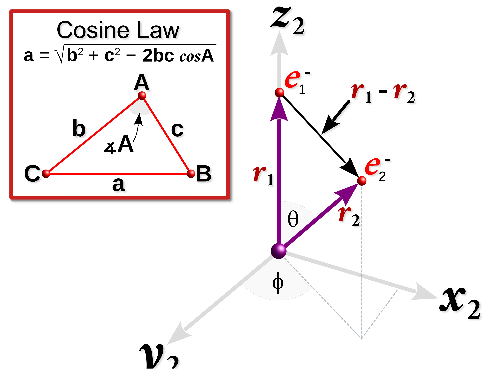
<figcaption>

<b>Figure 32: Helium Vector Diagram</b>
</figcaption>

</figure>

<!-------------------------------------------------------->

<!-------------------------------------------------------->

<!-------------------------------------------------------->

For example He is the first multi-electron atom within the PT, and therefore the ideal system to test using the **Variational Method**. Since no exact analytical solution exists for He any theoretical calculations generated for He can only be compared to its experimental values. As always a good first step in solving any mathematical problem is stating what we do known about the problem. For example, a vector diagram (**Fig. 32**) is always a good visual aid, while the experimental ionization energies of He provide real reference values to test the accuracy of our theoretical calculations.

 

`$$\tag{57}$$`

`$$\\ \large \text{Helium - Experimental Ionization Energies:} \normalsize \\ \Big[ \text{Note: E = 0} \rightarrow \text{infinite separation of nuclei and } e^- \Big] \\ \left. \begin{array}{r} \text{He} \phantom{.} \stackrel{\text{IE}_1}{\longrightarrow} \phantom{.} \text{He}^+ \; + \; e^- \phantom{....} \text{IE}_{1 \text s (\text{He})} \phantom{.} = \phantom{.} 24.59 \, e \text V \\ \text{He}^+ \phantom{.} \stackrel{\text{IE}_2}{\longrightarrow} \phantom{.} \text{He}^{+2} \; + \; e^- \phantom{...} \text{IE}_{1 \text s (\text{He}^+)} \phantom{.} = \phantom{.} 54.42 \, e \text V \end{array} \right] \text{E}_{(\text{exp't})} \phantom{.} = \phantom{.} -(\text{IE}_1 \; + \; \text{IE}_2) \phantom{.} \approx -78.975 \, e \text V \\$$`

The <b><a class="one" href="https://pubchem.ncbi.nlm.nih.gov/ptable/ionization-energy/" target="_blank" title="Go to NIST">first ionization energy</a></b> of He is the highest of any element within the PT, which comes as no surprise given its status as the first <b>Noble Gas</b>. The close proximity of the 1𝓈 electrons to the positively charged protons gives rise to strong electrostatic forces of attraction. Collectively the first and second ionization energies of He give us the <u>reference</u> ground state energy of our quantum system. A very rough upper bound estimate of the ground state of He can be made by simply ignoring the electron-electron repulsive term. Under this scenario our quantum system would be made up of two hydrogenic wave functions: `\(\psi_{\text o}(\vec v_1, \, \vec v_2) = \psi_{(100)} (\vec v_1) \cdot \psi_{(100)} (\vec v_2)\)`. Unfortunately the resulting energy solution is too inaccurate (<b>Eqn. 58, 59</b>), which means the electron-electron repulsive term can not be ignored.

`$$\tag{58}$$`

`$$\\ \large \text{Hamiltonian operator} \phantom{.} (\hat H) \normalsize \\ \large \hat H \normalsize \phantom{.} = \phantom{.} \overbrace{- \frac{\hbar^2}{2 m_e} \Bigg( \nabla^2_1 \; + \; \nabla^2_2 \Bigg)}^{\large \text{KE (T)}} \; + \; \overbrace{\frac{\text e^2}{4 \pi \epsilon_{\text o}} \bigg[ \frac{1}{\vec r_1} \; + \; \frac{1}{\vec r_2} \; - \; \frac{1}{| \vec r_1 \; - \; \vec r_2 |} \bigg] }^{\large \text{PE (V)}}$$`

`$$\\ \text{PE of electron-electron interactions } (\text V_{ee}) \\ \large \text V_{ee} \normalsize \; = \; \frac{\text e^2}{4 \pi \epsilon_{\text o}} \Bigg[ \frac{1}{| \vec r_1 \; - \; \vec r_2 |} \Bigg]$$`

`$$\\ \text{If} \phantom{.} \text V_{ee} \phantom{.} \text{is ignored then} \phantom{.} \hat H \phantom{.} \text{for our system takes on a simpler form:} \\ \hat H_{(\text H^1 + \text H^2)} \phantom{.} = \phantom{.} \overbrace{- \frac{\hbar^2}{2 m_e} \nabla^2_1 \; + \; \frac{\text e^2}{4 \pi \epsilon_{\text o} \vec r_1}}^{\hat H_{(\text H1)}} \; + \; \overbrace{- \frac{\hbar^2}{2 m_e} \nabla^2_2 \; + \; \frac{\text e^2}{4 \pi \epsilon_{\text o} \vec r_2}}^{\hat H_{(\text H2)}} \\[15px] \text{Above shows separate} \, \hat H \, \text{for a dual Hydrogenic quantum system} \\ \hat H \phantom{.} = \phantom{.} \hat H_{(\text H1)} \; + \; \hat H_{(\text H2)} \\$$`

`$$\tag{59}$$`

`$$\\ \large \text{Bohr Energy Equation for Hydrogenic system}: \\ \Big[\text{Note:} \; R_{\text H} \, \text{(Ryberg energy unit)} \phantom{.} = \phantom{.} 13.6 \, eV \phantom{.} = \phantom{.} \frac{\text E_h}{2} \phantom{..} (\text E_h = \text{1 atomic Energy unit}) \Big] \\ \large \text E_n \normalsize \phantom{.} = \phantom{.} - R_{\text H} \Bigg[ \frac{Z^2}{n^2} \Bigg] \\ \begin{align*} \large \text E_{\text{He} (1 \text s)} \normalsize \phantom{.} = & \phantom{.} \large \text E_{(\text H1 \; + \; \text H2)} \normalsize \phantom{.} = \phantom{.} \large \text E_{(\text H1)} \normalsize \; + \; \large \text E_{(\text H2)} \\ = & \phantom{.} \Bigg( - R_{\text H} \Bigg[ \frac{2^2}{1^2} \Bigg] \Bigg) \; + \; \Bigg( - R_{\text H} \Bigg[ \frac{2^2}{1^2} \Bigg] \Bigg) \\ = & \phantom{.} - 8 \, R_{\text H} \phantom{...} (-109 \, e \text V) \\ \end{align*}$$`

So the goal is to come up with a Hamiltonian expression that provides an accurate estimate of the <u>expectation value</u> for `\(\text V_{ee}\)`, which is denoted as `\(\langle \text V_{ee} \rangle\)`. Fortunately, we can improve on the above Hydrogenic model of He by simply using the 1𝓈 orbital wave function of H as our <u>trial</u> wave function.

`$$\\ \large \text{Hydrogen-like Wave Function} \normalsize  \\ (n =1, \phantom{.} \ell = 0, \phantom{.} m_{\ell} = 0, \phantom{.} Z = 2) \\ \Large \psi_{\normalsize (100)} \normalsize \phantom{.} = \phantom{.} \frac{1}{\sqrt \pi} \Bigg( \frac{Z}{a_{\text o}} \Bigg)^{\frac{3}{2}} e^{-Zr/a_{\text o}}  \\ \phantom{.} \\ \large \text{Trial Wave Function}: \normalsize \\[10px] \begin{align*} \large \psi_{\text o} \normalsize (\vec r_1, \vec r_2) \phantom{.} \normalsize = & \phantom{.} \large \psi_{\normalsize (100)} \normalsize (\vec r_1) \cdot \large \psi_{\normalsize (100)} \normalsize (\vec r_2) \\ = & \phantom{.} \sqrt{\frac{2^3}{\pi a_{\text o}^3}} \phantom{.} e^{-2 \vec r_1/a_{\text o}} \cdot \sqrt{\frac{2^3}{\pi a_{\text o}^3}} \phantom{.} e^{-2 \vec r_2/a_{\text o}} \\ = & \phantom{.} \frac{8}{\pi a_{\text o}^3} \phantom{.} e^{-2 \vec r_1/a_{\text o}} \phantom{.} e^{-2 \vec r_2/a_{\text o}} \\ \end{align*}$$`

`$$\hat H \phantom{.} = \phantom{.} - 8 R_{\text H} \; + \; \text V_{ee} \\ \langle H \rangle \phantom{.} = \phantom{.} - 8 R_{\text H} \; + \; \langle \text V_{ee} \rangle \\ \; \\ \text{Determine} \, \langle E \rangle \, \text{xpectation Value for V}_{ee} \Longrightarrow \langle \text V_{ee} \rangle \\ \big[ \text{Note: integrating over two distinct sets of three dimensional vectors} \big] \\ \begin{align*} \large \langle \text V_{ee} \rangle \normalsize \phantom{.} = & \phantom{.} \large \int \int \normalsize \frac{\text e^2}{4 \large \pi \normalsize \, \epsilon_{\text o}} \cdot \frac{\large \psi_{\text o} \normalsize (\vec r_1, \vec r_2) \cdot \large \psi_{\text o} \normalsize (\vec r_1, \vec r_2)}{| \vec r_1 \; - \; \vec r_2 |} \, \overbrace{d^3 \, \vec r_1 \; d^3 \, \vec r_2}^{2 \times 3 \, \text{dimensions}} \\ = & \phantom{.} \overbrace{\Bigg( \frac{\text e^2}{4 \large \pi \normalsize \, \epsilon_{\text o}} \Bigg) \Bigg( \frac{8}{\large \pi \normalsize \, a_{\text o}^3} \Bigg)^2}^{\large \text{constants}} \large \int \int \normalsize \frac{e^{-4 \vec r_1/a_{\text o}} \, e^{-4 \vec r_2/a_{\text o}}}{| \vec r_1 \; - \; \vec r_2 |} \, \overbrace{d^3 \vec r_1}^{\large Int1^{\dagger}} \, \overbrace{d^3 \vec r_2}^{\large Int2^{\ddagger}} \\ = & \phantom{.} \frac{16 \, \text e^2}{\large \pi^3 \normalsize \, \epsilon_{\text o} \, a_{\text o}^6} \large \int \int \normalsize \frac{e^{-4 \vec r_1/a_{\text o}} \, e^{-4 \vec r_2/a_{\text o}}}{| \vec r_1 \; - \; \vec r_2 |} \, \overbrace{d^3 \vec r_1}^{\large Int1^{\dagger}} \, \overbrace{d^3 \vec r_2}^{\large Int2^{\ddagger}} \end{align*}$$`

The new equation for `\(\langle \text V_{ee} \rangle\)` contains two (electron-proton) distance vectors, and therefore <u>two sets</u> of three dimensional co-ordinates (**Fig. 32**). Fortunately this dimensional complexity can be simplified by placing the first vector (i.e. `\(\vec r_1\)`) along the <b>𝓏-axis</b> of the second vector (i.e. `\(\vec r_2\)`) as shown in **Figure 32**. A third mixed vector can be drawn which represents the distance separating the two interacting electrons (i.e. `\(|\vec r_1 - \vec r_2|\)`). After adopting spherical co-ordinates the complex `\(\langle \text V_{ee} \rangle\)` function is then integrated step-wise with respect to each vector separately. Fortunately, because of the spherical symmetry of the 1𝓈 orbital the actual calculus is focused on just two <u>radial</u> vectors (`\(\vec r_1, \vec r_2\)`). This means integrating with respect to the angular dimensions (i.e. `\(\phi_1\)` and `\(\phi_2\)`) becomes fairly straight forward.<b>[13](#ref-mcquarrie_physical_1997),[102](#ref-griffiths_introduction_1994)</b>

`$$\\ \boxed{\text{Step #1}} \; \text{ Integrate} \; \vec r_2 \; \text{component using Spherical co-ordinates} \\ \text{Apply Cosine Law to} \; \measuredangle \theta_2 \; \text{(see Fig. 32 vector diagram)} \\ | \vec r_1 \; - \; \vec r_2 | = \sqrt{\vec r_1^2 \; + \; \vec r_2^2 \; - \; 2 \vec r_1 \vec r_2 \, cos (\theta_2)}$$`

`$$\\ \Big[ \text{Note}: \phantom{..} cos(\pi) = -1, \phantom{..} cos (0) = 1 \Big] \\ Int2 \phantom{.} = \phantom{.} \overbrace{\Large \int^{2 \pi}_{0} \normalsize \phi_2 \; d \phi_2}^{\large 2\pi} \, \overbrace{\Large \int^{\pi}_{0} \normalsize \frac{sin(\theta_2) \, d \theta_2}{\sqrt{\vec r_1^2 \; + \; \vec r_2^2 \; - \; 2 \vec r_1 \vec r_2 \, cos (\theta_2)}}}^{\large \text{Integral} \, \theta_2} \, \overbrace{\Large \int^{\infty}_{0} \normalsize \frac{e^{-4 \vec r_2/a_{\text o}}}{\sqrt{\vec r_1^2 \; + \; \vec r_2^2 \; - \; 2 \vec r_1 \vec r_2 \, cos (\theta_2)}} \, (\vec r_2)^2 \, d \vec r_2}^{\large \text{Integral r}_2 \, (IR2)} \\ \; \\ \begin{align*} \text{Integral} \, \theta_2 \phantom{.} = & \phantom{.} \Large \int^{\pi}_{0} \normalsize \frac{sin(\theta_2) \, d \theta_2}{\sqrt{\vec r_1^2 \; + \; \vec r_2^2 \; - \; 2 \vec r_1 \vec r_2 \, cos (\theta_2)}} \\[10px] \text{Let: } u \phantom{.} = & \phantom{.} r_1^2 \; + \; r_2^2 \; + \; 2 r_1 r_2 \, cos(\theta_2) \\[5px] \frac{du}{d \theta_2} \phantom{.} = & \phantom{.} -2 r_1 r_2 \, sin(\theta_2) \\ ^{\large \dagger}sin(\theta_2) d\theta_2 \phantom{.} = & \phantom{.} - \frac{1}{2 r_1 r_2} du \\ ^{\large \dagger}\text{Exact or Perfect Derivative} \; \Longrightarrow & \; \text{entire numerator can be directly substituted by the derivative} \\ & \; \text{of the function inside the denominator's square root} \\[10px] & \text{New Lower & Upper limits:} \\ u_{\text{upper}} \phantom{.} = & \phantom{.} r_1^2 \; + \; r_2^2 \; + \; 2 r_1 r_2 \, cos(0) \phantom{.} = \phantom{.} (r_1 \; + \; r_2)^2 \\ u_{\text{lower}} \phantom{.} = & \phantom{.} r_1^2 \; + \; r_2^2 \; + \; 2 r_1 r_2 \, cos(\pi) \phantom{.} = \phantom{.} (r_1 \; - \; r_2)^2 \\ \end{align*}$$`

`$$\begin{align*} \text{Integral} \, \theta_2 \phantom{.} = & \phantom{.} \large \int^{(r_1 \; - \; r_2)^2}_{(r_1 \; + \; r_2)^2} \normalsize \frac{1}{\sqrt u} \Bigg( - \frac{1}{2 r_1 r_2}  \Bigg) du \phantom{.} = \phantom{.} \frac{1}{2 r_1 r_2} \large \overbrace{\int^{(r_1 \; + \; r_2)^2}_{(r_1 \; - \; r_2)^2} \normalsize u^{\large - \frac{1}{2}} \, du}^{\text{Use neg. sign to flip} \\ \text{limits of Integration}} \\[5px] = & \phantom{.} \frac{1}{2 r_1 r_2} \large \overbrace{\int^{(r_1 \; + \; r_2)^2}_{(r_1 \; - \; r_2)^2} \normalsize u^{\large - \frac{1}{2}} \, du}^{\text{Use Power Rule} \\ \phantom{..} \text{of Integration}} \normalsize \phantom{.} = \phantom{.} \frac{1}{2 r_1 r_2} \, \Bigg[ 2 \sqrt u \Bigg]^{(r_1 \; + \; r_2)^2}_{(r_1 \; - \; r_2)^2} \phantom{.} = \phantom{.} \frac{1}{r_1 r_2} \, \Bigg[ \normalsize \sqrt u \Bigg]^{(r_1 \; + \; r_2)^2}_{(r_1 \; - \; r_2)^2} \\ = & \phantom{.} \frac{1}{r_1 r_2} \, \Bigg[ \sqrt{(r_1 \; + \; r_2)^2} \; - \; \sqrt{(r_1 \; - \; r_2)^2} \Bigg] \phantom{.} = \phantom{.} \frac{1}{r_1 r_2} \, \Bigg[ (r_1 \; + \; r_2) \; - \; \Big| r_1 \; - \; r_2 \Big| \Bigg] \\[5px] & \large \text{If: } \normalsize r_1 \, \gt \, r_2 \phantom{..} \Longrightarrow \phantom{..} \Big| r_1 \; - \; r_2 \Big| \phantom{.} = \phantom{.} r_1 \; - \; r_2 \\ & \text{Integral} \, \theta_2 \phantom{.} = \phantom{.} \frac{1}{r_1 r_2} \, \Bigg[ (r_1 \; + \; r_2) \; - \; (r_1 \; - \; r_2) \Bigg] \phantom{.} = \phantom{.} \large \frac{2}{r_1} \\[5px] & \large \text{If: } \normalsize r_1 \, \lt \, r_2 \phantom{..} \Longrightarrow \phantom{..} \Big| r_1 \; - \; r_2 \Big| \phantom{.} = \phantom{.} r_2 \; - \; r_1 \\ & \text{Integral} \, \theta_2 \phantom{.} = \phantom{.} \frac{1}{r_1 r_2} \, \Bigg[ (r_1 \; + \; r_2) \; - \; (r_2 \; - \; r_1) \Bigg] \phantom{.} = \phantom{.} \large \frac{2}{r_2} \\ \end{align*}$$`

Evaluating the `\(\phi_2\)` integral produces the simple constant `\(2 \large \pi\)`, while the `\(\theta_2\)` integrand turns out to be a so called “<i>perfect</i>” derivative (i.e. nice exact solution for this anti-derivative). The new upper and lower limits of this integrand produces <u>two valid solutions</u> that depend on the relative magnitude of the two vectors (i.e. `\(\vec r_1 > \vec r_2\)` or `\(\vec r_1 < \vec r_2\)`). In order to complete the `\(\vec r_2\)` integration (`\(Int2\)`) it has to be split into two parts to satisfy both limit conditions. Since each part of `\(Int2\)` is a product of two functions both can be solved using the <b><a class="one" href="https://www.mathsisfun.com/calculus/integration-by-parts.html" target="_blank" title="Go to MathIsFun">integration by parts</a></b> method (i.e. `\(IBP1\)` and `\(IBP2\)`).

`$$\\ Int2 \phantom{.} = \phantom{.} 2 \large \pi \normalsize \Bigg[ \frac{2}{\vec r_1} \, \int^{\vec r_1}_{0} \vec r_2^2 \phantom{.} e^{-4 \vec r_2 / a_{\text o}} \, d \vec r_2 \; + \; \frac{2}{\vec r_2} \, \int^{\infty}_{\vec r_1} \vec r_2^2 \, e^{-4 \vec r_2 / a_{\text o}} \, d \vec r_2 \Bigg] \\[15px] \large \text{Perform Integration by Parts (IBP)} \normalsize \\ Int2 \phantom{.} = \phantom{.} 2 \large \pi \normalsize \cdot 2 \Bigg[ \frac{1}{\vec r_1} \, \overbrace{\int^{\vec r_1}_{0} \vec r_2^2 \, e^{-4 \vec r_2 / a_{\text o}} \, d \vec r_2}^{\large \text{IBP1}} \; + \; \overbrace{\int^{\infty}_{\vec r_1} \vec r_2 \, e^{-4 \vec r_2 / a_{\text o}} \, d \vec r_2}^{\large \text{IBP2}} \Bigg] \\[15px] \large \text{Recall IBP Formula} \\ \int u \frac{d \text v}{d x} du \phantom{.} = \phantom{.} u \text v \; - \; \int \text v \frac{du}{dx} dx \\[15px] \boxed{\large \text{IBP2}} \\ \text{Let } u \phantom{.} = \phantom{.} \vec r_2 \phantom{..} \Longrightarrow \phantom{..} du \phantom{.} = \phantom{.} d \vec r_2 \\ \text{Let } \frac{d \text v}{d x} \phantom{.} = \phantom{.} e^{-4 \vec r_2 / a_{\text o}} \phantom{..} \Longrightarrow \phantom{..} \text v \phantom{.} = \phantom{.} \int \frac{d \text v}{d x} d x \phantom{.} = \phantom{.} - \bigg( \frac{a_{\text o}}{4} \bigg) e^{-4 \vec r_2 / a_{\text o}} \\ \begin{align*} \\ \int \vec r_2 \phantom{.} e^{-4 \vec r_2 / a_{\text o}} \phantom{.} = & \phantom{.} \bigg( \vec r_2 \bigg) \bigg( - \frac{a_{\text o}}{4} e^{-4 \vec r_2 / a_{\text o}} \bigg) \; - \; \int \frac{- a_{\text o}}{4} e^{-4 \vec r_2 / a_{\text o}} \, d \vec r_2 \\ = & \phantom{.} \bigg( \vec r_2 \bigg) \bigg( - \frac{a_{\text o}}{4} e^{-4 \vec r_2 / a_{\text o}} \bigg) \; - \; \bigg( \frac{a_{\text o}}{4} \bigg)^2 e^{-4 \vec r_2 / a_{\text o}} \\ = & \phantom{.} e^{-4 \vec r_2 / a_{\text o}} \Bigg[ - \vec r_2 \bigg(\frac{a_{\text o}}{4} \bigg) \; - \; \bigg( \frac{a_{\text o}}{4} \bigg)^2 \Bigg] \end{align*} \\$$`

`$$\boxed{\large \text{IBP1}} \\ \text{Let } u \phantom{.} = \phantom{.} \vec r_2^2 \phantom{..} \Longrightarrow \phantom{..} du \phantom{.} = \phantom{.} 2 \vec r_2 \phantom{.} d\vec r_2 \\ \text{Let } \frac{d \text v}{d x} \phantom{.} = \phantom{.} e^{-4 \vec r_2 / a_{\text o}} \phantom{..} \Longrightarrow \phantom{..} \text v \phantom{.} = \phantom{.} \int \frac{d \text v}{d x} d x \phantom{.} = \phantom{.} - \frac{a_{\text o}}{4} e^{-4 \vec r_2 / a_{\text o}} \\ \begin{align*} \\ \int \vec r_2^2 \phantom{.} e^{-4 \vec r_2 / a_{\text o}} \phantom{.} = & \phantom{.} \bigg( \vec r_2^2 \bigg) \bigg( - \frac{a_{\text o}}{4} e^{-4 \vec r_2 / a_{\text o}} \bigg) \phantom{.} - \phantom{.} \int - \frac{a_{\text o}}{4} e^{-4 \vec r_2 / a_{\text o}} \phantom{.} 2 \vec r_2 \phantom{.} d \vec r_2 \\ = & \phantom{.} \bigg( \vec r_2^2 \bigg) \bigg( - \frac{a_{\text o}}{4} e^{-4 \vec r_2 / a_{\text o}} \bigg) \phantom{.} + \phantom{.} 2 \frac{a_{\text o}}{4} \overbrace{\int - e^{-4 \vec r_2 / a_{\text o}} \phantom{.} \vec r_2 \phantom{.} d \vec r_2}^{\large \text{IBP2}} \\ = & \phantom{.} \bigg( \vec r_2^2 \bigg) \bigg( - \frac{a_{\text o}}{4} e^{-4 \vec r_2 / a_{\text o}} \bigg) \phantom{.} + \phantom{.} 2 \frac{a_{\text o}}{4} \Bigg( e^{-4 \vec r_2 / a_{\text o}} \Bigg[ - \vec r_2 \bigg(\frac{a_{\text o}}{4} \bigg) \phantom{.} - \phantom{.} \bigg( \frac{a_{\text o}}{4} \bigg)^2 \Bigg] \Bigg) \\ = & \phantom{.} \vec r_2^2 \bigg( \frac{-a_{\text o}}{4} \bigg) e^{-4 \vec r_2 / a_{\text o}} \phantom{.} - \phantom{.} 2 \vec r_2 \bigg( \frac{a_{\text o}}{4} \bigg)^2 e^{-4 \vec r_2 / a_{\text o}} \phantom{.} - \phantom{.} 2 \bigg( \frac{a_{\text o}}{4} \bigg)^3 e^{-4 \vec r_2 / a_{\text o}} \\ \end{align*}$$`

`$$\\ \begin{align*} \\ \large Int2 \normalsize \phantom{.} = & \phantom{.} 4 \large \pi \normalsize \phantom{.} \frac{1}{\vec r_1} \left[ \phantom{.} \vec r_2^2 \Bigg( \frac{-a_{\text o}}{4} \Bigg) e^{-4 \vec r_2 / a_{\text o}} \phantom{.} - \phantom{.} 2 \vec r_2 \Bigg( \frac{a_{\text o}}{4} \Bigg)^2 e^{-4 \vec r_2 / a_{\text o}} \phantom{.} - \phantom{.} 2 \Bigg( \frac{a_{\text o}}{4} \Bigg)^3 e^{-4 \vec r_2 / a_{\text o}} \right]^{\vec r_1}_{0} \\ & \phantom{....} + \phantom{.} \large 4 \normalsize \pi \; \left[ \phantom{.} e^{-4 \vec r_2 / a_{\text o}} \phantom{.} \Bigg( - \vec r_2 \bigg( \frac{a_{\text o}}{4} \bigg) \phantom{.} - \phantom{.} \bigg( \frac{a_{\text o}}{4} \bigg)^2 \Bigg) \right]^{\infty}_{\vec r_1} \\ = & \phantom{.} 4 \large \pi \normalsize \phantom{.} \frac{1}{\vec r_1} \left[ \Bigg( \phantom{.} \vec r_1^2 \bigg( \frac{-a_{\text o}}{4} \bigg) e^{-4 \vec r_1 / a_{\text o}} \phantom{.} - \phantom{.} 2 \vec r_1 \bigg( \frac{a_{\text o}}{4} \bigg)^2 e^{-4 \vec r_1 / a_{\text o}} \phantom{.} - \phantom{.} 2 \bigg( \frac{a_{\text o}}{4} \bigg)^3 e^{-4 \vec r_1 / a_{\text o}} \Bigg) \right. \\ & \left. \phantom{....} - \phantom{.} \Bigg( 0 \phantom{.} - \phantom{.} 0 \phantom{.} - \phantom{.} 2 \bigg( \frac{a_{\text o}}{4} \bigg)^3 \cdot 1  \Bigg) \right] \phantom{.} + \phantom{.} 4 \large \pi \normalsize \, \left[ 0 \phantom{.} - \phantom{.}   e^{-4 \vec r_1 / a_{\text o}} \Bigg( - \vec r_1 \bigg( \frac{a_{\text o}}{4} \bigg) \phantom{.} - \phantom{.} \bigg( \frac{a_{\text o}}{4} \bigg)^2 \Bigg) \right] \\ = & \phantom{.} 4 \large \pi \normalsize \phantom{.} \left[ \phantom{.} \require{cancel} \cancel{- \vec r_1 \bigg( \frac{a_{\text o}}{4} \bigg) e^{-4 \vec r_1 / a_{\text o}}} \phantom{.} - \phantom{.} 2 \bigg( \frac{a_{\text o}}{4} \bigg)^2 e^{-4 \vec r_1 / a_{\text o}} \phantom{.} - \phantom{.} \frac{2}{\vec r_1} \bigg( \frac{a_{\text o}}{4} \bigg)^3 e^{-4 \vec r_1 / a_{\text o}} \phantom{.} \right. \\ & \left. \phantom{....} + \phantom{.} \frac{2}{\vec r_1} \bigg( \frac{a_{\text o}}{4} \bigg)^3 \phantom{.} + \phantom{.} \require{cancel} \cancel{\vec r_1 \bigg( \frac{a_{\text o}}{4} \bigg) e^{-4 \vec r_1 / a_{\text o}}} \phantom{.} + \phantom{.} \bigg( \frac{a_{\text o}}{4} \bigg)^2 e^{-4 \vec r_1 / a_{\text o}} \right] \\ = & \phantom{.} 4 \large \pi \normalsize \phantom{.} \left[ \phantom{.} - \bigg( \frac{a_{\text o}}{4} \bigg)^2 e^{-4 \vec r_1 / a_{\text o}} \phantom{.} - \phantom{.} \frac{2}{\vec r_1} \bigg( \frac{a_{\text o}}{4} \bigg)^3 e^{-4 \vec r_1 / a_{\text o}} \phantom{.} + \phantom{.} \frac{2}{\vec r_1} \bigg( \frac{a_{\text o}}{4} \bigg)^3 \right] \\ = & \phantom{.} 4 \large \pi \normalsize \phantom{.} \frac{2}{\vec r_1} \bigg( \frac{a_{\text o}}{4} \bigg)^3 \left[ \phantom{.} - \Bigg( \frac{4}{a_{\text o}} \Bigg) \Bigg( \frac{\vec r_1}{2} \Bigg) e^{-4 \vec r_1 / a_{\text o}} \phantom{.} - \phantom{.} e^{-4 \vec r_1 / a_{\text o}} \phantom{.} + \phantom{.} 1 \right] \\ = & \phantom{.} \frac{\large \pi \normalsize \phantom{.} a_{\text o}^3}{8 \vec r_1} \left[ 1 \phantom{.} - \phantom{.} \Bigg( 1 \phantom{.} + \phantom{.} \frac{2 \vec r_1}{a_{\text o}} \Bigg) e^{-4 \vec r_1 / a_{\text o}} \right] \\ \end{align*}$$`

Having solved the `\(\vec r_2\)` integral (`\(Int2\)`) we are now left with a `\(\langle V_{ee} \rangle\)` expression that contains only <u>one unknown</u> variable, `\(\vec r_1\)`. Fortunately dealing with the angular components is rather trivial since `\(\vec r_1\)` is independent of both `\(\phi_1\)` and `\(\theta_1\)` (i.e. integrand yields simple constants).

`$$\\ \langle \text V_{ee} \rangle \phantom{.} = \phantom{.} \Bigg( \frac{ \require{cancel} \cancel{16}^2 \, \text e^2}{\large \pi^{\require{cancel} \cancel{3}^2} \normalsize \, \epsilon_{\text o} \, a_{\text o}^{\require{cancel} \cancel{6}^3}} \Bigg) \Bigg( \overbrace{\frac{\large \require{cancel} \cancel{\pi} \normalsize \phantom{.} \require{cancel} \cancel{a_{\text o}^3}}{\require{cancel} \cancel{8}}}^{ \phantom{.....} \large \text{Int2} \\ \large \text{constants}} \Bigg) \overbrace{\overbrace{\large \int^{2 \pi}_{0} \normalsize d \phi_1}^{2 \pi} \overbrace{\large \int^{\pi}_{0} \normalsize sin \theta \, d \theta_1}^{2} \; \large \int^{\infty}_0 \normalsize \overbrace{ \frac{1}{\vec r_1} \left[ 1 \; - \; \Bigg( 1 \; + \; \frac{2 \vec r_1}{a_{\text o}} \Bigg) e^{\large \frac{-4 \vec r_1}{a_{\text o}}} \right]}^{\large Int2 \; \text{solution}} e^{\large \frac{-4 \vec r_1}{a_{\text o}}} \, \vec r_1^2 \, d \vec r_1}^{\large Int1} \\ \begin{align*} \langle \text V_{ee} \rangle \phantom{.} = & \phantom{.} \Bigg( \frac{2 \text e^2}{ \large \pi^{\require{cancel} \cancel{2}} \normalsize \epsilon_{\text o} a_{\text o}^3} \Bigg) \phantom{.} 4 \large \require{cancel} \cancel{\pi} \normalsize \phantom{.} \large \int^{\infty}_{0} \normalsize \frac{1}{\vec r_1} \left[ 1 \; - \; \Bigg( 1 \; + \; \frac{2 \vec r_1}{a_{\text o}} \Bigg) e^{\large \frac{-4 \vec r_1}{a_{\text o}}} \right] \cdot e^{\large \frac{-4 \vec r_1}{a_{\text o}}} \, \vec r_1^2 \, d \vec r_1 \\ = & \phantom{.} \Bigg( \frac{8 \text e^2}{\large \pi \normalsize \epsilon_{\text o} a_{\text o}^3} \Bigg) \large \int^{\infty}_{0} \normalsize \left[ \vec r_1 e^{\large \frac{-4 \vec r_1}{a_{\text o}}} \; - \; \Bigg( \vec r_1 \; + \; \frac{2 \vec r_1^2}{a_{\text o}} \Bigg) e^{\large \frac{-8 \vec r_1}{a_{\text o}}} \right] d \vec r_1 \\ = & \phantom{.} \Bigg( \frac{8 \text e^2}{\large \pi \normalsize \epsilon_{\text o} a_{\text o}^3} \Bigg) \left[ \overbrace{ \large \int^{\infty}_{0} \normalsize \vec r_1 e^{\large \frac{-4 \vec r_1}{a_{\text o}}} \, d \vec r_1}^{\text{IBP3}} \; - \; \overbrace{ \large \int^{\infty}_{0} \normalsize \vec r_1 e^{\large \frac{-8 \vec r_1}{a_{\text o}}} \, d \vec r_1}^{\text{IBP4}} \; - \; \overbrace{ \large \int^{\infty}_{0} \normalsize \frac{2 \vec r_1^2}{a_{\text o}} e^{\large \frac{-8 \vec r_1}{a_{\text o}}} \, d \vec r_1}^{\text{IBP5}} \right] \end{align*}$$`

A final solution to `\(\langle \text V_{ee} \rangle\)` now only requires three more relatively simple integration steps. Fortunately each one of these integrands have been partly or fully solved in the previous steps.

`$$\\ \boxed{\large \text{IBP3}}: \; \text{same as IBP2} \\ \text{Let } u \phantom{.} = \phantom{.} \vec r_1 \phantom{..} \Longrightarrow \phantom{..} du \phantom{.} = \phantom{.} d\vec r_1 \\ \text{Let } \frac{d \text v}{d x} \phantom{.} = \phantom{.} e^{-4 \vec r_1 / a_{\text o}} \phantom{..} \Longrightarrow \phantom{..} \text v \phantom{.} = \phantom{.} \int \frac{d \text v}{d x} d x \phantom{.} = \phantom{.} - \frac{a_{\text o}}{4} e^{-4 \vec r_1 / a_{\text o}} \\ \int \vec r_1 \phantom{.} e^{-4 \vec r_1 / a_{\text o}} \, d \vec r_1 \phantom{.} = \phantom{.} - \bigg( \frac{a_{\text o}}{4} \bigg) \, \vec r_1 \, e^{-4 \vec r_1 / a_{\text o}} \; - \bigg( \frac{a_{\text o}}{4} \bigg)^2 e^{-4 \vec r_1 / a_{\text o}} \\ \phantom{.} \\ \boxed{\large \text{IBP 3}}: \; \text{Solution} \\ \begin{align*} \int^{\infty}_{0} \vec r_1 e^{-4 \vec r_1 / a_{\text o}} \phantom{.} \phantom{.} = & \phantom{.} \left[ \, - \bigg( \frac{a_{\text o}}{4} \bigg) \, \vec r_1 \, e^{-4 \vec r_1 / a_{\text o}} \; - \; \bigg( \frac{a_{\text o}}{4} \bigg)^2 e^{-4 \vec r_1 / a_{\text o}} \, \right]^{\infty}_{0} \\ = & \phantom{.} \Bigg[ 0 \; - \; 0 \Bigg] \; - \; \Bigg[ 0 \; - \; \bigg(\frac{a_{\text o}}{4} \bigg)^2 \Bigg] \\ = & \phantom{.} \bigg(\frac{a_{\text o}}{4} \bigg)^2 \\ \end{align*}$$`

`$$\\ \boxed{\large \text{IBP4}}: \; \text{variation of IBP2} \\ \text{Let } u \phantom{.} = \phantom{.} \vec r_1 \phantom{..} \Longrightarrow \phantom{..} du \phantom{.} = \phantom{.} d\vec r_1 \\ \text{Let } \frac{d \text v}{d x} \phantom{.} = \phantom{.} e^{-8 \vec r_1 / a_{\text o}} \phantom{..} \Longrightarrow \phantom{..} \text v \phantom{.} = \phantom{.} \int \frac{d \text v}{d x} d x \phantom{.} = \phantom{.} - \bigg( \frac{a_{\text o}}{8} \bigg) e^{-8 \vec r_1 / a_{\text o}} \\ \begin{align*} \\ \int \vec r_1 \phantom{.} e^{-8 \vec r_1 / a_{\text o}} \, d \vec r_1 \phantom{.} = & \phantom{.} - \vec r_1 \, \bigg( \frac{a_{\text o}}{8} \bigg) \phantom{.} e^{-8 \vec r_1 / a_{\text o}} \; + \; \bigg( \frac{a_{\text o}}{8} \bigg) \int e^{-8 \vec r_1 / a_{\text o}} \, d \vec r_1 \\ = & \phantom{.} - \bigg( \frac{a_{\text o}}{8} \bigg) \, \vec r_1 \, e^{-8 \vec r_1 / a_{\text o}} \; - \; \bigg( \frac{a_{\text o}}{8} \bigg)^2 \, e^{-8 \vec r_1 / a_{\text o}} \\ \phantom{.} \\ & \phantom{....} \boxed{\large \text{IBP 4}}: \; \text{Solution} \\ \int^{\infty}_{0} \vec r_1 e^{-8 \vec r_1 / a_{\text o}} \phantom{.} = & \phantom{.} \left[ - \bigg( \frac{a_{\text o}}{8} \bigg) \, \vec r_1 \phantom{.} e^{-8 \vec r_1 / a_{\text o}} \; - \; \bigg( \frac{a_{\text o}}{8} \bigg)^2 e^{-8 \vec r_1 / a_{\text o}} \right]^{\infty}_{0}  \\ = & \phantom{.} \Bigg[ 0 \; - \; 0 \Bigg] \; - \; \Bigg[ 0 \; - \; \bigg(\frac{a_{\text o}}{8} \bigg)^2 \Bigg] \\ = & \phantom{.} \bigg(\frac{a_{\text o}}{8} \bigg)^2 \\ \end{align*}$$`

`$$\\ \boxed{\large \text{IBP5}} \\ \text{Let } u \phantom{.} = \phantom{.} \vec r_1^2 \phantom{..} \Longrightarrow \phantom{..} \frac{du}{d\vec r_1} \phantom{.} = 2 \vec r_1 \\ \text{Let } \frac{d \text v}{d x} \phantom{.} = \phantom{.} \overbrace{e^{-8 \vec r_1 / a_{\text o}}}^{\large \text{same as} \\ \phantom{...} \text{IBP4}} \phantom{..} \Longrightarrow \phantom{..} \text v \phantom{.} = \phantom{.} - \bigg( \frac{a_{\text o}}{8} \bigg) e^{-8 \vec r_1 / a_{\text o}} \\ \begin{align*} \int \frac{2 \vec r_1^2}{a_{\text o}} \, e^{-8 \vec r_1 / a_{\text o}} \, d \vec r_1 \phantom{.} = & \phantom{.} \frac{2}{a_{\text o}} \left[ - \vec r_1^2 \bigg( \frac{a_{\text o}}{8} \bigg) e^{-8 \vec r_1 / a_{\text o}} \; - \; \int - \bigg( \frac{a_{\text o}}{8} \bigg) e^{-8 \vec r_1 / a_{\text o}} \, 2\vec r_1 \, d \vec r_1 \right] \\ = & \phantom{.} \frac{2}{a_{\text o}} \left[ - \vec r_1^2 \bigg( \frac{a_{\text o}}{8} \bigg) e^{-8 \vec r_1 / a_{\text o}} \; + \; 2 \bigg( \frac{a_{\text o}}{8} \bigg) \overbrace{\int e^{-8 \vec r_1 / a_{\text o}} \, \vec r_1 \, d \vec r_1}^{\large \text{same as IBP4}} \right] \\ = & \phantom{.} \frac{2}{a_{\text o}} \left( - \vec r_1^2 \bigg( \frac{a_{\text o}}{8} \bigg) e^{-8 \vec r_1 / a_{\text o}} \; + \; 2 \bigg( \frac{a_{\text o}}{8} \bigg)  \Bigg[ - \bigg( \frac{a_{\text o}}{8} \bigg) \phantom{.} \vec r_1 \phantom{.} e^{-8 \vec r_1 / a_{\text o}} \; - \; \bigg( \frac{a_{\text o}}{8} \bigg)^2 \phantom{.} e^{-8 \vec r_1 / a_{\text o}} \Bigg] \right) \\ = & \phantom{.} - \frac{2 \vec r_1^2}{a_{\text o}} \bigg( \frac{a_{\text o}}{8} \bigg) e^{-8 \vec r_1 / a_{\text o}} \; - \; \frac{4 \vec r_1}{a_{\text o}} \bigg( \frac{a_{\text o}}{8} \bigg)^2 e^{-8 \vec r_1 / a_{\text o}} \; - \; \frac{4}{a_{\text o}} \bigg( \frac{a_{\text o}}{8} \bigg)^3 e^{-8 \vec r_1 / a_{\text o}} \\ = & \phantom{.} \left[ - \frac{2 \vec r_1^2}{a_{\text o}} \bigg( \frac{a_{\text o}}{8} \bigg) \; - \; \frac{4 \vec r_1}{a_{\text o}} \bigg( \frac{a_{\text o}}{8} \bigg)^2 \; - \; \frac{4}{a_{\text o}} \bigg( \frac{a_{\text o}}{8} \bigg)^3 \right] e^{-8 \vec r_1 / a_{\text o}} \end{align*}$$`

`$$\\ \boxed{\large \text{IBP 5}}: \; \text{Solution} \\ \Big[ \text{Note:} \phantom{..} \text{if} \; r_1 \rightarrow \infty \phantom{.} ... \text{then} \; e^{- r_1} = 0 \Big] \\ \begin{align*} \int^{\infty}_{0} \frac{2 \vec r_1^2}{a_{\text o}} \phantom{.} e^{-8 \vec r_1 / a_{\text o}} \phantom{.} d \vec r_1 \phantom{.} = & \phantom{.} \left[ \Bigg( - \frac{2 \vec r_1^2}{a_{\text o}} \Big( \frac{a_{\text o}}{8} \Big) \; - \; \frac{4 \vec r_1}{a_{\text o}} \Big( \frac{a_{\text o}}{8} \Big)^2 \; - \; \frac{4}{a_{\text o}} \Big( \frac{a_{\text o}}{8} \Big)^3 \Bigg) \, e^{-8 \vec r_1 / a_{\text o}} \right]^{\infty}_{0}  \\ = & \phantom{.} \Bigg[ 0 \; - \; 0 \; - \; 0 \Bigg] \; - \; \Bigg[ 0 \; - \; 0 \; - \; \bigg(\frac{4}{a_{\text o}} \bigg) \bigg(\frac{a_{\text o}}{8} \bigg)^3 \Bigg] \\ = & \phantom{.} \bigg(\frac{4}{a_{\text o}} \bigg) \bigg(\frac{a_{\text o}}{8} \bigg)^3 \\ \end{align*}$$`

Plugging the solutions of three final integrals into our `\(\langle \text V_{ee} \rangle\)` expression gives us a much needed energy correction of 34 `\(e \text V\)`, which results in a final estimate of -75 `\(e \text V\)` (5% error).

`$$\\ \begin{align*} \large \langle \text V_{ee} \rangle \normalsize = & \phantom{.} \Bigg( \frac{8 \text e^2}{\large \pi \normalsize \epsilon_{\text o} a_{\text o}^3} \Bigg) \left[ \overbrace{\Bigg[ \frac{a_{\text o}}{4} \Bigg]^2 }^{\text{IBP3} \\ \text{sol'n}} \; - \; \overbrace{\bigg( \frac{a_{\text o}}{8} \bigg)^2}^{\text{IBP4} \\ \text{sol'n}} \; - \; \overbrace{\bigg( \frac{4}{a_{\text o}} \bigg) \, \bigg( \frac{a_{\text o}}{8} \bigg)^3}^{\text{IBP5} \\ \text{sol'n}} \right] \\ = & \phantom{.} \bigg( \frac{8 \text e^2}{\large \pi \normalsize \epsilon_{\text o} a_{\text o}^3} \bigg) a_{\text o}^2 \left[ \frac{1}{16} \; - \; \frac{1}{64} \; - \; \frac{1}{128} \right] \phantom{.} = \phantom{.} \frac{8 \text e^2}{\large \pi \normalsize \epsilon_{\text o} a_{\text o}} \left[ \frac{8 \, - \, 2 \, - 1}{128} \right] \\[5px] = & \phantom{.} \frac{8 \text e^2}{\large \pi \normalsize \epsilon_{\text o}} \bigg( \frac{5}{128} \bigg) \cdot \frac{1}{a_{\text o}} \phantom{.} = \phantom{.} \bigg( \frac{5}{2} \bigg) \frac{\text e^2}{8 \large \pi \normalsize \epsilon_{\text o}} \cdot \frac{m_e \text e^2}{4 \large \pi \normalsize \epsilon_{\text o} \hbar^2} \\[5px] = & \phantom{.} \bigg( \frac{5}{2} \bigg) \overbrace{ \frac{m_e \text e^4}{32 \large \pi^2 \normalsize \epsilon_{\text o}^2 \hbar^2} }^{\large \text{E}_{1 (\text H)} \; = \; 1R_{\text H}} \phantom{.} = \phantom{.} \frac{5}{2} R_{\text H} \phantom{.} = \phantom{.} \frac{5}{2} \Big( 13.6 \, e \text V \Big) \phantom{.} = \phantom{.} 34 \, e \text V \end{align*}$$`

`$$\overbrace{\large \text E_{\text{o (He)}} \normalsize \phantom{.} > \phantom{.} \large \text E_{\text{exp't}} \normalsize}^{\large \text{Variational Principle} \; \Huge \checkmark} \\[10px] \Big[ \text{Note:} \phantom{..} 2 R_{\text H} \, = \,\text E_h \, \approx \, 27.2 \, e \text V\Big] \\ \begin{align*} \large \text E_{\normalsize \text{o (He)}} \normalsize \phantom{.} = & \phantom{.} - 8 R_{\text H} \; + \; \large \langle \text V_{ee} \rangle \normalsize \phantom{.} = \phantom{.} - 8 \Big[ 13.6 \, e \text V \Big] \; + \; 34 \, e \text V \\ = & \phantom{.} -75 \, e \text V \phantom{.} \approx \phantom{.} -2.75 \, \text E_h \\ \end{align*}$$`

Although our simple **Gaussian** <u>trial</u> wave function produced a relatively good estimate of the ground-state of He it is still unacceptably high. This becomes evident when looking at exactly how much energy the 5% error represents (i.e. more energy than a common C-C bond).

`$$\\ \left. \begin{array}{l} \phantom{\Huge H} \large \text E_{\text{o}_{(\text{He})}} \normalsize \phantom{.} = \phantom{.} -75 \, e \text V \\ \large \text E_{\text{o}_{(\text{Exp't})}} \normalsize \phantom{.} = -78.975 \, e \text V \end{array} \right] \Longrightarrow \; \Bigg(\frac{\overbrace{(-78.975) \, - \, (-75)}^{\large | \Delta \text E_{\text o} | \; = \; 3.975 \, e \text V}}{-78.975} \Bigg) \times 100\% \phantom{.} = \phantom{.} 5.03 \% \\ 3.975 \, e \text V \normalsize \times \frac{1.6022 \times 10^{-19} \text J}{1 \, e \text V} \times \overbrace{6.022 \times 10^{23} \phantom{.} \text{mole}^{-1}}^{\text N_A} \normalsize \phantom{.} \approx \phantom{.} 383.5 \; \text{kJ/mole} \\ \Big[ \text{Note: energy of a C-C covalent bond ~347 kJ/mole} \Big] \\$$`

<b>  4.3.3 Ground State Energy of Hydrogen Ion Molecule  :</b> The simplest molecule to model is two H atoms sharing one electron (i.e. H2+ ion). Assuming the two hydrogen nuclei are essentially stationary with respect to the highly kinetic electron (i.e. **Born-Oppenheimer Approximation**) we can derive an analytical solution for this quantum system. However, *Does such a molecule exist?*  
    If it does exist then the energy of H<b>2</b>+ must be less than the energy of its constituent parts, namely a hydrogen atom and a free proton. We therefore need to calculate its energy expectation value in order to understand the <u>ground state</u> of this system (`\(\hat H \cdot \psi_{\text o} = E \cdot \psi_{\text o}\)`). As previously mentioned a **Hamiltonian** operator (`\(\hat H\)`) is used to describe the total energy of a quantum system, including **kinetic** (T) and **potential energy** (V). The former is expressed in terms of momentum (`\(\vec p\)`) while V is in the form of **Coulombic** electrostatic interactions, which is directly proportional to the magnitude of the point charges (i.e. `\(q \cdot q = q^2\)`) and inversely proportional to the distance separating them (i.e. `\(\vec r\)`). Some important mathematical relationships that are used to construct `\(\hat H\)` are listed below (Note: for more info see <b><a class="one" href="https://opc-project.netlify.app/project/opcchemprimer2_atom/#Mwaves" target="_blank" title="Go to ChemPrimer2">ChemPrimer2</a></b>).

`$$\tag{60}$$`

`$$\\ \begin{align*} \text{Kinetic Energy (T)}: \phantom{..} & \phantom{.} \boxed{ \, \text T = \frac{1}{2}m \vec{v}^2 \, } \times \frac{m}{m} \phantom{.} = \phantom{.} \frac{(m \vec v)^2}{2m} \phantom{.} = \phantom{.} \boxed{\frac{\vec p^2}{2m}} \\[5px] \text{Recall momentum operator} \; (\hat p): \phantom{..} & \boxed{-i\hbar \frac{\partial}{\partial x}} \, \psi_{(x,t)} \phantom{.} = \phantom{.} \boxed{\vec p} \phantom{.} \psi_{(x,t)} \phantom{..} \Longrightarrow \phantom{..} \boxed{ \, \hat p_x \phantom{.} = \phantom{.} -i\hbar \frac{\partial}{\partial x} \, } \end{align*}$$`

`$$\\ \text{Pythagorean theorem applied to momentum operator:} \; \large \hat p  \\ \begin{align*} & \phantom{.........} \boxed{ \; \hat p^2 \phantom{.} = \phantom{.} \hat p_x^2 \; + \; \hat p_y^2 \; + \; \hat p_z^2 \; } \\[5px] \hat p^2 \phantom{.} = & \phantom{.} \bigg( -i\hbar \frac{\partial}{\partial x} \bigg)^2 \; + \; \bigg( -i\hbar \frac{\partial}{\partial y} \bigg)^2 \; + \; \bigg( -i\hbar \frac{\partial}{\partial z} \bigg)^2 \\ \phantom{.} = & \phantom{.} - \hbar^2 \Bigg( \, \overbrace{\frac{\partial^2}{\partial x^2} \; + \; \frac{\partial^2}{\partial y^2} \; + \; \frac{\partial^2}{\partial z^2}}^{\phantom{...} \large \nabla^2 \; = \; \text{Laplacian} \\ \large \text{differential operator}} \, \Bigg) \phantom{.} = \phantom{.} - \hbar^2 \, \large \nabla^2 \\ \end{align*}$$`

As shown above the **kinetic energy** can be expressed in terms of momentum (`\(\vec p\)`), which serves as a useful mathematical <b><a class="one" href="https://opc-project.netlify.app/project/opcchemprimer2_atom/#3DSE" target="_blank" title="Go to ChemPrimer2">operator</a></b> for our quantum system.

`$$\tag{61}$$`

`$$\text{Hamiltonian operator:} \phantom{..} \hat H  \phantom{.} = \phantom{.} T \; + \; V \phantom{.} = \phantom{.} \frac{1}{2m}\vec p^2 \; + \; V \\[5px] \hat H \phantom{.} = \phantom{.} \overbrace{- \frac{\hbar^2}{2m_p} \Big( \nabla^{2}_{\text A} \; + \; \nabla^{2}_{\text B} \Big)}^{\large \text T_{p^+}} \; \overbrace{- \; \frac{\hbar^2}{2m_e} \nabla^{2}_e}^{\large \text T_{e^-}} \; + \; V \\[15px] \hat H \, \large \psi_{\text o} \normalsize \phantom{.} = \phantom{.} \Bigg[ - \frac{\hbar^2}{2m_p} \Big( \nabla^{2}_{\text A} \; + \; \nabla^{2}_{\text B} \Big) \; - \; \frac{\hbar^2}{2m_e} \nabla^{2}_e \; + \; V \Bigg] \, \large \psi_{\text o}$$`

The <b><a class="one" href="https://opc-project.netlify.app/project/opcchemprimer2_atom/#3DSE" target="_blank" title="Go to ChemPrimer2">Laplacian operator</a></b> (`\(\nabla\)`) measures the multi-dimensional changes in the wave function. In addition, the details of the **potential energy** (`\(V\)`) term needs to be added to the equation. This involves changes in the <b><a class="one" href="https://physics.info/coulomb/" target="_blank" title="Go to Physics HyperTextbook">Coulombic forces</a></b> (`\(\vec F_e\)`) generated by either <u>repulsive</u> (i.e. <u>positive</u> vector quantity) or <u>attractive</u> (i.e. <u>negative</u> vector quantity) electrostatic interactions as the electron moves in relation to the two protons.<b>[13](#ref-mcquarrie_physical_1997),[102](#ref-griffiths_introduction_1994)</b>

`$$\tag{62}$$`

`$$\\ \text{Coulomb's Law:} \phantom{..} \vec F_e \propto q_1 \, q_2 \phantom{..} \text{and} \phantom{..} \vec F_e \; \propto \; \frac{1}{r^2}    \\ \large \vec F_{1,2} \normalsize \phantom{.} = \phantom{.} \large k_e \normalsize \, \frac{|q_1| \, |q_2|}{r^2} \\ \phantom{.} \\ \text{Work (W) displacing} \, (d\vec r) \, \text{point charge relative to reference charge:} \\ \large \text W \normalsize \phantom{.} = \phantom{.} \large \vec F_{\normalsize (1,2)} \normalsize \; d \vec r \\[10px] \text{Change in Potential Energy} \phantom{.} (\Delta U) \phantom{.} \text{due to W:} \\ \text W \phantom{.} = \phantom{.} \Delta V \phantom{.} = \phantom{.} V_{r} \; - \; V_{r_{ref}}$$`

According to **Eqn. 62** the **work** (W) done on the system results in changes in the electron’s <u>position</u>, which in turn changes its **potential energy** (`\(\Delta V\)`). As noted previously W and V are essentially the same thing since they share the same units (i.e. Joule = 1 Newton ⋅ metre).<b>[13](#ref-mcquarrie_physical_1997),[102](#ref-griffiths_introduction_1994),[106](#ref-serway_physics_2004)</b> Plugging the force formula into the equation below produces a complete expression of the potential energy term for our H2+ system.

`$$\tag{63}$$`

`$$\text{Potential Energy change} \phantom{.} (\Delta V) \phantom{.} \text{for electrostatic attraction (neg.):} \\ \large \Delta U \normalsize \phantom{.} = \phantom{.} V_{r} - V_{r_{ref}} \phantom{.} = \phantom{.} - \int_{r_{ref}}^{r} \vec F_{1,2} \phantom{.} d \vec r \phantom{.} = \phantom{.} - \int_{r_{ref}}^{r} k_e \frac{q \cdot q}{r^2} \, d \vec r \phantom{.} = \phantom{.} - \large k_e \normalsize \, q^2 \int_{r_{ref}}^{r} \frac{1}{r^2} \, d \vec r \\ \text{Integral Calculus:} \; \int_{r_1}^{r_2} a \phantom{.} x^n \, dx \phantom{.} = \phantom{.} a \, \Bigg[ \overbrace{\frac{x^{n \; + \; 1}}{n \; + \; 1}}^{\; \text{Power Rule} \\ \text{of Integration}} \Bigg]_{r_1}^{r_2} \phantom{..} \Longrightarrow \phantom{..} a \, \large \int_{r_1}^{r_2} \normalsize x^{-2} \, dx \phantom{.} = \phantom{.} a \, \Bigg[ -\frac{1}{x} \Bigg]_{r_1}^{r_2} \\ \text{If reference nuclear charge is distant:} \; (r_{ref}) \rightarrow \infty \; \text{then:} \; \frac{1}{r_{ref}} \rightarrow 0 \\ \large \Delta V \normalsize \phantom{.} = \phantom{.} - \large k_e \normalsize \, q^2 \Bigg[ - \frac{1}{r} \Bigg]_{r_{_{ref}}}^r = \phantom{.} \large k_e \normalsize \, q^2 \Bigg[ \frac{1}{r} \; - \; \frac{1}{r_{_{ref}}} \Bigg] \phantom{.} = \phantom{.} \boxed{\large k_e \normalsize \, q^2 \, \frac{1}{r}} \\[15px] \large \text{Note:} \normalsize \phantom{..} \text e^{-} \, \text{vectors} \; =\; \vec r_{\text A}, \, \vec r_{\text B} \phantom{...} \text{Coulomb constant} \; = \; k_e \\ \text e^{-} \text{charge} \; = \; \text e_q \phantom{...} \text{Inter-nuclear vector} \; = \; \text R \\ \text{Hamiltonian:} \; (\hat H \phantom{.} = \phantom{.} T \; + \; V): \\[10px] \boxed{ \; \large \hat H \normalsize \phantom{.} = \phantom{.} - \frac{\hbar^2}{2m_p} \big( \nabla^{2}_{\text A} \; + \; \nabla^{2}_{\text B} \Big) \; - \; \frac{\hbar^2}{2m_e} \nabla^{2}_e \; - \; \frac{k_e \, \text e_q^2}{\vec r_{\text{A}}} \; - \; \frac{k_e \, \text e_q^2}{\vec r_{\text{B}}} \; + \; \frac{k_e \, \text e_q^2}{\text{R}} \; }$$`

<!--------------------------------------------------------->

<!------------------ Fig. 33 H2+ Vectors ------------------>

<!--------------------------------------------------------->

<figure id="FRight300b">

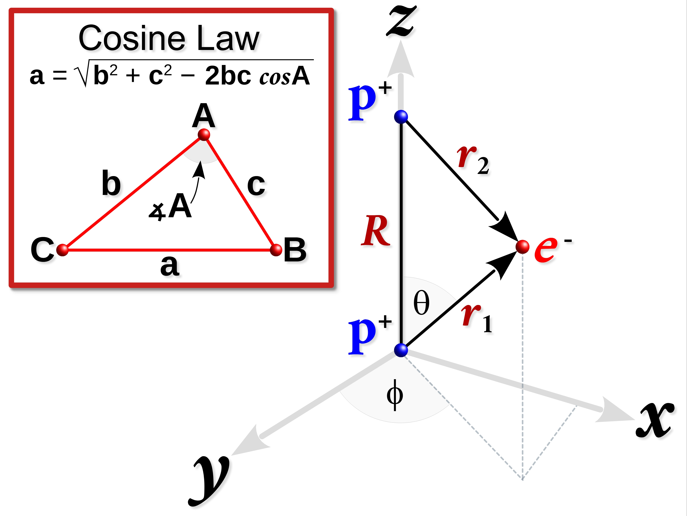
<figcaption>

<b>Figure 33: H<b>2</b><b>+</b> Vector Diagram</b>
</figcaption>

</figure>

<!-------------------------------------------------------->

<!-------------------------------------------------------->

<!-------------------------------------------------------->

The proposed model of H<b>2</b>+ has two simple proton nuclei that are separated by a distance R, which is superimposed on the z-axis, while the lone electron (e-) is positioned somewhere between these two nuclei (**Fig. 33**). Also, as eluded to above, we must use the **Born-Oppenheimer Approximation** (**BOA**)<b>[71](#ref-born_zur_1927)</b> in order to carry out the calculations. Under this scheme the **kinetic energy** of the protons can be ignored. **BOA** also adopts <u>atomic units</u>, which greatly simplifies the analysis (**Eqn 64**). Altogether, the `\(\hat H\)` can be applied to a trial wave function for H<b>2</b>+ (`\(\psi_{\pm}\)`), which is a linear combination of 1𝓈 atomic orbitals.<b>[13](#ref-mcquarrie_physical_1997),[102](#ref-griffiths_introduction_1994)</b>

 

`$$\tag{64}$$`

`$$\\ \text{BOA Modified Hamiltonian} \text{ (atomic unit conversions)} \\ \begin{align*} \large \hbar \normalsize \phantom{.} = & \phantom{.} 1 \, \text{(Planck's reduced unit)}, \phantom{..} \large \text e_q \normalsize \phantom{.}  = 1 \, \text{(unit charge)}, \phantom{..} m_e \phantom{.}  = \phantom{.} 1 \, \text{(mass unit)}, \\ \large k_e \normalsize \phantom{.} = & \phantom{.} 1 \, \text{(Coulomb constant unit)}, \phantom{...} \large a_{\text o} \normalsize \phantom{.} = \phantom{.} 1 \, \text{(Bohr atomic radius unit)} \end{align*} \\[20px] \boxed{ \; \hat H \phantom{.} = \phantom{.} - \frac{1}{2} \nabla_e^2 \; - \; \frac{1}{r_{\text A}} \; - \; \frac{1}{r_{\text B}} \; + \; \frac{1}{\text R} \; } \\[25px] \large \text{Molecular Wave Equation:} \\ \large \hat H \, \psi \normalsize (r_{_\text A}, \, r_{_\text B}, \, \text R) \phantom{.} = \phantom{.} \large \text E \, \psi \normalsize (r_{_\text A}, \, r_{_\text B}, \, \text R) \\ \text{Let:} \phantom{..} \large \psi \normalsize (r_{_\text A}, \, r_{_\text B}, \, \text R) \phantom{.} = \phantom{.} \large \psi  \\[15px] \large \text{Linear Combination of Atomic Orbitals (LCAO):} \\ \overbrace{\large \psi_{+} \normalsize \phantom{.} = \phantom{.} \text A \Big( \text{1s}_{\text A} \; + \; \text{1s}_{\text B} \Big)}^{\large \text{Bonding}} \phantom{...} \text{and} \phantom{...} \overbrace{\large \psi_{-} \normalsize \phantom{.} = \phantom{.} \text A \Big( \text{1s}_{\text A} \; - \; \text{1s}_{\text B} \Big)}^{\large \text{Anti-Bonding}}$$`

Looking at the above **LCAO** expression it’s important to keep in mind the concept of **constructive** and **destructive interference** of wave functions (Note: for details see <b><a class="one" href="https://opc-project.netlify.app/project/opcchemprimer2_atom/#SPWP" target="_blank" title="Go to ChemPrimer2">ChemPrimer2</a></b>),<b>[13](#ref-mcquarrie_physical_1997),[102](#ref-griffiths_introduction_1994)</b> since the former increases electron density between bonding atoms while the latter decreases electron density within the same inter-nuclear region (i.e. anti-bonding orbitals invariable contain one or more regions of <u>zero</u> electron density known as <u>nodes</u>). Most importantly the probability of the electron density function can be used to calculate the <u>average energy expectation value</u>, or `\(\langle E \rangle\)`, of our quantum system (**Eqn. 65**).

`$$\tag{65}$$`

`$$\\ \large \text{Energy Expectation Value:} \; \langle E \rangle \\ \begin{align*} \overbrace{\large \langle E \rangle}^{\text{constant}} \normalsize \large \int \psi^*_+ \psi^{\phantom{.}}_+ \normalsize \, dx \phantom{.} = & \phantom{.} \large \int \psi^*_+ \normalsize \, \large \langle \hat H \rangle  \normalsize \, \large \psi^{\phantom{.}}_+ \normalsize \, dx \\ \large \langle E \rangle \normalsize \phantom{.} = & \phantom{.} \large \frac{\int \psi^*_+ \, \langle \hat H \rangle \, \psi^{\phantom{.}}_+ \, \normalsize dx}{\int \psi^*_+ \, \psi^{\phantom{.}}_+ \, \normalsize dx} \\ \end{align*}$$`

According to **Max Born**<b>[3](#ref-born_zur_1926-1),[4](#ref-born_zur_1926)</b> the absolute value of the square of the wave function (i.e. `\(\big| \psi^{\phantom{.}}_+ \big|^2 \phantom{..} \text{or} \phantom{..} \big|\psi^*_+ \, \psi^{\phantom{.}}_+ \big|\)`) is proportional to the <b><a class="one" href="https://online.stat.psu.edu/stat414/Lesson14" target="_blank" title="Go to Stats PSU">probability density</a></b> (i.e. **PD** = probability per dimensional unit like length or volume) of our electron for a given position. This measure of probability can also be applied to the energy state of our quantum system. The first step in calculating `\(\langle E \rangle\)` is to normalize the denominator of the equation. Although the ground state 1𝓈 orbital of H is a complicated exponential function it can be simplified for analysis purposes as shown below.

`$$\tag{66}$$`

`$$\\ \text{Ground State Hydrogen 1s orbital wave functions:} \\ \large \psi_{_{1,0}} \normalsize (r_{\text A}) \normalsize \phantom{.} = \phantom{.} \Bigg( \frac{1}{\sqrt{\pi \cdot a_{\text o}^3}} \Bigg) e^{-r_{\text A}/a_{\text o}} \phantom{...} \text{and} \phantom{...} \large \psi_{_{1,0}} \normalsize (r_{\text B}) \normalsize \phantom{.} = \phantom{.} \Bigg( \frac{1}{\sqrt{\pi \cdot a_{\text o}^3}} \Bigg) e^{-r_{\text B}/a_{\text o}} \\ \; \\ \boxed{\text{Step #2}} \; \text{Abbreviate AO and MO wave functions:} \\ \large \psi_{_{1,0}} \normalsize (r_{\text A}) \phantom{.} = \phantom{.} \text{1s}_{\text A} \phantom{...} \text{and} \phantom{...} \large \psi_{_{1,0}} \normalsize (r_{\text B}) \phantom{.} = \phantom{.} \text{1s}_{\text B} \\ \large \psi_{_+} \normalsize \phantom{.} = \phantom{.} \text A \Big[ \text{1s}_{\text A} \phantom{.} + \phantom{.} \text{1s}_{\text B} \Big] \phantom{.........} \large \psi_{_{-}} \normalsize \phantom{.} = \phantom{.} \text A \Big[ \text{1s}_{\text A} \phantom{.} - \phantom{.} \text{1s}_{\text B} \Big]$$`

The normalized ground-state of H is represented by the Radial wave function, which was briefly discussed in <b><a class="one" href="https://opc-project.netlify.app/project/opcchemprimer2_atom/#RfPfplot" target="_blank" title="Go to ChemPrimer2">ChemPrimer2</a></b> (`\(\psi_{n, \ell, m_{\ell}} (r, \theta, \phi) = \text{R}_{n, \ell}(1,0,0)\)`). This obviously comes in handy since it can be used to construct a trial MO wave function for H2+, which also has to be <b>normalized</b> like its component AO wave functions.

`$$\tag{67}$$`

`$$\text{PROBABILITIES} \\[5px] \text{Probability (Pr) Density Function (PDF)} \phantom{..} \Longrightarrow \phantom{..} pdf(x) \\ \text{Cumulative Distribution Function (CDF)} \phantom{..} \Longrightarrow \phantom{..} cdf(x) \\ pdf(x) = \frac{\partial \big( \, cdf(x) \, \big)}{\partial x} \phantom{..} \text{...where} \phantom{..} cdf(x) \phantom{.} = \large \int_{a}^{b} \normalsize pdf(x) \, dx \phantom{.} = \phantom{.} \text{Pr}\Big[ \, a \; \le \; x \; \le \; b \, \Big]$$`

Since the `\(pdf(x)\)` is the derivative of the <b><a class="one" href="https://online.stat.psu.edu/stat414/Lesson14#cumulative-distribution-functions" target="_blank" title="Go to Stats PSU">cumulative distribution function</a></b> (`\(cdf(x)\)`) its anti-derivative (i.e. integral) must therefore be equal to the `\(cdf(x)\)`. Integrating the `\(pdf(x)\)` over a <u>defined</u> interval (i.e. within a range of `\(x\)` values) generates a <u>probability</u> of finding the electron within that region.

`$$\\ \text{Normalize Denominator of} \; \langle E \rangle \; (\text{Eqn. 65}) \\ \text{Recall:} \; \large \psi_{_+} \normalsize \phantom{.} = \phantom{.} \text A \big( \text{1s}^{\phantom{.}}_{\text A} \; + \; \text{1s}^{\phantom{.}}_{\text B} \big) \\ \begin{align*} 1 \phantom{.} = & \phantom{.} \int_{-\infty}^{+\infty} \large \psi^*_{_+} \normalsize \, \large \psi_{_+}^{\phantom{.}} \normalsize \, dr  \phantom{.} = \phantom{.} \text{A}^2 \int_{-\infty}^{+\infty} \Big( \text{1s}^*_{\text A} + \text{1s}^*_{\text B} \Big) \Big( \text{1s}^{\phantom{.}}_{\text A} \; + \; \text{1s}^{\phantom{.}}_{\text B} \Big) \, dr \\ 1 \phantom{.} = & \phantom{.} \text{A}^2 \Bigg[ \; \overbrace{\int_{-\infty}^{+\infty} \text{1s}^*_{\text A}  \text{1s}^{\phantom{.}}_{\text A} \, dr}^{\large 1} \; + \; \int_{-\infty}^{+\infty} \text{1s}^*_{\text A} \text{1s}^{\phantom B}_{\text B} \, dr \; + \; \int_{-\infty}^{+\infty} \text{1s}^*_{\text B} \text{1s}^{\phantom{.}}_{\text A} \, dr \; + \; \overbrace{\int_{-\infty}^{+\infty} \text{1s}^*_{\text B} \text{1s}^{\phantom{.}}_{\text B} \, dr}^{\large 1} \; \Bigg] \\ \end{align*}$$`

`$$\text{Since:} \phantom{..} \int \text{1s}^*_{\text A} \, \text{1s}^{\phantom{.}}_{\text A} \, dr \phantom{.} = \phantom{.} 1 \phantom{...} \text{and} \phantom{...} \phantom{.} \int \text{1s}^*_{\text B} \, \text{1s}^{\phantom{.}}_{\text B} \, dr \phantom{.} = \phantom{.} 1  \\[10px] 1 \phantom{.} = \phantom{.} \text{A}^2 \Bigg[ \, 1 \; + \; \int_{-\infty}^{+\infty} \text{1s}^*_{\text A} \, \text{1s}^{\phantom B}_{\text B} \, dr \; + \; \int_{-\infty}^{+\infty} \text{1s}^*_{\text B} \, \text{1s}^{\phantom{.}}_{\text A} \, dr \; + \; 1 \, \Bigg]$$`

`$$\tag{68}$$`

`$$\text{Let S represent the Overlap Integral:} \\ \begin{align*} & \large \text S \normalsize \phantom{.} = \phantom{.} \int \text{1s}^*_{\text A} \phantom{.} \text{1s}^{\phantom{.}}_{\text B} \, dr \phantom{.} = \int \text{1s}^*_{\text B} \phantom{.} \text{1s}^{\phantom{.}}_{\text A} \, dr \\[5px] & \text{Re-write expression using above notation:} \\ & \phantom{.......} 1 \phantom{.} = \phantom{.} \text{A}^2 \Big[ \, 1 \; + \; \large \text S \normalsize \; + \; \large \text S \normalsize \; + \; 1 \, \Big] \\ & \phantom{......} \, \text A \phantom{.} = \phantom{.} \pm \frac{1}{\sqrt{2 \big( \, 1 \; + \; \large \text S \normalsize \, \big)}} \end{align*}$$`

`$$\text{Normalized Molecular Wave Functions:} \\ \large \psi_+ \normalsize \phantom{.} = \phantom{.} \frac{1}{\sqrt{2 \big(1 \; + \; \large \text S \normalsize \big)}} \; \overbrace{\Big( \, \text{1s}^{\phantom{.}}_{\text A} \; + \; \text{1s}^{\phantom{.}}_{\text B} \, \Big)}^{\large \text{bonding}} \phantom{...} \text{and} \phantom{...} \large \psi_- \normalsize \phantom{.} = \phantom{.} \frac{1}{ \sqrt{2 \big(1 \; + \; \large \text S \normalsize \big)}} \; \overbrace{\Big( \text{1s}^{\phantom{.}}_{\text A} \; - \; \text{1s}^{\phantom{.}}_{\text B} \Big) }^{\large \text{anti-bonding}}$$`

The **Overlap Integral** (S) defined in **Eqn. 68** measures the amount of physical <u>overlap</u> between AO. If there is no overlap (i.e. S = 0) then the two AO are considered <u>orthogonal</u> to each other (e.g. 2𝓅x and 2𝓅y orbitals). Moreover, since S is dependent on the inter-nuclear distance its magnitude will increase as R approaches zero. Completing the normalization process requires not only the use of integral calculus, but also (as seen before) the conversion of the Cartesian co-ordinates into <b><a class="one" href="https://opc-project.netlify.app/project/opcchemprimer2_atom/#SPcoord" target="_target" title="Go to ChemPrimer2">spherical polar co-ordinates</a></b> (i.e. `\(x,y,x \longrightarrow r, \theta, \phi\)`). A simple outline of the normalization process is provided below.

`$$\tag{69}$$`

`$$\\ \text{Solve for the Numerator (Num.) of} \; \langle E \rangle \; \text{in Eqn. 65}: \\ \large Num. \normalsize \phantom{.} = \phantom{.} \int \large \psi^* \normalsize \, \hat H \, \large \psi \normalsize \phantom{.} dr \phantom{.} = \phantom{.} \int \Big( \text{1s}^*_{\text A} \; + \; \text{1s}^*_{\text B} \Big) \, \hat H \, \Big( \text{1s}^{\phantom{.}}_{\text A} \; + \; \text{1s}^{\phantom{.}}_{\text B} \Big) \, dr \\[20px] \text{Step #1. Expand right side (RS) of equation:} \\ \large Num. \normalsize \phantom{.} = \phantom{.} \int \text{1s}^*_{\text A} \, \hat H \, \text{1s}^{\phantom{.}}_{\text A} \, dr \; + \; \int \text{1s}^*_{\text A} \, \hat H \, \text{1s}^{\phantom{.}}_{\text B} \, dr \; + \; \int \text{1s}^*_{\text B} \, \hat H \, \text{1s}^{\phantom{.}}_{\text A} \, dr \; + \; \int \text{1s}^*_{\text B} \, \hat H \, \text{1s}^{\phantom{.}}_{\text B} \, dr \\[20px] \text{Recall Schrodinger equation for} \; \boxed{\text{H atom}}  \\ \overbrace{ \Bigg(- \frac{1}{2} \nabla_e^2 \; - \; \frac{1}{r_{\text A}} \Bigg) }^{\large \hat H} \text{1s}^{\phantom{.}}_{\text A} \phantom{.} = \phantom{.} \text E_{\text{1s}} \, \text{1s}^{\phantom{.}}_{\text A} \phantom{...} \text{and} \phantom{...} \overbrace{\Bigg(- \frac{1}{2} \nabla_e^2 \; - \; \frac{1}{r_{\text B}} \Bigg)}^{\large \hat H} \text{1s}^{\phantom{.}}_{\text B} \phantom{.} = \phantom{.} \text E_{\text{1s}} \, \text{1s}^{\phantom{.}}_{\text B} \\[30px] \boxed{\text{Step #2}} \; \text{Apply the above relation to the RS of equation as examplified below:} \\ \text{1s}^*_{\text A} \overbrace{\Bigg(- \frac{1}{2} \nabla_e^2 \; - \; \frac{1}{r_{\text A}} \; - \; \frac{1}{r_{\text B}} \; + \; \frac{1}{\text R} \Bigg)}^{\large \hat H \, \text{for H}_2^+} \text{1s}^{\phantom{.}}_{\text A} \phantom{.} = \phantom{.} \text{1s}^*_{\text A} \Bigg(\text E_{\text{1s}} \; - \; \frac{1}{r_{\text B}} \; + \; \frac{1}{\text R} \Bigg) \text{1s}^{\phantom{.}}_{\text A} \\[10px] \text{Repeat for rest of equation:} \\ \begin{align*} \large Num. \normalsize \phantom{.} = \phantom{.} & \int \text{1s}^*_{\text A} \Bigg(\text E_{\text{1s}} \; - \; \frac{1}{r_{\text B}} \; + \; \frac{1}{\text R} \Bigg) \text{1s}^{\phantom{.}}_{\text A} \, dr \; + \; \int \text{1s}^*_{\text A} \Bigg(\text E_{\text{1s}} \; - \; \frac{1}{r_{\text A}} \; + \; \frac{1}{\text R} \Bigg) \text{1s}^{\phantom{.}}_{\text B} \, dr \\ & + \int \text{1s}^*_{\text B} \Bigg(\text E_{\text{1s}} \; - \; \frac{1}{r_{\text A}} \; + \; \frac{1}{\text R} \Bigg) \text{1s}^{\phantom{.}}_{\text B} \, dr \; + \; \int \text{1s}^*_{\text B} \Bigg(\text E_{\text{1s}} \; - \; \frac{1}{r_{\text B}} \; + \; \frac{1}{\text R} \Bigg) \text{1s}^{\phantom{.}}_{\text A} \, dr \end{align*}$$`

`$$\boxed{\text{Step #3}} \; \text{Apply following logic to each type of integral in step 2} \\ \int \text{1s}^*_{\text A} \Bigg(\text E_{\text 1s} \; - \; \frac{1}{r_{\text B}} \; + \; \frac{1}{\text R} \Bigg) \text{1s}^{\phantom{.}}_{\text A} \, dr \phantom{.} = \phantom{.} \overbrace{\text E_{\text{1s}} \int \text{1s}^*_{\text A} \phantom{.} \text{1s}^{\phantom{.}}_{\text A} \, dr}^{\large \text{Value = E}_{\text{1s}} \, \times \, 1} \; + \; \int \text{1s}^*_{\text A} \Bigg( - \frac{1}{r_{\text B}} \; + \; \frac{1}{\text R} \Bigg) \text{1s}^{\phantom{.}}_{\text A} \, dr \\ \int \text{1s}^*_{\text A} \Bigg(\text E_{\text{1s}} \; - \; \frac{1}{r_{\text A}} \; + \; \frac{1}{\text R} \Bigg) \text{1s}^{\phantom{.}}_{\text B} \, dr \phantom{.} = \phantom{.} \overbrace{\text E_{\text{1s}} \int \text{1s}^*_{\text A} \phantom{.} \text{1s}^{\phantom{.}}_{\text B} \, dr}^{\large \text{Value = E}_{\text{1s}} \, \times \, \text S} \phantom{.} + \int \text{1s}^*_{\text A} \Bigg( - \frac{1}{r_{\text A}} + \frac{1}{\text R} \Bigg) \text{1s}^{\phantom{.}}_{\text B} \phantom{.} dr \\ \int \text{1s}^*_{\text B} \Bigg(\text E_{\text{1s}} \; - \; \frac{1}{r_{\text B}} \; + \; \frac{1}{\text R} \Bigg) \text{1s}^{\phantom{.}}_{\text A} \, dr \phantom{.} = \phantom{.} \overbrace{\text E_{\text{1s}} \int \text{1s}^*_{\text B} \text{1s}^{\phantom{.}}_{\text A} \, dr}^{\large \text{Value = E}_{\text{1s}} \, \times \, \text S} \; + \; \int \text{1s}^*_{\text B} \Bigg( - \frac{1}{r_{\text B}} \; + \; \frac{1}{\text R} \Bigg) \text{1s}^{\phantom{.}}_{\text A} \, dr \\ \int \text{1s}^*_{\text B} \Bigg(\text E_{\text{1s}} \; - \; \frac{1}{r_{\text A}} \; + \; \frac{1}{\text R} \Bigg) \text{1s}^{\phantom{.}}_{\text B} \, dr \phantom{.} = \phantom{.} \overbrace{\text E_{\text{1s}} \int \text{1s}^*_{\text B} \text{1s}^{\phantom{.}}_{\text B} \, dr}^{\large \text{Value = E}_{\text{1s}} \, \times \, 1} \; + \; \int \text{1s}^*_{\text B} \Bigg( - \frac{1}{r_{\text A}} \; + \; \frac{1}{\text R} \Bigg) \text{1s}^{\phantom{.}}_{\text B} \, dr \\$$`

`$$\boxed{\text{Step #4}} \; \text{Simplify RS of equation by plugging in values from step 3} \\ \begin{align*} \large Num. \normalsize \phantom{.} = \phantom{.} & \Big( \text{E}_{\text{1s}} \Big) \; + \; \int \text{1s}^*_{\text A} \Bigg( - \frac{1}{r_{\text B}} \; + \; \frac{1}{\text R} \Bigg) \text{1s}^{\phantom{.}}_{\text A} \, dr \; + \; \Big( \text{E}_{\text{1s}} \cdot \text S \Big) \; + \; \int \text{1s}^*_{\text A} \Bigg( - \frac{1}{r_{\text A}} \; + \; \frac{1}{\text R} \Bigg) \text{1s}^{\phantom{.}}_{\text B} \, dr  \\ & + \phantom{.} \Big( \text{E}_{\text{1s}} \cdot \text S \Big) \; + \; \int \text{1s}^*_{\text B} \Bigg( - \frac{1}{r_{\text B}} \; + \; \frac{1}{\text R} \Bigg) \text{1s}^{\phantom{.}}_{\text A} \, dr \; + \; \Big( \text{E}_{\text{1s}} \Big) \; + \; \int \text{1s}^*_{\text B} \Bigg( - \frac{1}{r_{\text A}} \; + \; \frac{1}{\text R} \Bigg) \text{1s}^{\phantom{.}}_{\text B} \, dr \\ \end{align*}$$`

`$$\tag{70}$$`

`$$\\ \boxed{\text{Step #5}} \; \text{Define Direct (D) and Exchange (X) Integrals} \\ \text{X} \phantom{.} = \phantom{.} \int \text{1s}^*_{\text A} \bigg( - \frac{1}{r_{\text A}} \; + \; \frac{1}{\text R} \bigg) \text{1s}^{\phantom{.}}_{\text B} \, dr \phantom{.} = \phantom{.} \int \text{1s}^*_{\text B} \bigg( - \frac{1}{r_{\text B}} \; + \; \frac{1}{\text R} \bigg) \text{1s}^{\phantom{.}}_{\text A} \, dr \\ \text{D} \phantom{.} = \phantom{.} \int \text{1s}^*_{\text A} \bigg( - \frac{1}{r_{\text B}} \; + \; \frac{1}{\text R} \bigg) \text{1s}^{\phantom{.}}_{\text A} \, dr \phantom{.} = \phantom{.} \int \text{1s}^*_{\text B} \bigg( - \frac{1}{r_{\text A}} \; + \; \frac{1}{\text R} \bigg) \text{1s}^{\phantom{.}}_{\text B} \, dr \\[20px] \text{Plug these new terms into the equation from step 4} \\ \begin{align*} \large Num. \normalsize \phantom{.} = & \phantom{.} \text{E}_{\text{1s}} \Big( 1 \; + \; \text S \Big) \; + \; \text D \; + \; \text X \; + \; \text{E}_{\text{1s}} \Big( 1 \; + \; \text S \Big) \; + \; \text X \; + \; \text D \phantom{.} \\ = & \phantom{.} 2 \, \text{E}_{\text{1s}} \Big( 1 \; + \; \text S \Big) \; + \; 2 \, \Big( \text D \; + \; \text X \Big) \\ \end{align*}$$`

`$$\tag{71}$$`

`$$\\ \boxed{\text{Step #6}} \; \text{Final} \; \langle E \rangle \; \text{Equation} \\ \large \langle E \rangle_{\normalsize \text{(bonding)}} \normalsize \phantom{.} = \phantom{.} \frac{\large \int \psi^*_+ \; \hat H \; \psi^{\phantom{.}}_+ \normalsize \, dr}{\large \int \psi^*_+ \, \psi^{\phantom{.}}_+ \normalsize \, dr} \phantom{.} = \phantom{.} \frac{2 \, \large \text{E}_{\text{1s}} \normalsize \big( 1 \; + \; \text S \big) \; + \; 2 \big( \text D \; + \; \text X \big)}{2 \big( 1 \; + \; \text S \big)} \phantom{.} = \phantom{.} \large \text{E}_{\text{1s}} \normalsize \; + \; \frac{\big( \text D \; + \; \text X \big)}{\big( 1 \; + \; \text S \big)} \\ \large \langle E \rangle_{\normalsize \text{(bonding)}} \normalsize \phantom{.} = \phantom{.} \large \text{E}_{\text{1s}} \normalsize \; + \; \frac{\big( \text D \; + \; \text X \big)}{\big( 1 \; + \; \text S \big)} \phantom{........} \large \langle E \rangle_{\normalsize \text{(anti-bonding)}} \normalsize \phantom{.} = \phantom{.} \large \text{E}_{\text{1s}} \normalsize \; + \; \frac{\big( \text D \; - \; \text X \big)}{\big( 1 \; - \; \text S \big)}$$`

Having the three integrals appear as modular components of `\(\langle E \rangle\)` is convenient since each can be solved separately and then plugged back into the equation. The individual integrals themselves describe some aspect of the electrostatic interactions between the electron and the protons. For example, the **Exchange Integral** (X) measures the <u>potential energy</u> of the electron with respect to the “neighbouring” proton, which is part of the spatially ambiguous nature of the bonding electrons (i.e. **de-localization**), while the **Direct Integral** (D) measures the <u>potential energy</u> of the electron with its “own” proton. Lastly the **Overlap Integral** (S), as the name suggests, is a measure of the physical <u>overlap</u> between neighbouring AO.<b>[13](#ref-mcquarrie_physical_1997),[102](#ref-griffiths_introduction_1994)</b>  
    The solution for the **Exchange Integral** is shown below, while the solutions for the other integrals have been omitted for the sake of brevity. Glancing over **Eqn. 72** one can appreciate just how dense the math is for such a relatively simple 3 particle system. It should therefore come as no surprise that larger atoms or molecules with multiple electron-electron repulsive interactions would require much more complicated mathematical treatments.

`$$\tag{72}$$`
`$$\\ \large \text{Exchange Integral (X):}  \\ \text{1s}_{\text A} \phantom{.} = \phantom{.} \frac{1}{\sqrt{\large \pi \normalsize a_{\text o}^3}} \normalsize \, e^{-r_{\text A}/a_{\text o}} \phantom{...} \text{and} \phantom{...} \text{1s}_{\text B} \phantom{.} = \phantom{.} \frac{1}{\sqrt{\large \pi \normalsize a_{\text o}^3}} \, e^{-r_{\text B}/a_{\text o}} \\[5px] \boxed{\text{Step #1}} \; \langle \text X \rangle \; \text{for a region of space defined by the distance vector} \\ r \; \text{normalized to the scale of the Bohr radius} \; (a_{\text o}) \\ \large \langle \text X \rangle \normalsize \phantom{.} = \iiint \frac{1}{\sqrt{\large \pi \normalsize a_{\text o}^3}} \, e^{-r_{\text A}/a_{\text o}} \bigg( \frac{a_{\text o}}{r} \bigg) \frac{1}{\sqrt{\large \pi \normalsize a_{\text o}^3}} \phantom{.} e^{-r_{\text B}/a_{\text o}} \, d \text v \\[30px] \boxed{\text{Step #2}} \; \text{Apply Spherical Polar Co-ordinates} \\ r_{\text A} \equiv r, \phantom{..} \text R \equiv \text R, \phantom{..} ^{\dagger}r_{\text B} = \sqrt{r^2 \; + \; \text R^2 \; -2r \text R \, cos\theta} \phantom{..} ^{\dagger}(\text{See: Fig. 33}) \\[5px] \begin{align*} \large \langle \text X \rangle \normalsize \phantom{.} = & \phantom{.} a_{\text o} \frac{1}{\large \pi \normalsize a_{\text o}^3} \overbrace{\int_0^{2 \large \pi} \, d \phi}^{2 \large \pi} \int_0^{\infty} e^{-r/a_{\text o}} \Bigg [ \int_0^{\large \pi} e^{-\sqrt{r^2 \; + \; \text R^2 \; -2r \text R \, cos \theta } \Large / \normalsize a_{\text o}} \phantom{.} sin \theta \, d \theta \Bigg ] \frac{1}{\require{cancel} \cancel{r}} \, r^{\require{cancel} \cancel{2}} \, dr \\ \phantom{.} \large \langle \text X \rangle \normalsize \phantom{.} = & \phantom{.} \frac{2 \require{cancel} \cancel{\large \pi}}{\require{cancel} \cancel{\large \pi} \normalsize a_{\text o}^2} \int_0^{\infty} r \, e^{-r/a_{\text o}} \Bigg [ \int_0^{\large \pi} e^{-\sqrt{r^2 \; + \; \text R^2 \; -2r \text R \, cos \theta} \Large / \normalsize a_{\text o}} \, sin \theta \, d \theta \Bigg ] \, dr \\ \end{align*}$$`

The wave function requires three separate integration steps. Fortunately the `\(r\)`adial vector is independent of the `\(\phi\)` angle, which means integrating the latter angular dimension will produce a simple constant (i.e. `\(2\pi\)`). This makes sense because the two-dimensional plane defined by `\(r\)` and `\(\theta\)` is independent of `\(\phi\)` (**Fig 33**). For example if we try to reconstruct the spherical volume occupied by the electron by rotating a two-dimensional (`\(r \; \times \; \theta\)`) disc one full revolution (i.e. `\(\measuredangle \phi = 360^{\circ} = 2\pi \; \text{radians}\)`) the fixed dimensions of `\(r\)` and `\(\theta\)` would remain unchanged. Although converting Cartesian co-ordinates to Polar co-ordinates produces a cumbersome term for one of the distance vectors (See <b><a class="one" href="https://www.mathsisfun.com/algebra/trig-cosine-law.html" target="_blank" title="Go to MathIsFun">Law of Cosines</a></b>), it is easily dealt with using standard integral calculus. For example, pairing **sine** with **cosine** is well suited for <b><a class="one" href="https://www.mathsisfun.com/calculus/integration-by-substitution.html" target="_blank" title="Go to MathIsFun">integration by substitution</a></b>. It’s also worth reiterating that <b><a class="one" href="https://www.mathsisfun.com/numbers/e-eulers-number.html" target="_blank" title="Go to MathIsFun">exponential functions</a></b> are relatively easy to work with using differential and integral calculus (e.g. <b><a class="one" href="https://www.mathsisfun.com/calculus/integration-by-parts.html" target="_blank" title="Go to MathIsFun">integration by parts</a></b>).

`$$\boxed{\text{Step #3}} \; \text{Integration by Substitution for} \; \theta \; \text{variable dimension} \\ \text{Let:} \; y \phantom{.} = \phantom{.} \sqrt{r^2 \; + \; \text R^2 \; - \; 2r \text R \, cos \theta} \\ \frac{d(y^2)}{dy} \phantom{.} = \phantom{.} 2y \phantom{..} \Longrightarrow \phantom{..} d(y^2) \phantom{.} = \phantom{.} 2y \cdot dy \\ \text{and}  \\ \frac{d(y^2)}{d\theta} \phantom{.} = \phantom{.} 2r \text R \cdot sin \theta \phantom{..} \Longrightarrow \phantom{..} d(y^2) \phantom{.} = \phantom{.} 2r \text R \cdot sin \theta \cdot d\theta \\ 2y \phantom{.} dy \phantom{.} = \phantom{.} 2r \text R \, sin \theta \, d\theta \phantom{..} \Longrightarrow \phantom{..} d \theta \phantom{.} = \phantom{.} \frac{\require{cancel} \cancel{2}y \, dy}{\require{cancel} \cancel{2}r \text R \, sin \theta} \phantom{.} = \phantom{.} \frac{y \, dy}{r \text R \, sin \theta} \\ \begin{align*} \large \langle \text X \rangle \normalsize \phantom{.} = & \phantom{.} \frac{2}{a_{\text o}^2} \int_0^{\infty} e^{-r/a_{\text o}} \, \require{cancel} \cancel{r} \Bigg [ \int_0^{\pi} e^{-y/a_{\text o}} \, \require{cancel} \cancel{sin \theta} \, \frac{y \, dy}{\require{cancel} \cancel{r} \text R \, \require{cancel} \cancel{sin \theta} } \Bigg ] \, dr \\ \large \langle \text X \rangle \normalsize \phantom{.} = & \phantom{.} \overbrace{\frac{2}{a_{\text o}^2 \; \text R}}^{\text{constants}} \int_0^{\infty} e^{-r/a_{\text o}} \Bigg [ \int_0^{\pi} y \, e^{-y/a_{\text o}} \, dy \Bigg ] \, dr \\ \end{align*}$$`

`$$\boxed{\text{Step #4}} \; \text{Integration by Part for} \; \theta \; \text{variable} \\  \text{general formula} \phantom{..} \Longrightarrow \phantom{.} \int u \phantom{.} \frac{d \text v}{dx} \, du \phantom{.} = \phantom{.} (u) (\text v) \; - \; \int \text v \, \frac{du}{d \text x} \, dx \\ \text{Let:} \phantom{..} u \phantom{.} = \phantom{.} y \phantom{..} \Longrightarrow \phantom{..} \frac{du}{dy} \phantom{.} = \phantom{.} \overbrace{\frac{dy}{dy}}^{\large 1} \phantom{..} \Longrightarrow \phantom{..} du \phantom{.} = \phantom{.} dy \\ \text{Let:} \phantom{..} \frac{d \text v}{dy} \phantom{.} = \phantom{.} e^{-y/a_{\text o}} \phantom{..} \Longrightarrow \phantom{..} \text v \phantom{.} = \phantom{.} \int \frac{d \text v}{dy} \, dy \phantom{.} = \phantom{.} \int e^{-y/a_{\text o}} \, dy \phantom{.} = \phantom{.} - a_\text{o} e^{-y/a_{\text o}} \\ \; \\ \text{Now Solve:} \phantom{..} \int_0^{\large \pi} y \phantom{.} e^{-y/a_{\text o}} \, dy \phantom{...} \text{using general formula above} \\ \begin{align*} \int_0^{\large \pi} y e^{-y/a_{\text o}} \, dy \phantom{.} = & \phantom{.} (y) \, (-a_{\text o} \, e^{-y/a_{\text o}}) \; - \; \int_0^{\large \pi} - a_\text{o} \, e^{-y/a_{\text o}} \, dy \\ = & \phantom{.} -y \, a_{\text o} \, e^{-y/a_{\text o}} \; - \; a_{\text o}^2 \, e^{-y/a_{\text o}} \\ = & \phantom{.} - a_{\text o} e^{-y/a_{\text o}}(y \; + \; a_{\text o}) \\ \end{align*}$$`

`$$\boxed{\text{Step #5}} \; \text{Plug in values from step 4 and Integrate over new} \; \theta \; \text{boundary}  \\[5px] \text{Range values:} \phantom{...} cos(\pi) \phantom{.} = \phantom{.} -1 \phantom{...} \text{and} \phantom{...} cos(0) \phantom{.} = \phantom{.} 1 \\ \begin{align*} y(\pi) \phantom{.} = & \phantom{.} \sqrt{r^2 \; + \; \text R^2 \; - \; 2r \text R \, (-1)} \phantom{.} = \phantom{.} \sqrt{r^2 \; + \; \text R^2 \; + \; 2r \text R} \phantom{.} = \phantom{.} \sqrt{(r \; + \; \text R)^2} \\ = & \phantom{.} r \; + \; \text R \\ y(0) \phantom{.} = & \phantom{.} \sqrt{r^2 \; + \; \text R^2 \; - \; 2r \text R \, (1)} \phantom{.} = \phantom{.} \sqrt{r^2 \; + \; \text R^2 \; - \; 2r \text R} \phantom{.} = \phantom{.} \sqrt{(r \; - \; \text R)^2} \\ = & \phantom{.} | r \; - \; \text R | \\ \large \langle \text X \rangle \normalsize \phantom{.} = & \phantom{.} \frac{2}{a_{\text o}^2 \text R} \large \int \normalsize e^{-r/a_{\text o}} \Bigg [ \large \int_{|r \; - \; \text R|}^{r \; + \; \text R} \normalsize y \phantom{.} e^{-y/a_{\text o}} \, dy \phantom{.} \Bigg ] dr \\ = & \phantom{.} \frac{-2 \require{cancel} \cancel{a_{\text o}}}{a_{\text o}^{\require{cancel} \cancel{2}} \text R} \large \int \normalsize e^{-r/a_{\text o}} \Bigg [ \bigg[ e^{-y/a_{\text o}}(y \; + \; a_{\text o}) \bigg]_{|r \; - \; \text R|}^{r \; + \; \text R} \Bigg] \, dr \\ \large \langle \text X \rangle \normalsize \phantom{.} = & \phantom{.} \frac{-2}{a_{\text o} \text R} \large \int \normalsize e^{-r/a_{\text o}} \bigg[ e^{-(r \; + \; \text R)/a_{\text o}} \Big( r \; + \; \text R \; + \; a_{\text o} \Big) \phantom{.} - \phantom{.} e^{-(|r \; - \; \text R|)/a_{\text o}} \Big( |r \; - \; \text R | \; + \; a_{\text o} \Big) \bigg] \, dr \\ \end{align*}$$`

To complete the integration operation in step 5 new boundary conditions need to be calculated by plugging the `\(\theta\)` values into `\(y\)`. Fortunately the values of <b><a class="one" href="https://opc-project.netlify.app/project/opcchemprimer2_atom/#DFunc" target="_blank" title="Go to ChemPrimer2">cosine</a></b> functions are well known. Integrating the wave function using the new upper and lower limits produces a slightly simpler equation (i.e. two variables remaining: `\(\vec r\)` and `\(\text R\)`). Unfortunately the lower limit of the integral is an absolute value (i.e. `\(|r - \text R|\)`). This treatment is necessary since the scalar distance has to be positive (i.e. need <u>real</u> distance). Considering that the proton occupies a central position within the <b>1𝓈</b> orbital it is only logical that the electron be some real positive distance from this central reference point. Fortunately integrating using this unusual lower limit can be dealt with by simply dividing the integral into two parts, which produces three separate integral operations that need to be performed (step 6).

`$$\boxed{\text{Step #6}} \; \text{Note:} \; \text{distance} \; | r - \text R | \; \text{has to be a real positive value} \\ \text{Need to perform two step Integration:} \phantom{..} 0 \rightarrow \text{R} \phantom{..} \text{and} \phantom{..} \text{R} \rightarrow \infty \\[10px] \begin{align*} \langle \text X \rangle \phantom{.} = & \phantom{.} \frac{-2}{a_{\text o} \text R} \Bigg[ \int_0^{\infty} e^{-r/a_{\text o}} \bigg[ e^{-(r \; + \; \text R)/a_{\text o}} \Big( r \; + \; \text R \; + \; a_{\text o} \Big) \; - \; e^{-(|r \; - \; \text R|)/a_{\text o}} \Big( |r \; - \; \text R | \; + \; a_{\text o} \Big) \bigg] \Bigg] \, dr \\ \langle \text X \rangle \phantom{.} = & \phantom{.} \frac{-2}{a_{\text o} \text R} \Bigg[ e^{- \text R / a_{\text o}} \int_0^{\infty} e^{-2r/a_{\text o}} \Big( r \; + \; \text R \; + \; a_{\text o} \Big) \, dr \; - \; \int_0^{\text R} e^{-\text R/a_{\text o}} \cdot e^{(-r \; + \; r)/a_{\text o}} \Big( \overbrace{\text R \; - \; r}^{\large \text R \; > \; r} \; + \; a_{\text o} \Big) \, dr  \\ & - \int_{\text R}^{\infty} e^{\text R/a_{\text o}} \cdot e^{-2r/a_{\text o}} \Big( \overbrace{r \; - \; \text R}^{\large r \; > \; \text R} \; + \; a_{\text o} \Big) \, dr \, \Bigg] \\ \langle \text X \rangle \phantom{.} = & \phantom{.} \frac{-2}{a_{\text o} \text R} \Bigg[ e^{- \text R / a_{\text o}} \int_0^{\infty} e^{-2r/a_{\text o}} \Big( r \; + \; \text R \; + \; a_{\text o} \Big) \, dr \; - \; e^{-\text R/a_{\text o}} \int_0^{\text R} \, \overbrace{e^{(0)/a_{\text o}}}^{1} \Big( \text R \; - \; r \; + \; a_{\text o} \Big) \, dr  \\ & - \phantom{.} e^{\text R/a_{\text o}} \int_{\text R}^{\infty} e^{-2r/a_{\text o}} \Big( r \; - \; \text R \; + \; a_{\text o} \Big) \, dr \; \Bigg] \\ \langle \text X \rangle \phantom{.} = & \phantom{.} \frac{-2}{a_{\text o} \text R} \Bigg[ e^{- \text R / a_{\text o}} \overbrace{\int_0^{\infty} e^{-2r/a_{\text o}} \Big( r + \text R + a_{\text o} \Big) dr}^{\text{Int1}} \phantom{..} - \phantom{..} e^{-\text R/a_{\text o}} \overbrace{\int_0^{\text R} \Big( \text R - r + a_{\text o} \Big)dr}^{\text{Int2}} \phantom{.}  \\ & - \phantom{.} e^{\text R/a_{\text o}} \overbrace{\int_{\text R}^{\infty} e^{-2r/a_{\text o}} \Big( r - \text R + a_{\text o} \Big)dr}^{\text{Int3}} \phantom{.} \Bigg] \\ \end{align*}$$`

 

`$$\\ \boxed{\text{Step #7}} \; \text{Solve Integral #1 using Integration by Parts} \\ \int_0^{\infty} e^{-2r/a_{\text o}} \Big( r + \text R + a_{\text o} \Big) dr \phantom{..} = \phantom{.} \int_0^{\infty} r e^{-2r/a_{\text o}} dr \phantom{.} + \phantom{.} \Big(\text R + a_{\text o} \Big) \int_0^{\infty} e^{-2r/a_{\text o}} dr \\ \boxed{\text{Step #7.1}} \; \text{Integration by Part (see Part 4 for General Formula)} \\ \text{Let:} \phantom{.} u = r \phantom{.} \Longrightarrow \phantom{.} \frac{du}{dr} = \frac{dr}{dr}= 1 \phantom{.} \Longrightarrow \phantom{.} du = dr \\ \text{Let:} \phantom{.} \frac{d \text v}{dr} = e^{-2r/a_{\text o}} \phantom{.} \Longrightarrow \phantom{.} \text v \phantom{.} = \phantom{.} \int \frac{d \text v}{dr} dr \phantom{.} = \phantom{.} \int e^{-2r/a_{\text o}} dr \phantom{.} = \phantom{.} - \frac{a_\text{o}}{2} e^{-2r/a_{\text o}} \\ \int r e^{-2r/a_{\text o}} dr \phantom{.} = \phantom{.} (r) \Big( - \frac{a_{\text o}}{2} e^{-2r/a_{\text o}} \Big) \phantom{.} - \phantom{.} \int - \frac{a_{\text o}}{2} e^{-2r/a_{\text o}} dr \phantom{.} = \phantom{.} - \frac{a_{\text o} \phantom{.} r}{2} \phantom{.} e^{-2r/a_{\text o}} \phantom{.} - \phantom{.} \frac{a_{\text o}^2}{4} \phantom{.} e^{-2r/a_{\text o}} \\ \int r \cdot e^{-2r/a_{\text o}} dr \phantom{.} = \phantom{.} e^{-2r/a_{\text o}} \bigg( - \frac{a_{\text o}}{2}r \phantom{.} - \phantom{.} \frac{a_{\text o}^2}{4} \bigg) \\ \boxed{\text{Step #7.2}} \; \text{Complete integration across boundaries} \; (\text{when:} \; r \rightarrow \infty \phantom{..} e^{-r} = 0) \\ \begin{align*} \int_0^{\infty} e^{-2r/a_{\text o}} \Big( r + \text R + a_{\text o} \Big) dr \phantom{..} = & \phantom{..} \Bigg[ e^{-2r/a_{\text o}} \bigg( - \frac{a_{\text o}}{2}r \phantom{.} - \phantom{.} \frac{a_{\text o}^2}{4} \bigg) \Bigg]_{0}^{\infty} + \phantom{.} \Big(\text R + a_{\text o} \Big) \Bigg[ - \frac{a_{\text o}}{2} e^{-2r/a_{\text o}} \Bigg]_{0}^{\infty} \\ = & \phantom{..} \Bigg[ 0 \bigg( - \frac{a_{\text o}}{2}(\infty) \phantom{.} - \phantom{.} \frac{a_{\text o}^2}{4} \bigg) \phantom{.} - \phantom{.} e^0 \bigg( - \frac{a_{\text o}}{2}(0) \phantom{.} - \phantom{.} \frac{a_{\text o}^2}{4} \bigg) \Bigg] \\ & + \phantom{.} \Big(\text R + a_{\text o} \Big) \Bigg[ - \frac{a_{\text o}}{2}(0) \phantom{.} - \phantom{.} \bigg( - \frac{a_{\text o}}{2} e^0 \bigg) \Bigg] \\ = & \phantom{..} \Bigg[ 0 + 0 + \frac{a_{\text o}^2}{4} \Bigg] + \Big(\text R + a_{\text o} \Big) \Bigg[ \frac{a_{\text o}}{2} \Bigg] \\ \end{align*} \\ \boxed{\; \text{Integral  #1  Solution} \phantom{..} = \phantom{..} \frac{3 a_{\text o}^2}{4} \phantom{.} + \phantom{.} \frac{a_{\text o} \phantom{.} \text R}{2} \;} \\$$`

`$$\boxed{\text{Step #8}} \; \text{Solve Integral #2} \\ \begin{align*} \int_0^{\text R} \Big( \text R \; - \; r \; + \; a_{\text o} \Big) \, dr \phantom{.} = & \phantom{.} \Bigg[ \text R \, r \; - \; \frac{r^2}{2} \; + \; a_{\text o}r \Bigg]_{0}^{\text R} \\ = & \phantom{.} \Bigg[ \bigg( \text R^2 \; - \; \frac{\text R^2}{2} \; + \; a_{\text o} \, \text R \bigg) \; - \; \bigg( 0 \; - \; 0 \; + \; 0 \bigg) \Bigg] \\ \end{align*} \\ \boxed{\; \text{Integral #2 Solution} \phantom{.} = \phantom{.} \frac{\text R^2}{2} \; + \; a_{\text o} \, \text R \;} \\$$`

`$$\boxed{\text{Step #9}} \; \text{Solve Integral #3} \\[5px] \int_{\text R}^{\infty} e^{-2r/a_{\text o}} \Big( r \; - \; \text R \; + \; a_{\text o} \Big) \, dr \phantom{.} = \phantom{.} \int_{\text R}^{\infty} r \cdot e^{-2r/a_{\text o}} \, dr \; + \; \Big( a_{\text o} \; - \; \text R \Big) \int_{\text R}^{\infty} e^{-2r/a_{\text o}} \, dr \\[5px] \boxed{\text{Step #9.1}} \; \text{Integration by Parts (formula from step 4) - repeat of step 7} \\ \text{Let} \phantom{.} u \phantom{.} = \phantom{.} r \phantom{..} \Longrightarrow \phantom{..} \frac{du}{dr} \phantom{.} = \phantom{.} 1 \\ \text{Let} \phantom{.} \frac{d \text v}{dr} \phantom{.} = \phantom{.} e^{-2r/a_{\text o}} \phantom{..} \Longrightarrow \phantom{..} \text v \phantom{.} = \phantom{.} - \frac{a_\text{o}}{2} \, e^{-2r/a_{\text o}} \\[5px] \begin{align*} \int_{\text R}^{\infty} e^{-2r/a_{\text o}} \Big( r \; - \; \text R \; + \; a_{\text o} \Big) \, dr \phantom{.} = & \phantom{.} \Bigg[ e^{-2r/a_{\text o}} \bigg( - \frac{a_{\text o}}{2}r \; - \; \frac{a_{\text o}^2}{4} \bigg) \Bigg]_{\text R}^{\infty} \; + \; \Big( a_{\text o} \; - \; \text R \Big)\Bigg[ - \frac{a_{\text o}}{2} e^{-2r/a_{\text o}} \Bigg]_{\text R}^{\infty} \\ = & \phantom{.} \Bigg[ 0 \bigg( - \frac{a_{\text o}}{2}(\infty) \; - \; \frac{a_{\text o}^2}{4} \bigg) \; - \; e^{-2 \text R/a_{\text o}} \bigg( - \frac{a_{\text o}}{2}(\text R) \; - \; \frac{a_{\text o}^2}{4} \bigg) \Bigg]  \\ & + \phantom{.} \Big( a_{\text o} \; - \; \text R \Big)\Bigg[ - \frac{a_\text{o}}{2} (0) \; + \; \frac{a_\text{o}}{2} \, e^{-2 \text{R}/a_{\text o}} \Bigg] \\ = & \phantom{.} \require{cancel} \cancel{\frac{\text R \; a_{\text o}}{2} \; e^{-2 \text R/a_{\text o}}} \; + \; \frac{a_{\text o}^2}{4} \, e^{-2 \text R/a_{\text o}} \; + \; \frac{a_\text{o}^2}{2} \, e^{-2 \text{R}/a_{\text o}} \; - \; \require{cancel} \cancel{\frac{\text R \, a_\text{o}}{2} \, e^{-2 \text{R}/a_{\text o}}} \\ \end{align*} \\ \boxed{ \; \text{Integral #3 Solution} \phantom{.} = \phantom{.} \frac{3 a_{\text o}^2}{4} \, e^{-2R/a_{\text o}} \; } \\$$`

`$$\boxed{\text{Step #10}} \; \text{Plug in solutions to integrals #1-3 to finalize Exchange Integral} \\ \begin{align*} \langle \text X \rangle \phantom{.} = & \phantom{.} \frac{-2}{a_{\text o} \; \text R} \Bigg[ \; e^{-\text R/a_{\text o}} \bigg( \frac{3 a_{\text o}^2}{4} \; + \; \frac{a_{\text o} \; \text R}{2} \bigg) \; - \; e^{-\text R/a_{\text o}} \bigg( \frac{\text R^2}{2} \; + \; a_{\text o} \phantom{.} \text R \bigg) \; - \; e^{\text R/a_{\text o}} \bigg( \frac{3 a_{\text o}^2}{4} \; e^{-2R/a_{\text o}} \bigg) \Bigg] \\ \langle \text X \rangle \phantom{.} = & \phantom{.} \frac{-2}{a_{\text o} \; \text R} \Bigg[ \; \require{cancel} \cancel{e^{-\text R/a_{\text o}} \bigg( \frac{3 a_{\text o}^2}{4} \bigg)} \; + \; e^{-\text R/a_{\text o}} \bigg( \; \frac{a_{\text o} \phantom{.} \text R}{2} \; - \; \frac{\text R^2}{2} \; - \; a_{\text o} \phantom{.} \text R \bigg) \; - \; \require{cancel} \cancel{e^{- \text R/a_{\text o}} \bigg( \frac{3 a_{\text o}^2}{4} \bigg)} \Bigg] \\ \langle \text X \rangle \phantom{.} = & \phantom{.} \frac{-\require{cancel} \cancel{2}}{a_{\text o} \; \require{cancel} \cancel{\text R}} \Bigg[ \; e^{-\text R/a_{\text o}} \bigg( - \frac{a_{\text o} \; \require{cancel} \cancel{\text R}}{\require{cancel} \cancel{2}} \; - \; \frac{\text R^{\require{cancel} \cancel{2}}}{\require{cancel} \cancel{2}} \; \bigg) \Bigg] \phantom{.} = \phantom{.} \frac{e^{-\text R/a_{\text o}}}{a_{\text o}} \bigg( a_{\text o} \; + \; \text R \bigg) \\ \end{align*} \\ \boxed{ \; \langle \text X \rangle \phantom{.} = \phantom{.} e^{-\text R/a_{\text o}} \bigg( 1 \; + \; \frac{\text R}{a_{\text o}} \bigg) \; } \\$$`

As shown above the solution to the **Exchange Integral** is long and mathematically complex, but certainly doable using introductory level calculus. Nevertheless, plugging all of the integral solutions back into the `\(\langle \text E \rangle\)` equation for H<b>2</b>+ provides us with a final equation (**Eqn. 73**) that can be plotted (**Fig. 34**) as a function of the inter-nuclear distance (i.e. **Bohr** radius normalized distance = `\(\text R/a_{\text o}\)`). The plot clearly shows that the <u>bonding</u> MO of H<b>2</b>+ does indeed have an energy <u>minimum</u> (i.e. `\(\text R/a_{\text o} \approx 2.5\)`). Therefore it is safe to say that H<b>2</b>+ does represent a “<i>true</i>” **bound state**.

`$$\tag{73}$$`

`$$\begin{align*} \text{Final Exchange (X) Integral:} & \phantom{..} \text X \phantom{.} = \phantom{.} e^{-\text R/a_{\text o}} \bigg( 1 \; + \; \frac{\text R}{a_{\text o}} \bigg) \\[5px] \text{Final Overlap (S) Integral:} & \phantom{..} \text S \phantom{.} = \phantom{.} e^{- \text R/a_{\text o}} \Bigg[ \, 1 \; + \; \frac{\text R}{a_{\text o}} \; + \; \frac{1}{3} \bigg( \frac{\text R}{a_{\text o}} \bigg)^2 \, \Bigg] \\[5px] \text{Final Direct (D) Integral:} & \phantom{..} \text D \phantom{.} = \phantom{.} \frac{a_{\text o}}{\text R} \Bigg[ \, 1 \; - \; e^{-2\text R /a_{\text o}} \bigg( \frac{\text R}{a_{\text o}} \; + \; 1 \bigg) \Bigg] \\[5px]  \text{Energy Expectation Value:} & \phantom{.} \text{Bonding} \; (+) \; \text{and anti-Bonding} \; (-) \; \text{Orbitals} \\[5px] \large \langle E \rangle \normalsize \phantom{.} = & \phantom{.} \large \langle \hat H \rangle \normalsize \phantom{.} = \phantom{.} \frac{\int \psi^* \, \big( \hat H \big) \, \psi^{\phantom{.}} \, d^3r}{\int \psi^* \, \psi^{\phantom{.}} \, d^3r} \phantom{.} = \phantom{.} \large \text{E}_{\text{1s}} \normalsize \Bigg[ \, 1 \; + \; 2\frac{\big( \text D \pm \text X \big)}{\big( 1 \pm \text S \big)} \, \Bigg] \\[10px] \text{Average Total Energy of System} & \, \text{includes Potential Energy term for 2 Protons} \\[5px] \large \langle \hat H \rangle \normalsize \phantom{.} = & \phantom{.} \large \text{E}_{\text{1s}} \normalsize \Bigg[ \phantom{.} 1 \; + \; 2\frac{\big( \text D \pm \text X \big)}{\big( 1 \, \pm \, \text S \big)} \; - \; \frac{2 \, a_{\text o}}{\text R} \, \Bigg] \\[5px] \large \text{Let:} \phantom{..} \text F(x) \phantom{.} = & \phantom{.} \large \frac{\langle \hat H \rangle}{\text{E}_{\text{1s}}} \normalsize \phantom{.} = \phantom{.} \Bigg[ \, 1 \; + \; 2 \frac{\big( \text D \phantom{.} \pm \phantom{.} \text X \big)}{\big( 1 \phantom{.} \pm \phantom{.} \text S \big)} \; - \; \frac{2 \, a_{\text o}}{\text R} \, \Bigg] \\ \end{align*}$$`

<!-------------------------------------------------------------->

<!----------- FIG 34  H2+ Energy Expectation Plot  ------------->

<!-------------------------------------------------------------->

<figure>

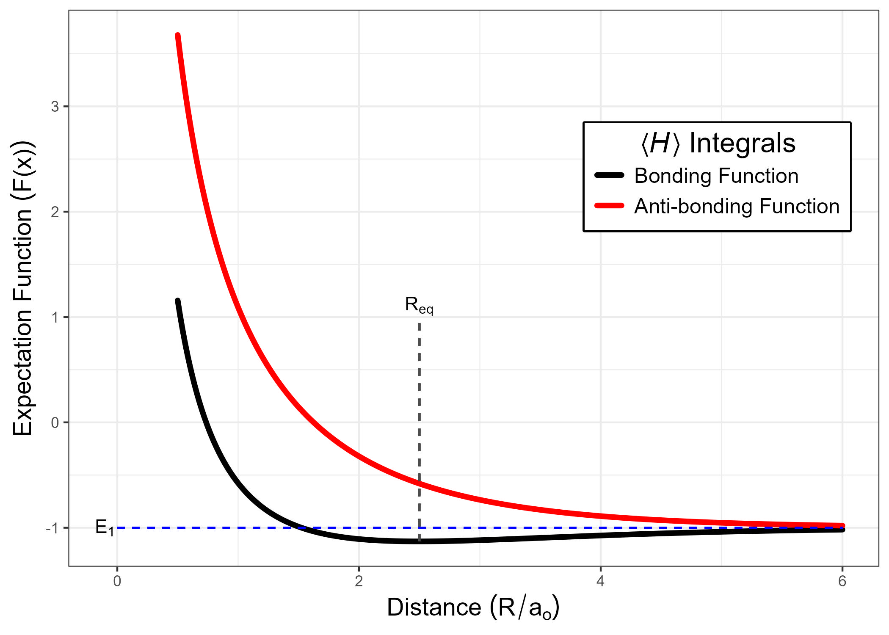
</figure>

<b><u>Figure 34</u>: Energy Plot of H<b>2+</b> Molecule.</b> Bonding (`\(\large \psi_+\)`) and anti-bonding (`\(\large \psi_-\)`) MO energies of H<b>2+</b> are plotted as a function of their **Bohr** radius (`\(a_{\text o}\)`) normalized inter-molecular distance (`\(R/a_{\text o}\)`). Note that the graphed function dips below `\(\langle \hat H \rangle/ \text E_1 \; = \; -1\)`, which shows the energy of this molecule is less than that of a neutral atom plus a free proton (**Note:** E<b>1</b> of H `\(\approx\)` -13.6 eV).

<!-------------------------------------------------------------------->

<!-------------------------------------------------------------------->

<!-------------------------------------------------------------------->

**  4.4 Frontier Molecular Orbitals and Chemical Reactivity  :** A typical chemical reactions involves molecular interactions (i.e. between **reactants**) that give rise to new molecules (i.e. **products**). In order for these molecular collisions to be productive the **reactants** must not only be properly oriented, but also have sufficient energy. The energy driving the reaction forward is primarily used to <u>activate</u> the **reactants**, via the breaking of existing bonds and the formation of new ones. This is why chemical reactions are not spontaneous. Even though a given reaction may be thermodynamically favourable, such as in the case of **exothermic** reactions (i.e. **products** are much lower in energy than the **reactants**), it still requires a “<i>spark</i>” of energy to start the reaction. If, on the other hand, chemical reactions were spontaneous than life itself would have likely not evolve on this planet. Under this scenario any organic molecule that comes in contact with atmospheric oxygen would quickly undergone combustion. Obviously there is more to a chemical reaction than just its **reactants** and **products**. Indeed, every chemical reaction where chemical bonds are broken will have a relatively high energy intermediate known as the **transition state** (TS).<b>[107](#ref-eyring_activated_1935),[108](#ref-evans_applications_1935)</b> The specific energy required to form the TS complex is called the **energy of activation** (E<b>a</b>). Based on the collision theory (`\(\text{rx. rate} \propto \text{# collisions/time}\)`) if E<b>a</b> is much higher than the average kinetic energy of the molecules then the reaction will proceed very slowly. The corresponding <b><a class="one" href="https://opc-project.netlify.app/project/opcchemprimer1_atomists/#BarFormula" target="_blank" title="Go to ChemPrimer1">Maxwell-Boltzmann distribution of the molecular velocities</a></b> would show few fast-moving molecules that could overcome such a high energy barrier. Conversely, if E<b>a</b> is much smaller than the average kinetic energy of the molecules, then a significant fraction of the molecules would have enough kinetic energy to overcome this energy barrier. One way of calculating E<b>a</b> is to use the <b><a class="one" href="https://www.nobelprize.org/prizes/chemistry/1903/arrhenius/facts/" target="_blank" title="Go to NoblePrize.org">Arrhenius</a></b> (1889) equation, which quantifies the relationship between the rates of chemical reactions and temperature (<b>Eqn. 75</b>).<b>[109](#ref-arrhenius_uber_1889),[110](#ref-arrhenius_uber_1889-1)</b>

`$$\tag{74}$$`

`$$\\ \large \text{Collision Model - Gas Chemical Kinetics:} \\ \large \text{Arrhenius Equation}^{\dagger} \\ \text{Note:} \phantom{..} A \; = \; \text{collision frequency constant}, \; k \; = \; \text{rate constant} \\ R \; = \; \text{universal gas constant}, \; \text T \; = \; \text{temperature (Kelvin)} \\ \large e \normalsize \; = \; \text{base of the natural logarithm scale} \\[5px] \Large ^{\dagger} \, \left. \begin{array}{|c|} \hline \large k \normalsize \phantom{.} = \phantom{.}  A \cdot \large e^{\frac{- \text E_a \, }{\, \text{RT} \,}} \\[10px] \hline \end{array} \right. \\[10px] \large ln(k) \normalsize \phantom{.} = \phantom{.} \large ln \normalsize \big( A \big) \; + \; \frac{- \text E_a}{\text{R}} \, \bigg[\frac{1}{\, \text{T}} \bigg] \\[10px] \overbrace{\large ln(k)}^{\large y} \normalsize \phantom{.} = \phantom{.} \overbrace{\frac{- \text E_a \, }{\, \text{R}}}^{\large m} \, \overbrace{\bigg[\frac{1}{\, \text{T}} \bigg]}^{\large x} \; + \; \overbrace{\large ln \normalsize \big( A \big)}^{\large b} \\$$`

<!-------------------------------------->

<!---- FIG 35 - Arrhenius function ----->

<!-------------------------------------->

<figure>

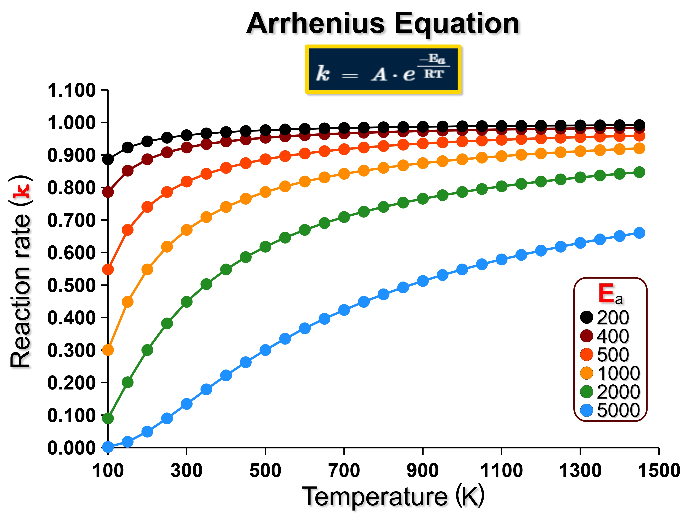

<b>Figure 35: Arrhenius Equation</b>
</figure>

<!-------------------------------------------->

<!-------------------------------------------->

<!-------------------------------------------->

The variable `\(k\)` (i.e. # collisions that yield <b>product</b> per second) in <b>Eqn. 74</b> is equal to the frequency factor `\(A\)` (i.e. total \# of collisions per second) times the <u>probability</u> (i.e. `\(e^{-\text{E}_a/\text{RT}}\)`) that a given collision yields **product**. When this equation is log (natural) transformed it creates a <u>linear</u> equation that can be easily plotted. If the kinetic data is fitted to the **Arrhenius** equation and graphed the slope of the line of best fit would be equal to E<b>a/R</b>, and its y-intercept would be equal to the collision frequency `\(A\)` (**Fig. 36**). Simply looking at the non-transformed **Arrhenius** equation (**Fig. 35**) one can see that the rate constant (`\(k\)`) is dependent on both E<b>a</b> and temperature (<b>T</b>). It is also clear to see that the rate constant (`\(k\)`) is directly proportional to the collision frequency (`\(A\)`), which you may recall from earlier discussions about the <b><a class="one" href="https://opc-project.netlify.app/project/opcchemprimer1_atomists/#MBDh2" target="_blank" title="Go to ChemPrimer1">Maxwell-Boltzmann</a></b> molecular speed distributions in <b>ChemPrimer1</b> is temperature dependent. Notably the changes in E<b>a</b> will have a significant affect on the rate constant `\(k\)` since a chemical reaction will proceed very slowly if E<b>a</b> is prohibitively high. Nevertheless, even a reaction rate with a relatively large E<b>a</b> will increase quite rapidly with increasing temperature. This effect will be modified by the collision frequency (`\(A\)`) since it also increases with temperature (i.e. increase kinetic energy of molecules increases collision frequency). To illustrate the importance of the **Arrhenius equation** consider the following chemical reaction involving the hydroxyl radical and methane:

`$$\\ ^{\Large \cdot}\text{OH} \; + \; \text{CH}_4 \phantom{.} \longrightarrow \phantom{.} \text H_2 \text{O} \; + \; ^{\Large \cdot}\text{CH}_3 \\$$`

The chemistry of free radicals is a fascinating one. Besides playing a major role in health and chronic diseases,<b>[111](#ref-Harman_aging_1956)–[114](#ref-chandimali_free_2025)</b> some like `\(^{\Large \cdot}\text{OH}\)` also play an important role in regulating the atmosphere (i.e. major tropospheric oxidant of volatile organic compounds).<b>[115](#ref-lelieveld_role_2004)–[120](#ref-hoover_measurements_2026)</b> For example **Florian Berg** and colleagues (2024) studied the temperature dependent reaction rates of the hydroxyl radical with several alkanes, including the major greenhouse gas methane.<b>[119](#ref-berg_temperature-dependent_2024)</b> The results of one of their experiments, tabulated below, was fitted to the <b>Arrhenius equation</b> and plotted (**Fig. 36**).

`$$\\ \text{Temperature-dependent Hydroxyl radical reaction rates of methane} \\ \left. \begin{array}{|c|c|c|c|} \hline {\phantom{.} \\ \text{Temperature} \\ \phantom{.....} \text{(K)}} & {\phantom{.} \\ \phantom{...} \large \frac{\Large 1}{\Large \text K}} & {\phantom{.} \\ \phantom{........} \large k \\ (10^{-14} \, \text{cm}^3 \, \text{sec}^{-1})} & {\phantom{.} \\ \phantom{..} \large \ln(k)}  \\[10px] \hline 340.3 & 0.00294 & 1.40 & 0.33647 \\[10px] \hline  331.1 & 0.00302 & 1.12 & 0.11333 \\[10px] \hline  321.7	& 0.00311	& 0.99 & -0.01005 \\[10px] \hline  312.4 & 0.00320 & 0.83 & -0.18633 \\[10px] \hline  303.1 & 0.00330 & 0.73 & -0.31471 \\[10px] \hline  293.8 & 0.00340 & 0.62 & -0.47804 \\[10px]	 \hline  286.0 & 0.00350 & 0.50 & -0.69315 \\[10px] \hline \end{array} \right. \\$$`

 

<!-------------------------------------------------------------->

<!--- FIG 36: Arrhenius Plot of OH radical reacting with CH4 --->

<!-------------------------------------------------------------->

<figure>

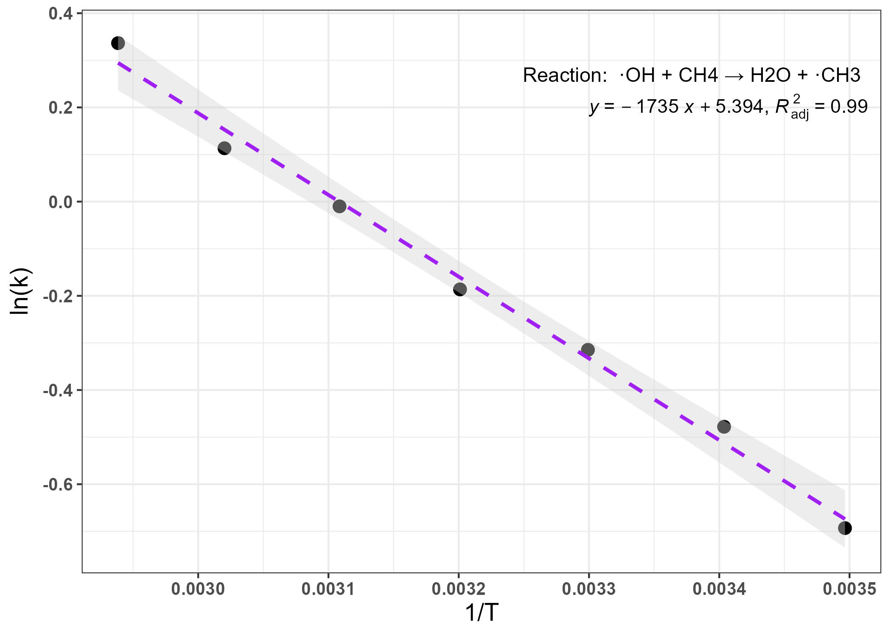
</figure>

<b><u>Figure 36</u>: Arrhenius plot for Hydroxyl Radical reaction with Methane.</b> Reaction rate data from the <b>Florian Berg</b> et. al. (2024) study (see: <b><a class="one" href="https://acp.copernicus.org/articles/24/13715/2024/" target="_blank" title="Go to ACP">supplemental material</a></b> file) was fitted to the **Arrhemius equation** and plotted as shown above. A line of “best fit” (dashed line) was also generated using a linear regression model of the natural log transformed data (Note: shaded area = 95% confidence interval). The equation to the line of “best fit” and the adjusted <b>R2</b> statistic, which assesses the how well the model fits the data, is also included. The value of E<b>a</b> for the experimental temperature range of 280-340 <b>K</b> under standard pressure conditions (i.e. 1 **bar**) was calculated using the slope: E<b>a</b> = `\(1735 \, \text K \times (8.314 \; \text J \, \text{mol}^{-1} \, \text K^{-1}) \; \approx \; 14.4 \; \text{kJ} \, \text{mol}^{-1}\)`.

<!-------------------------------------------------------------------->

<!-------------------------------------------------------------------->

<!-------------------------------------------------------------------->

Another more convenient way of determining E<b>a</b> involves measuring the rate constant using only two temperature data points. This can be done by simply rearranging the **Arrhenius equation** so that it takes the following form:

`$$\tag{75}$$`

`$$\\ \large \text{Temperature Data Points:} \\ \large ln \, k_1 \normalsize \phantom{.} = \phantom{.} \large ln \normalsize \big( A \big) \; + \; \frac{- \text E_a}{\text{R}} \, \Bigg[ \frac{1}{\, \text{T}_1} \Bigg] \phantom{.......} \large ln \, k_2 \normalsize \phantom{.} = \phantom{.} \large ln \normalsize \big( A \big) \; + \; \frac{- \text E_a}{\text{R}} \, \Bigg[ \frac{1}{\, \text{T}_2} \Bigg] \\ \large ln \, k_2 \normalsize \; - \; \large ln \, k_1 \normalsize \phantom{.} =  \phantom{.} \frac{- \text E_a}{\text{R}} \, \Bigg[ \frac{1}{\, \text{T}_2} \; - \; \frac{1}{\, \text{T}_1}\Bigg] \\ \large \text E_a \normalsize \phantom{.} =  \phantom{.} - \text R \normalsize \left( \frac{ln \, k_2 \; - \; ln \, k_1}{ \, \Big[ \large \frac{1}{\text T_2} \; - \; \frac{1}{\text T_1} \, \Big]} \right) \\ \begin{align*} \\ \text{e.g.} \phantom{..} \text T_1 \; = & \; 286, \phantom{.} ln \, k_1 \; = \; -0.69315 \phantom{....} \text T_2 \; = \; 340.3, \phantom{.} ln \, k_2 \; = \; 0.33647 \\ \large \text E_a \normalsize \phantom{.} = & \phantom{.} - \text 8.314 \; \text J \, \text{mol}^{-1} \, \text K^{-1} \normalsize \cdot \left( \frac{\Big(0.33647 \; - \; (-0.69315) \Big) \, \text K}{ \, \Big[ \large \frac{1}{340.3 \, \text K} \; - \; \frac{1}{286 \, \text K} \, \Big]} \right) \\ \large \text E_a \normalsize \phantom{.} = & \phantom{.} - \text 8.314 \; \text J \, \text{mol}^{-1} \, \text K^{-1} \normalsize \cdot \left( \frac{1.02962}{ \, -0.00055792} \, \text K \right) \\ \large \text E_a \normalsize \phantom{.} = & \phantom{.} 15.343 \; \text{kJ} \, \text{mol}^{-1} \end{align*} \\$$`

Although the two-point (n = 2) version of the equation is more convenient to use it’s not as accurate as graphing the entire data set (n = 7). Regardless of what form you use the **Arrhenius** equation can only be used for gas-phase kinetics. Fortunately **Henry Eyring** and **Michael Polanyi** (1935) developed a new equation (i.e. **Eyring-Polanyi** or equation) as part of their novel **transition state** (TS) <b>theory</b>.<b>[107](#ref-eyring_activated_1935)</b> Although the **Eyring-Polanyi** equation is like the **Arrhenius equation**, in that it describes the relationship between chemical reaction rates and temperature, it’s also unique in a number of ways. Firstly, the **Eyring-Polanyi** equation is based on a TS mechanism as apposed to the more simplier collision theory. Secondly, it can be used to study not only gases, but also liquids and solids. Thirdly, it links reaction rates with the thermodynamic properties of the chemical system, including <b>Gibb’s free energy of activation</b> (`\(\Delta \text G^{\ddagger}\)`). Unlike the more familiar <b>Gibb’s free energy</b> (`\(\Delta \text G\)`), which measures how “favourable” a chemical reaction is under constant temperature and pressure, `\(\Delta{\text G}^{\ddagger}\)` is a measure of the energy barrier (i.e. position of TS along reaction coordinate path) that <b>reactants</b> must overcome to form a **product**.

`$$\\ \large ^{\ddagger} \text{Eyring-Polanyi Equation} \\ \text{Note:} \phantom{..} k \; = \; \text{rate constant}, \; k_{\text B} \; = \; \text{Boltzmann's constant}, \; h \; = \; \text{Planck's constant}, \\ \text T \; = \; \text{absolute Temperature}, \; \Delta{\text G}^{^\ddagger} \; = \; \text{Gibb's free energy of activation}, \\ \text R \; = \; \text{Universal Gas constant}, \; \Delta \text H \; = \; \text{Enthalpy}, \; \Delta \text S \; = \; \text{Entropy} \\[5px] \Large ^{\ddagger} \, \left. \begin{array}{|c|} \hline \large k \normalsize \phantom{.} = \phantom{.} \large \frac{k_{\text B} \, \text T}{h} \, e^{\frac{- \, \Large \Delta \text G^{^{\large \ddagger}}}{\text{RT}}} \\[10px] \hline \end{array} \right. \\[10px] \begin{align*} \text{Given:} \phantom{..} \Delta \text G^{^{\large \ddagger}} \phantom{.} = & \phantom{.} \Delta \text H^{^{\large \ddagger}} \; - \; \text T \, \Delta \text S^{^{\large \ddagger}} \\ \large k \normalsize \phantom{.} = & \phantom{.} \frac{k_{\text B} \, \text T}{h} \cdot \large e^{\frac{- \, \Large (\Delta \text H^{^{\large \ddagger}} \; - \; \text T \, \Delta \text S^{^{\large \ddagger}})}{\Large \text{RT}}} \\ \large k \normalsize \phantom{.} = & \phantom{.} \frac{k_{\text B} \, \text T}{h} \cdot \large e^{^\frac{\, \Large \Delta \text S^{^{\large \ddagger}}}{\Large \text{R}}} \cdot e^{^\frac{- \Large \Delta \text H^{^{\large \ddagger}}}{\Large \text{RT}}} \end{align*} \\$$`

`$$\text{Rearrange equation then log (natural) transform it:} \\ \begin{align*} \frac{k}{\text T} \normalsize \phantom{.} = & \phantom{.} \frac{k_{\text B}}{h} \cdot \large e^{^\frac{\, \Large \Delta \text S^{^{\large \ddagger}}}{\Large \text{R}}} \cdot e^{^\frac{- \Large \Delta \text H^{^{\large \ddagger}}}{\Large \text{RT}}} \\[5px] \overbrace{ln \bigg( \frac{k}{\text T} \bigg)}^{\large \text y} \phantom{.} = & \phantom{.}  - \overbrace{\frac{\Delta \text H^{\ddagger}}{\text{R}}}^{\large \text m} \, \overbrace{\bigg[ \frac{1}{\text T} \bigg]}^{\large \text x} \; + \; \overbrace{ln \bigg( \frac{k_{\text B}}{h} \bigg) \; + \; \frac{\Delta \text S^{\ddagger}}{\text R}}^{\large \text b} \\[15px] ^{\dagger}\text{Alternate} \, & \, \text{linearized (y = mx + b) form:} \\ \overbrace{\text T \cdot ln \bigg( \frac{k}{\text T} \bigg)}^{\large \text y} \phantom{.} = & \phantom{.} \overbrace{\Bigg[ ln \bigg( \frac{k_{\text B}}{h} \bigg) \; + \; \frac{\Delta \text S^{\ddagger}}{\text R} \Bigg] \, \text T}^{\large \text{mx}} \; - \; \overbrace{\frac{\Delta \text H^{\ddagger}}{\text{R}}}^{\large \text b} \\ \end{align*}  \\$$`

†<b>Ref:[122](#ref-lente_common_2005)</b>

<!------------------------------------------------------------------>

<!-- FIG 37: Eyring-Polanyi Eqn Plot OH radical reacting with CH4 -->

<!------------------------------------------------------------------>

<figure>

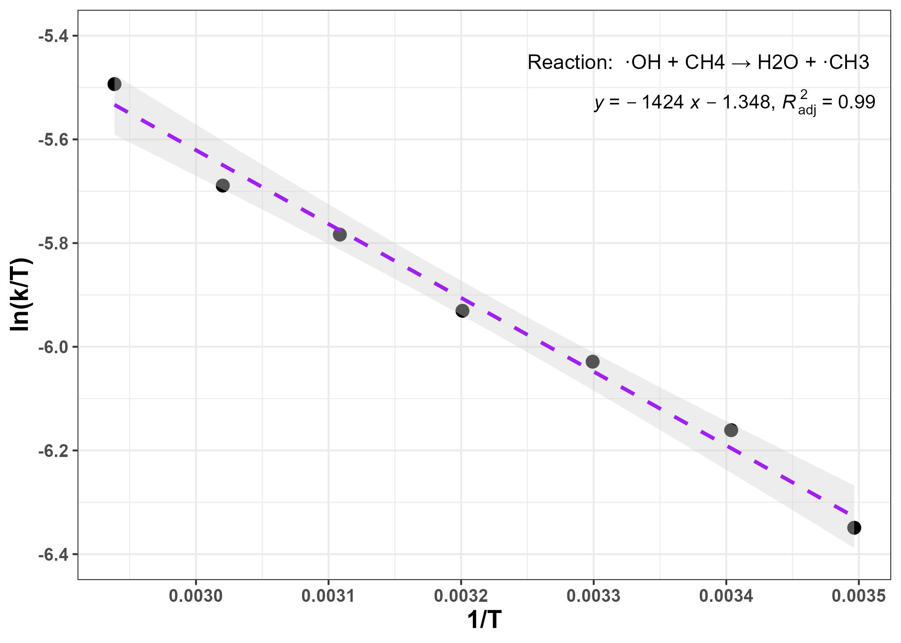
</figure>

<b><u>Figure 37</u>: Eyring-Polanyi (EP) plot of the temperature-dependent rate coefficients for Hydroxyl radical reaction with Methane.</b> The above plot was generated using reaction rate data from **Florian Berg** et. al (2024) (Note: downloaded data from <b><a class="one" href="https://acp.copernicus.org/articles/24/13715/2024/" target="_blank" title="Go to ACP">supplemental material</a></b> file). A line of “best fit” (dashed line) was generated using a linear regression model of the log (natural) transformed reaction rates versus (inverse) temperature (Note: shaded area represents the 95% confidence interval). The equation of the line of “best fit” and the adjusted **R2** statistic, which assesses the model’s fit to the data, is shown in the top right corner of the plot. The apparent <b>enthalpy of activation</b> (<b>ΔH‡</b>) for the chemical reaction can be calculated by multiplying the absolute value of the slope by the ideal gas constant **R**: <b>ΔH‡</b> = 8.314 J/(mol⋅K) × 1424 K = 11.84 kJ/mol. The **enthalpy of activation** can now be used to calculate E<b>a</b> via the following mathematical relationship: <b>ΔH‡ = Ea - RT</b>. Solving for E<b>a</b> (i.e. **T** = 313 K) generates a value of 14.44 kJ/mol, which closely matches the E<b>a</b> generated using the **Arrhenius** equation (14.425 kJ/mol). However, calculating the apparent <b>entropy of activation</b> (<b>ΔS‡</b>) is a little more complicated since corrections have to be implemented (i.e. volume units require standard-state adjustment factor). Nevertheless, using a known pre-exponential factor (<b>A = 1.13 × 106 m3/(mol⋅sec)</b>) the value of <b>ΔS‡</b> can be calculated using the following standard formula (standard conditions: 1 bar pressure):

`$$\Delta \text S^{\ddagger} \; = \; \text R \times ln \Bigg[ \frac{A \, h}{e^2 \, k_{_{\text B}} \, \text T} \Bigg] \; \approx \; - 145.5 \; \text J \, \text{mol}^{-1} \text{K}^{-1}$$`

where the physical constants and variables are: (i) <b>R</b> = gas constant = 8.31446 J/(mol-K); (ii) <b>kB</b> = Boltzmann constant = 1.38065 × 10-23 J/K; (iii) <b>ℎ</b> = Planck’s constant = 6.626072 × 10-34⋅J⋅sec; (iv) <b>T</b> = absolute temperature = 293.15 K; and (v) <b><i>e</i></b> = base of natural logarithm.

<!-------------------------------------------------------------------->

<!-------------------------------------------------------------------->

<!-------------------------------------------------------------------->

The thermodynamic properties of the hydroxyl radical reaction reveals some interesting aspects about its mechanism. Firstly, the energy barrier separating the **reactants** from the TS (i.e. E<b>a</b> ~14.4 kJ/mol) is not typical of most chemical reactions (i.e. \> 50 kJ/mol). However, according to **George Hammond’s Postulate** (1955):

> “In highly exothermic steps it will be expected that the transition states will resemble reactants closely and in endothermic steps the products will provide the best models for the transition states ….the postulate applies to fast, exothermic reactions and, by the principle of microscopic reversibility, to any reactions which have a finite rate in the reverse direction.”<b>[123](#ref-hammond_correlation_1955)</b>

So this highly **exothermic** chemical reaction (see calculations below), which is largely driven by the highly reactive hydroxyl radical, has (according to **Hammond’s Postulate**) a TS that closely resembles the **reactants** both energetically and structurally.

`$$\\ \text{According to Hess's Law} \; \Delta H^\circ \; (\text{enthalpy of a reaction) is equal to:} \\ \text{(Note:  BDE = bond dissociation energy)} \\[10px] \Delta H_{rxn}^\circ \phantom{.} = \phantom{.} \sum \text{BDE}_{\small \text{broken}} - \sum \text{BDE}_{\small \text{formed}} \\ \Delta H_{rxn}^\circ \phantom{.} = \phantom{.} \overbrace{439 \, \text{kJ/mol}}^{\text{methane: C-H}} \; - \; \overbrace{497 \, \text{kJ/mol}}^{\text{water: O-H}} \phantom{.} = \phantom{.} - 58 \, \text{kJ/mol} \\$$`

Presumably the similarities between the TS and **reactants** means that relatively little energy is needed to alter the structure of the **reactants** before bond breaking events occur, which lowers the energy barrier in the process. It’s also worth noting that the <u>empirically</u> generated E<b>a</b> for our hydroxyl radical reaction is an average energy value across varying temperature conditions. More accurate E<b>a</b> values for this important reaction have been generated (i.e. 14.7 kJ/mol) using more extensive computational based methods (e.g. Density Functional Theory) that take into consideration the molecule’s fundamental vibrational properties (i.e. zero-point vibrational energies),<b>[124](#ref-korchowiec_hydrogen_1999)</b> but this is beyond the scope of this discussion. This bi-molecular reaction also has a relatively low `\(\Delta \text S^{\ddagger}\)` (i.e. -145.5 J/mol⋅K), which suggests that the **reactants** require a specific spatial/angular orientation in order to successfully produce a **product** (i.e. **reactants** lose some translational and rotational freedoms, which decreases the randomness or **entropy** of the system). Of course, E<b>a</b> can vary considerably depending upon the type of chemical reaction and the reaction conditions (e.g. required bond-breaking energies, temperature, pressure, etc.). For example, the famous **Haber-Bosch process** is a highly **endothermic** reaction (i.e. N<b>2</b> + 3 H<b>2</b> → 2 NH<b>3</b>) that has an E<b>a</b> of approximately 460 kJ/mol. Because of the high energy barrier (Note: reaction requires the breaking of a triple bond within N<b>2</b>) this important chemical process, which is responsible for global fertilizer production,<b>[125](#ref-erisman_how_2008)</b> requires metal catalysts in addition to high pressures and temperatures.<b>[126](#ref-Haber_nobel_1920)</b> It’s estimated that this one chemical process is responsible for consuming ~2% of the global energy supplies, and producing ~3% of global CO<b>2</b> emissions.<b>[127](#ref-IEA_ammonia_2021)–[129](#ref-mingolla_low-carbon_2025)</b>

<!---------------------------------------------------------->

<!-- FIG 38: PE Plot OH radical abstraction of H from CH4 -->

<!---------------------------------------------------------->

<figure>

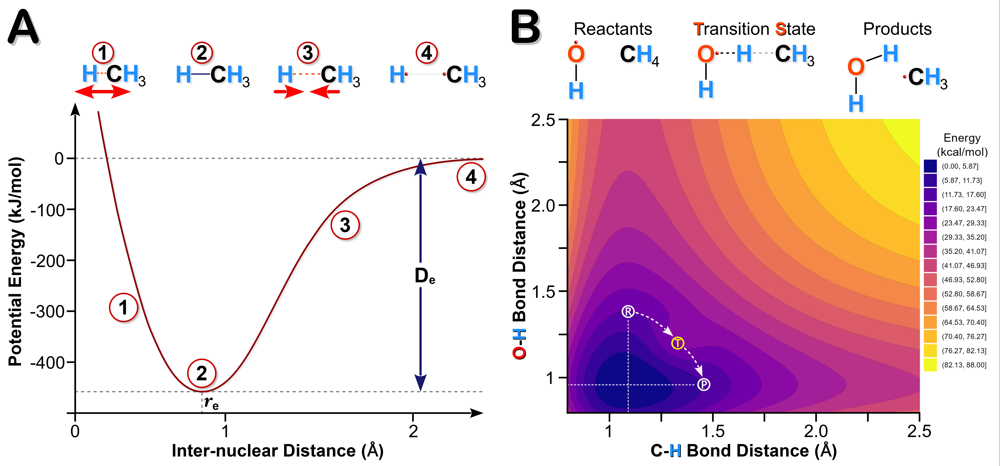
</figure>

<b><u>Figure 38</u>: Potential Energy Surface (PES) model of Hydroxyl Radical reaction with Methane.</b> **(A)** The well known **Morse function** (see below) was used to simulate the **potential energy** (**V(r)**) of the simultaneous bond-breaking (C<b>-</b>H) and bond-forming (O<b>-</b>H) events of this reaction via the intermediate TS complex (<b>Ⓣ</b>).<b>[15](#ref-Ball_physical_2014),[130](#ref-morse_diatomic_1929)</b> The total **V(r)** of the system was then plotted (gradient style) on a two-dimensional grid (**B**). Bond distances are often modelled like classical **harmonic oscillators**. Stretching a bond beyond its equilibrium position is resisted due to attractive Coulombic forces. However, as the inter-nuclear distance continues to increase (i.e. more energy input) the attractive forces slowly dissipate leading to the bond’s dissociation (i.e. bond breaks). Conversely, when the bond distance contracts its **V(r)** rapidly increases due to repulsive Coulombic forces. This type of behaviour, which is not perfectly **harmonic**, can be conveniently modelled using **Morse functions**. The specific equilibrium bond length and potential well widths used in the calculations were: (i) for the C<b>-</b>H of methane, 1.09 Å and 1.9 Å and (ii) for the O<b>-</b>H of water, 0.96 Å and 2.2 Å, respectively. A **Gaussian** like function was used for the TS, with bond distances of 1.33 Å (i.e. ~22% stretch of methane C<b>-</b>H bond) and 1.2 Å (~25% stretch of O<b>-</b>H bond) being used for the calculation. For illustrative purposes a reduced value (i.e. 47 kJ/mol) of the averaged `\(\text D_e\)` value (i.e. ~470 kJ/mol) of the reactant (~439 kJ/mol) and product (~497 kJ/mol) was used in this simulation to more clearly define the TS (“saddle” point) along the reaction path. For the **Gaussian** like function of the TS the pre-exponential constant (i.e. `\(A\)` = 10 kJ/mol) representing the peak amplitude of the reaction path (i.e. TS, where `\(A \cdot e^0 = A\)`) was also reduced for illustrative purposes (i.e. `\(A\)` = E<b>a</b> + <b>ΔH‡</b> = 11.84 + 14.4 = 26.24 kJ/mol). These altered values accentuate the height, width and decay of the energy contours moving away from the TS. Altogether the plot shows: (i) the reactant “valley” - located where `\(r_{\text{C-H}}\)` is close to equilibrium (1.09 Å) and `\(r_{\text{O-H}}\)` is large (<b>Ⓡ</b>); (ii) the product “valley” - where `\(r_{\text{O-H}}\)` is close to equilibrium (0.96 Å) and `\(r_{\text{C-H}}\)` is large (<b>Ⓟ</b>); and (iii) the TS, which is a <u>maximum</u> in <u>one</u> direction (i.e. only along the reaction coordinate path) and a <u>minimum</u> in all other directions within the energy landscape. This makes it a first-order <b>“saddle”</b> point (<b>Ⓣ</b>).<b>[131](#ref-schlegel_geometry_2011)</b>

`$$\\ ^{\large \dagger}\text{Morse Potenital Energy Function:} \phantom{..} \text V(r) \phantom{.} = \phantom{.} \text D_e \Big(1 \; - \; e^{-a \, \Delta r} \Big)^2 \\[10px] \text{TS Gaussian Function:} \phantom{..} \text V(r) \phantom{.} = \phantom{.} A \cdot e^{\big(\large - \text D_e \, (r_{\text{CH}} \; - \; 1.33)^2 \; - \; \text D_e \, (r_{\text{OH}} \; - \; 1.2)^2 \normalsize \big)} \\$$`

Note that the physical constants and variables for the above functions are: (i) `\(\text D_e\)` = potential energy well depth, which represents the bond dissociation energy; (ii) `\(e\)` = **Euler’s** number, which is the base of natural logarithms; (iii) `\(a\)` = width of the potential energy well is related to the force constant `\(k_e\)` by `\(a = \sqrt{k_e / 2 \text D_e}\)`. This force constant is directly related to the stiffness of a bond (i.e. `\(k_e\)` is the same as restoring force of a spring as described in <b><a class="one" href="https://phet.colorado.edu/sims/html/hookes-law/latest/hookes-law_all.html" target="_blank" title="Go to PhET">Hooke’s Law</a></b>). Like a stiff spring, a stiff bond has a strong restoring force even when it is subjected to small stretches; (iv) `\(\Delta r \; = \; r \, - \, r_{equ.}\)` = difference between a given inter-nuclear distance, or `\(r\)`, and the <u>equilibrium</u> bond length (i.e `\(r_{equ.}\)` = distance at minimum energy); (v) `\(A\)` is the corresponding amplitude of the **Gaussian** like function.

<!---------------------------------------------------------->

<!---------------------------------------------------------->

<!---------------------------------------------------------->

<!------------------------------------->

<!------ Fig. 39 Rx. Coordinate ------->

<!------------------------------------->

<figure id="FRight450c">

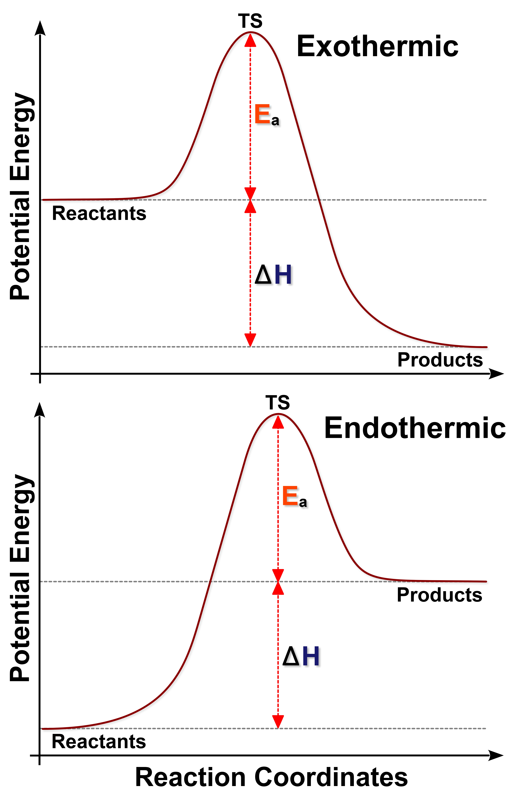
<figcaption>

<b>Figure 39: Reaction Coordinate</b>
</figcaption>

</figure>

<!-------------------------------------------->

<!-------------------------------------------->

<!-------------------------------------------->

The above plots crudely simulate the potential energy landscape of the bond-forming and bond-breaking events of the hydroxyl radical reaction. However, it may be more intuitive to describe these molecular events in terms of the **electrophilic** and **nucleophilic** nature of the **reactants**. In this way we can view the entire reaction through the “lens” of Coulombic interactions (e.g. **electrophile** attacking a **nucleophile**). But what part of a molecule serves as the source of the **electrophilic** or **nucleophilic** activity? To answer this question requires a more thorough understanding of the electron density distribution of the molecules, something that was previously discussed in the context of **Huckel’s** MO theory. Despite the algebraic complexity one could calculate and visualize, courtesy **HuLis**, the electron density distribution of a conjugated `\(\large \pi\)`-bonding system, which helped to explain why some positions within these types of molecules are more likely to be the site of a chemical reaction. Using the electron density of molecules to explain chemical reactions, including the exact position of the atoms and the kinetics of the reaction (i.e. rate constants, activation energy, number of transition states, etc.) would be ideal. However, such mechanistic details are rather rare for most chemical reactions. Often times we only have a **reaction co-ordinate**, which is a relatively simple graphical representation of the energetics of a chemical reaction over time (**Fig. 39**). These graphs highlight the energy levels of the **reactants**, TS and **products**, as well as the energy differences between **reactant** and **product** (i.e. **enthalpy**, or <b>Δ H</b>) and **reactant** and TS (i.e. energy of activation, or E<b>a</b>). With this information one can quickly determine whether a chemical reaction is **exothermic** (i.e. heat energy released, <b>Δ H</b> \< 0) or **endothermic** (i.e. heat energy consumed, <b>Δ H</b> \> 0).  
    MO theory does offer some insight into the reactivity of molecules via so called **frontier orbitals**, namely: (i) the **H**ighest **O**ccupied **M**olecular **O**rbital, or **HOMO**; (ii) the **L**owest **U**noccupied **M**olecular **O**rbital, or **LUMO**; and (iii) the **S**ingle **O**ccupied **M**olecular **O**rbital or **SOMO**. According to the **F**rontier **M**olecular **O**rbital (**FMO**) theory, which was developed by <b><a class="one" href="https://www.nobelprize.org/prizes/chemistry/1981/fukui/facts/" target="_blank" title="Go to Noble Prize">Kenichi Fukui</a></b> (1952), electrons within the **HOMO** of one molecule interacts with the empty **LUMO** of another molecule.<b>[132](#ref-fukui_molecular_1952)–[135](#ref-fukui_formulation_1970)</b> As mentioned previously **HOMO** holds the highest energy valence electrons, while **LUMO** represents the lowest energy empty orbital. When the chemical reaction involves free radicals then **LUMO** is replaced by **SOMO** (**S**ingly **O**ccupied **M**olecular **O**rbital), due to the presence of an unpaired electron. For our reaction the **HOMO** of methane acts as a **nucleophile**, while the **SOMO** of the hydroxyl radical acts as the **electrophile** (**Fig. 40**). The **nucleophilic** methane donates an electron from its **HOMO** `\(\large \sigma\)`-bond to the **SOMO** of the **electrophilic** hydroxyl radical. Overall we can say the frontier **SOMO** of the hydroxyl radical functions as an electron acceptor, which increases its electron density via the breaking of a C<b>-</b>H `\(\large \sigma\)`-bond in methane. However, one of the most important factors that determines the success of the reaction is the size of the **HOMO-SOMO** energy gap, which must be relatively small to ensure strong orbital “mixing”. Another key aspect of the theory is **orbital symmetry**, specifically the phase of the overlapping orbitals (i.e. matching signs = constructive interference). This latter point is not surprising given the wave-like properties of electrons as discussed at length above. Lastly, one must also consider the **spatial** or **steric** constraints of the chemical system. Specifically the spatial orientation, or angles, the **reactants** must assume in order to successfully interact with one another (i.e. provide maximize orbital overlap).

<!------------------------------------>

<!------ Fig. 40 HOMO-SOMO Rx. ------->

<!------------------------------------>

<figure>

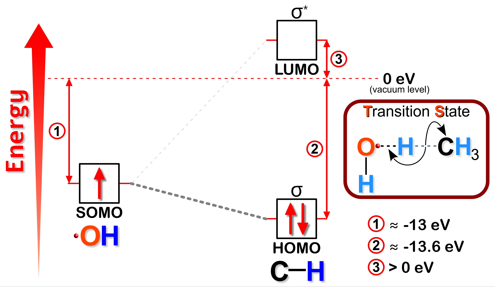
</figure>

<b><u>Figure 40</u>: SOMO-HOMO interaction of Hydroxyl radical reaction with Methane.</b> The **SOMO** of the hydroxyl radical is made up of a 2p non-bonding orbital of O, which is nearly perpendicular to the central `\(\large \sigma\)`-bond between O and H. The **SOMO-HOMO** energy gap is relatively small (Note: approximate ionization energy values: ①, ②, ③),<b>[136](#ref-collin_ionization_1967)–[138](#ref-dodson_vacuum_2018)</b> which allows for good orbital “mixing”. Lastly, the high electronegativity of Oxygen coupled with its half-filled 2p orbital makes the radical highly reactive (i.e. very favourable thermodynamically given the relatively low E<b>a</b> of the reaction).

<!-------------------------------------------->

<!-------------------------------------------->

<!-------------------------------------------->

Unfortunately our current knowledge of most chemical reactions is largely macroscopic in nature. Often times the tools we use to study them are limited (e.g. exact quantum solutions are only possible for the simplest two atom system, and approximation methods rely on multiple simplifying assumptions). Although thermodynamic methods do provide very meaningful insights, they too are limited in what they can tell us (e.g. average energies). The most intuitive pedagogical tool for studying chemical reactions is perhaps electron (arrow) “pushing” diagrams. Anyone who studied organic chemistry as a student learned how arrows are used to track or map electron movements between **nucleophiles** and **electrophiles** (e.g. see: <b><a class="one" href="https://opc-project.netlify.app/project/pnps/#Fig_SerProt" target="_blank" title="Go to PNP">serine proteases</a></b>). These types of diagrams are somewhat similar in function to <b><a class="one" href="https://www.nobelprize.org/prizes/physics/1965/feynman/facts/" target="_blank" title="Go to NobelPrize.org">Feynman</a></b> diagrams, since they both convert abstract rules into simple elegant drawings. For free radical chemical reactions such diagrams largely map the movements of single electrons (Note: <b><a class="one" href="https://opc-project.netlify.app/project/pnps/#Fig_VitCE" target="_blank" title="Go to PNP">lipid peroxidation</a></b> example). However, these simple drawings do not tell the whole story of a chemical reaction, since other important factors are often left out (e.g. many proteins like enzymes are flexible and undergo changes in shape, which usually requires X-ray crystallography, NMR spectroscopy or Cryo-EM techniques to observe).<b>[139](#ref-henzler-wildman_dynamic_2007)–[141](#ref-riziotis_conformational_2022)</b> The recent use of machine learning (**ML**) algorithms for protein and biomolecular structure predictions (i.e. <b><a class="one" href="https://alphafold.ebi.ac.uk/" target="_blank" title="Go to AFDB">AlphaFold2 Protein Structure Database</a></b>, and <b><a class="one" href="https://alphafoldserver.com/welcome" target="_blank" title="Go to AFS">AlphaFold3 Server</a></b>),<b>[142](#ref-jumper_highly_2021)–[144](#ref-abramson_accurate_2024)</b> is an exciting new way of studying molecules. However, using **ML** algorithms to make chemistry predictions (e.g. synthesis, bio-activity and energetics studies),<b>[145](#ref-behler_generalized_2007)–[148](#ref-tu_predictive_2023)</b> is greatly hampered by the enormous diversity and unstructured nature of chemical “space”.<b>[149](#ref-mitchell_machine_2014),[150](#ref-reymond_chemical_2015)</b> Current publicly available chemical databases (e.g. <b><a class="one" href="https://pubchem.ncbi.nlm.nih.gov/" target="_blank" title="Go to PubChem">PubChem</a></b>, <b><a class="one" href="https://www.ebi.ac.uk/chembl/" target="_blank" title="Go to ChEMBL">ChEMBL</a></b> and <b><a class="one" href="https://commonchemistry.cas.org/" target="_blank" title="Go to CAS Common Chemistry">CAS</a></b>)<b>[151](#ref-nicola_public_2012)–[153](#ref-jacobs_cas_2022)</b> are not standardized (e.g. differing file types for molecular structures), nor do they share the same information. Most were designed to document the biological activity of small molecules (e.g. drug screening). Other promising technologies that can be applied to chemistry problems (e.g. molecular modelling for medical and materials science) is quantum computing. Although it holds great promise, particularly in terms of its computational speed when compared to conventional computing,<b>[154](#ref-feynman_quantum_1985)–[157](#ref-reiher_elucidating_2017)</b> its prohibitively expensive (i.e. hardware and infrastructure) for most scientists. There are cheaper options, such as “cloud” access to quantum computing service providers. For example, **IBM** offers access to their quantum computing systems via a <b><a class="one" href="https://www.ibm.com/quantum/products" target="_blank" title="Go to IBM">Pay-as-you-Go-Plan</a></b> that starts at 96 USD/minute. For large biotech companies that spend many years and millions of dollars on drug discovery such spending is well justified. However, quantum computing hardware is not only expensive (i.e. \> 1 million USD for entry level systems), it also requires dedicated resources and infrastructure.<b>[158](#ref-krasnok_QuComp_2026)</b> It’s also subject to other limitations (e.g. fragile nature of **Qubits**), which makes it inferior (certainly on a practical scale) to classical computation methods (e.g. **D**ensity **F**unctional **T**heory, or **DFT**). This is rather disappointing since quantum computing should, by its very nature, be able to map and quantifying multiple quantum states with great ease.<b>[154](#ref-feynman_quantum_1985),[159](#ref-lloyd_universal_1996)</b> Hopefully, in the not so distant future, quantum computing will become a routine and practical modelling tool for basic scientists.

<!------------------------------------------------->
<!------------------  Info Box4 ------------------->
<!------------------------------------------------->

  INFORMATION BOX 4 - Computational (<i>ab initio</i>) Chemistry  

Computational methods used to model molecules are largely based on **G**aussian **F**unctions (**GF**), which form the basic units of <b><a class="one" href="https://chem.libretexts.org/Bookshelves/Physical_and_Theoretical_Chemistry_Textbook_Maps/Supplemental_Modules_(Physical_and_Theoretical_Chemistry)/Quantum_Mechanics/17%3A_Quantum_Calculations/ab_initio_Basis_Sets" target="_blank" title="Go to Chemistry LibreText">basis functions</a></b> used by **D**ensity **F**unction **T**heory (**DFT**) methods.<b>[160](#ref-hohenberg_inhomogeneous_1964)–[166](#ref-hehre_GaussianMO_1972)</b> The use of computational friendly **Gaussian** functions (i.e. `\(e^{\large \alpha r^2}\)`), which was pioneered by **Samuel F. Boys** (1950),<b>[167](#ref-boys_GaussianMO_1950)</b> to approximate electronic wave functions have largely replaced **Slater Type Orbital** (**STO**) functions (i.e. `\(e^{\large \zeta r}\)`).<b>[54](#ref-slater_directed_1931),[105](#ref-hartree_self-consistent_1939),[168](#ref-slater_atomic_1930)</b> Although **STO** functions accurately model the characteristic exponential radial decay of an atom’s electronic charges, the integral calculus used to calculate them is computationally “expensive”. Fortunately multiple **Gaussian functions** (**GF**) can be used to approximate a **STO**. Replacing one **STO** function with more than one **GF** seems counter intuitive, but computers can handle **Gaussian** type integrals far more easily than **STO** type integrals. This is largely due to the fact that <b><a class="one" href="https://www.3blue1brown.com/?topic=probability&lesson=gaussian-convolution" target="_blank" title="Go to 3Blue1Brown">multiplying two (or more) GF produces one new GF</a></b>. Obviously the main point here is that multi-electron integral calculations, which can number in the millions, are efficiently computed using **GF**. For example, a simple 10 atom organic molecule like **pyrrole** (C<b>4</b>H<b>5</b>N) modelled using a **basis set** like **STO-3G** carries out out over 100,000 two-electron integral calculations, while a slightly more modern and accurate **basis set** like **6-31G** (**N** = 55 **basis functions**) would require over 1.1 million two-electron calculations (Note: \# calculations ≈ **N**4/8). For a **pyrrole** molecule the number of primitive **GF** used by **STO-3G** is 90 (<b><u>Note</u>:</b> **N** = \# **basis functions** = \# atoms × \[orbitals/atom\] × \[**basis functions**/orbital\] = \[4 C × 5 × 1\] + \[1 N × 5 × 1\] + \[5 H × 1 × 1\] = 30 **basis functions**. Each **basis function** is a contraction of 3 primitive **GF**, which means there are a total of 90 primitive **GF** per molecule). As shown below plotting a single **GF** (**Fig. 42A**) clearly fails to accurately replicate the exponential radial decay of a spherical 1s AO (i.e. lacks a “cusp” at its centre, and it decays faster due to its squared exponent). However, a linear combination of three (or more) **GF**, as exemplified by **G3** (**Fig. 42A**, and mathematically expressed below), can clearly overcome these limitations. Unfortunately using **basis sets** to model the electronic structure of large molecules is not trivial since the shape of electron density clouds can vary (e.g. spherical 1s versus a dumbbell shaped 2p orbital), particularly in response to its environment (e.g. water can distort the shape of electron density clouds). As a result many different types of <b><a class="one" href="https://www.basissetexchange.org/" target="_blank" title="Go to Basis Set Exchange">basis sets</a></b> have been developed to account for these different electronic behaviours (e.g. geometries, energies, bond polarization, etc.).<b>[169](#ref-teale_dft_2022),[170](#ref-bursch_best-practice_2022)</b>

`$$\\ \text{Slater Type Orbitals (STO), Gaussian Type Orbitals (GTO)}, \\ \text{and Gaussian Functions (GF)} \\ \Big[ \text{Note:} \phantom{.} N = \text{normalization factor}, \; r = \text{radial distance} \Big] \\ \large \psi_{\normalsize i}^{\normalsize \text{STO}} \normalsize (r, \zeta) \phantom{.} = \phantom{.} \large N \normalsize e^{- \large \zeta \, r} \phantom{........} \large \psi_{\normalsize i}^{\normalsize \text{GF}} \normalsize (r, \, \alpha) \phantom{.} = \phantom{.} \large N \normalsize e^{- \large \alpha \, r^2} \\ \large \psi_i^{\normalsize \text{STO}} \normalsize (r, \zeta) \phantom{.} \approx \phantom{.} \large \psi_i^{\normalsize \text{GTO}} \normalsize (r, \zeta) \phantom{.} = \phantom{.} \large \sum_{i \, = \, 1}^{n} \normalsize \; c_i \; \large \psi_{\normalsize i}^{\normalsize \text{GF}} \normalsize (r, \, \alpha_i) \\$$`

For each basic **GF** the exponential factor `\(\alpha\)` determines its lateral spread (e.g. small value produces a more diffuse or wide **Gaussian**), while the position (`\(r\)`) of the function is purposely centred on an atom. The height or amplitude of the **GF** is determined by the pre-exponential coefficient (`\(c_i\)`). For example, C has four valence atomic orbitals (i.e. 2s, 2px, 2py, 2pz) and one inner or **core** 1s orbital (i.e. 5 orbitals in total). Therefore we would need one **basis function** for each of these five AO. Since there are 3 contracted **GF** per **basis function** that would give us 15 primitive **GF** per carbon atom. Differences in the behaviour of the core and valence orbitals (i.e. core orbitals have a relatively stable radius, while the shape of valence orbitals are often distorted by neighbouring atoms) have resulted in the design of “split” **basis sets**. For example, the split-valence **basis set** known as **3-21G**, which was designed by <b><a class="one" href="https://www.nobelprize.org/prizes/chemistry/1998/summary/" target="_blank" title="Go to Nobel.com">John Pople’s</a></b> group (1980), accurately models the geometries and electronic properties of small organic molecules. Although it has been largely superseded by more accurate **basis sets** it’s still used today (e.g. quick geometry optimizations).<b>[171](#ref-Binkley_Pople_1980),[172](#ref-ahlrichs_GaussianMO_1981)</b>

<figure>

</figure>

<b><u>Figure 41</u>: Basis Set Exchange</b>

The first number in the **3-21G basis set** refers to the three <u>primitive</u> **GF** (e.g. `\(g_1, g_2, g_3\)`) that are combined (i.e. “contracted”) to form a single **basis function** for the inner/core orbital (i.e. `\(\text{AO}_{1 \text s} = \large \text c_{\normalsize 1 \text s} \normalsize (f_1 g_1 \, + \, f_2 g_2 \, + \, f_3 g_3)\)` ). The next two numbers after the hyphen indicate a split-valence configuration (Note: **sp** = s and p orbitals share the same double **basis function**, `\(\text{AO}_{\text{sp}} = \large \text c_{\normalsize 2} \normalsize (f_4 g_4 \, + \, f_5 g_5) + \large \text c_3 \normalsize (f_6 g_6)\)`). The so called “inner” valence **basis function** is a contraction of 2 <u>primitive</u> **GF** (i.e. `\(g_4, g_5\)`), while the “outer” valence **basis function** is made up of a single (i.e. non-contracted) <u>primitive</u> **GF** whose <u>fixed</u> coefficient is equal to unity (i.e. `\(f_6 = 1\)`). Splitting the valence shell into two **basis functions** allows the electron structure to expand or stretch in order to more accurately model chemical bonding. It’s worth noting that the term “contraction” refers to a <u>fixed</u> linear combination of primitive **GF**. This means the coefficients of the primitives are optimized, fixed values or constants (`\(f_i\)`). This leaves the <u>group</u> coefficient (`\(c_i\)`) as a variable, which serves as a weighting factor for the contracted **basis function**. This latter coefficient does not appear in the output of the **basis set** shown above since it is a variable (i.e. changes depending on the unique geometry and electronic state of the molecule). To illustrated the usefulness of **GF** three **basis functions** (i.e. **G1**, **G2** and **G3**) are plotted below (**Fig. 42A**).<b>[13](#ref-mcquarrie_physical_1997)</b>

`$$\\ \begin{align*} \large \psi_{\normalsize \text{1s}}^{\normalsize \text{STO}} \normalsize (r, \zeta) \phantom{.} \approx \overbrace{\large \sum_{\large i \, = \, 1}^{n \, = \, 1} \; c_{\normalsize (\text{1s}_{\Large i})} \; \large \psi_{\normalsize \text{1s}}^{\normalsize \text{GF}} \normalsize ( r, \, \alpha_{_{\large \text{1s}_{\Large i}}})}^{\text{G1}} \phantom{.} = & \phantom{.} \large \psi_{\normalsize \text{1s}}^{\normalsize \text{GF}} \normalsize ( r, \, 0.4166) \\ \large \psi_{\normalsize \text{1s}}^{\normalsize \text{STO}} \normalsize (r, \zeta) \phantom{.} \approx \overbrace{\large \sum_{\large i \, = \, 1}^{n \, = \, 3} \; c_{\normalsize (\text{1s}_{\Large i})} \; \large \psi_{\normalsize \text{1s}}^{\normalsize \text{GF}} \normalsize ( r, \, \alpha_{_{\large \text{1s}_{\Large i}}})}^{\text{G3}} \phantom{.} = & \phantom{.} \overbrace{0.446}^{f_1} \, \large \psi_{\normalsize \text{1s}}^{\normalsize \text{GF}} \normalsize ( r, \, 0.1688) \\ + \; \overbrace{0.5353}^{f_2} \, \large \psi_{\normalsize \text{1s}}^{\normalsize \text{GF}} \normalsize ( r, \, 0.6239) \; + & \; \overbrace{0.1543}^{f_3} \, \large \psi_{\normalsize \text{1s}}^{\normalsize \text{GF}} \normalsize ( r, \, 3.425) \\ \large \psi_{\normalsize \text{1s}}^{\normalsize \text{STO}} \normalsize (r, \zeta) \phantom{.} \approx \overbrace{\large \sum_{\large i \, = \, 1}^{n \, = \, 6} \; c_{\normalsize (\text{1s}_{\Large i})} \; \large \psi_{\normalsize \text{1s}}^{\normalsize \text{GF}} \normalsize ( r, \, \alpha_{_{\large \text{1s}_{\Large i}}})}^{\text{G6}} \phantom{.} = & \phantom{.} \overbrace{0.1303}^{f_1} \, \large \psi_{\normalsize \text{1s}}^{\normalsize \text{GF}} \normalsize ( r, \, 0.10) \\ + \; \overbrace{0.4165}^{f_2} \, \large \psi_{\normalsize \text{1s}}^{\normalsize \text{GF}} \normalsize ( r, \, 0.2431) \; + & \; \overbrace{0.3706}^{f_3} \, \large \psi_{\normalsize \text{1s}}^{\normalsize \text{GF}} \normalsize ( r, \, 0.626) \\ + \; \overbrace{0.1685}^{f_4} \, \large \psi_{\normalsize \text{1s}}^{\normalsize \text{GF}} \normalsize ( r, \, 1.8222) \; + & \; \overbrace{0.0494}^{f_5} \, \large \psi_{\normalsize \text{1s}}^{\normalsize \text{GF}} \normalsize ( r, \, 6.5131) \\ + \; \overbrace{0.0092}^{f_6} \, \large \psi_{\normalsize \text{1s}}^{\normalsize \text{GF}} \normalsize ( r, \, 35.5231) \; \; & \end{align*} \\$$`

Using **basis sets** to model the chemical properties of molecules is of course a major goal of computational quantum chemistry. So we can re-visit the hydroxyl radical reaction with methane (i.e. abstraction of a H atom) and analyze it in more detail. For example, in order to model the **transition state** (TS) of this chemical reaction we need a **basis set** that accounts for loosely bound electrons (i.e. diffuse functions) and potentially distorted or bent electron densities (i.e. polarization functions).

`$$\text{CH}_4 \, + \, \cdot\text{OH} \; \rightarrow \; \cdot\text{CH}_3 \, + \, \text{H}_2\text O$$`

Polarization functions are particularly important due to the distorted electron density along the reaction coordinate of the TS (i.e. bond stretching and compression events affect the activation energy). The analysis can be carried out using two popular and free (academic use only) chemistry computer programs known as <b><a class="one" href="https://avogadro.cc/index.html" target="_blank" title="Go to Avogadro">Avogadro (v2.0)</a></b> and <b><a class="one" href="https://www.faccts.de/orca/" target="_blank" title="Go to ORCA">ORCA (v6.1.0)</a></b>.<b>[173](#ref-hanwell_avogadro_2012)–[176](#ref-Neese_Orca6_2025)</b> **Avogadro** is a molecular visualization program capable of generating input files for several advanced quantum chemistry software packages such as **ORCA**. Although **ORCA** is only run via command line **Avogadro** is capable of visualizing various **ORCA** output files. **ORCA** has many useful functions for analyzing chemical reactions, including the **N**udged **E**lastic **B**and (<b><a class="one" href="https://www.faccts.de/docs/orca/6.1/manual/contents/structurereactivity/neb.html" target="_blank" title="Go to ORCA">NEB</a></b>) method.<b>[177](#ref-asgeirsson_nudged_2021)</b> The nice thing about the **NEB** method is that it approximates the geometry of a TS based solely on the known geometries of the **reactants** and **products**. It essentially finds a **M**inimum **E**nergy **P**ath (**MEP**) that connects these two defined energy <u>minimized</u> states. Somewhere along this path one or more potential energy **maxima** may be found (i.e. **saddle points** representing one or more TS along the **reaction co-ordinate**). Before running **NEB** the geometry of the **reactants** and **products** must be configured using the basic build and editing tools of **Avogadro**, and then subjected to **ORCA** geometry optimization scans (i.e. used a **DFT method** known as an Unrestricted Kohn-Sham, or **UKS**, version of **B3LYP**, and a **basis set** known as **def2-TZVP**). The **UKS** method is required for any open shell (i.e. unpaired electrons) systems like our hydroxyl radical, while **B3LYP** is a standard density function used in geometry optimization calculations.<b>[161](#ref-kohn_self-consistent_1965),[178](#ref-pople_spin-unrestricted_1995)–[180](#ref-becke_B3LYP_1993)</b> The **basis set** known as **def2-SVP** is often used for small molecules,<b>[181](#ref-weigend_balanced_2005)</b> while the auxiliary basis set **def2/J** helped optimize the electronic structure calculations.<b>[182](#ref-eichkorn_auxiliary_1997),[183](#ref-weigend_accurate_2006)</b> Chain-of-Spheres Exchange (**COSX**) and **Shark** algorithms, as well as the sequential Image-Dependent Pair Potential (**S-IDPP**) method were also used (“under-the-hood”) by **ORCA** to speed up various calculations (i.e. **DFT** method, molecular integrals, Minimum Energy Path).<b>[184](#ref-Neese_HF_DFT_COSalg_2009)–[189](#ref-schmerwitz_improved_2024)</b> The time it takes to complete an **ORCA** geometry optimization scan depends on the size of the molecule, as well as your choice of **basis sets**. Fortunately this quantum system only has 7 atoms, which reduces the time it takes to complete the computations (**Run Times:** reactant file = 9 minutes 4 seconds 452 msec, product file = 24 minutes 33 seconds 518 msec). A simple <u>input</u> text file (“.inp”) was then generated via **Avogadro’s** main “input” feature. This small file contains: (i) the names of the specific **ORCA** jobs (**NEB-TS** and **Freq**) to be performed; (ii) the names of the electronic structure method (**UKS B3LYP** calculation) and **basis sets** (**def2-SVP**) used in the main calculations; (iii) the maximum number of optimization cycles to be performed (optional); (iv) the names of the **reactant** and **product** input .xyz files; and (v) the charge state (i.e. 0) and **M**ultiplicity (**M**) of the chemical system (i.e. **M** = **S** × (1/2) + 1 = **2** × (1/2) + 1 = 2). **M** is a calculation based on the number of unpaired electrons (**n** = 1), which determines the electronic spin (**S**) state of the chemical system (i.e. **S** = 2**n** = 2 × 1 = 2). Since we are dealing with a <u>neutral</u> hydroxyl radical: **M** = 2 and the charge is zero. The **NEB-TS** method carries out an additional TS geometry optimization calculation (**OptTS**) once a likely TS geometry has been found, which makes this version of **NEB** more computationally demanding (**Run Time:** 3 hours 37 minutes 57 seconds 353 msec). Once the **NEB-TS** calculations are completed several different file types are generated in your designated **ORCA** job folder, including: (i) “.interp”, (ii) “.output”, (iii) “NEB-TS_converged.xyz” and (iv) “trj.xyz”. The “.interp” file contains a path summary of the **NEB-TS** calculations. It’s in the form of two simple tables, each listing the reaction coordinate (column 1), Bohr radii (column 2), and energy of the reaction (column 3). The first table is a truncated version (i.e. 10 of the 81 steps for my reaction), while the second table lists all 81 steps. Graphing the energy values versus the reaction coordinates (pathway) reveals a clear peak, which presumably is the most likely TS structure (**Fig. 42B**). Opening either the “NEB-TS_converged.xyz” file (i.e. single converged structure) or the “trj.xyz” file (i.e. multiple stacked pics that can be played as an animation) in **Avogadro** shows the candidate TS structure. **Avogadro** provides a number of viewing options, such as a simple ball-and-stick model (**Fig. 42C**). You can also add surface layers to your ball-and-stick model. For example the **Van der Waals** surface (i.e. physical space a molecule occupies) in combination with the **E**lectrostatic **P**otential (**EP**) surface provides a view of the molecule’s charge distribution. Various molecular properties can also be retrieved using the “Analyze” feature, such as the partial charges assigned to each atom, or the various bond angles. The calculated geometry of the TS for our hydroxyl radical reaction shows a nearly linear array of the three key atoms: C<b>⋅⋅⋅</b>H<b>⋅⋅⋅</b>O (i.e. `\(\measuredangle 169^{\circ}\)` bond angle). The breaking bond length (C<b>⋅⋅⋅</b>H) is stretched approximately 14% (1.24 Å) when compared to methane (1.09 Å), while the developing H<b>⋅⋅⋅</b>O bond is ~1.29 Å. The latter bond length is considerably larger (~34%) than the normal 0.96 Å bond length found in water. Lastly the methyl group (CH<b>3</b>), which will become a radical on the **product** side of the reaction, is taking on a more planar geometry (i.e. sp2 hybrid orbital geometry).

<figure>

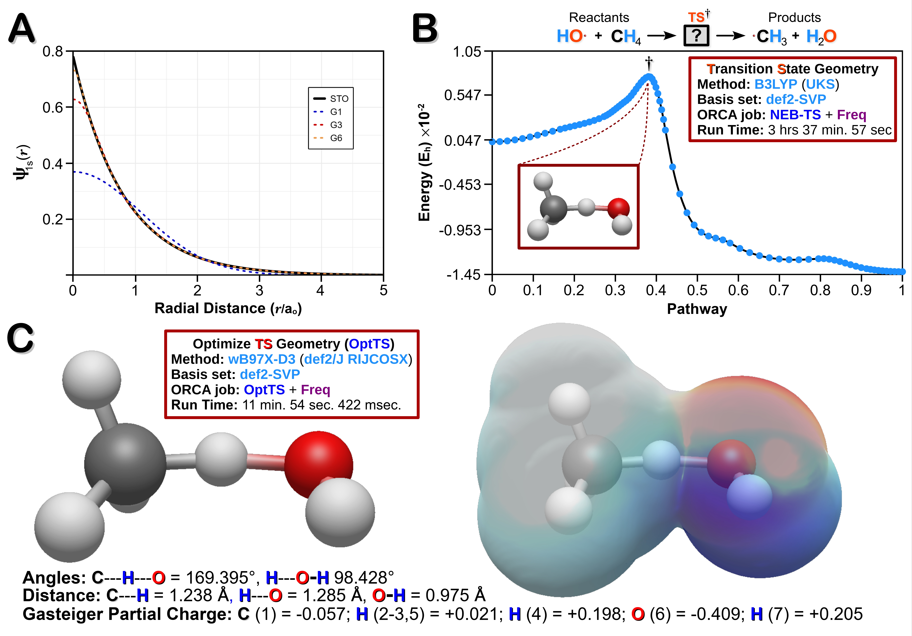
</figure>

<b><u>Figure 42</u>: Gaussian Functions (GF) & ORCA Computer analysis of TS complex for Hydroxyl radical reaction with Methane.</b>

 

<figure>

</figure>

<b><u>Figure 43</u>: Transition State Vibrational Mode</b>. Opening the <b>NEB</b> output file in <b>Avogadro</b> displays the geometry optimized transition state along with a table of computed vibrational frequencies. The program allows you to visualize any vibrating frequency of the candidate TS molecule in animation mode. The H atom at the centre of the TS (CH<b>3⋅⋅⋅</b>H<b>⋅⋅⋅</b>OH) is shown moving in a periodic-like fashion similar to a classical harmonic oscillator. As H moves closer to the hydroxyl radical (i.e. abstraction process), which will eventually form a H<b>2</b>O molecule, the remainder of the methane molecule begins to take on a more planar geometry (i.e. eventual methyl radical product: <b>⋅</b>CH3).

<!----------------------------------------->

<!------------ END - Info Box4 ------------>

<!----------------------------------------->

 

------------------------------------------------------------------------

<!--------------------------------------------------------------------->

© Jeffrey C Howard B.Sc. M.Sc. Ph.D. B.Ed. The material contained within
this website may be copied, distributed and displayed without
alterations for noncommercial purposes only provided that it is
accompanied by acknowledgements to the author. All commercial and
non-commercial rights are reserved to the author.  
<!--------------------------------------------------------------------->

**REFERENCES:**

1 Schrödinger E. Quantisierung als Eigenwertproblem. *Annalen Der Physik* 1926;**384**:489–527. <https://doi.org/10.1002/andp.19263840602>.

2 Schrödinger E. An Undulatory Theory of the Mechanics of Atoms and Molecules. *Physical Review* 1926;**28**:1049–70. <https://doi.org/10.1103/PhysRev.28.1049>.

3 Born M. Zur Quantenmechanik der Stoßvorgänge. *Zeitschrift Für Physik* 1926;**37**:863–7. <https://doi.org/10.1007/BF01397477>.

4 Born M. Zur Quantenmechanik der Stoßvorgänge. *Zeitschrift Für Physik* 1926;**37**:863–7. <https://doi.org/10.1007/BF01397477>.

5 Friedrich B, Herschbach D. Stern and Gerlach: How a Bad Cigar Helped Reorient Atomic Physics. *Physics Today* 2003;**56**:53–9. <https://doi.org/10.1063/1.1650229>.

6 Gerlach W, Stern O. Der experimentelle Nachweis des magnetischen Moments des Silberatoms. *Zeitschrift Für Physik* 1922;**8**:110–1. <https://doi.org/10.1007/BF01329580>.

7 Bohr N. I. On the constitution of atoms and molecules. *Philosophical Magazine* 1913;**26**:1–25. <https://doi.org/10.1080/14786441308634955>.

8 Pauli W. Über den Einfluß der Geschwindigkeitsabhängigkeit der Elektronenmasse auf den Zeemaneffekt. *Zeitschrift Für Physik* 1925;**31**:373–85. <https://doi.org/10.1007/BF02980592>.

9 Pauli W. [Nobel Prize Lecture](https://www.nobelprize.org/prizes/physics/1945/pauli/lecture/) 1946.

10 Uhlenbeck GE, Goudsmit S. Ersetzung der Hypothese vom unmechanischen Zwang durch eine Forderung bezüglich des inneren Verhaltens jedes einzelnen Elektrons. *Die Naturwissenschaften* 1925;**13**:953–4. <https://doi.org/10.1007/BF01558878>.

11 Uhlenbeck GE, Goudsmit S. Spinning Electrons and the Structure of Spectra. *Nature* 1926;**117**:264–5. <https://doi.org/10.1038/117264a0>.

12 Commins ED. Electron Spin and Its History. *Annual Review of Nuclear and Particle Science* 2012;**62**:133–57. <https://doi.org/10.1146/annurev-nucl-102711-094908>.

13 McQuarrie DA, Simon JD. *Physical Chemistry: A Molecular Approach*. Sausalito, Calif: Univ. Science Books; 1997.

14 Thornton S, Rex A. *Modern Physics for Scientists and Engineers*. 4th edition. Boston, MA: Brooks Cole; 2013.

15 Ball DW. *[Physical Chemistry](https://www.cengage.ca/c/physical-chemistry-2e-ball/9781133958437/)*. 2nd edn. Boston, MA, USA: Cengage Learning; 2014.

16 Sommerfeld A. *[Atomic structure and spectral lines. Translated from the third German edition by Henry L. Brose by Sommerfeld, Arnold (1923), Rulon-Miller Books](https://www.abebooks.com/first-edition/Atomic-structure-spectral-lines-Translated-third/740113135/bd)*. 1923.

17 Born M. *[Vorlesungen über Atommechanik. Erster band.](https://www.abebooks.com/Vorlesungen-Atommechanik-Erster-band-Born-Max/31409181604/bd)* Berlin: Julius Stringer; 1925.

18 Hund F. *[Linienspektren und Periodisches System der Elemente](https://doi.org/10.1007/978-3-7091-5695-7)*. Berlin: Springer; 1927.

19 Jensen WB. The Origin of the s, p, d, f Orbital Labels. *Journal of Chemical Education* 2007;**84**:757. <https://doi.org/10.1021/ed084p757>.

20 Janet C. *[La classificaiton héricoïdal des éléments chimiques](https://cir.nii.ac.jp/crid/1971712334762667195)*. Impr. Départementale de l’Oise; 1928.

21 Janet C. [Concordance de l’arrangement quantique, de base, des électrons planétaires des atomes, avec la classification scalariforme, hélicoïdale, des éléments chimiques](https://library.wur.nl/WebQuery/titel/1737442). *Beauvais Imprimerie De´partementale de l’Oise, Beauvais* 1930:54 p.

22 Madelung E. *[Die Mathematischen Hilfsmittel des Physikers](https://doi.org/10.1007/978-3-662-02177-4)*. Berlin, Heidelberg: Springer; 1936.

23 Stewart PJ. Charles Janet: Unrecognized genius of the periodic system. *Foundations of Chemistry* 2010;**12**:5–15. <https://doi.org/10.1007/s10698-008-9062-5>.

24 Bohr N. Der Bau der Atome und die physikalischen und chemischen Eigenschaften der Elemente. *Zeitschrift Für Physik* 1922;**9**:1–67. <https://doi.org/10.1007/BF01326955>.

25 Bohr N. *The Theory of Spectra and Atomic Constitution*. Cambridge University Press; 1922.

26 Hund F. Zur Deutung verwickelter Spektren, insbesondere der Elemente Scandium bis Nickel. *Zeitschrift Für Physik* 1925;**33**:345–71. <https://doi.org/10.1007/BF01328319>.

27 Hund F. Zur Deutung einiger Erscheinungen in den Molekelspektren. *Zeitschrift Für Physik* 1926;**36**:657–74. <https://doi.org/10.1007/BF01400155>.

28 Hund F. Zur Deutung der Molekelspektren. III. *Zeitschrift Für Physik* 1927;**43**:805–26. <https://doi.org/10.1007/BF01397249>.

29 Hund F. Zur Deutung der Molekelspektren. IV. *Zeitschrift Für Physik* 1928;**51**:759–95. <https://doi.org/10.1007/BF01400239>.

30 Abegg R. Die Valenz und das periodische System. Versuch einer Theorie der Molekularverbindungen. *Zeitschrift Für Anorganische Chemie* 1904;**39**:330–80. <https://doi.org/10.1002/zaac.19040390125>.

31 Lewis GN. THE ATOM AND THE MOLECULE. *Journal of the American Chemical Society* 1916;**38**:762–85. <https://doi.org/10.1021/ja02261a002>.

32 Hess GH. Thermochemical research. *Bulletin Scientifique* 1840;**8**:257–72.

33 Davy H. I. The Bakerian Lecture, on some chemical agencies of electricity. *Philosophical Transactions of the Royal Society of London* 1807;**97**:1–56. <https://doi.org/10.1098/rstl.1807.0001>.

34 Jensen WB. Electronegativity from Avogadro to Pauling: II. Late Nineteenth- and Early Twentieth-Century Developments. *Journal of Chemical Education* 2003;**80**:279. <https://doi.org/10.1021/ed080p279>.

35 Pauling L. THE NATURE OF THE CHEMICAL BOND. IV. THE ENERGY OF SINGLE BONDS AND THE RELATIVE ELECTRONEGATIVITY OF ATOMS. *Journal of the American Chemical Society* 1932;**54**:3570–82. <https://doi.org/10.1021/ja01348a011>.

36 Mulliken RS. A New Electroaffinity Scale; Together with Data on Valence States and on Valence Ionization Potentials and Electron Affinities. *The Journal of Chemical Physics* 1934;**2**:782–93. <https://doi.org/10.1063/1.1749394>.

37 Gerace KS, Mauro JC. Characterization of soda–lime silicate glass bottles to support recycling efforts. *International Journal of Ceramic Engineering & Science* 2024;**6**:e10217. <https://doi.org/10.1002/ces2.10217>.

38 Lewis GN. VALENCE AND TAUTOMERISM. *Journal of the American Chemical Society* 1913;**35**:1448–55. <https://doi.org/10.1021/ja02199a004>.

39 Lewis GN. Introductory address: Valence and the electron. *Transactions of the Faraday Society* 1923;**19**:452–8. <https://doi.org/10.1039/TF9231900452>.

40 Denny RA, Bagchi B. Barrierless Isomerization Dynamics in Viscous Liquids: Decoupling of the Reaction Rate from the Slow Frictional Forces. *The Journal of Physical Chemistry A* 1999;**103**:9061–71. <https://doi.org/10.1021/jp9928309>.

41 Wagman DD, Evans WH, Parker VB, Schumm RH, Halow I, Bailey SM, *et al.* [The NBS Tables of Chemical Thermodynamic Properties: Selected values for inorganic and C1 and C2 organic substances in SI units](https://data.nist.gov/od/id/mds2-2124). *Journal of Physical and Chemical Referernce Data* 1982;**11**:181.

42 Gillespie RJ D.Sc., Nyholm DSc M.Sc. Inorganic stereochemistry. *Quarterly Reviews, Chemical Society* 1957;**11**:339–80. <https://doi.org/10.1039/QR9571100339>.

43 Gillespie RJ. The valence-shell electron-pair repulsion (VSEPR) theory of directed valency. *Journal of Chemical Education* 1963;**40**:295. <https://doi.org/10.1021/ed040p295>.

44 Gillespie RJ. Teaching Molecular Geometry with the VSEPR Model. *Journal of Chemical Education* 2004;**81**:298. <https://doi.org/10.1021/ed081p298>.

45 Supuran CT, Scozzafava A, Casini A. Carbonic anhydrase inhibitors. *Medicinal Research Reviews* 2003;**23**:146–89. <https://doi.org/10.1002/med.10025>.

46 Wischeler JS, Innocenti A, Vullo D, Agrawal A, Cohen SM, Heine A, *et al.* Bidentate Zinc Chelators for α-Carbonic Anhydrases that Produce a Trigonal Bipyramidal Coordination Geometry. *ChemMedChem* 2010;**5**:1609–15. <https://doi.org/10.1002/cmdc.201000200>.

47 Zalkin A, Forrester JD, Templeton DH. Crystal and Molecular Structure of Ferrichrome A. *Science* 1964;**146**:261–3. <https://doi.org/10.1126/science.146.3641.261>.

48 Winkelmann G. Ecology of siderophores with special reference to the fungi. *BioMetals* 2007;**20**:379–92. <https://doi.org/10.1007/s10534-006-9076-1>.

49 Montesdeoca N, Karges J. Metal complexes in medicine: Structural scaffolds vs. Functional centres. *Chemical Science* 2026;**17**:7340–56. <https://doi.org/10.1039/d6sc01182a>.

50 Thair A-A, Sarapaa O. *Clay and clay mineralogy. Physical-Chemical Properties and Industrial Uses*. Goelogical Survey of Findland; 2008.

51 Bergaya F, Jaber M, Lambert J-F. [Clays and Clay Minerals](https://doi.org/10.1002/9781118092866.ch1). *Rubber-Clay Nanocomposites*. John Wiley & Sons, Ltd; 2011. p. 1–44.

52 Heitler W, London F. Wechselwirkung neutraler Atome und homöopolare Bindung nach der Quantenmechanik. *Zeitschrift Für Physik* 1927;**44**:455–72. <https://doi.org/10.1007/BF01397394>.

53 Pauling L. [THE NATURE OF THE CHEMICAL BOND. APPLICATION OF RESULTS OBTAINED FROM THE QUANTUM MECHANICS AND FROM A THEORY OF PARAMAGNETIC SUSCEPTIBILITY TO THE STRUCTURE OF MOLECULES](https://pubs.acs.org/doi/10.1021/ja01355a027). *Journal of the American Chemical Society* 1931;**53**:1367–400.

54 Slater JC. Directed Valence in Polyatomic Molecules. *Physical Review* 1931;**37**:481–9. <https://doi.org/10.1103/PhysRev.37.481>.

55 Pauling L. *[The Nature of the Chemical Bond and the Structure of Molecules and Crystals: An Introduction to Modern Structural Chemistry](https://www.cornellpress.cornell.edu/book/9780801403330/the-nature-of-the-chemical-bond/)*. 3rd edn. Ithaca, New York: CORNELL UNIVERSITY PRESS; 1960.

56 Heisenberg W. Über die Spektra von Atomsystemen mit zwei Elektronen. *Zeitschrift Für Physik* 1926;**39**:499–518. <https://doi.org/10.1007/BF01322090>.

57 Pauling L, Yost DM. The Additivity of the Energies of Normal Covalent Bonds. *Proceedings of the National Academy of Sciences of the United States of America* 1932;**18**:414–6. <https://doi.org/10.1073/pnas.18.6.414>.

58 Mulliken RS. Electronic States and Band Spectrum Structure in Diatomic Molecules. I. Statement of the Postulates. Interpretation of CuH, CH, and Co Band-Types. *Physical Review* 1926;**28**:481–506. <https://doi.org/10.1103/PhysRev.28.481>.

59 Mulliken RS. Electronic States and Band Spectrum Structure in Diatomic Molecules. IV. Hund’s Theory; Second Positive Nitrogen and Swan Bands; Alternating Intensities. *Physical Review* 1927;**29**:637–49. <https://doi.org/10.1103/PhysRev.29.637>.

60 Mulliken RS. The Assignment of Quantum Numbers for Electrons in Molecules. I. *Physical Review* 1928;**32**:186–222. <https://doi.org/10.1103/PhysRev.32.186>.

61 Mulliken RS. Electronic Structures of Polyatomic Molecules and Valence. *Physical Review* 1932;**40**:55–62. <https://doi.org/10.1103/PhysRev.40.55>.

62 Lennard-Jones JE. The electronic structure of some diatomic molecules. *Transactions of the Faraday Society* 1929;**25**:668–86. <https://doi.org/10.1039/TF9292500668>.

63 Lennard-Jones J. [The Molecular Orbital Theory of Chemical Valency. I. The Determination of Molecular Orbitals](https://www.jstor.org/stable/98215). *Proceedings of the Royal Society of London Series A, Mathematical and Physical Sciences* 1949;**198**:1–13.

64 Pais A. Max Born’s Statistical Interpretation of Quantum Mechanics. *Science* 1982;**218**:1193–8. <https://doi.org/10.1126/science.218.4578.1193>.

65 Baker AD, Baker C, Brundle CR, Turner DW. The electronic structures of methane, ethane, ethylene and formaldehyde studied by high-resolution molecular photoelectron spectroscopy. *International Journal of Mass Spectrometry and Ion Physics* 1968;**1**:285–301. <https://doi.org/10.1016/0020-7381(68)85005-3>.

66 Hamrin K, Johansson G, Gelius U, Fahlman A, Nordling C, Siegbahn K. Ionization energies in methane and ethane measured by means of ESCA. *Chemical Physics Letters* 1968;**1**:613–5. <https://doi.org/10.1016/0009-2614(68)80095-8>.

67 Hückel E. Quantentheoretische Beiträge zum Benzolproblem I. Die Elektronenkonfiguration des Benzols und verwandter Verbindungen. *Zeitschrift Für Physik* 1931;**70**:204–86. <https://doi.org/10.1007/BF01339530>.

68 Hückel E. Quanstentheoretische Beiträge zum Benzolproblem II. Quantentheorie der induzierten Polaritäten. *Zeitschrift Für Physik* 1931;**72**:310–37. <https://doi.org/10.1007/BF01341953>.

69 Hückel E. Quantentheoretische Beiträge zum Problem der aromatischen und ungesättigten Verbindungen. III. *Zeitschrift Für Physik* 1932;**76**:628–48. <https://doi.org/10.1007/BF01341936>.

70 Coulson CA, O’leary B, Mallion RB. *Hückel Theory for Organic Chemists*. London: Academic Press Inc. Ltd.; 1978.

71 Born M, Oppenheimer R. Zur Quantentheorie der Molekeln. *Annalen Der Physik* 1927;**389**:457–84. <https://doi.org/10.1002/andp.19273892002>.

72 Oort JH. [Observational evidence confirming Lindblad’s hypothesis of a rotation of the galactic system](https://scholarlypublications.universiteitleiden.nl/handle/1887/2725533?solr_nav%5Bid%5D=3287d8943ed68aca6c78&solr_nav%5Bpage%5D=3&solr_nav%5Boffset%5D=16). *Bulletin of the Astronomical Institutes of the Netherlands* 1927;**3**:275–82.

73 Kerr FJ, Lynden-Bell D. Review of galactic constants. *Monthly Notices of the Royal Astronomical Society* 1986;**221**:1023–38. <https://doi.org/10.1093/mnras/221.4.1023>.

74 Copernicus N. *[Torinensis de revolutionibus orbium coelestium](http://archive.org/details/nicolaicopernici00cope_1)*. Norimbergae : Apud Ioh. Petreium; 1543.

75 Coulson CA. The electronic structure of some polyenes and aromatic molecules. VII. Bonds of fractional order by the molecular orbital method. *Proceedings of the Royal Society of London A Mathematical and Physical Sciences* 1939;**169**:413–28. <https://doi.org/10.1098/rspa.1939.0006>.

76 Frost AA, Musulin B. A Mnemonic Device for Molecular Orbital Energies. *The Journal of Chemical Physics* 1953;**21**:572–3. <https://doi.org/10.1063/1.1698970>.

77 Dewar MJS, Gleicher GJ. Self-Consistent Field Molecular Orbital Calculations for Cyclobutadiene1. *Journal of the American Chemical Society* 1965;**87**:3255–6. <https://doi.org/10.1021/ja01092a051>.

78 Reeves PC, Devon T, Pettit R. Possible rectangular nature of cyclobutadiene. *Journal of the American Chemical Society* 1969;**91**:5890–1. <https://doi.org/10.1021/ja01049a043>.

79 Borden WT, Davidson ER, Hart P. The potential surfaces for the lowest singlet and triplet states of cyclobutadiene. *Journal of the American Chemical Society* 1978;**100**:388–92. <https://doi.org/10.1021/ja00470a006>.

80 Wu JI-C, Mo Y, Evangelista FA, Ragué Schleyer P von. Is cyclobutadiene really highly destabilized by antiaromaticity? *Chemical Communications* 2012;**48**:8437–9. <https://doi.org/10.1039/c2cc33521b>.

81 Coulson CA. On the calculation of the energy in unsaturated hydrocarbon molecules. *Mathematical Proceedings of the Cambridge Philosophical Society* 1940;**36**:201–3. <https://doi.org/10.1017/S0305004100017175>.

82 Bloch F. Über die Quantenmechanik der Elektronen in Kristallgittern. *Zeitschrift Für Physik* 1929;**52**:555–600. <https://doi.org/10.1007/BF01339455>.

83 Peierls R. The size of a dislocation. *Proceedings of the Physical Society* 1940;**52**:34. <https://doi.org/10.1088/0959-5309/52/1/305>.

84 Nabarro FRN. Dislocations in a simple cubic lattice. *Proceedings of the Physical Society* 1947;**59**:256. <https://doi.org/10.1088/0959-5309/59/2/309>.

85 Lu G. [The Peierls—Nabarro Model of Dislocations: A Venerable Theory and its Current Development](https://doi.org/10.1007/978-1-4020-3286-8_41). In: Yip S, editor. *Handbook of Materials Modeling: Methods*. Dordrecht: Springer Netherlands; 2005. p. 793–811.

86 Shirakawa H, Louis EJ, MacDiarmid AG, Chiang CK, Heeger AJ. Synthesis of electrically conducting organic polymers: Halogen derivatives of polyacetylene, (CH)x. *Journal of the Chemical Society, Chemical Communications* 1977;**13**:578–80. <https://doi.org/10.1039/C39770000578>.

87 Chiang CK, Fincher CR, Park YW, Heeger AJ, Shirakawa H, Louis EJ, *et al.* Electrical Conductivity in Doped Polyacetylene. *Physical Review Letters* 1977;**39**:1098–101. <https://doi.org/10.1103/PhysRevLett.39.1098>.

88 Chiang CK, Druy MA, Gau SC, Heeger AJ, Louis EJ, MacDiarmid AG, *et al.* Synthesis of highly conducting films of derivatives of polyacetylene, (CH)x. *Journal of the American Chemical Society* 1978;**100**:1013–5. <https://doi.org/10.1021/ja00471a081>.

89 Swager TM. 50th Anniversary Perspective: Conducting/Semiconducting Conjugated Polymers. A Personal Perspective on the Past and the Future. *Macromolecules* 2017;**50**:4867–86. <https://doi.org/10.1021/acs.macromol.7b00582>.

90 Miao Z, Gonsales SD, Ehm C, Mentink-Vigier F, Bowers CR, Sumerlin BS, *et al.* Cyclic Polyacetylene. *Nature Chemistry* 2021;**13**:792–9. <https://doi.org/10.1038/s41557-021-00713-2>.

91 Perutz MF, Rossmann MG, Cullis AF, Muirhead H, Will G, North AC. Structure of haemoglobin: A three-dimensional Fourier synthesis at 5.5-A. Resolution, obtained by X-ray analysis. *Nature* 1960;**185**:416–22. <https://doi.org/10.1038/185416a0>.

92 Okada Y, Okajima H, Konishi H, Terauchi M, Ishii K, Liu I-M, *et al.* Antioxidant effect of naturally occurring furan fatty acids on oxidation of linoleic acid in aqueous dispersion. *Journal of the American Oil Chemists’ Society* 1990;**67**:858–62. <https://doi.org/10.1007/BF02540506>.

93 Okada Y, Kaneko M, Okajima H. Hydroxyl Radical Scavenging Activity of Naturally Occurring Furan Fatty Acids. *Biological & Pharmaceutical Bulletin* 1996;**19**:1607–10. <https://doi.org/10.1248/bpb.19.1607>.

94 Lemke RAS, Peterson AC, Ziegelhoffer EC, Westphall MS, Tjellström H, Coon JJ, *et al.* Synthesis and scavenging role of furan fatty acids. *Proceedings of the National Academy of Sciences* 2014;**111**:E3450–7. <https://doi.org/10.1073/pnas.1405520111>.

95 Chang F, Rowart P, Salvatore SR, Rom O, Mascal M, Schopfer FJ. The emerging significance of furan fatty acids in food, nutrition, and potential therapeutic use. *Food Chemistry* 2025;**479**:143759. <https://doi.org/10.1016/j.foodchem.2025.143759>.

96 Streitwieser A. *Molecular Orbital Theory for Organic Chemists*. Toppan; 1961.

97 Streitwieser A, Salzberg HW. Molecular Orbital Theory for Organic Chemists. *Journal of The Electrochemical Society* 1962;**109**:116Cb.

98 Humbel S. Getting the Weights of Lewis Structures out of Hückel Theory: Hückel–Lewis Configuration Interaction (HL-CI). *Journal of Chemical Education* 2007;**84**:1056. <https://doi.org/10.1021/ed084p1056>.

99 Hagebaum-Reignier D, Girardi R, Carissan Y, Humbel S. Hückel theory for Lewis structures: Hückel–Lewis Configuration Interaction (HL-CI). *Journal of Molecular Structure: THEOCHEM* 2007;**817**:99–109. <https://doi.org/10.1016/j.theochem.2007.04.026>.

100 Carissan Y, Hagebaum-Reignier D, Goudard N, Humbel S. [HuLiS Program: Lewis embedded in Hückel Theory](https://ctom-ism2.github.io/hulis/index.shtml). *HuLiS Program: Lewis Embedded in Hückel Theory* 2008.

101 Carissan Y, Hagebaum-Reignier D, Goudard N, Humbel S. Hückel-Lewis Projection Method: A ‘Weights Watcher’ for Mesomeric Structures. *The Journal of Physical Chemistry A* 2008;**112**:13256–62. <https://doi.org/10.1021/jp803813e>.

102 Griffiths DJ. *[Introduction to Quantum Mechanics](https://doi.org/10.1017/9781316995433)*. Upper Saddle River, New Jersey: Prentice Hall Inc.; 1994.

103 Hartree DR. The Wave Mechanics of an Atom with a Non-Coulomb Central Field. Part I. Theory and Methods. *Mathematical Proceedings of the Cambridge Philosophical Society* 1928;**24**:89–110. <https://doi.org/10.1017/S0305004100011919>.

104 Fock V. Näherungsmethode zur Lösung des quantenmechanischen Mehrkörperproblems. *Zeitschrift Für Physik* 1930;**61**:126–48. <https://doi.org/10.1007/BF01340294>.

105 Hartree DR, Hartree W, Swirles B. Self-consistent field, including exchange and superposition of configurations, with some results for oxygen. *Philosophical Transactions of the Royal Society of London, Series A: Mathematical and Physical Sciences* 1939;**238**:229–47. <https://doi.org/10.1098/rsta.1939.0008>.

106 Serway RA, Jewett JW. *Physics for Scientists and Engineers*. 6th edn. Thomson Brooks/Cole; 2004.

107 Eyring H. The Activated Complex in Chemical Reactions. *The Journal of Chemical Physics* 1935;**3**:107–15. <https://doi.org/10.1063/1.1749604>.

108 Evans MG, Polanyi M. Some applications of the transition state method to the calculation of reaction velocities, especially in solution. *Transactions of the Faraday Society* 1935;**31**:875–94. <https://doi.org/10.1039/TF9353100875>.

109 Arrhenius S. Über die Dissociationswärme und den Einfluss der Temperatur auf den Dissociationsgrad der Elektrolyte. *Zeitschrift Für Physikalische Chemie* 1889;**4U**:96–116. <https://doi.org/10.1515/zpch-1889-0408>.

110 Arrhenius S. Über die Reaktionsgeschwindigkeit bei der Inversion von Rohrzucker durch Säuren. *Zeitschrift Für Physikalische Chemie* 1889;**4U**:226–48. <https://doi.org/10.1515/zpch-1889-0416>.

111 Harman D. Aging: A theory based on free radical and radiation chemistry. *Journal of Gerontology* 1956;**11**: <https://doi.org/10.1093/geronj/11.3.298>.

112 Beckman KB, Ames BN. The free radical theory of aging matures. *Physiological Reviews* 1998;**78**:547–81. <https://doi.org/10.1152/physrev.1998.78.2.547>.

113 Wang Y, Branicky R, Noë A, Hekimi S. Superoxide dismutases: Dual roles in controlling ROS damage and regulating ROS signaling. *The Journal of Cell Biology* 2018;**217**:1915–28. <https://doi.org/10.1083/jcb.201708007>.

114 Chandimali N, Bak SG, Park EH, Lim H-J, Won Y-S, Kim E-K, *et al.* Free radicals and their impact on health and antioxidant defenses: A review. *Cell Death Discovery* 2025;**11**:19. <https://doi.org/10.1038/s41420-024-02278-8>.

115 Lelieveld J, Dentener FJ, Peters W, Krol MC. On the role of hydroxyl radicals in the self-cleansing capacity of the troposphere. *Atmospheric Chemistry and Physics* 2004;**4**:2337–44. <https://doi.org/10.5194/acp-4-2337-2004>.

116 Monks PS. Gas-phase radical chemistry in the troposphere. *Chemical Society Reviews* 2005;**34**:376–95. <https://doi.org/10.1039/b307982c>.

117 Lelieveld J, Gromov S, Pozzer A, Taraborrelli D. Global tropospheric hydroxyl distribution, budget and reactivity. *Atmospheric Chemistry and Physics* 2016;**16**:12477–93. <https://doi.org/10.5194/acp-16-12477-2016>.

118 Chen X, Millet DB, Singh HB, Wisthaler A, Apel EC, Atlas EL, *et al.* On the sources and sinks of atmospheric VOCs: An integrated analysis of recent aircraft campaigns over North America. *Atmospheric Chemistry and Physics* 2019;**19**:9097–123. <https://doi.org/10.5194/acp-19-9097-2019>.

119 Berg F, Novelli A, Dubus R, Hofzumahaus A, Holland F, Wahner A, *et al.* Temperature-dependent rate coefficients for the reactions of OH radicals with selected alkanes, aromatic compounds, and monoterpenes. *Atmospheric Chemistry and Physics* 2024;**24**:13715–31. <https://doi.org/10.5194/acp-24-13715-2024>.

120 Hoover B, Reidy E, Spink I, Hamachek A, Bottorff B, Stevens PS. Measurements and model comparisons suggest that HONO is not an important source of OH radical concentrations below a rural forest canopy. *Environmental Science: Atmospheres* 2026;**6**:661–75. <https://doi.org/10.1039/d5ea00122f>.

121 Eyring H, Polanyi M. On Simple Gas Reactions. *Zeitschrift Für Physikalische Chemie* 1931.

122 Lente G, Fábián I, Poë AJ. A common misconception about the Eyring equation. *New Journal of Chemistry* 2005;**29**:759–60. <https://doi.org/10.1039/b501687h>.

123 Hammond GS. A Correlation of Reaction Rates. *Journal of the American Chemical Society* 1955;**77**:334–8. <https://doi.org/10.1021/ja01607a027>.

124 Korchowiec J, Kawahara S, Matsumura K, Uchimaru T, Sugie M. Hydrogen Abstraction from Methane and Hydrofluoromethanes by •OH Radical:  Modified GAUSSIAN-2 Study. *The Journal of Physical Chemistry A* 1999;**103**:3548–53. <https://doi.org/10.1021/jp984810x>.

125 Erisman JW, Sutton MA, Galloway J, Klimont Z, Winiwarter W. How a century of ammonia synthesis changed the world. *Nature Geoscience* 2008;**1**:636–9. <https://doi.org/10.1038/ngeo325>.

126 Haber F. [The Synthesis of Ammonia from Its Elements](https://www.nobelprize.org/prizes/chemistry/1918/haber/lecture/). *NobelPrizeorg* 1920.

127 Agency IE. *[Ammonia Technology Roadmap Towards more sustainable nitrogen fertiliser production](https://iea.blob.core.windows.net/assets/6ee41bb9-8e81-4b64-8701-2acc064ff6e4/AmmoniaTechnologyRoadmap.pdf.)*. 2021.

128 FAO. *[Greenhouse gas emissions from agrifood systems. Global, regional and country trends, 2000–2022](https://openknowledge.fao.org/handle/20.500.14283/cd3167en)*. Rome, Italy; 2024.

129 Mingolla S, Rosa L. Low-carbon ammonia production is essential for resilient and sustainable agriculture. *Nature Food* 2025;**6**:610–21. <https://doi.org/10.1038/s43016-025-01125-y>.

130 Morse PM. Diatomic Molecules According to the Wave Mechanics. II. Vibrational Levels. *Physical Review* 1929;**34**:57–64. <https://doi.org/10.1103/PhysRev.34.57>.

131 Schlegel HB. Geometry optimization. *WIREs Computational Molecular Science* 2011;**1**:790–809. <https://doi.org/10.1002/wcms.34>.

132 Fukui K, Yonezawa T, Shingu H. A Molecular Orbital Theory of Reactivity in Aromatic Hydrocarbons. *The Journal of Chemical Physics* 1952;**20**:722–5. <https://doi.org/10.1063/1.1700523>.

133 Fukui K, Yonezawa T, Nagata C, Shingu H. Molecular Orbital Theory of Orientation in Aromatic, Heteroaromatic, and Other Conjugated Molecules. *The Journal of Chemical Physics* 1954;**22**:1433–42. <https://doi.org/10.1063/1.1740412>.

134 Fukui K. A Simple Quantum-Theoretical Interpretation of the Chemical Reactivity of Organic Compounds. In: Lowdin PO, Pullman B, editors. *Molecular Orbitals in Chemistry, Physics, and Biology. A tribute to R.S. Mulliken*. New York: Academic Press Inc. Ltd.; 1964. p. 513–37.

135 Fukui K. Formulation of the reaction coordinate. *The Journal of Physical Chemistry* 1970;**74**:4161–3. <https://doi.org/10.1021/j100717a029>.

136 Collin JE, Jacques D. Ionization of methane and its electronic energy levels. *Canadian Journal of Chemistry* 1967;**45**:1875–82. <https://doi.org/10.1139/v67-299>.

137 Ruscic B, Wagner AF, Harding LB, Asher RL, Feller D, Dixon DA, *et al.* On the Enthalpy of Formation of Hydroxyl Radical and Gas-Phase Bond Dissociation Energies of Water and Hydroxyl. *The Journal of Physical Chemistry A* 2002;**106**:2727–47. <https://doi.org/10.1021/jp013909s>.

138 Dodson LG, Savee JD, Gozem S, Shen L, Krylov AI, Taatjes CA, *et al.* Vacuum ultraviolet photoionization cross section of the hydroxyl radical. *The Journal of Chemical Physics* 2018;**148**:184302. <https://doi.org/10.1063/1.5024249>.

139 Henzler-Wildman K, Kern D. Dynamic personalities of proteins. *Nature* 2007;**450**:964–72. <https://doi.org/10.1038/nature06522>.

140 Kovermann M, Ådén J, Grundström C, Sauer-Eriksson AE, Sauer UH, Wolf-Watz M. Structural basis for catalytically restrictive dynamics of a high-energy enzyme state. *Nature Communications* 2015;**6**:7644. <https://doi.org/10.1038/ncomms8644>.

141 Riziotis IG, Ribeiro AJM, Borkakoti N, Thornton JM. Conformational Variation in Enzyme Catalysis: A Structural Study on Catalytic Residues. *Journal of Molecular Biology* 2022;**434**:167517. <https://doi.org/10.1016/j.jmb.2022.167517>.

142 Jumper J, Evans R, Pritzel A, Green T, Figurnov M, Ronneberger O, *et al.* Highly accurate protein structure prediction with AlphaFold. *Nature* 2021;**596**:583–9. <https://doi.org/10.1038/s41586-021-03819-2>.

143 Bertoni D, Tsenkov M, Magana P, Nair S, Pidruchna I, Querino Lima Afonso M, *et al.* AlphaFold Protein Structure Database 2025: A redesigned interface and updated structural coverage. *Nucleic Acids Research* 2026;**54**:D358–62. <https://doi.org/10.1093/nar/gkaf1226>.

144 Abramson J, Adler J, Dunger J, Evans R, Green T, Pritzel A, *et al.* Accurate structure prediction of biomolecular interactions with AlphaFold 3. *Nature* 2024;**630**:493–500. <https://doi.org/10.1038/s41586-024-07487-w>.

145 Behler J. Generalized Neural-Network Representation of High-Dimensional Potential-Energy Surfaces. *Physical Review Letters* 2007;**98**: <https://doi.org/10.1103/PhysRevLett.98.146401>.

146 Meuwly M. Machine Learning for Chemical Reactions. *Chemical Reviews* 2021;**121**:10218–39. <https://doi.org/10.1021/acs.chemrev.1c00033>.

147 Käser S, Vazquez-Salazar LI, Meuwly M, Töpfer K. Neural network potentials for chemistry: Concepts, applications and prospects. *Digital Discovery* 2023;**2**:28–58. <https://doi.org/10.1039/d2dd00102k>.

148 Tu Z, Stuyver T, Coley CW. Predictive chemistry: Machine learning for reaction deployment, reaction development, and reaction discovery. *Chemical Science* 2023;**14**:226–44. <https://doi.org/10.1039/d2sc05089g>.

149 Mitchell JBO. Machine learning methods in chemoinformatics. *WIREs Computational Molecular Science* 2014;**4**:468–81. <https://doi.org/10.1002/wcms.1183>.

150 Reymond J-L. The Chemical Space Project. *Accounts of Chemical Research* 2015;**48**:722–30. <https://doi.org/10.1021/ar500432k>.

151 Nicola G, Liu T, Gilson M. Public Domain Databases for Medicinal Chemistry. *Journal of Medicinal Chemistry* 2012;**55**:6987–7002. <https://doi.org/10.1021/jm300501t>.

152 González-Medina M, Naveja JJ, Sánchez-Cruz N, Medina-Franco JL. Open chemoinformatic resources to explore the structure, properties and chemical space of molecules. *RSC Advances* 2017;**7**:54153–63. <https://doi.org/10.1039/c7ra11831g>.

153 Jacobs A, Williams D, Hickey K, Patrick N, Williams AJ, Chalk S, *et al.* CAS Common Chemistry in 2021: Expanding Access to Trusted Chemical Information for the Scientific Community. *Journal of Chemical Information and Modeling* 2022;**62**:2737–43. <https://doi.org/10.1021/acs.jcim.2c00268>.

154 Feynman RP. Quantum Mechanical Computers. *Optics News* 1985;**11**:11–20. <https://doi.org/10.1364/ON.11.2.000011>.

155 Aspuru-Guzik A, Dutoi AD, Love PJ, Head-Gordon M. Simulated quantum computation of molecular energies. *Science* 2005;**309**:1704–7. <https://doi.org/10.1126/science.1113479>.

156 Whitfield JD, Biamonte J, Aspuru-Guzik A. Simulation of electronic structure Hamiltonians using quantum computers. *Molecular Physics* 2011;**109**:735–50. <https://doi.org/10.1080/00268976.2011.552441>.

157 Reiher M, Wiebe N, Svore KM, Wecker D, Troyer M. Elucidating reaction mechanisms on quantum computers. *Proceedings of the National Academy of Sciences* 2017;**114**:7555–60. <https://doi.org/10.1073/pnas.1619152114>.

158 Krasnok A. [What quantum computer to buy?](https://arxiv.org/abs/2604.04761v1) *arXivorg* 2026.

159 Lloyd S. Universal Quantum Simulators. *Science* 1996;**273**:1073–8. <https://doi.org/10.1126/science.273.5278.1073>.

160 Hohenberg P, Kohn W. Inhomogeneous Electron Gas. *Physical Review* 1964;**136**:B864–71. <https://doi.org/10.1103/PhysRev.136.B864>.

161 Kohn W, Sham LJ. Self-Consistent Equations Including Exchange and Correlation Effects. *Physical Review* 1965;**140**:A1133–8. <https://doi.org/10.1103/PhysRev.140.A1133>.

162 Huzinaga S. Gaussian‐Type Functions for Polyatomic Systems. I. *The Journal of Chemical Physics* 1965;**42**:1293–302. <https://doi.org/10.1063/1.1696113>.

163 Hehre WJ, Stewart RF, Pople JA. Self‐Consistent Molecular‐Orbital Methods. I. Use of Gaussian Expansions of Slater‐Type Atomic Orbitals. *The Journal of Chemical Physics* 1969;**51**:2657–64. <https://doi.org/10.1063/1.1672392>.

164 Huzinaga S, McWilliams D, Domsky B. Approximate Atomic Wavefunctions. *The Journal of Chemical Physics* 1971;**54**:2283–4. <https://doi.org/10.1063/1.1675170>.

165 Ditchfield R, Hehre WJ, Pople JA. Self‐Consistent Molecular‐Orbital Methods. IX. An Extended Gaussian‐Type Basis for Molecular‐Orbital Studies of Organic Molecules. *The Journal of Chemical Physics* 1971;**54**:724–8. <https://doi.org/10.1063/1.1674902>.

166 Hehre WJ, Ditchfield R, Pople JA. Self—Consistent Molecular Orbital Methods. XII. Further Extensions of Gaussian—Type Basis Sets for Use in Molecular Orbital Studies of Organic Molecules. *The Journal of Chemical Physics* 1972;**56**:2257–61. <https://doi.org/10.1063/1.1677527>.

167 Boys SF. Electronic wave functions - I. A general method of calculation for the stationary states of any molecular system. *Proceedings of the Royal Society of London A Mathematical and Physical Sciences* 1950;**200**:542–54. <https://doi.org/10.1098/rspa.1950.0036>.

168 Slater JC. Atomic Shielding Constants. *Physical Review* 1930;**36**:57–64. <https://doi.org/10.1103/PhysRev.36.57>.

169 Teale AM, Helgaker T, Savin A, Adamo C, Aradi B, Arbuznikov AV, *et al.* DFT exchange: Sharing perspectives on the workhorse of quantum chemistry and materials science. *Physical Chemistry Chemical Physics* 2022;**24**:28700–81. <https://doi.org/10.1039/d2cp02827a>.

170 Bursch M, Mewes J-M, Hansen A, Grimme S. Best-Practice DFT Protocols for Basic Molecular Computational Chemistry. *Angewandte Chemie International Edition* 2022;**61**:e202205735. <https://doi.org/10.1002/anie.202205735>.

171 Binkley JS, Pople JA, Hehre WJ. Self-consistent molecular orbital methods. 21. Small split-valence basis sets for first-row elements. *Journal American Chemical Society* 1980;**102**:939–47.

172 Ahlrichs R, Taylor PR. The choice of Gaussian basis sets for molecular electronic structure calculations. *Journal de Chimie Physique* 1981;**78**:315–24. <https://doi.org/10.1051/jcp/1981780315>.

173 Hanwell MD, Curtis DE, Lonie DC, Vandermeersch T, Zurek E, Hutchison GR. Avogadro: An advanced semantic chemical editor, visualization, and analysis platform. *Journal of Cheminformatics* 2012;**4**:17. <https://doi.org/10.1186/1758-2946-4-17>.

174 Neese F. The ORCA program system. *WIRES Comput Molec Sci* 2012;**2**:73–8. <https://doi.org/10.1002/wcms.81>.

175 Neese F, Wennmohs F, Becker U, Riplinger C. The ORCA quantum chemistry program package. *Journal of Chemical Physics* 2020;**152**:224108. <https://doi.org/10.1063/5.0004608>.

176 Neese F. Software update: The ORCA program system, version 6.0. *WIRES Comput Molec Sci* 2025;**15**:e70019. <https://doi.org/10.1002/wcms.7019>.

177 Ásgeirsson V, Birgisson BO, Bjornsson R, Becker U, Neese F, Riplinger C, *et al.* Nudged Elastic Band Method for Molecular Reactions Using Energy-Weighted Springs Combined with Eigenvector Following. *Journal of Chemical Theory and Computation* 2021;**17**:4929–45. <https://doi.org/10.1021/acs.jctc.1c00462>.

178 Pople JA, Gill PMW, Handy NC. Spin-unrestricted character of Kohn-Sham orbitals for open-shell systems. *International Journal of Quantum Chemistry* 1995;**56**:303–5. <https://doi.org/10.1002/qua.560560414>.

179 Lee C, Yang W, Parr RG. Development of the Colle-Salvetti correlation-energy formula into a functional of the electron density. *Physical Review B* 1988;**37**:785–9. <https://doi.org/10.1103/PhysRevB.37.785>.

180 Becke AD. A new mixing of Hartree–Fock and local density‐functional theories. *The Journal of Chemical Physics* 1993;**98**:1372–7. <https://doi.org/10.1063/1.464304>.

181 Weigend F, Ahlrichs R. Balanced basis sets of split valence, triple zeta valence and quadruple zeta valence quality for H to Rn: Design and assessment of accuracy. *Physical Chemistry Chemical Physics* 2005;**7**:3297–305. <https://doi.org/10.1039/b508541a>.

182 Eichkorn K, Weigend F, Treutler O, Ahlrichs R. Auxiliary basis sets for main row atoms and transition metals and their use to approximate Coulomb potentials. *Theoretical Chemistry Accounts* 1997;**97**:119–24. <https://doi.org/10.1007/s002140050244>.

183 Weigend F. Accurate Coulomb-fitting basis sets for H to Rn. *Physical Chemistry Chemical Physics* 2006;**8**:1057–65. <https://doi.org/10.1039/b515623h>.

184 Neese F, Wennmohs F, Hansen A, Becker U. Efficient, approximate and parallel Hartree-Fock and hybrid DFT calculations. A ’chain-of-spheres’ algorithm for the Hartree-Fock exchange. *Chemical Physics* 2009;**356**:98–109. <https://doi.org/10.1016/j.chemphys.2008.10.036>.

185 Izsak R, Hansen A, Neese F. The resolution of identity and chain of spheres approximations for the LPNO-CCSD singles Fock term. *Molec Phys* 2012;**110**:2413–7. <https://doi.org/10.1080/00268976.2012.687466>.

186 Helmich-Paris B, Souza B de, Neese F, Izsák R. An improved chain of spheres for exchange algorithm. *The Journal of Chemical Physics* 2021;**155**:104109. <https://doi.org/10.1063/5.0058766>.

187 Neese F. The SHARK integral generation and digestion system. *J Comp Chem* 2022;**44**:381. <https://doi.org/10.1002/jcc.26942>.

188 Smidstrup S, Pedersen A, Stokbro K, Jónsson H. Improved initial guess for minimum energy path calculations. *The Journal of Chemical Physics* 2014;**140**:214106. <https://doi.org/10.1063/1.4878664>.

189 Schmerwitz YLA, Ásgeirsson V, Jónsson H. Improved Initialization of Optimal Path Calculations Using Sequential Traversal over the Image-Dependent Pair Potential Surface. *Journal of Chemical Theory and Computation* 2024;**20**:155–63. <https://doi.org/10.1021/acs.jctc.3c01111>.

